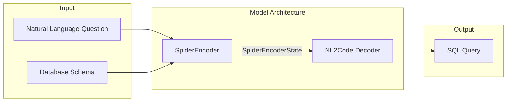
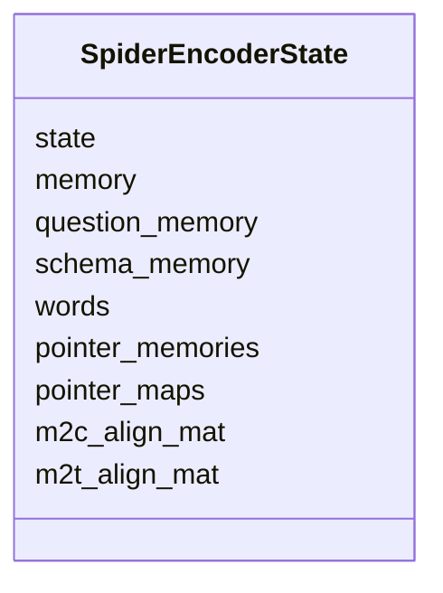
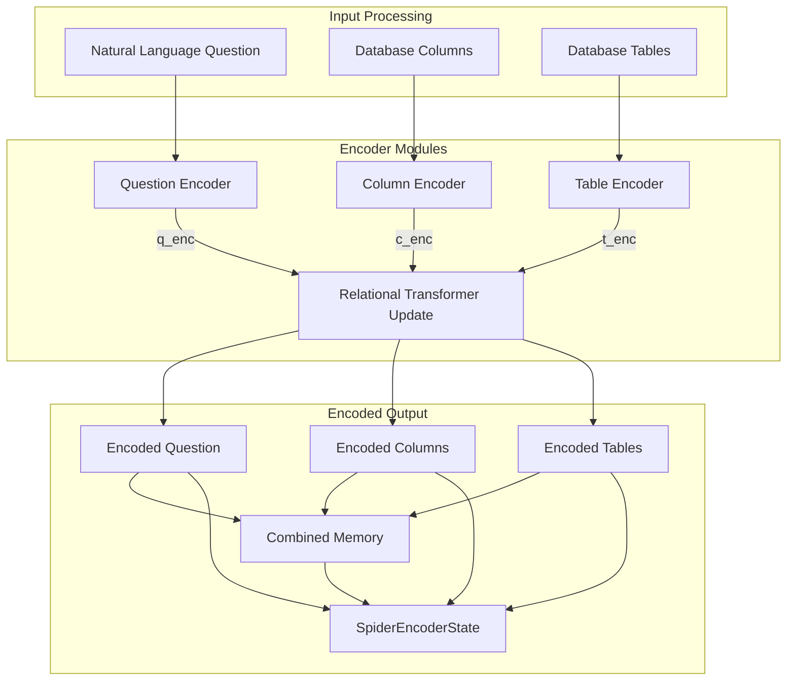
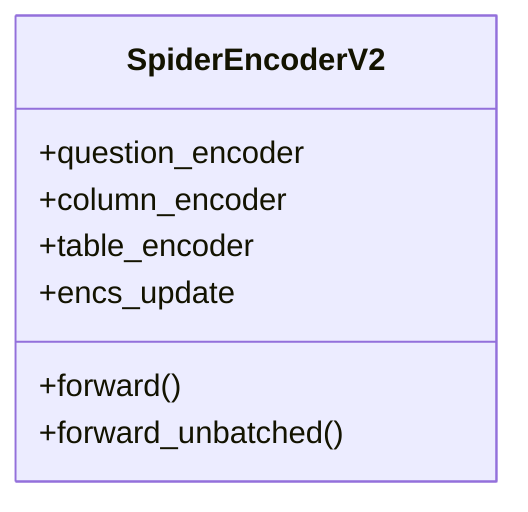
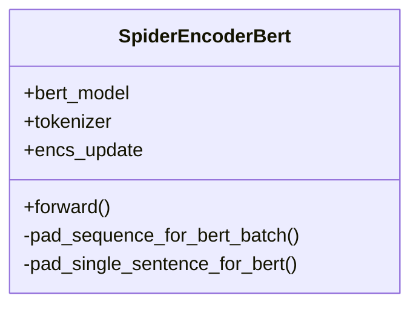
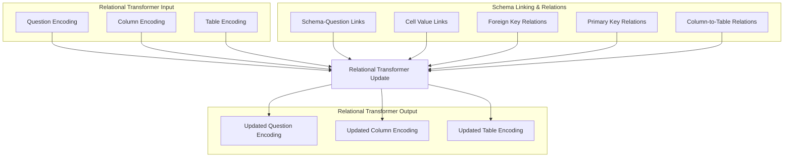
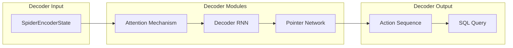
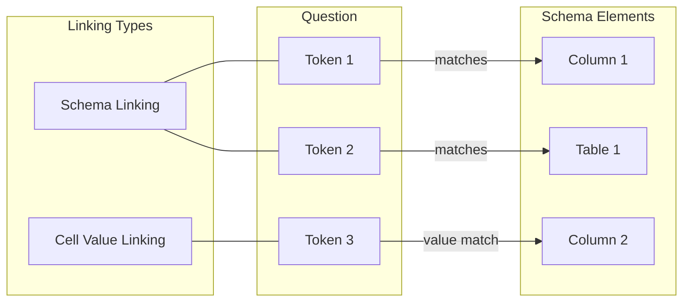
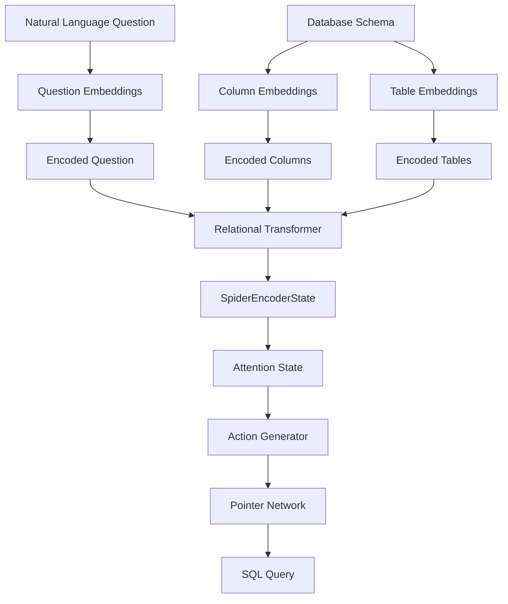

<!-- source: DeepWiki mcp.deepwiki.com · repo microsoft/rat-sql · page 4 Model Architecture · fetched 2026-10-26 -->

# Model Architecture

Relevant source files

The following files were used as context for generating this wiki page:

- [README.md](README.md)
- [ratsql/models/spider/spider_enc.py](ratsql/models/spider/spider_enc.py)

This document provides a comprehensive explanation of the RAT-SQL model architecture, focusing on the encoder-decoder structure that powers the text-to-SQL translation process. The document covers the core model components, how they interact, and their implementation details.

For information about how the model is trained, see [Training System](#5). For dataset preprocessing, see [Preprocessing](#8).

## Overview

RAT-SQL uses a specialized encoder-decoder architecture designed specifically for text-to-SQL tasks. The model takes a natural language question and database schema as input and generates a SQL query that answers the question.

Sources: [ratsql/models/spider/spider_enc.py:23-38]()

## Encoder Architecture

The encoder is responsible for processing both the natural language question and the database schema. RAT-SQL implements two variants of encoders:

1. **SpiderEncoderV2**: Uses GloVe embeddings with BiLSTM networks
2. **SpiderEncoderBert**: Uses BERT embeddings with special tokenization and encoding

Both encoders output a `SpiderEncoderState` that contains the encoded representations needed by the decoder.

### SpiderEncoderState Structure

The `SpiderEncoderState` encapsulates the entire context needed for decoding:

Sources: [ratsql/models/spider/spider_enc.py:23-38]()

### Encoder Components and Flow

The encoder uses separate sub-modules to process different parts of the input:

Sources: [ratsql/models/spider/spider_enc.py:264-541]()

## SpiderEncoderV2 Implementation

The `SpiderEncoderV2` class is the primary encoder implementation that uses GloVe word embeddings:

The encoder processing pipeline consists of:

1. **Input Encoding**: Question, columns, and tables are encoded separately
2. **Relational Transformer**: Updates the encoded representations while considering relationships between them
3. **Memory Construction**: Combines the updated encodings into a unified memory representation

Sources: [ratsql/models/spider/spider_enc.py:264-541]()

### Question, Column, and Table Encoding

Each part of the input is processed through specialized modules. The encoder supports multiple encoding methods combined in sequence:

| Module Type | Description |
|-------------|-------------|
| emb | Word embedding lookup (GloVe) |
| bilstm | Bidirectional LSTM encoder |
| bilstm-summarize | BiLSTM with summarization |
| linear | Linear transformation of embeddings |

Sources: [ratsql/models/spider/spider_enc.py:318-356]()

## SpiderEncoderBert Implementation

For enhanced performance, RAT-SQL provides `SpiderEncoderBert`, which uses BERT embeddings instead of GloVe:

The BERT-based encoder:
1. Uses special tokenization for BERT
2. Handles the 512 token length limit of BERT
3. Processes schema elements and questions together to leverage BERT's contextualized embeddings

Sources: [ratsql/models/spider/spider_enc.py:751-1014]()

## Relational Transformer Update

A key innovation in RAT-SQL is the relational transformer that updates the encoded representations while accounting for relationships between different elements:

Sources: [ratsql/models/spider/spider_enc.py:292-316]()

## NL2Code Decoder

The decoder in RAT-SQL is an NL2Code decoder that takes the encoder state and generates SQL queries. The decoder operates on the encoded representations to produce a sequence of SQL tokens.

The decoder uses:
1. **Attention mechanism** over the encoded representations
2. **Pointer network** for copying schema elements directly
3. **Grammar-based action sequence** generation that ensures syntactically valid SQL

## Schema Linking and Representation

RAT-SQL employs schema linking to establish connections between natural language question tokens and database schema elements:

Types of linking:
1. **Schema Linking (SC)**: Connects question tokens to schema elements
2. **Cell Value Linking (CV)**: Links question tokens to values in the database

Sources: [ratsql/models/spider/spider_enc.py:192-221]()

## End-to-End Information Flow

The following diagram illustrates the complete information flow from input to output:

Sources: [ratsql/models/spider/spider_enc.py:358-428](), [ratsql/models/spider/spider_enc.py:798-947]()

## Preprocessing and Configuration

The encoders require preprocessing steps to convert raw inputs into the format expected by the model. This includes:

1. Tokenization of questions and schema elements
2. Schema linking computation
3. Cell value linking computation
4. Handling of special tokens and schema structure

The details of preprocessing are implemented in:
- `SpiderEncoderV2Preproc` for GloVe-based models
- `SpiderEncoderBertPreproc` for BERT-based models

Sources: [ratsql/models/spider/spider_enc.py:129-262](), [ratsql/models/spider/spider_enc.py:645-749]()

## Module Configuration

The model architecture is highly configurable through JSONnet configuration files. Key configuration options include:

| Configuration Parameter | Description |
|-------------------------|-------------|
| word_emb_size | Size of word embeddings |
| recurrent_size | Size of recurrent layers |
| question_encoder | List of modules for question encoding |
| column_encoder | List of modules for column encoding |
| table_encoder | List of modules for table encoding |
| update_config | Configuration for the relational transformer |
| include_in_memory | Which components to include in memory |
| bert_version | Which BERT model to use (for BERT-based encoder) |

Sources: [ratsql/models/spider/spider_enc.py:269-316](), [ratsql/models/spider/spider_enc.py:756-792]()

## Conclusion

The RAT-SQL model architecture is designed specifically for text-to-SQL tasks, with sophisticated components for processing both natural language questions and database schemas. The key innovations include:

1. Specialized encoders for questions and schema elements
2. Relational transformer for context-aware representations
3. Schema linking mechanisms for connecting language to database structures
4. Flexible configuration for different embedding types and model variants

This architecture enables RAT-SQL to achieve state-of-the-art performance on text-to-SQL benchmarks like Spider and WikiSQL.

---

