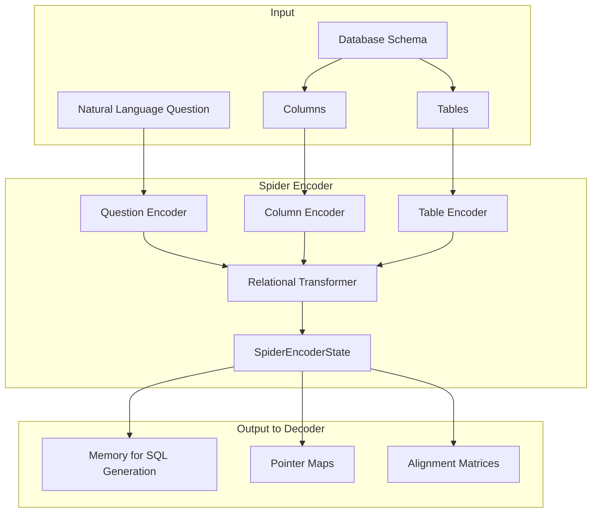
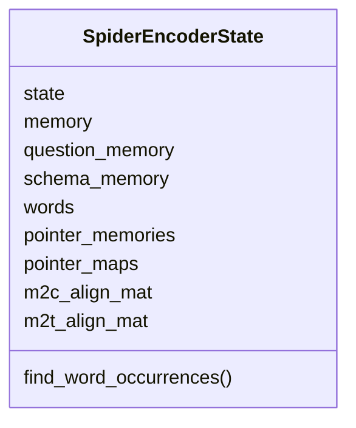
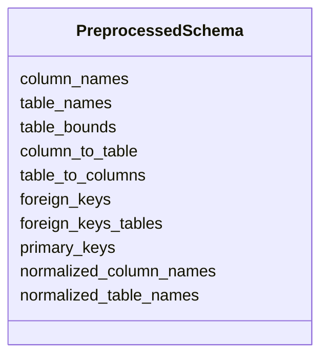
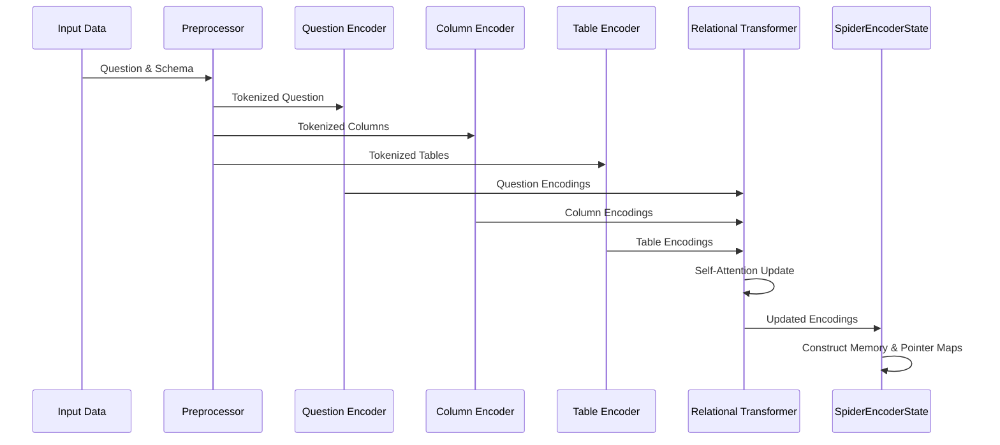
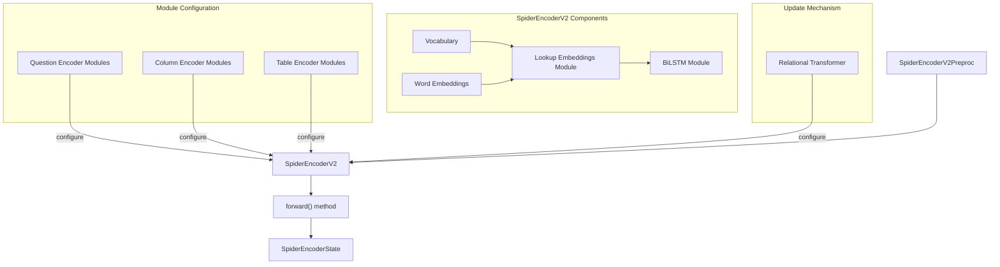
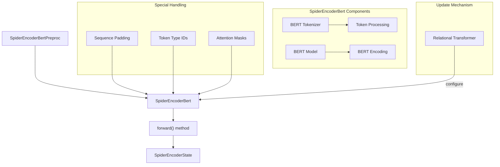
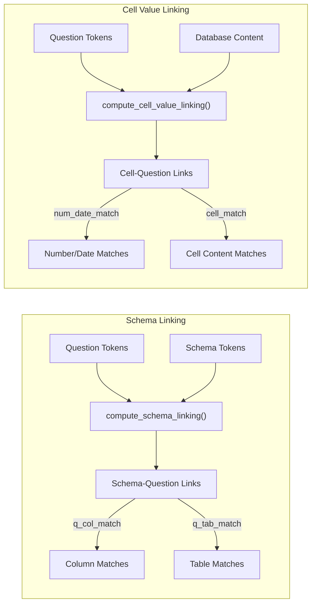
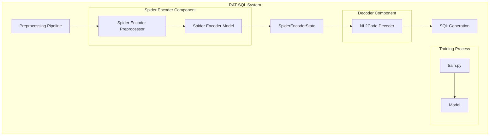

<!-- source: DeepWiki mcp.deepwiki.com · repo microsoft/rat-sql · page 4.1 Spider Encoder · fetched 2026-10-26 -->

# Spider Encoder

Relevant source files

The following files were used as context for generating this wiki page:

- [ratsql/models/spider/spider_enc.py](ratsql/models/spider/spider_enc.py)

The Spider Encoder is a critical component of RAT-SQL's architecture responsible for encoding both natural language questions and database schema elements into vector representations. These representations capture the semantic relationships between question elements and database schema components, enabling the SQL decoder to generate accurate SQL queries.

This page documents the Spider Encoder components, their architecture, and implementation details. For information about the SQL decoder that consumes the encoder output, see [NL2Code Decoder](#4.2).

## Overview

The Spider Encoder transforms natural language questions and database schemas into contextualized vector representations. Two main variants are implemented:

1. **SpiderEncoderV2**: Uses GloVe word embeddings as the foundation for encoding.
2. **SpiderEncoderBert**: Uses BERT-based embeddings for enhanced contextual understanding.

Both encoders share a similar high-level architecture but differ in their token handling and underlying embedding mechanisms.

Sources: [ratsql/models/spider/spider_enc.py:23-38](), [ratsql/models/spider/spider_enc.py:264-541](), [ratsql/models/spider/spider_enc.py:751-1014]()

## Core Data Structures

### SpiderEncoderState

The `SpiderEncoderState` class maintains the output of the encoding process, serving as the interface between the encoder and decoder:

Key attributes:
- `memory`: Combined representation of all encoded elements
- `question_memory`: Encoded question representations
- `schema_memory`: Encoded schema (columns and tables) representations
- `pointer_memories`: Specific memories for pointing mechanisms
- `pointer_maps`: Mappings that allow the decoder to point to specific columns or tables
- `m2c_align_mat` and `m2t_align_mat`: Alignment matrices between memory and columns/tables

Sources: [ratsql/models/spider/spider_enc.py:23-38]()

### PreprocessedSchema

The `PreprocessedSchema` class stores the preprocessed database schema information:

This structure organizes schema elements into a format suitable for encoding, including normalization of names for schema linking.

Sources: [ratsql/models/spider/spider_enc.py:41-55]()

## Encoding Process

The encoding process consists of several stages:

1. **Preprocessing**: Transform raw questions and schema into tokenized formats
2. **Initial Encoding**: Encode questions, columns, and tables independently
3. **Relation-Aware Update**: Apply a relational transformer to capture interactions between elements
4. **Memory Construction**: Combine encodings into a unified memory representation

Sources: [ratsql/models/spider/spider_enc.py:358-428](), [ratsql/models/spider/spider_enc.py:430-541](), [ratsql/models/spider/spider_enc.py:798-948]()

## SpiderEncoderV2

SpiderEncoderV2 uses GloVe embeddings and LSTM-based encoders to process the input data.

### Architecture

The encoder is constructed with flexible module configurations, supporting combinations of embedding layers and BiLSTM layers.

Sources: [ratsql/models/spider/spider_enc.py:264-356]()

### Preprocessing

The `SpiderEncoderV2Preproc` class handles:
- Tokenization of questions and schema elements
- Computation of schema linking between questions and schema
- Building vocabulary from training data
- Preprocessing and caching of database schemas

Key methods:
- `preprocess_item`: Processes a single item (question + schema)
- `_preprocess_schema`: Processes and caches database schemas
- `_tokenize`: Handles tokenization based on the configured word embeddings

Sources: [ratsql/models/spider/spider_enc.py:129-261]()

### Forward Pass

The forward pass processes a batch of inputs:
1. Encodes questions, columns, and tables independently
2. Creates pointer maps for referencing columns and tables
3. Updates encodings using the relational transformer
4. Constructs the final SpiderEncoderState

The encoder supports both batched and unbatched processing, with special handling for batched updates.

Sources: [ratsql/models/spider/spider_enc.py:358-428](), [ratsql/models/spider/spider_enc.py:430-541]()

## SpiderEncoderBert

SpiderEncoderBert leverages BERT's contextual embeddings for improved understanding of natural language and schema elements.

### Architecture

The BERT-based encoder uses the BERT model to obtain contextualized embeddings, with specialized handling for schema elements.

Sources: [ratsql/models/spider/spider_enc.py:751-794]()

### Specialized Preprocessing

The `SpiderEncoderBertPreproc` class extends the base preprocessor with BERT-specific features:
- Uses BERT tokenizer for tokenization
- Adds special tokens for column types
- Handles sequence length limitations (maximum 512 tokens)
- Computes BERT-specific schema linking

The class includes `Bertokens` utility for handling BERT's wordpiece tokenization and maintaining alignment between original and tokenized text.

Sources: [ratsql/models/spider/spider_enc.py:544-642](), [ratsql/models/spider/spider_enc.py:645-748]()

### BERT-Specific Forward Pass

The forward pass in SpiderEncoderBert:
1. Prepares BERT input by concatenating question and schema tokens
2. Creates attention masks and token type IDs
3. Processes through the BERT model to get contextualized embeddings
4. Extracts representations for questions, columns, and tables
5. Updates these representations using the relational transformer
6. Constructs the final SpiderEncoderState

Special handling is included for:
- Padding sequences for batch processing
- Managing token types for segment embeddings
- Extracting representations for schema elements (using "first" or "avg" strategy)

Sources: [ratsql/models/spider/spider_enc.py:798-948](), [ratsql/models/spider/spider_enc.py:984-1014]()

## Schema Linking Mechanism

Schema linking is a crucial feature that helps connect natural language question elements to database schema components. This improves the model's ability to generate correct SQL queries.

### Schema Linking Process

Schema linking computes matches between:
1. Question tokens and column names
2. Question tokens and table names
3. Question tokens and cell values (when enabled)

These links are then used by the relational transformer to better contextualize the relationship between question elements and schema components.

Sources: [ratsql/models/spider/spider_enc.py:193-206](), [ratsql/models/spider/spider_enc.py:612-627](), [ratsql/models/spider/spider_enc.py:629-642]()

## Integration with RAT-SQL

The Spider Encoder integrates with the broader RAT-SQL system as follows:

The encoder is registered with the system's registry mechanism and is configured through experiment configuration files.

## Performance Considerations

- **SpiderEncoderV2**: Faster training and inference, but potentially less accurate for complex queries
- **SpiderEncoderBert**: Slower due to BERT's complexity, but provides better semantic understanding
- **Sequence Length**: BERT variant has a 512 token limit, requiring special handling for long sequences
- **Batching**: Both encoders support batched processing with appropriate padding and masking

## Conclusion

The Spider Encoder serves as the foundation for RAT-SQL's text-to-SQL capability by transforming natural language questions and database schemas into rich vector representations. The two variants (GloVe-based and BERT-based) offer different trade-offs between performance and accuracy, with the BERT variant typically achieving higher accuracy on complex queries at the cost of computational efficiency.

Understanding the Spider Encoder is crucial for developers who want to modify or extend RAT-SQL's capabilities, particularly for adapting to new domains or language features.

---

