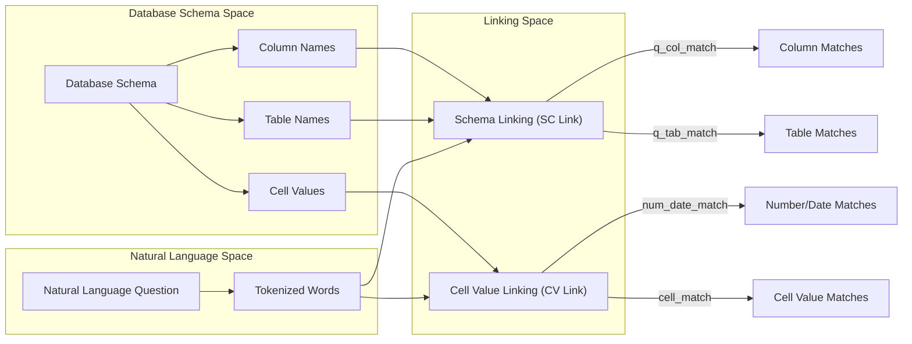
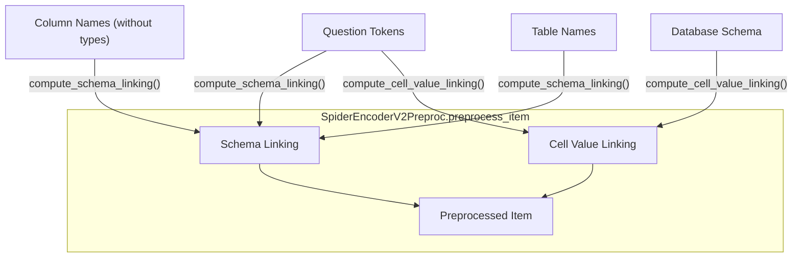
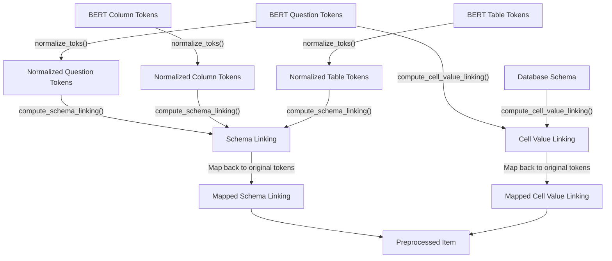
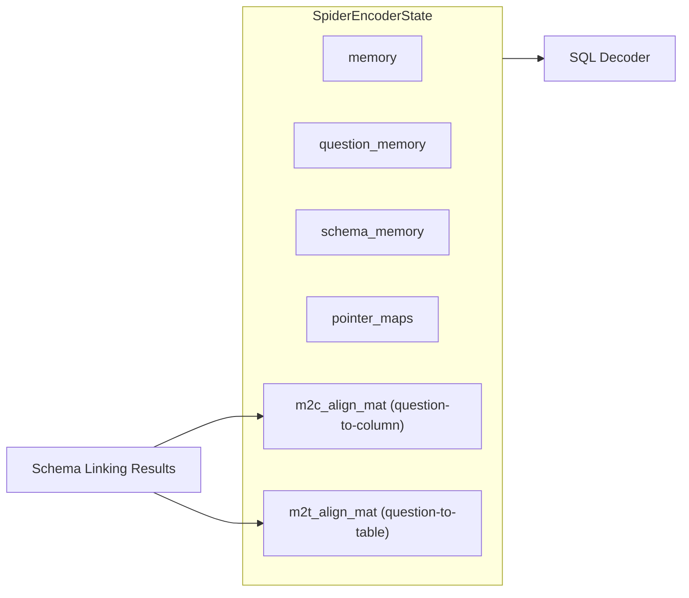
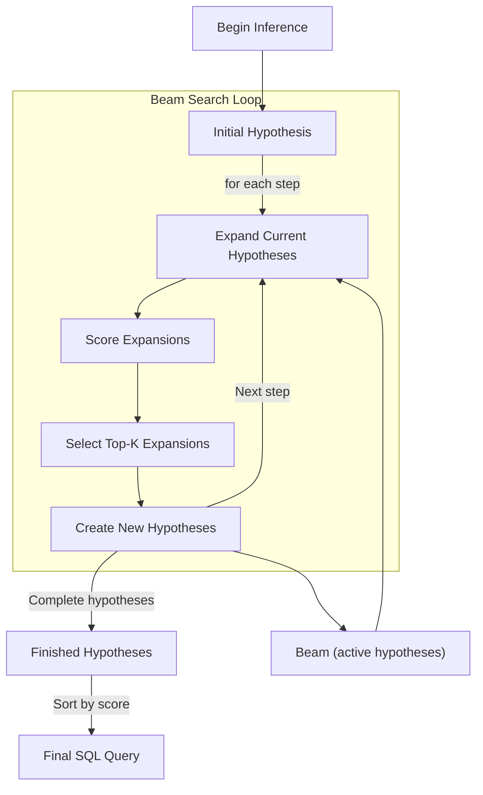
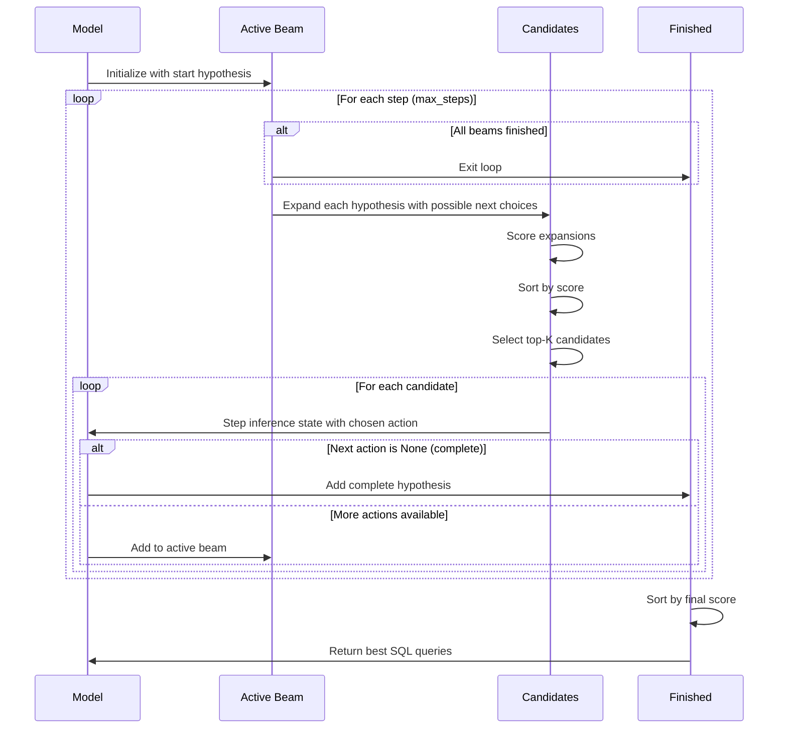
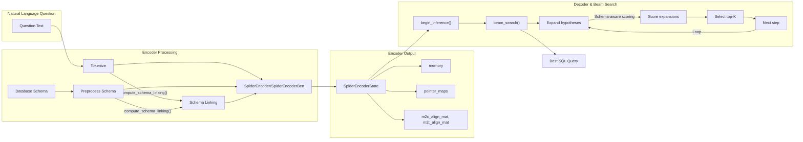

<!-- source: DeepWiki mcp.deepwiki.com · repo microsoft/rat-sql · page 4.2 Schema Linking and Beam Search · fetched 2026-10-26 -->

# Schema Linking and Beam Search

Relevant source files

The following files were used as context for generating this wiki page:

- [ratsql/beam_search.py](ratsql/beam_search.py)
- [ratsql/models/spider/spider_enc.py](ratsql/models/spider/spider_enc.py)

## Purpose and Scope

This document explains two critical components in the RAT-SQL text-to-SQL system: Schema Linking and Beam Search. Schema Linking establishes connections between natural language questions and database schema elements (tables and columns), while Beam Search is used during SQL generation to efficiently explore the space of possible SQL queries. Together, these components significantly enhance the system's ability to accurately translate natural language questions to SQL queries.

For information about the overall model architecture, see [Model Architecture](#4), and for details specifically about the encoder architecture, see [Spider Encoder](#4.1).

## Schema Linking

### Overview

Schema linking is a preprocessing mechanism that identifies potential matches between tokens in the natural language question and elements in the database schema. This linking provides crucial information that helps the model decide which tables and columns to reference in the generated SQL query.

Sources: [ratsql/models/spider/spider_enc.py:195-205]()

### Types of Schema Linking

RAT-SQL implements two types of schema linking:

1. **Schema Linking (SC Link)**: Links words in the natural language question to tables and columns in the database schema
   - `q_col_match`: Maps question tokens to column names
   - `q_tab_match`: Maps question tokens to table names

2. **Cell Value Linking (CV Link)**: Links words in the question to actual values in the database
   - `num_date_match`: Identifies numbers and dates in the question that match database values
   - `cell_match`: Maps question tokens to specific cell values in the database

### Implementation Details

The schema linking mechanism is implemented in the preprocessing stage and varies slightly between the standard encoder and the BERT-based encoder:

#### Standard Encoder (SpiderEncoderV2)

Sources: [ratsql/models/spider/spider_enc.py:192-206]()

#### BERT-based Encoder (SpiderEncoderBert)

For the BERT-based encoder, an additional normalization step is performed to handle BERT's subword tokenization:

Sources: [ratsql/models/spider/spider_enc.py:611-642]()

### Schema Linking in Encoder Output

The computed schema linking information is stored in the encoder state and passed to the decoder:

Sources: [ratsql/models/spider/spider_enc.py:523-540]()

## Beam Search

### Overview

Beam search is a heuristic search algorithm that explores a graph by expanding the most promising nodes in a limited set. In the context of RAT-SQL, beam search is used during the SQL generation process to efficiently explore the space of possible SQL queries.

Sources: [ratsql/beam_search.py:17-59]()

### Hypothesis Structure

Each hypothesis in the beam search represents a partial solution:

| Attribute | Description |
|-----------|-------------|
| `inference_state` | Current state of the inference process |
| `next_choices` | Possible next actions |
| `score` | Cumulative score of the hypothesis |
| `choice_history` | History of choices made |
| `score_history` | History of scores for each choice |

Sources: [ratsql/beam_search.py:7-14]()

### Beam Search Algorithm

The beam search algorithm maintains a list of active hypotheses (the "beam") and a list of finished hypotheses:

Sources: [ratsql/beam_search.py:17-59]()

## Integration of Schema Linking and Beam Search

### How Schema Linking Informs Beam Search

The schema linking information computed during preprocessing is used during the beam search process to guide the selection of tables and columns:

Sources: [ratsql/models/spider/spider_enc.py:358-428](), [ratsql/beam_search.py:17-59]()

### End-to-End Flow

The complete flow from natural language question to SQL query leverages both schema linking and beam search:

1. **Preprocessing**:
   - Tokenize the natural language question
   - Preprocess the database schema
   - Compute schema linking (SC link) and cell value linking (CV link)

2. **Encoding**:
   - Encode the question, columns, and tables
   - Update representations using schema linking information
   - Create the encoder state with alignment matrices

3. **Decoding with Beam Search**:
   - Initialize beam search with the encoder state
   - Generate SQL query incrementally, using schema linking to guide table/column selection
   - Score partial queries and keep the top-K at each step
   - Return the highest-scoring complete SQL query

## Performance Impact

The combination of schema linking and beam search significantly improves RAT-SQL's accuracy in translating natural language to SQL:

1. **Schema Linking Benefits**:
   - Helps resolve ambiguities in natural language questions
   - Identifies the most relevant tables and columns for the query
   - Provides strong signals for table/column selection even with limited training data

2. **Beam Search Benefits**:
   - Explores multiple possible SQL query structures in parallel
   - Allows the model to recover from local decision errors
   - Produces more reliable final queries than greedy decoding

Sources: [ratsql/models/spider/spider_enc.py:130-262](), [ratsql/beam_search.py:17-59]()

## Conclusion

Schema linking and beam search are two key components of RAT-SQL that work together to achieve high accuracy in text-to-SQL translation. Schema linking provides crucial connections between the natural language question and database schema, while beam search efficiently explores the space of possible SQL queries to find the most likely translation.

---

