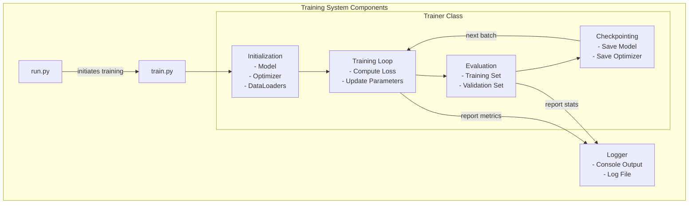
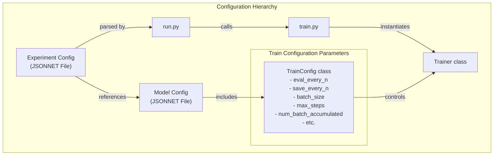
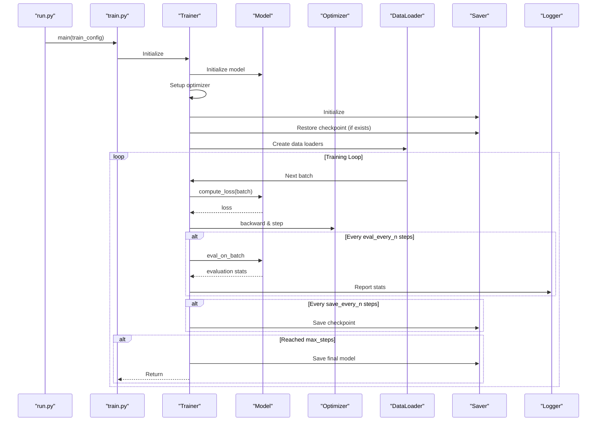
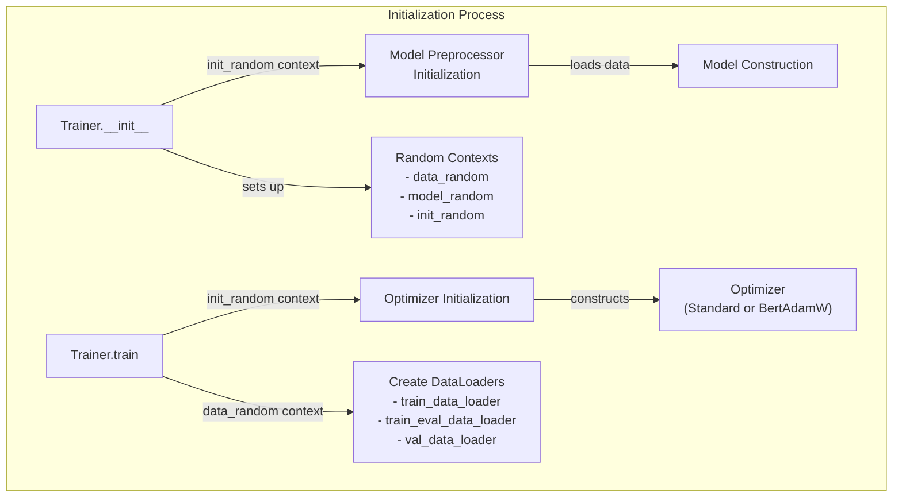
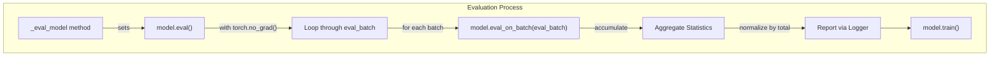
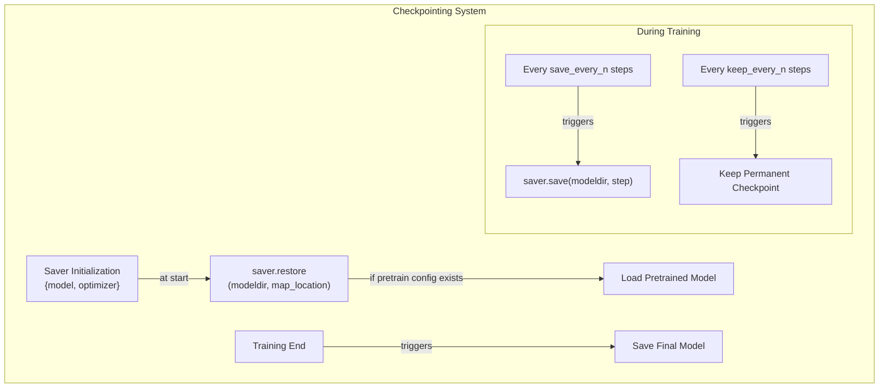
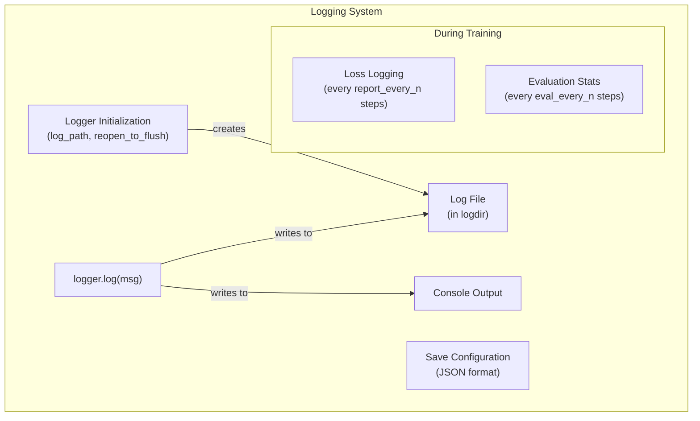
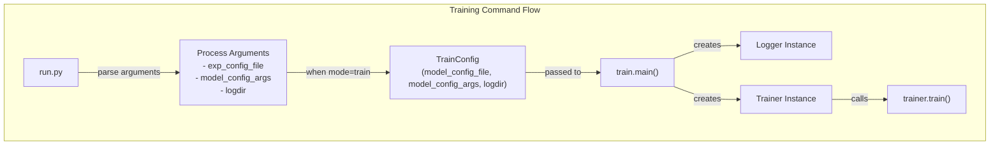
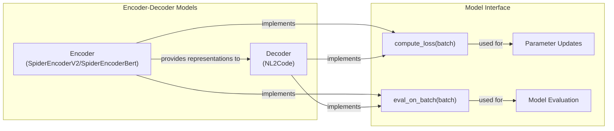

<!-- source: DeepWiki mcp.deepwiki.com · repo microsoft/rat-sql · page 5 Training System · fetched 2026-10-26 -->

# Training System

<details>
<summary>Relevant source files</summary>

The following files were used as context for generating this wiki page:

- [ratsql/commands/train.py](ratsql/commands/train.py)
- [run.py](run.py)

</details>


This document explains the training system of RAT-SQL, focusing on how models are trained, evaluated, and persisted. The training system manages the entire process from model initialization through optimization and checkpointing. For information about model architecture, see [Model Architecture](#4), and for information about inference and evaluation, see [Inference and Evaluation](#7).

## Training System Overview

The RAT-SQL training system manages the complete training process for text-to-SQL models, coordinating optimization, periodic evaluation, checkpointing, and logging. Training is controlled through configuration files and is designed to support various model architectures.



Sources: [run.py:74-77](), [ratsql/commands/train.py:78-214]()

## Configuration System

RAT-SQL training is controlled through a hierarchical configuration system. The experiment configuration file defines high-level parameters and references a model configuration file.



The `TrainConfig` class defines numerous parameters that control the training process:

| Parameter | Description | Default |
|-----------|-------------|---------|
| eval_every_n | Steps between evaluations | 100 |
| save_every_n | Steps between saving checkpoints | 100 |
| keep_every_n | Steps between keeping permanent checkpoints | 1000 |
| batch_size | Training batch size | 32 |
| max_steps | Maximum number of training steps | 100000 |
| data_seed | Seed for data shuffling RNG | None |
| init_seed | Seed for model initialization RNG | None |
| model_seed | Seed for model training RNG | None |
| num_batch_accumulated | Number of batches for gradient accumulation | 1 |
| clip_grad | Maximum gradient norm (None = no clipping) | None |

Sources: [ratsql/commands/train.py:31-54](), [run.py:16-20](), [run.py:49-69]()

## Training Workflow

The training process follows a specific sequence of operations, from initialization to final model saving.



Sources: [ratsql/commands/train.py:105-214](), [run.py:74-77]()

## Model Initialization and Data Loading

The Trainer initializes the model and data loaders with careful attention to random number generator (RNG) control for reproducibility.



The training system provides special handling for BERT-based models with the `bertAdamw` optimizer, which uses different learning rates for BERT parameters and other model parameters.

Sources: [ratsql/commands/train.py:78-102](), [ratsql/commands/train.py:105-171]()

## Training Loop and Gradient Updates

The core training loop processes batches of data, computes loss, and updates model parameters.

```mermaid
flowchart TD
    subgraph "Training Loop"
        BatchGet["Get next batch"]
        
        subgraph "Gradient Computation"
            ModelRandom["model_random context"]
            ModelRandom -->|"controls"| LossCompute["model.compute_loss(batch)"]
            LossCompute --> Backward["norm_loss.backward()"]
        end
        
        GradClip["Gradient Clipping\n(if clip_grad is set)"]
        OptimizerStep["optimizer.step()"]
        LRUpdate["lr_scheduler.update_lr(step)"]
        ZeroGrad["optimizer.zero_grad()"]
        
        Report["Report metrics\n(if report_every_n)"]
        Eval["Evaluate model\n(if eval_every_n)"]
        Save["Save checkpoint\n(if save_every_n)"]
        
        BatchGet --> ModelRandom
        Backward --> GradClip
        GradClip --> OptimizerStep
        OptimizerStep --> LRUpdate
        LRUpdate --> ZeroGrad
        ZeroGrad --> Report
        Report --> Eval
        Eval --> Save
        Save --> |"next iteration"| BatchGet
    end
```



The training loop supports gradient accumulation through the `num_batch_accumulated` parameter, allowing effective batch sizes larger than what fits in GPU memory.

Sources: [ratsql/commands/train.py:174-214]()

## Evaluation During Training

The training system periodically evaluates the model on both training and validation data to track progress.



Evaluation computes various metrics depending on the model, such as exact match accuracy, and logs these statistics for monitoring progress.

Sources: [ratsql/commands/train.py:222-243](), [ratsql/commands/train.py:180-187]()

## Checkpointing and Model Persistence

The training system uses a `Saver` to manage model checkpoints and support resuming training from interruptions.



The Saver manages:
1. Restoring previous training state
2. Loading pretrained models for fine-tuning
3. Regular checkpointing during training
4. Permanent checkpoints at specified intervals
5. Final model saving

Sources: [ratsql/commands/train.py:136-150](), [ratsql/commands/train.py:209-214]()

## Logging System

The Logger captures training progress, evaluation results, and configuration information.



The Logger timestamps all entries and can be configured to reopen the log file after each write to ensure outputs are flushed to disk (useful in distributed environments).

Sources: [ratsql/commands/train.py:57-75](), [ratsql/commands/train.py:255-277]()

## Training Entry Point and Command-Line Interface

The training system is primarily invoked through the main `run.py` script with the "train" command.



Example usage:
```
python run.py train experiments/spider-glove-run.jsonnet
```

Sources: [run.py:48-77](), [ratsql/commands/train.py:246-282]()

## Integration with the Model Architecture

The training system is agnostic to the specific model architecture and interacts with models through a standard interface.



Models must implement:
1. `compute_loss(batch)` - For training updates
2. `eval_on_batch(batch)` - For evaluation metrics

Sources: [ratsql/commands/train.py:99-102](), [ratsql/commands/train.py:193-195](), [ratsql/commands/train.py:228-229]()

## Training System Design Considerations

The RAT-SQL training system incorporates several important design considerations:

1. **Reproducibility**: Careful management of random seeds for initialization, data shuffling, and model training
2. **Resource Efficiency**: Gradient accumulation for effective larger batch sizes
3. **Monitoring**: Regular evaluation and metric reporting
4. **Persistence**: Flexible checkpointing system for resuming training
5. **Pre-training Support**: Ability to load pretrained models for fine-tuning
6. **BERT Integration**: Special handling for BERT-based models with separate learning rates

These design choices make the system robust for training complex text-to-SQL models on various datasets.

Sources: [ratsql/commands/train.py:86-89](), [ratsql/commands/train.py:115-134](), [ratsql/commands/train.py:191-202]()

---

