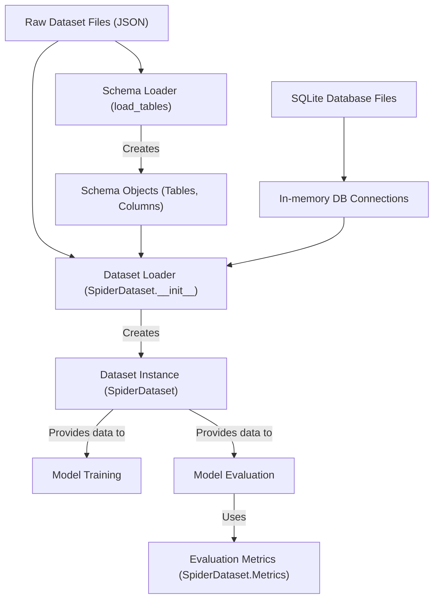
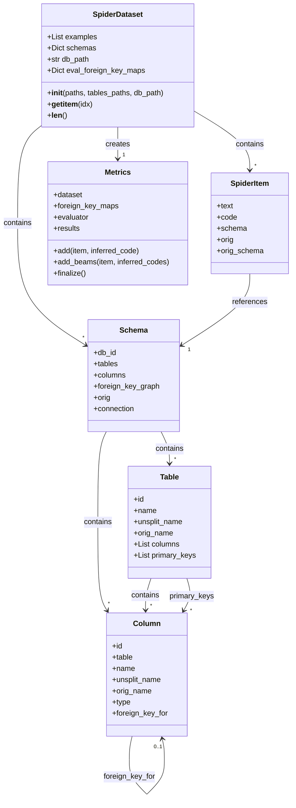
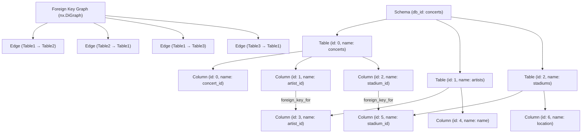
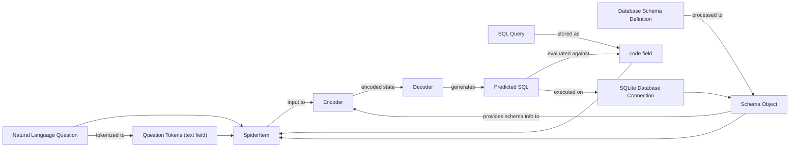

<!-- source: DeepWiki mcp.deepwiki.com · repo microsoft/rat-sql · page 6 Dataset Handling · fetched 2026-10-26 -->

# Dataset Handling

Relevant source files

The following files were used as context for generating this wiki page:

- [ratsql/datasets/__init__.py](ratsql/datasets/__init__.py)
- [ratsql/datasets/spider.py](ratsql/datasets/spider.py)

## Purpose and Scope

This document describes how RAT-SQL loads, processes, and manages datasets used for training and evaluating text-to-SQL models. It covers the data structures used to represent datasets, schema handling, database connections, and evaluation metrics. RAT-SQL primarily supports two datasets: Spider and WikiSQL. For specific implementation details about the Spider dataset, see [Spider Dataset](#6.1).

## Dataset Architecture Overview

### Dataset Handling Workflow

Sources: [ratsql/datasets/spider.py:126-169]()

## Data Structures

RAT-SQL uses a set of specialized classes to represent datasets and their elements. These structures provide an abstraction over the raw dataset files and make them more easily usable by the model.

### Core Data Classes

Sources: [ratsql/datasets/spider.py:17-55](), [ratsql/datasets/spider.py:171-208]()

| Class | Purpose |
|-------|---------|
| `SpiderDataset` | Top-level dataset class that loads examples and schemas |
| `SpiderItem` | Represents a single example (question-SQL pair with schema) |
| `Schema` | Represents a database schema with tables and columns |
| `Table` | Represents a database table with columns and keys |
| `Column` | Represents a database column with type and relationship info |
| `Metrics` | Provides evaluation metrics for model predictions |

### Database Schema Representation

Sources: [ratsql/datasets/spider.py:47-54](), [ratsql/datasets/spider.py:61-123]()

## Dataset Loading Process

The dataset loading process consists of two main phases:

1. **Schema Loading**: Processing database schema definitions 
2. **Example Loading**: Loading the actual dataset examples (questions and SQL queries)

### Schema Loading

The `load_tables` function handles loading database schemas:

1. Reads schema definitions from JSON files
2. Creates `Table` and `Column` objects for each database element
3. Links columns to their respective tables
4. Sets up primary key information
5. Builds a graph of foreign key relationships using NetworkX
6. Returns a dictionary of schemas indexed by database ID

Source: [ratsql/datasets/spider.py:61-123]()

### Example Loading

The `SpiderDataset.__init__` method handles loading examples:

1. Calls `load_tables` to get schema information
2. Loads example data from JSON files
3. Creates `SpiderItem` instances for each example
4. Creates in-memory SQLite database connections

Source: [ratsql/datasets/spider.py:128-157]()

## From Natural Language to Database Query

Sources: [ratsql/datasets/spider.py:17-23](), [ratsql/datasets/spider.py:137-144]()

## Evaluation Metrics

The `SpiderDataset.Metrics` class provides functionality for evaluating model predictions:

1. Initializes an evaluator with database paths and foreign key maps
2. Adds evaluation results for individual predictions
3. Supports beam search evaluation (testing multiple predictions per question)
4. Generates final evaluation results with both per-item metrics and overall scores

Key methods include:
- `add`: Evaluates a single prediction against ground truth
- `add_beams`: Evaluates multiple predictions (beam search results)
- `finalize`: Computes final evaluation results

Source: [ratsql/datasets/spider.py:171-208]()

## Database Connections

RAT-SQL creates in-memory copies of SQLite databases for each database schema:

1. Connects to the on-disk SQLite database
2. Creates an in-memory copy using the `backup` method
3. Stores the connection in the `Schema.connection` field
4. Closes connections when the dataset is deleted

This approach provides efficient access to the databases during training and evaluation.

Sources: [ratsql/datasets/spider.py:149-157](), [ratsql/datasets/spider.py:166-169]()

## Supported Datasets

RAT-SQL supports two main datasets:

| Dataset | Module | Description |
|---------|--------|-------------|
| Spider | `spider.py` | A complex and cross-domain text-to-SQL benchmark |
| WikiSQL | `wikisql.py` | A large-scale dataset of questions and SQL queries |

The dataset modules are registered with the system using the `@registry.register('dataset', 'name')` decorator, allowing them to be referenced in configuration files.

Sources: [ratsql/datasets/__init__.py:1-2](), [ratsql/datasets/spider.py:126]()

## Name Processing

RAT-SQL processes table and column names to make them more suitable for natural language processing:

1. Original names are preserved in `orig_name` fields
2. Names are split into tokens (e.g., "customerID" becomes ["customer", "ID"])
3. Both the split and unsplit versions are stored
4. The `postprocess_original_name` function handles things like camelCase conversion

This processing helps with schema linking between natural language questions and database elements.

Source: [ratsql/datasets/spider.py:57-58]()

---

