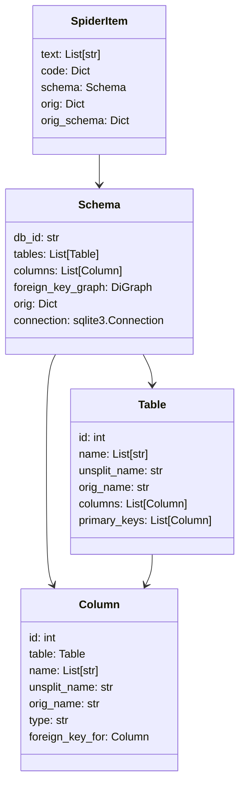
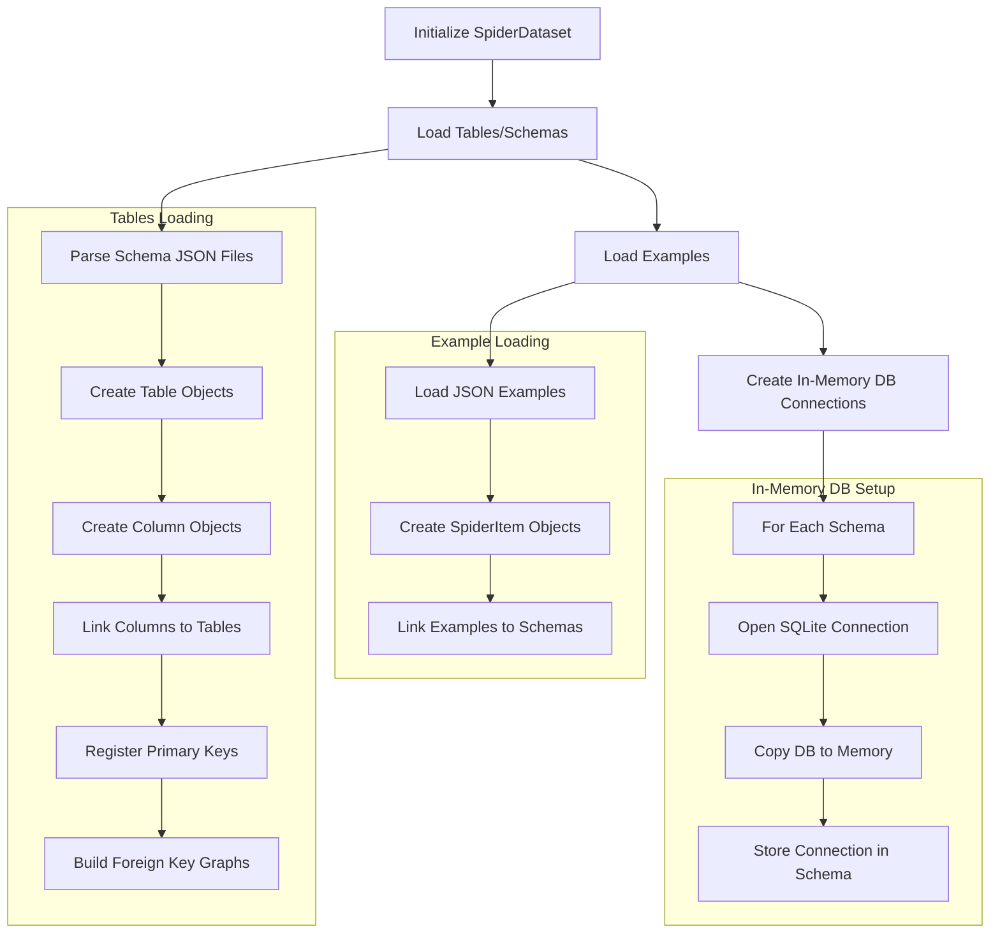
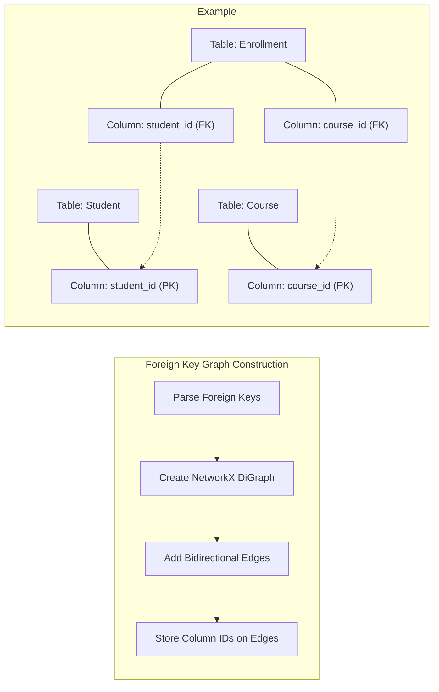
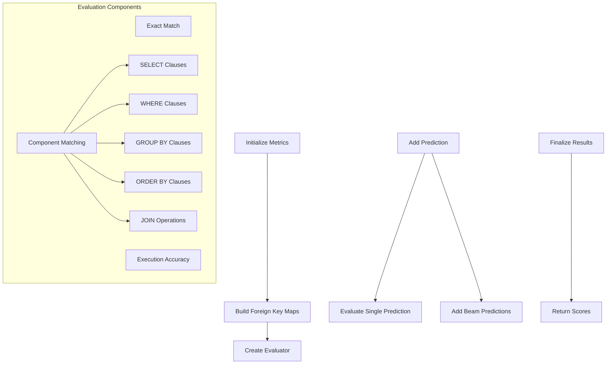
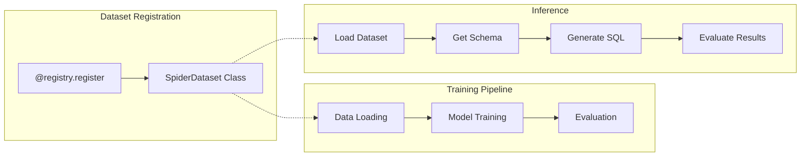

<!-- source: DeepWiki mcp.deepwiki.com · repo microsoft/rat-sql · page 6.1 Spider Dataset · fetched 2026-10-26 -->

# Spider Dataset

<details>
<summary>Relevant source files</summary>

The following files were used as context for generating this wiki page:

- [ratsql/datasets/spider.py](ratsql/datasets/spider.py)
- [ratsql/datasets/spider_lib/README.md](ratsql/datasets/spider_lib/README.md)
- [ratsql/datasets/spider_lib/__init__.py](ratsql/datasets/spider_lib/__init__.py)
- [ratsql/datasets/spider_lib/evaluation.py](ratsql/datasets/spider_lib/evaluation.py)

</details>


## Purpose and Scope

This document provides technical documentation for the Spider dataset implementation in RAT-SQL. It covers the data structures, loading process, and evaluation metrics used when working with this dataset. For information about other dataset implementations like WikiSQL, see [Dataset Handling](#6).

The Spider dataset is a large-scale, complex, and cross-domain text-to-SQL dataset used for training and evaluating the RAT-SQL model's ability to generate SQL queries from natural language questions.

Sources: [ratsql/datasets/spider.py:1-209]()

## Data Structures

The Spider dataset implementation defines several key data structures to represent database elements and questions:



### Data Structure Description

- **SpiderItem**: Represents a single dataset example with:
  - `text`: Tokenized natural language question
  - `code`: The gold SQL query in dictionary representation
  - `schema`: Database schema associated with this question
  - `orig`: Original dataset entry
  - `orig_schema`: Original schema representation

- **Schema**: Represents a database schema with:
  - `db_id`: Database identifier
  - `tables`: List of tables in the database
  - `columns`: List of all columns across all tables
  - `foreign_key_graph`: NetworkX graph for foreign key relationships
  - `connection`: In-memory SQLite database connection

- **Table**: Represents a database table with:
  - `id`: Table identifier
  - `name`: Tokenized table name
  - `columns`: List of columns in the table
  - `primary_keys`: List of primary key columns

- **Column**: Represents a database column with:
  - `id`: Column identifier
  - `table`: Reference to the parent table
  - `name`: Tokenized column name
  - `type`: Data type of the column
  - `foreign_key_for`: Reference to foreign key column if applicable

Sources: [ratsql/datasets/spider.py:17-54]()

## Dataset Loading Process

The Spider dataset is loaded through a multi-stage process:



The dataset loading process involves:

1. **Schema and Table Loading**:
   - Parse database schema files to create a structured representation of tables, columns, and relationships
   - Build foreign key graphs to represent relationships between tables
   - Create mapping dictionaries for evaluation purposes

2. **Example Loading**:
   - Load example JSON files containing natural language questions and SQL queries
   - Create SpiderItem objects that link questions to their associated database schemas

3. **In-Memory Database Setup**:
   - Create in-memory copies of all SQLite databases for efficient access during training and evaluation
   - Connections are maintained for the lifetime of the dataset object

Sources: [ratsql/datasets/spider.py:61-157]()

## Schema Processing and Relationship Handling

The Spider dataset implementation handles database relationships through a graph-based representation:



Key aspects of schema processing include:

1. **Foreign Key Handling**:
   - Foreign key relationships are represented as a bidirectional graph
   - Each edge contains the source and destination column IDs
   - This graph facilitates traversal of the schema during encoding

2. **Name Processing**:
   - Table and column names are tokenized and normalized
   - Original names are preserved for evaluation purposes
   - The `postprocess_original_name` function (line 57) handles formatting of names

3. **Schema Generation**:
   - The schema for each database is loaded once and shared across all examples
   - Primary key and foreign key information is extracted and stored explicitly

Sources: [ratsql/datasets/spider.py:61-123](), [ratsql/datasets/spider_lib/evaluation.py:817-863]()

## Evaluation System

The Spider Dataset provides a comprehensive evaluation system through its `Metrics` inner class:



The evaluation system measures:

1. **Exact Match Accuracy**:
   - Determines if the predicted SQL query exactly matches the gold query structure
   - Takes into account table selections, conditions, and operations

2. **Component-wise Matching**:
   - Evaluates individual SQL components (SELECT, WHERE, GROUP BY, etc.)
   - Calculates precision, recall, and F1 score for each component

3. **Execution Accuracy** (optional):
   - Executes both the predicted and gold queries against the database
   - Compares the result sets to determine functional equivalence

4. **Difficulty Classification**:
   - Queries are classified as easy, medium, hard, or extra based on their complexity
   - Scores are calculated per difficulty level

The evaluation results include per-item scores as well as aggregated metrics.

Sources: [ratsql/datasets/spider.py:171-208](), [ratsql/datasets/spider_lib/evaluation.py:359-563]()

## Integration with RAT-SQL System

The Spider dataset integrates with the RAT-SQL system through the PyTorch Dataset interface:



Key integration points:

1. **Dataset Registration**:
   - The `@registry.register('dataset', 'spider')` decorator registers the dataset with RAT-SQL's registry system
   - This allows the dataset to be dynamically loaded based on configuration

2. **Training Integration**:
   - The dataset implements PyTorch's Dataset interface with `__len__` and `__getitem__` methods
   - This enables seamless integration with PyTorch's DataLoader for batch processing

3. **Evaluation Pipeline**:
   - The `Metrics` class provides evaluation functionality that integrates with the training and evaluation loops
   - Supports both single prediction evaluation and beam search results evaluation

4. **Database Connection Management**:
   - The class implements `__del__` to properly close database connections when the dataset is no longer needed

Sources: [ratsql/datasets/spider.py:126-169]()

## Spider Dataset Format

The Spider dataset consists of several key file components:

| Component | Description | Format |
|-----------|-------------|--------|
| Questions | Natural language questions paired with SQL | JSON |
| Database Schemas | Table and column definitions | JSON |
| SQLite Databases | Actual databases to execute queries against | SQLite files |
| Tables Data | Contents of the database tables | Various formats |

A typical Spider dataset example looks like:

```json
{
  "question_toks": ["List", "the", "names", "of", "singers", "who", "have", "more", "than", "3", "albums"],
  "query": "SELECT name FROM singer WHERE num_of_albums > 3",
  "db_id": "music_store",
  "sql": {
    "select": [false, [[0, [0, [0, 2, false], null]]]],
    "from": {"table_units": [[0, "singer"]], "conds": []},
    "where": [[false, 3, [0, [0, 6, false], null], "3", null]],
    "groupBy": [],
    "having": [],
    "orderBy": [],
    "limit": null,
    "intersect": null,
    "union": null,
    "except": null
  }
}
```

The evaluation system assesses model performance across different query complexity levels:

| Complexity | Description | Example |
|------------|-------------|---------|
| Easy | Simple queries with single conditions | SELECT name FROM students WHERE age > 20 |
| Medium | Queries with 2-3 conditions or basic joins | SELECT s.name FROM students s JOIN classes c ON s.id = c.student_id WHERE s.age > 20 |
| Hard | Multiple joins, aggregations, nested queries | SELECT dept_name, AVG(salary) FROM instructor GROUP BY dept_name HAVING AVG(salary) > 50000 |
| Extra | Very complex queries with multiple operations | SELECT * FROM instructor WHERE salary > (SELECT AVG(salary) FROM instructor) |

Sources: [ratsql/datasets/spider_lib/evaluation.py:49-54](), [ratsql/datasets/spider.py:135-144]()

## Resource Management

The Spider dataset implementation includes careful management of database connections:

1. **Connection Creation**:
   - SQLite databases are loaded from disk and copied to memory
   - In-memory connections provide faster access during model training and evaluation

2. **Connection Cleanup**:
   - The `__del__` method ensures proper cleanup of database connections
   - This prevents resource leaks when the dataset is no longer needed

3. **Memory Efficiency**:
   - Database schemas are loaded once and shared across all examples
   - This reduces memory overhead for datasets with many examples from the same database

Sources: [ratsql/datasets/spider.py:149-169]()

---

