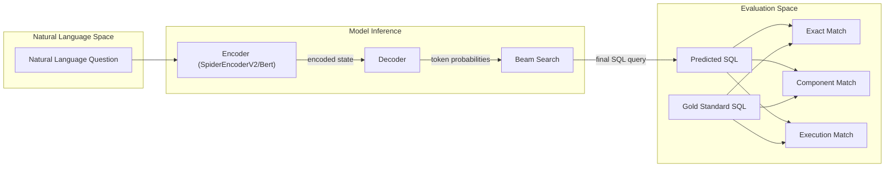
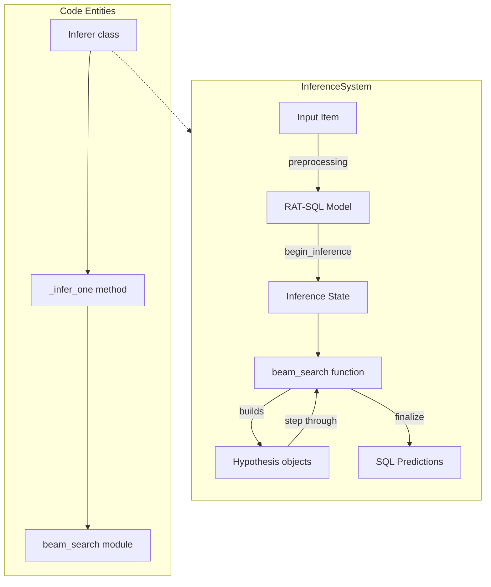
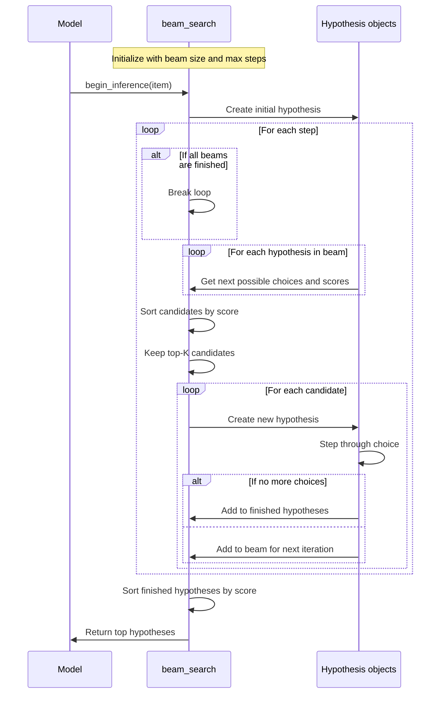
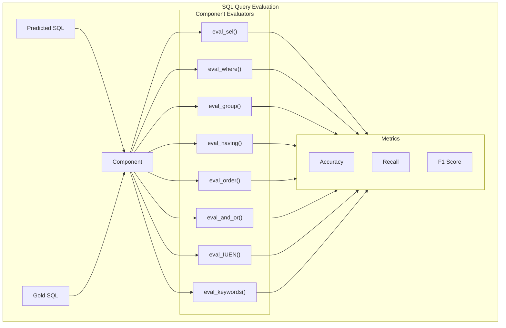

<!-- source: DeepWiki mcp.deepwiki.com · repo microsoft/rat-sql · page 7 Inference and Evaluation · fetched 2026-10-26 -->

# Inference and Evaluation

<details>
<summary>Relevant source files</summary>

The following files were used as context for generating this wiki page:

- [ratsql/beam_search.py](ratsql/beam_search.py)
- [ratsql/commands/eval.py](ratsql/commands/eval.py)
- [ratsql/commands/infer.py](ratsql/commands/infer.py)
- [ratsql/datasets/spider_lib/evaluation.py](ratsql/datasets/spider_lib/evaluation.py)

</details>


This page documents the inference and evaluation systems in RAT-SQL. The inference system generates SQL queries from natural language questions using trained models, while the evaluation system assesses the quality of these predictions against gold standards. For information about model training, see [Training System](#5).

## Table of Contents
- [Overview](#overview)
- [Inference System](#inference-system)
  - [Inference Architecture](#inference-architecture)
  - [Beam Search](#beam-search)
  - [Heuristic-based Search](#heuristic-based-search)
- [Evaluation System](#evaluation-system)
  - [Evaluation Metrics](#evaluation-metrics)
  - [Component-wise Evaluation](#component-wise-evaluation)
  - [Hardness Classification](#hardness-classification)
- [Command Usage](#command-usage)
  - [Running Inference](#running-inference)
  - [Running Evaluation](#running-evaluation)
  - [Interpreting Results](#interpreting-results)

## Overview

The inference and evaluation pipeline in RAT-SQL follows a three-step process:

1. **Inference**: The trained model generates SQL predictions for input questions
2. **SQL Generation**: Beam search converts model outputs into executable SQL queries
3. **Evaluation**: Predictions are compared to gold standards using various metrics



Sources: [ratsql/commands/infer.py:56-102](), [ratsql/commands/eval.py:19-32](), [ratsql/datasets/spider_lib/evaluation.py:359-532]()

## Inference System

### Inference Architecture

The RAT-SQL inference system processes natural language questions to generate SQL queries through several components:



The `Inferer` class manages the inference process:

1. **Model Loading**: Loads a trained model from a checkpoint directory
2. **Preprocessing**: Applies the same preprocessing used during training
3. **Beam Search**: Generates candidate SQL queries using beam search
4. **Finalization**: Converts the highest-scoring candidates to SQL

Sources: [ratsql/commands/infer.py:27-93]()

### Beam Search

Beam search is the core algorithm used to generate SQL queries during inference. It explores multiple possible SQL queries in parallel and selects the highest-scoring ones.



The beam search algorithm maintains a list of partial solutions (hypotheses) and expands them incrementally, keeping only the top-K highest-scoring candidates at each step. The process continues until all hypotheses are finished or the maximum number of steps is reached.

Sources: [ratsql/beam_search.py:17-59]()

### Heuristic-based Search

RAT-SQL also implements a heuristic-enhanced beam search specifically for the Spider dataset. This variant uses domain-specific heuristics to guide the search process and improve SQL generation quality.

The system provides an option to use either standard beam search or heuristic-based beam search during inference:

```python
# Standard beam search
beams = beam_search.beam_search(model, data_item, preproc_item, beam_size=beam_size, max_steps=1000)

# Heuristic-based beam search
beams = spider_beam_search.beam_search_with_heuristics(model, data_item, preproc_item, 
                                                      beam_size=beam_size, max_steps=1000, from_cond=False)
```

Sources: [ratsql/commands/infer.py:94-115]()

## Evaluation System

### Evaluation Metrics

RAT-SQL uses three main types of metrics to evaluate the quality of generated SQL queries:

| Metric Type | Description | Implementation |
|-------------|-------------|----------------|
| **Exact Match** | Checks if the predicted SQL exactly matches the gold SQL structure | `eval_exact_match` |
| **Component Match** | Evaluates individual SQL components (SELECT, WHERE, etc.) | Various component evaluators |
| **Execution Match** | Verifies if executing the predicted SQL gives the same results as the gold SQL | `eval_exec_match` |

The evaluation system can be run in three modes:
- `all`: Compute all metrics
- `match`: Only compute structure matching metrics (exact and component)
- `exec`: Only compute execution matching metrics

Sources: [ratsql/datasets/spider_lib/evaluation.py:359-404](), [ratsql/datasets/spider_lib/evaluation.py:630-655]()

### Component-wise Evaluation

The evaluation system breaks down SQL queries into components and evaluates each separately:



For each component, the system calculates:
- **Accuracy**: Proportion of predicted elements that are correct
- **Recall**: Proportion of gold elements that are predicted correctly
- **F1 Score**: Harmonic mean of accuracy and recall

Sources: [ratsql/datasets/spider_lib/evaluation.py:111-299](), [ratsql/datasets/spider_lib/evaluation.py:405-456]()

### Hardness Classification

The Spider dataset classifies SQL queries into difficulty levels based on their complexity:

| Hardness Level | Criteria |
|----------------|----------|
| **Easy** | Simple queries with at most 1 condition and no aggregation or nesting |
| **Medium** | Queries with up to 2 conditions or up to 2 "other" components |
| **Hard** | Queries with more complex conditions or components |
| **Extra** | Very complex queries with multiple conditions, joins, and nested structures |

The evaluation system calculates separate metrics for each hardness level to provide a more nuanced assessment of model performance.

Sources: [ratsql/datasets/spider_lib/evaluation.py:304-402]()

## Command Usage

### Running Inference

To run inference on a trained model, use the `infer` command:

```bash
python run.py eval --config configs/spider-bert-run.jsonnet --logdir logs/spider-bert --section val --beam-size 5
```

Key parameters:
- `--config`: Path to the experiment configuration file
- `--logdir`: Directory containing model checkpoints
- `--section`: Dataset section to run inference on (train, val, test)
- `--beam-size`: Size of beam for beam search (larger = more candidates)
- `--output-history`: Whether to include decoding history in output
- `--use_heuristic`: Whether to use heuristic-based beam search

The inference command generates a JSON file containing predicted SQL queries for each input question.

Sources: [ratsql/commands/infer.py:128-168]()

### Running Evaluation

To evaluate the predictions against gold standards, use the `eval` command:

```bash
python run.py eval --config configs/spider-bert-run.jsonnet --section val --inferred output/spider-bert/val_pred.json
```

Key parameters:
- `--config`: Path to the experiment configuration file
- `--section`: Dataset section being evaluated
- `--inferred`: Path to the inference output file
- `--output`: Path to save evaluation results

The evaluation command computes metrics and outputs a JSON file with detailed results.

Sources: [ratsql/commands/eval.py:7-37]()

### Interpreting Results

The evaluation output contains the following information:

```json
{
  "per_item": [
    { 
      "predicted": "SELECT ...",
      "gold": "SELECT ...",
      "hardness": "medium",
      "exact": 1,
      "partial": { ... }
    },
    ...
  ],
  "total_scores": {
    "easy": { ... },
    "medium": { ... },
    "hard": { ... },
    "extra": { ... },
    "all": { ... }
  }
}
```

For each hardness level, the system reports:
- Exact match accuracy
- Component-wise accuracy, recall, and F1
- Execution match accuracy (if enabled)

These metrics help identify specific strengths and weaknesses in the model's SQL generation capabilities.

Sources: [ratsql/datasets/spider_lib/evaluation.py:573-627]()

---

