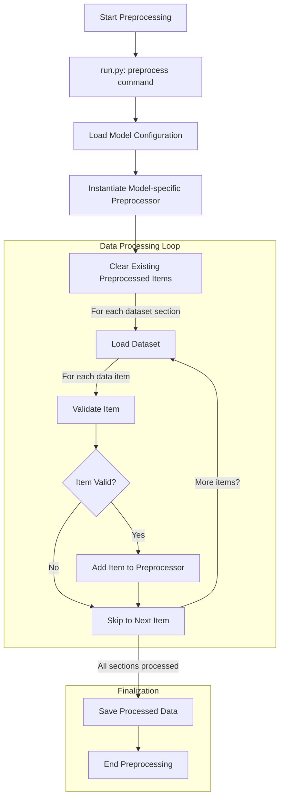
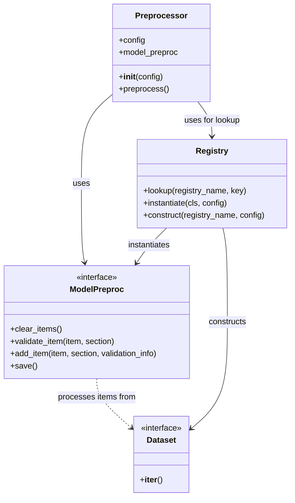
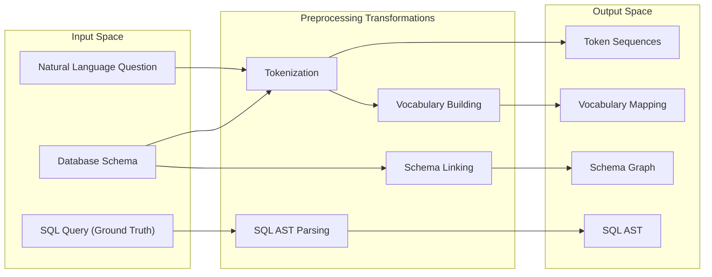
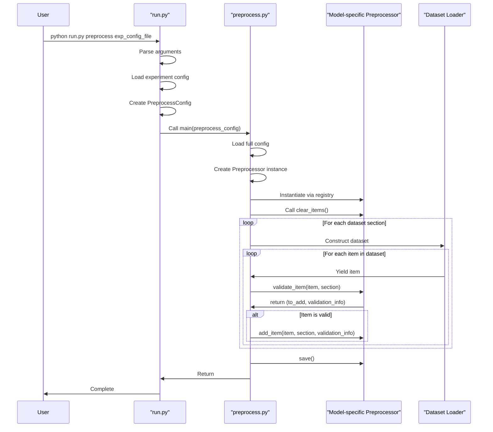
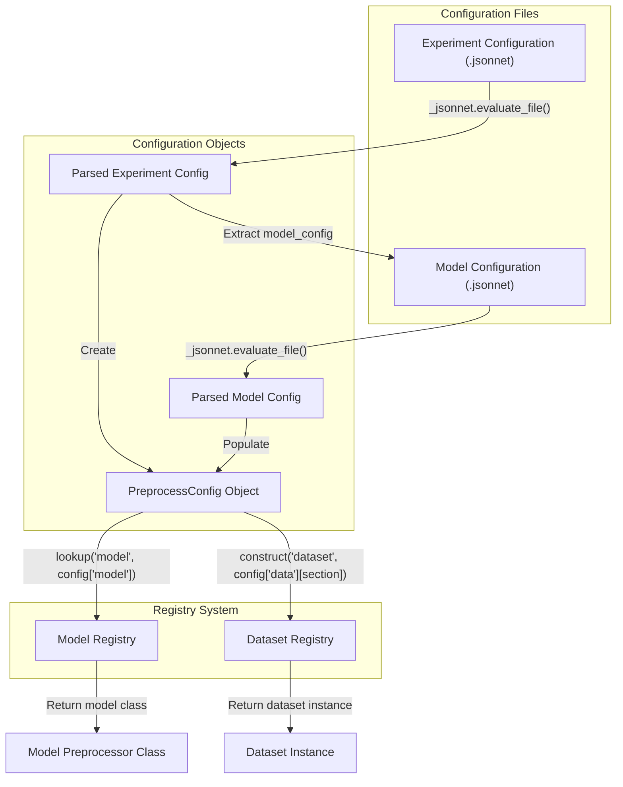
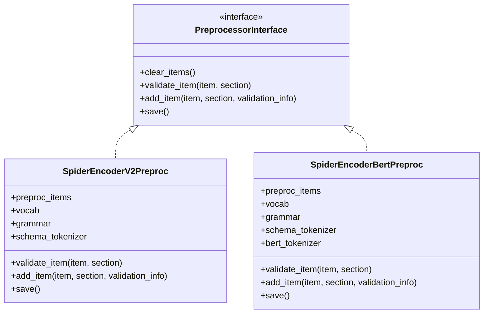
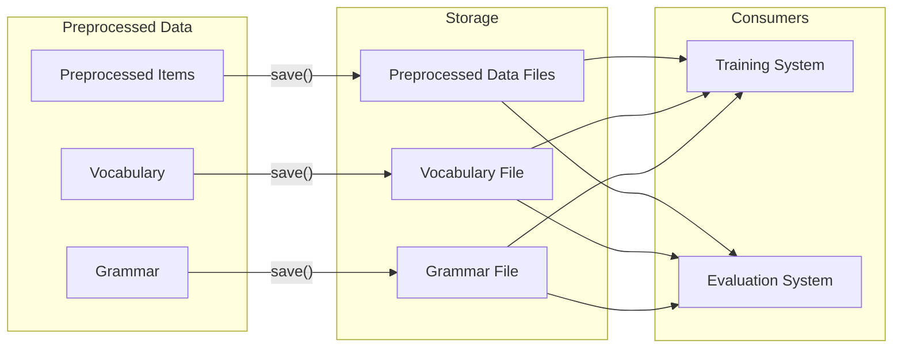
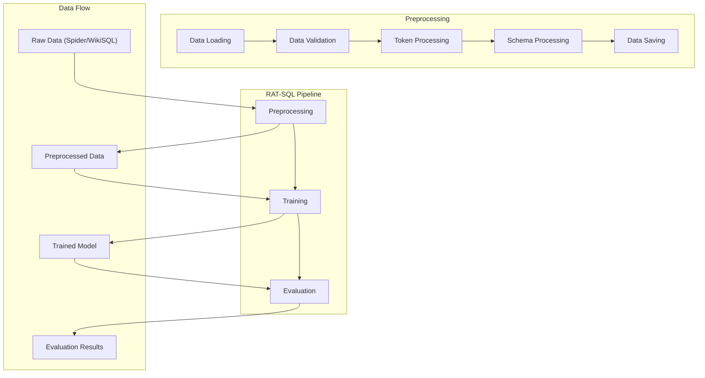
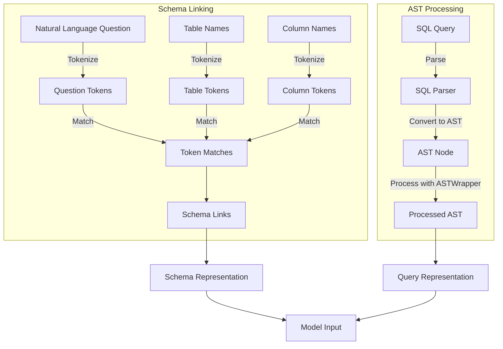

<!-- source: DeepWiki mcp.deepwiki.com · repo microsoft/rat-sql · page 8 Preprocessing · fetched 2026-10-26 -->

# Preprocessing

Relevant source files

The following files were used as context for generating this wiki page:

- [ratsql/ast_util.py](ratsql/ast_util.py)
- [ratsql/commands/preprocess.py](ratsql/commands/preprocess.py)
- [run.py](run.py)

## Overview

This document provides a detailed explanation of the preprocessing system in RAT-SQL, which is responsible for transforming raw dataset inputs into structured formats that can be efficiently consumed during model training and evaluation. The preprocessing system handles both the Spider and WikiSQL datasets, performing operations such as tokenization, schema linking, and vocabulary building.

The preprocessing step is a crucial first phase in the RAT-SQL pipeline that must be completed before training or evaluation can begin. For information about training models on the preprocessed data, see [Training System](#5).

Sources: [run.py:71-73](), [ratsql/commands/preprocess.py:20-35]()

## Preprocessing Workflow

The preprocessing workflow in RAT-SQL follows a straightforward pipeline architecture that prepares raw text and database schema inputs for training and evaluation.

**Preprocessing Workflow Steps:**

1. **Command Execution**: The preprocessing starts when the user runs the `preprocess` command through `run.py`.
2. **Configuration Loading**: The system loads the model configuration from the specified JSONNET file.
3. **Preprocessor Initialization**: A model-specific preprocessor is instantiated based on the model configuration.
4. **Data Processing**: The system iterates through each dataset section (train, validation, test):
   - Loads the dataset
   - For each item in the dataset:
     - Validates the item
     - If valid, adds it to the preprocessor
5. **Data Saving**: After processing all items, the preprocessor saves the processed data to disk.

Sources: [run.py:71-73](), [ratsql/commands/preprocess.py:27-35]()

## Preprocessor Architecture

The preprocessing system utilizes a registry-based architecture to dynamically load and configure the appropriate preprocessor for the selected model.

The main components in the preprocessor architecture:

1. **Preprocessor**: The main class that orchestrates the preprocessing workflow
2. **Model-specific Preprocessor**: Implemented by each model type to handle model-specific preprocessing
3. **Registry**: A central system for looking up and instantiating model and dataset classes
4. **Dataset**: Provides access to the raw data items to be processed

Sources: [ratsql/commands/preprocess.py:20-26](), [ratsql/commands/preprocess.py:9-17]()

## Data Transformation Flow

The preprocessing system transforms raw natural language questions and database schemas into model-ready inputs through a series of steps.

The data transformation process includes:

1. **Tokenization**: Breaking down natural language questions and schema elements into tokens
2. **Schema Linking**: Establishing connections between question tokens and database schema elements
3. **Vocabulary Building**: Creating a vocabulary mapping for tokens
4. **AST Parsing**: Parsing SQL queries into abstract syntax trees

Sources: [ratsql/commands/preprocess.py:27-35](), [ratsql/ast_util.py:68-243]()

## Command Interface

The preprocessing command is executed through the `run.py` CLI, which handles loading configurations and launching the preprocessing process.

The CLI interface accepts the following parameters:

- `exp_config_file`: Path to the experiment configuration file (JSONNET)
- `--model_config_args`: Optional overrides for model configuration arguments

Sources: [run.py:47-73](), [ratsql/commands/preprocess.py:38-58]()

## Configuration System

The preprocessing system uses a configuration-driven approach, where settings are defined in JSONNET files and loaded at runtime.

Example configuration structure for preprocessing:

| Configuration Section | Description | Example Settings |
|---|---|---|
| `model` | Specifies the model type | `"nl2code"`, `"rat"` |
| `model_config` | Path to model configuration file | `"configs/nl2code.jsonnet"` |
| `data` | Defines dataset sections | `train`, `dev`, `test` |
| `data.train` | Train dataset configuration | `name`, `paths`, `tables` |
| `data.dev` | Dev dataset configuration | Same as train |
| `data.test` | Test dataset configuration | Same as train |

Sources: [run.py:55-67](), [ratsql/commands/preprocess.py:46-50]()

## Model-Specific Preprocessing

Different models in RAT-SQL require different preprocessing steps. The system uses a registry pattern to select the appropriate preprocessor for each model type.

Key preprocessing operations performed by model-specific preprocessors:

1. **Tokenization**: Converting text into tokens
2. **Schema Encoding**: Processing database schema information
3. **Grammar Building**: Constructing grammar for SQL generation
4. **Vocabulary Creation**: Building model vocabulary
5. **Data Validation**: Ensuring data quality and completeness

Sources: [ratsql/commands/preprocess.py:23-25]()

## Preprocessing Output and Storage

After preprocessing is complete, the system saves the processed data to disk for later use during training and evaluation.

The preprocessed data typically includes:

1. **Item Representations**: Structured representations of natural language questions, database schemas, and SQL queries
2. **Vocabulary**: Mapping between tokens and indices
3. **Grammar**: Grammar rules for SQL generation
4. **Schema Information**: Processed database schema information

Sources: [ratsql/commands/preprocess.py:35]()

## Integration with RAT-SQL Pipeline

Preprocessing is the first step in the RAT-SQL pipeline, followed by training and evaluation.

The integration points between preprocessing and other pipeline stages:

1. **Input to Training**: Preprocessed data serves as input to the training process
2. **Configuration Consistency**: The same configuration is used across preprocessing, training, and evaluation
3. **Vocabulary and Grammar Sharing**: Vocabulary and grammar built during preprocessing are used in training and evaluation

Sources: [run.py:47-105]()

## Schema Linking and AST Processing

Two critical components of preprocessing are schema linking and SQL AST (Abstract Syntax Tree) processing.

Schema linking involves:
1. Tokenizing natural language questions and schema elements
2. Identifying matches between question tokens and schema elements
3. Creating links between matched tokens

AST processing involves:
1. Parsing SQL queries into AST representation
2. Processing the AST with ASTWrapper
3. Creating a structured representation of the query

Sources: [ratsql/ast_util.py:68-243]()

## Best Practices and Common Issues

Below are some best practices and common issues encountered during preprocessing:

| Issue | Description | Solution |
|---|---|---|
| Missing schema information | Database schema information is incomplete | Ensure all tables and columns are properly defined |
| Vocabulary mismatch | Tokens in evaluation data not seen during training | Use preprocessing options that handle unknown tokens |
| Invalid SQL queries | SQL queries in the dataset are not valid | Use validation options to filter or fix invalid queries |
| Memory limitations | Processing large datasets consumes excessive memory | Use batch processing or filtering options |
| Preprocessing time | Preprocessing large datasets takes too long | Consider using cached preprocessing results |

Sources: [ratsql/commands/preprocess.py:32-34]()

## Conclusion

The preprocessing system in RAT-SQL is a critical component that transforms raw natural language questions and database schemas into structured inputs for model training and evaluation. It performs tasks such as tokenization, schema linking, vocabulary building, and AST parsing. By following a registry-based architecture, it provides flexibility to support different models and datasets.

To configure preprocessing, users can modify the JSONNET configuration files to specify model type, dataset paths, and preprocessing options. The processed data is saved to disk and subsequently used during training and evaluation.

For information about training models on the preprocessed data, refer to the [Training System](#5) documentation.

---

