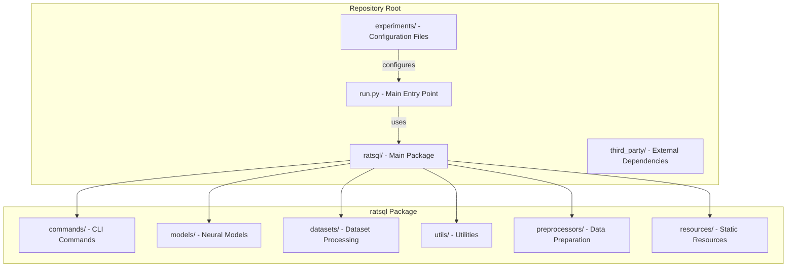
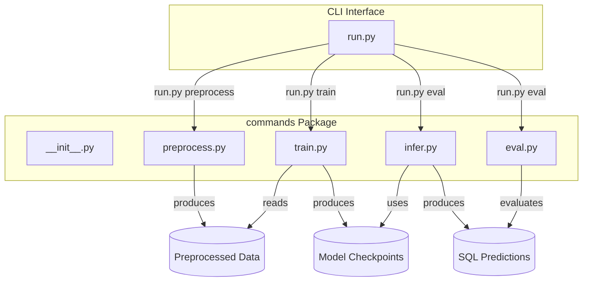
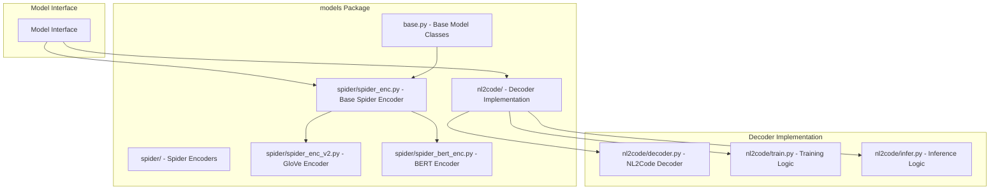
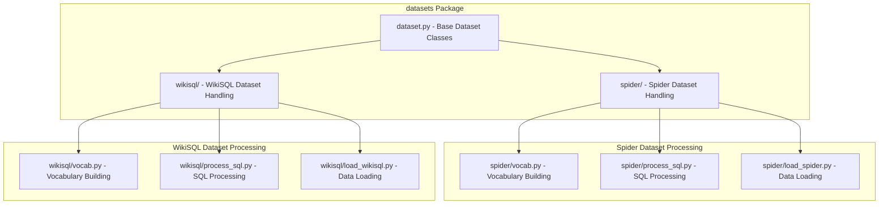
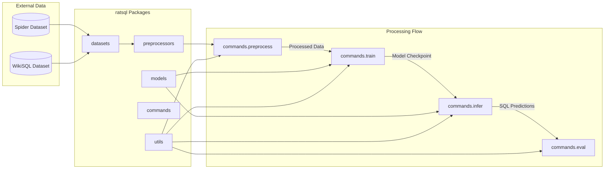
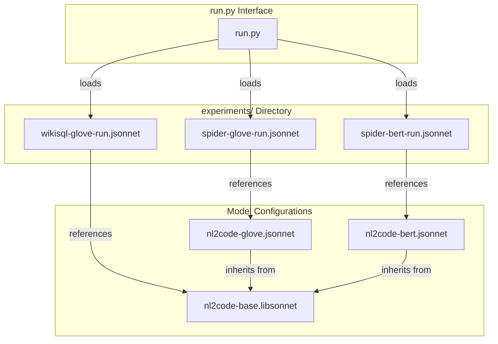
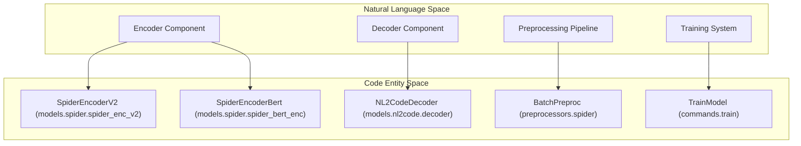
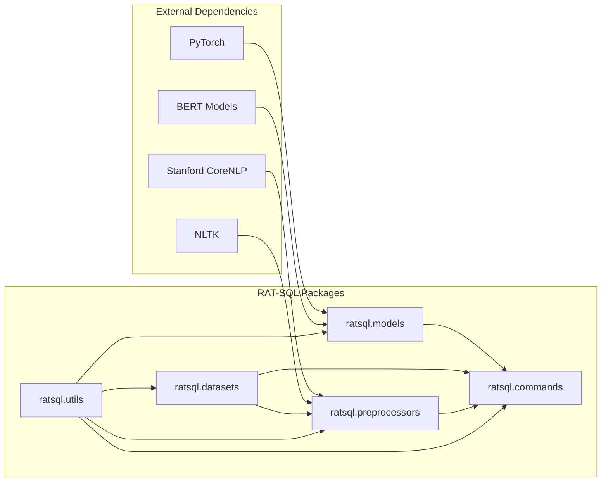

<!-- source: DeepWiki mcp.deepwiki.com · repo microsoft/rat-sql · page 9 Package Structure · fetched 2026-10-26 -->

# Package Structure

Relevant source files

The following files were used as context for generating this wiki page:

- [README.md](README.md)
- [ratsql/__init__.py](ratsql/__init__.py)
- [ratsql/commands/__init__.py](ratsql/commands/__init__.py)

This document provides a comprehensive overview of the RAT-SQL repository package structure and organization. It explains the main packages, their relationships, and how they map to the system functionality described in the [System Architecture](#3) document. Understanding this package structure will help developers navigate the codebase effectively and locate relevant components when modifying or extending the system.

## Overview

RAT-SQL is organized as a Python package with a modular structure that separates the different functional components of the text-to-SQL system. The main package is `ratsql`, which contains several subpackages organized by functionality.

Sources: [README.md:78-86](), [ratsql/__init__.py](), [ratsql/commands/__init__.py]()

## Main Package Structure

The `ratsql` package is the core of the system and contains the following main subpackages:

| Package | Description |
|---------|-------------|
| `commands` | Contains the command handlers for preprocessing, training, evaluation, and inference operations |
| `models` | Houses the model architecture components, including encoders and decoders |
| `datasets` | Manages dataset loading, processing, and conversions for Spider and WikiSQL |
| `utils` | General utility functions and helpers used throughout the codebase |
| `preprocessors` | Data preprocessing logic for transforming raw inputs into model-ready formats |
| `resources` | Static resources and configuration files used by the system |

## Command Package Structure

The command package implements the main operations exposed through the CLI interface. Each command corresponds to a specific operation in the pipeline.

Sources: [ratsql/commands/__init__.py](), [README.md:83-86]()

## Model Package Structure

The models package contains the neural network architecture components, including the encoder and decoder variants.

Sources: [README.md:88-92]()

## Dataset Package Structure

The dataset package handles the loading, processing, and manipulation of the Spider and WikiSQL datasets.

Sources: [README.md:30-53]()

## Runtime Data Flow Between Packages

This diagram illustrates how data flows between different packages during the execution of RAT-SQL processing pipeline:

Sources: [README.md:83-86]()

## Configuration Files Organization

The configuration system in RAT-SQL uses JSONNET files to define experiment settings and model architectures. These files are organized in the `experiments` directory.

Sources: [README.md:88-92]()

## Code-to-Entity Mapping

This diagram maps the main code entities (classes and modules) to their corresponding system components, bridging the gap between the natural language descriptions and the actual code implementation:

Sources: [README.md:90-92]()

## File Organization for RAT-SQL Components

This diagram shows how the different RAT-SQL components map to specific files in the repository structure:

```mermaid
graph TD
    subgraph "RAT-SQL Components"
        component_cli["Command-Line Interface"]
        component_encoder["Encoder Architecture"]
        component_decoder["Decoder Architecture"]
        component_dataset["Dataset Processing"]
        component_train["Training System"]
        component_eval["Evaluation System"]
    end
    
    subgraph "Repository Files"
        file_run["run.py"]
        file_spider_enc["ratsql/models/spider/spider_enc.py"]
        file_spider_encv2["ratsql/models/spider/spider_enc_v2.py"]
        file_spider_bert["ratsql/models/spider/spider_bert_enc.py"]
        file_nl2code["ratsql/models/nl2code/decoder.py"]
        file_spider_ds["ratsql/datasets/spider/"]
        file_wikisql_ds["ratsql/datasets/wikisql/"]
        file_train["ratsql/commands/train.py"]
        file_eval["ratsql/commands/eval.py"]
    end
    
    component_cli --> file_run
    component_encoder --> file_spider_enc
    component_encoder --> file_spider_encv2
    component_encoder --> file_spider_bert
    component_decoder --> file_nl2code
    component_dataset --> file_spider_ds
    component_dataset --> file_wikisql_ds
    component_train --> file_train
    component_eval --> file_eval
```

Sources: [README.md:83-92]()

## Package Dependencies

This diagram illustrates the dependencies between the main packages in RAT-SQL:

Sources: [README.md:74-75]()

## Summary

The RAT-SQL package structure follows a modular design that separates concerns based on functionality. The `ratsql` package contains subpackages for commands, models, datasets, utilities, and preprocessing. This organization facilitates maintenance, extension, and customization of the system. The package structure maps directly to the system architecture described in the [System Architecture](#3) document, with clear separation between the preprocessing, training, and evaluation components.

---

