# Page: Overview

# Overview

<details>
<summary>Relevant source files</summary>

The following files were used as context for generating this wiki page:

- [README.md](README.md)

</details>


This document provides a comprehensive introduction to RAT-SQL, a text-to-SQL parsing system developed by Microsoft Research that translates natural language questions into SQL queries. For detailed setup instructions, see [Installation and Setup](#2), and for deeper architectural details, see [System Architecture](#3).

## Purpose and Scope

RAT-SQL (Relation-Aware Schema Encoding and Linking for Text-to-SQL Parsers) is designed to bridge the gap between natural language questions and database queries by generating accurate SQL code. The system's primary innovation is its relation-aware schema encoding and linking mechanism that explicitly incorporates database structure into the neural architecture.

Key capabilities include:
- Processing natural language questions about a database
- Understanding database schema components (tables, columns, relationships)
- Creating appropriate linkages between question terms and schema elements
- Generating syntactically and semantically correct SQL queries

Sources: [README.md:3-17]()

## System Architecture

### High-Level Architecture

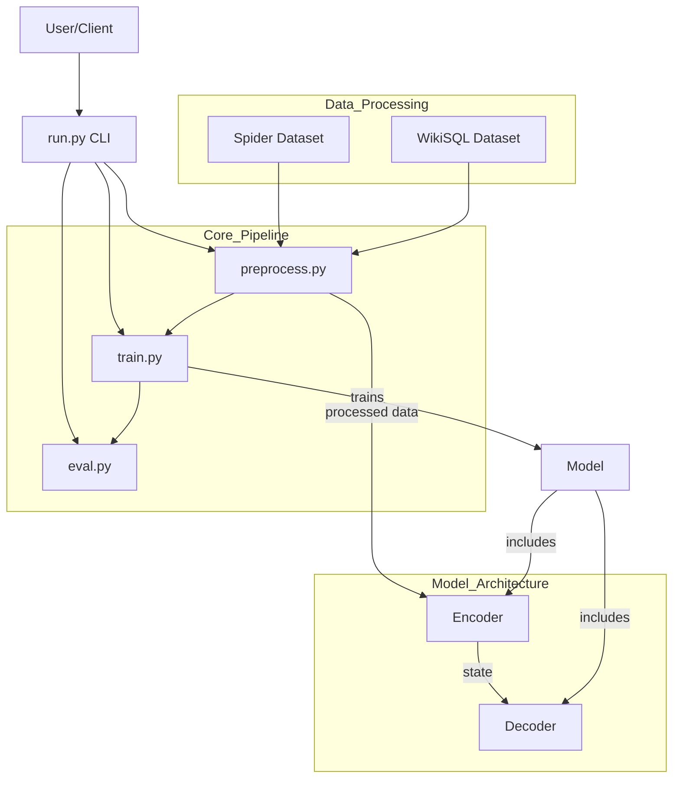

The system follows a modular architecture with a clear separation between preprocessing, training, and evaluation components. The command-line interface in `run.py` provides access to these components, allowing users to preprocess data, train models, and evaluate results.

Sources: [README.md:80-86]()

### Encoder-Decoder Framework

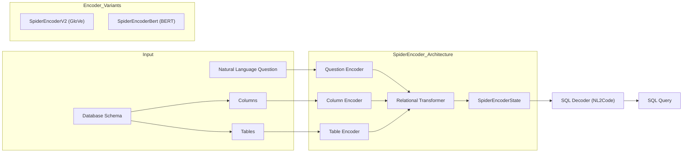

The core of RAT-SQL is its encoder-decoder architecture:
- The encoder processes both the natural language question and database schema
- Specialized encoders handle questions, columns, and tables
- A relational transformer combines these representations
- The decoder (NL2Code) generates SQL based on the encoder state

Sources: [README.md:88-93]()

## Workflow and Configuration

### User Workflow

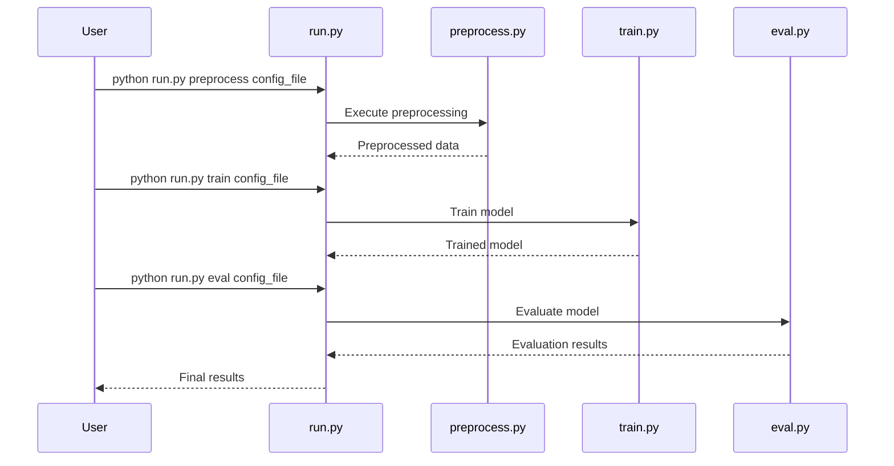

RAT-SQL follows a three-step workflow:
1. **Preprocessing**: Converts raw dataset files into formats suitable for model training
2. **Training**: Trains the encoder-decoder model on the preprocessed data
3. **Evaluation**: Assesses model performance using standard text-to-SQL metrics

Sources: [README.md:80-86]()

### Configuration System

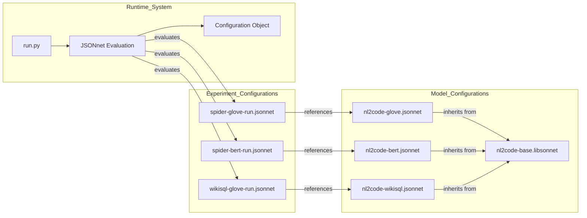

RAT-SQL uses a flexible configuration system based on JSONnet files:
- Experiment configuration files define execution parameters
- Model configuration files define architecture and hyperparameters
- Configurations follow an inheritance pattern for reusability

Sources: [README.md:88-93]()

## Supported Datasets and Models

RAT-SQL supports two primary datasets for text-to-SQL translation:

| Dataset | Description | Key Files |
|---------|-------------|-----------|
| Spider  | A complex cross-domain text-to-SQL dataset | train_spider.json, dev.json, tables.json |
| WikiSQL | A large-scale dataset of questions and SQL queries | train.jsonl, dev.jsonl, test.jsonl |

The system provides different model configurations for these datasets:

| Dataset | Model Variant | Configuration File | Description |
|---------|---------------|-------------------|-------------|
| Spider  | GloVE         | spider-glove-run.jsonnet | Uses GloVE word embeddings |
| Spider  | BERT          | spider-bert-run.jsonnet | Uses BERT contextual embeddings (requires GPU with 16GB+ memory) |
| WikiSQL | GloVE         | wikisql-glove-run.jsonnet | Uses GloVE word embeddings for WikiSQL dataset |

Sources: [README.md:30-53](), [README.md:88-93]()

## Environment and Dependencies

```mermaid
flowchart TB
    subgraph "Docker_Container"
        PyTorch["PyTorch 1.5 CUDA 10.1"]
        CoreNLP["Stanford CoreNLP"]
        BERT["BERT Models"]
        NLTK["NLTK"]
        
        RatSQL["RAT-SQL Code"]
        MountPoint["/mnt/data Volume"]
        
        PyTorch --> RatSQL
        CoreNLP --> RatSQL
        BERT --> RatSQL
        NLTK --> RatSQL
        
        MountPoint --> RatSQL
    end
    
    subgraph "Host_Machine"
        HostData["Spider & WikiSQL Datasets"]
        HostData --> |"mounted at"| MountPoint
    end
    
    User["User"] --> |"docker build/run"| DockerCommand["Docker Command"]
    DockerCommand --> "Docker_Container"
```

RAT-SQL is containerized using Docker to ensure a consistent environment:
- Based on PyTorch 1.5 with CUDA 10.1 support
- Includes Stanford CoreNLP for linguistic processing
- Supports both GloVE and BERT embeddings
- Requires at least 4GB of RAM for preprocessing
- Mounts datasets from the host machine to the container

Sources: [README.md:61-75](), [README.md:20-24]()

## From Question to SQL: End-to-End Process

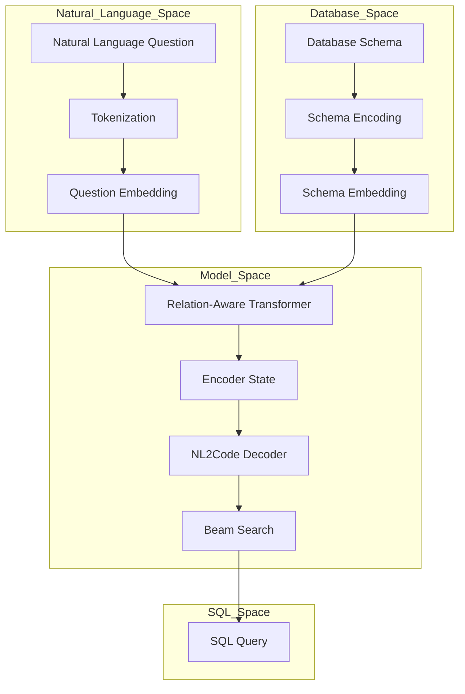

The end-to-end process of RAT-SQL demonstrates how it bridges natural language to SQL:
1. **Input Processing**: Tokenizes the question and encodes the database schema
2. **Embedding**: Converts tokens and schema elements into embeddings (GloVE or BERT)
3. **Relation-Aware Encoding**: Applies transformers to capture relationships
4. **Decoding**: Generates SQL using the NL2Code decoder and beam search
5. **Output**: Produces the final SQL query that answers the original question

Sources: [README.md:3-17]()

---

# Page: Installation and Setup

# Installation and Setup

<details>
<summary>Relevant source files</summary>

The following files were used as context for generating this wiki page:

- [.dockerignore](.dockerignore)
- [.gitignore](.gitignore)
- [Dockerfile](Dockerfile)
- [README.md](README.md)

</details>


This document provides comprehensive instructions for setting up the RAT-SQL environment, including downloading necessary datasets, configuring the Docker environment, and preparing the system for running experiments. For information about the system architecture and components, see [System Architecture](#3), and for details on running experiments after installation, see [Command-Line Interface](#3.1).

## Prerequisites

Before installing RAT-SQL, ensure you have the following:

- **Hardware Requirements**:
  - At least 4GB of RAM for preprocessing
  - GPU with 16GB+ memory recommended for BERT models
  - Sufficient disk space for datasets (~1GB) and pretrained models

- **Software Requirements**:
  - [Docker](https://www.docker.com/products/docker-desktop) (recommended)
  - Git
  - If not using Docker: Python 3.7+ and JVM for Stanford CoreNLP

## Dataset Preparation

RAT-SQL requires specific datasets to function properly. These must be downloaded and organized before running the system.

### Downloading Datasets

1. **Spider Dataset**: Download from [Yale-LILY Spider page](https://yale-lily.github.io/spider)
   - Ensure you download version `08/03/2020` or newer

2. **WikiSQL Dataset**: Download from [WikiSQL GitHub repository](https://github.com/salesforce/WikiSQL)

3. **WikiSQL Evaluation Scripts**:
   ```bash
   mkdir -p third_party
   git clone https://github.com/salesforce/WikiSQL third_party/wikisql
   ```

### Dataset Organization

Organize the downloaded datasets in the following structure outside the project directory:

```
/path/to/data
├── spider
│   ├── database
│   │   └── ...
│   ├── dev.json
│   ├── dev_gold.sql
│   ├── tables.json
│   ├── train_gold.sql
│   ├── train_others.json
│   └── train_spider.json
└── wikisql
    ├── dev.db
    ├── dev.jsonl
    ├── dev.tables.jsonl
    ├── test.db
    ├── test.jsonl
    ├── test.tables.jsonl
    ├── train.db
    ├── train.jsonl
    └── train.tables.jsonl
```

Sources: [README.md:28-53]()

## Docker Environment Setup (Recommended)

Using Docker is the recommended approach for setting up RAT-SQL, as it ensures consistent environment configuration across different systems.

### 1. Docker Image Build

The provided Dockerfile sets up the complete environment with all dependencies:

```bash
# From the repository root
docker build -t ratsql .
```

### 2. Running the Docker Container

Mount your datasets directory as a volume and run the container:

```bash
docker run --rm -m4g -v /path/to/data:/mnt/data -it ratsql
```

> **Note**: The `-m4g` switch allocates 4GB of RAM to the container, which is required for preprocessing. If using Docker Desktop for Mac or Windows, you may need to increase the default memory limit in Docker settings.

Sources: [README.md:61-75](), [Dockerfile:1-50]()

## Docker Environment Structure

The Docker environment sets up a complete development environment for RAT-SQL:

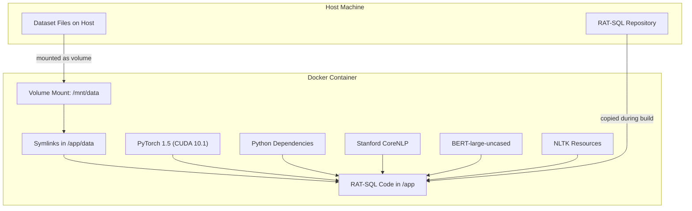

Sources: [Dockerfile:1-50]()

## Key Components in Docker Image

The Docker image includes several important components:

| Component | Description | Location in Container |
|-----------|-------------|----------------------|
| PyTorch | Deep learning framework (v1.5 with CUDA 10.1) | Base image |
| Python Dependencies | Required Python packages | Installed via pip |
| Stanford CoreNLP | NLP toolkit for preprocessing | `/app/third_party/stanford-corenlp-full-2018-10-05/` |
| BERT Model | Pre-trained BERT model | Cached in transformers directory |
| NLTK Resources | Stopwords and tokenization data | Downloaded during build |
| RAT-SQL Code | The codebase itself | `/app/` |
| Dataset Symlinks | Links to mounted datasets | `/app/data/spider` and `/app/data/wikisql` |

Sources: [Dockerfile:18-48]()

## Manual Setup (Alternative)

If you prefer not to use Docker, you can set up the environment manually:

1. **Install system dependencies**:
   - Python 3.7 or higher
   - JDK for Stanford CoreNLP
   - Git

2. **Clone the repository**:
   ```bash
   git clone https://github.com/microsoft/rat-sql.git
   cd rat-sql
   ```

3. **Install Python dependencies**:
   ```bash
   pip install -r requirements.txt
   pip install entmax
   python -c "import nltk; nltk.download('stopwords'); nltk.download('punkt')"
   ```

4. **Download Stanford CoreNLP**:
   ```bash
   mkdir -p third_party
   cd third_party
   curl https://download.cs.stanford.edu/nlp/software/stanford-corenlp-full-2018-10-05.zip | jar xv
   cd ..
   ```

5. **Cache BERT model** (optional, speeds up first run):
   ```bash
   python -c "from transformers import BertModel; BertModel.from_pretrained('bert-large-uncased-whole-word-masking')"
   ```

6. **Set up dataset symlinks**:
   ```bash
   mkdir -p data
   cd data
   ln -s /path/to/data/spider spider
   ln -s /path/to/data/wikisql wikisql
   cd ..
   ```

7. **Set up WikiSQL evaluation scripts**:
   ```bash
   mkdir -p third_party
   git clone https://github.com/salesforce/WikiSQL third_party/wikisql
   export PYTHONPATH="$PWD/third_party/wikisql/:$PYTHONPATH"
   ```

Sources: [Dockerfile:7-48](), [README.md:74-75]()

## Setup Process Workflow

The complete setup process follows this workflow:

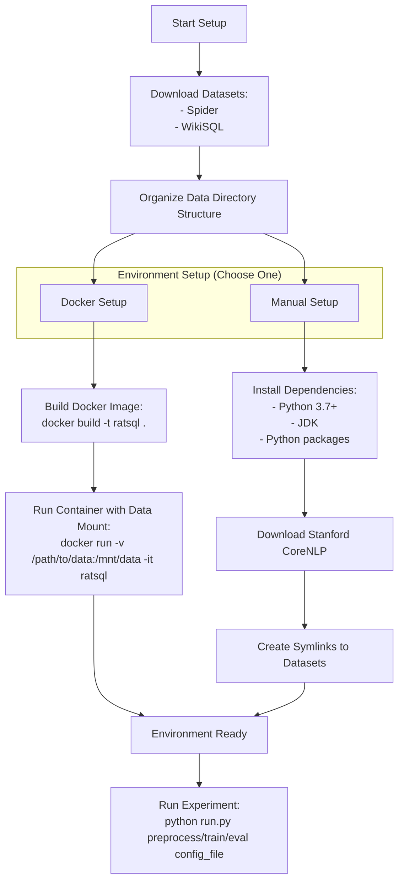

Sources: [README.md:26-93]()

## Verifying Installation

To verify that your installation is working properly, you can run a simple preprocessing step:

```bash
# Inside the Docker container or your manual setup environment
python run.py preprocess experiments/spider-glove-run.jsonnet
```

If successful, this will process the Spider dataset using GloVE embeddings and create preprocessed files in the specified output directory.

## Running Experiments

After completing the installation and setup, you can run experiments using the provided configurations:

```bash
# Preprocess the data
python run.py preprocess experiment_config_file

# Train a model
python run.py train experiment_config_file

# Evaluate results
python run.py eval experiment_config_file
```

Available experiment configurations:
- Spider with GloVE: `experiments/spider-glove-run.jsonnet`
- Spider with BERT: `experiments/spider-bert-run.jsonnet` (requires GPU with 16GB+ memory)
- WikiSQL with GloVE: `experiments/wikisql-glove-run.jsonnet`

For more details on the experiment running process, see [Training System](#5).

Sources: [README.md:80-94]()

## Troubleshooting

### Common Issues

1. **Insufficient Docker Memory**:
   - **Symptom**: Container crashes during preprocessing
   - **Solution**: Increase memory allocation to at least 4GB with `-m4g` flag or in Docker Desktop settings

2. **Dataset Mount Issues**:
   - **Symptom**: `FileNotFoundError` when running experiments
   - **Solution**: Verify the dataset paths and ensure the volume is correctly mounted in Docker

3. **CUDA Issues with BERT Model**:
   - **Symptom**: Out of memory errors when training BERT model
   - **Solution**: Ensure GPU has sufficient memory (16GB+) or use a smaller batch size in the configuration

### Requirements File

The requirements are specified in the repository's `requirements.txt` file, which is installed during the Docker build process. Key dependencies include:

- PyTorch
- Transformers (for BERT)
- AllenNLP
- TensorBoardX
- Jsonnet
- tqdm

Sources: [Dockerfile:18-22]()

---

# Page: System Architecture

# System Architecture

<details>
<summary>Relevant source files</summary>

The following files were used as context for generating this wiki page:

- [README.md](README.md)
- [ratsql/commands/train.py](ratsql/commands/train.py)
- [ratsql/models/spider/spider_enc.py](ratsql/models/spider/spider_enc.py)
- [run.py](run.py)

</details>


This document provides a comprehensive overview of the RAT-SQL system architecture. It covers the high-level structure of the codebase, its main components, and how they interact during the text-to-SQL translation process. For detailed information about the specific model architecture, refer to [Model Architecture](#4). For information about the command-line interface specifically, see [Command-Line Interface](#3.1).

## Overview

RAT-SQL (Relation-Aware Schema Encoding and Linking for Text-to-SQL Parsers) is a neural network-based system designed to translate natural language questions into SQL queries based on database schemas. The system follows a modular architecture with clear separation between preprocessing, training, inference, and evaluation components.

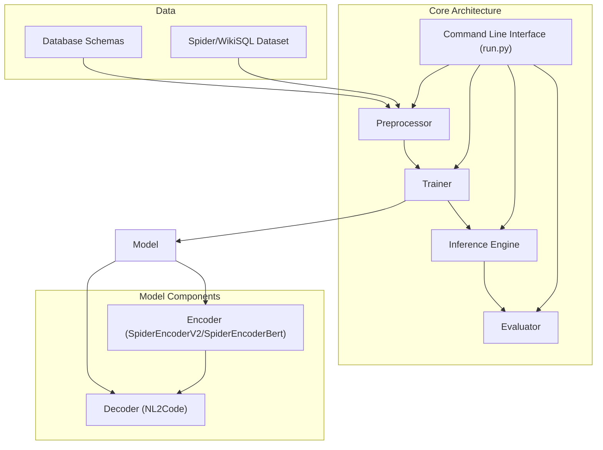

Sources: [run.py:1-109](), [README.md:1-109]()

## Key Components

The system is organized into several key components that work together to translate natural language questions into SQL queries:

### Command Line Interface

The command-line interface (`run.py`) serves as the main entry point to the system, providing a unified way to execute preprocessing, training, and evaluation operations.

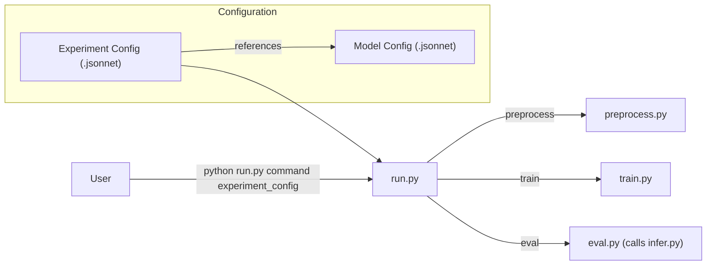

Sources: [run.py:1-109](), [README.md:79-93]()

### Encoder-Decoder Architecture

RAT-SQL follows an encoder-decoder architecture:

1. **Encoder**: Processes natural language questions and database schemas, creating a joint representation that captures the relationships between them.
2. **Decoder**: Generates SQL queries based on the encoded representation.

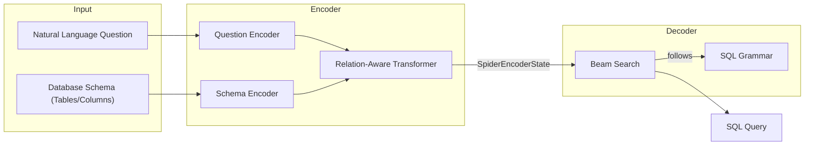

The system provides two encoder variants:
- **SpiderEncoderV2**: Uses GloVe embeddings for token representation
- **SpiderEncoderBert**: Uses BERT for token representation

Sources: [ratsql/models/spider/spider_enc.py:264-542](), [ratsql/models/spider/spider_enc.py:751-948]()

## Data Processing Pipeline

RAT-SQL's data processing pipeline transforms raw text questions and database schemas into model-ready inputs.

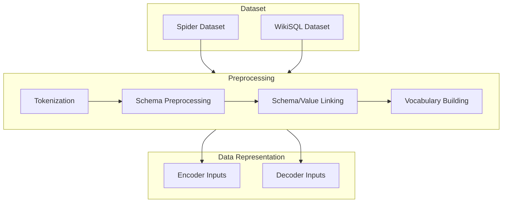

Key preprocessing steps include:
- Tokenization of questions and schema elements
- Schema preprocessing to capture table/column relationships
- Schema linking to identify connections between question tokens and schema elements
- Value linking to match question tokens with database values

Sources: [ratsql/models/spider/spider_enc.py:129-263](), [ratsql/models/spider/spider_enc.py:645-749]()

## Encoder State Representation

The encoder produces a structured state representation that captures the question and schema information along with their relationships.

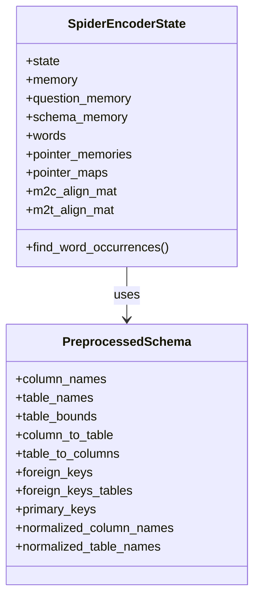

The `SpiderEncoderState` is a comprehensive representation that includes:
- Memory tensors for question and schema elements
- Alignment matrices between natural language and schema elements
- Pointer maps for efficient access to columns and tables

Sources: [ratsql/models/spider/spider_enc.py:23-39](), [ratsql/models/spider/spider_enc.py:41-55]()

## Training Process

RAT-SQL's training process orchestrates model training using a comprehensive workflow.

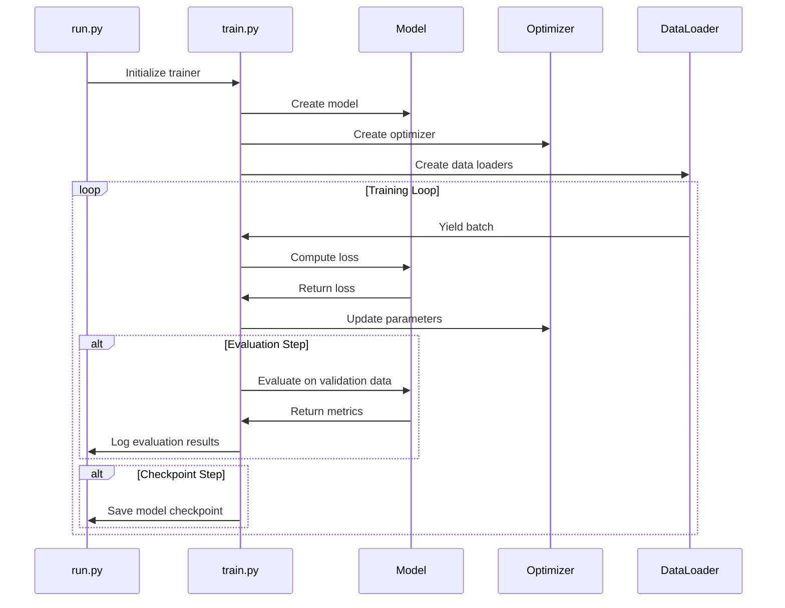

Key components of the training process:
- The `Trainer` class orchestrates the training loop
- Model training is driven by configuration parameters
- Periodic evaluation and checkpointing
- Support for various optimizers and learning rate schedulers

Sources: [ratsql/commands/train.py:78-244]()

## Configuration System

RAT-SQL uses a comprehensive configuration system based on JSONNET files to control all aspects of model training and evaluation.

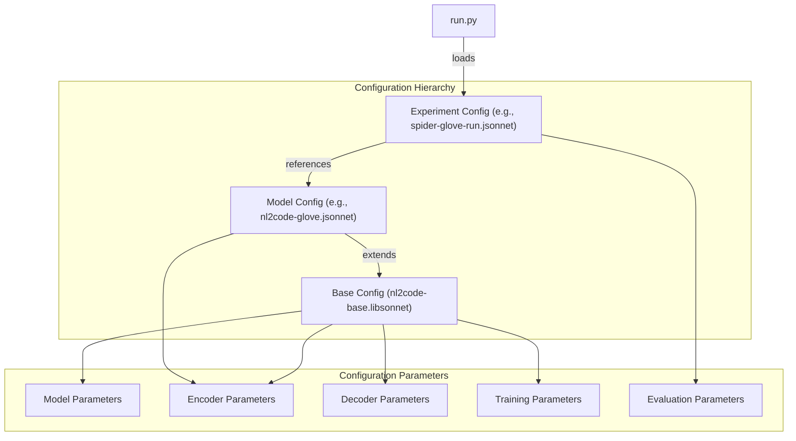

The configuration system provides:
- Hierarchical configuration through JSONNET inheritance
- Different configurations for different experiments
- Separation of model architecture and training parameters
- Runtime parameter overrides via command line

Sources: [run.py:48-106]()

## Class Relationships

This diagram shows key class relationships in the RAT-SQL system:

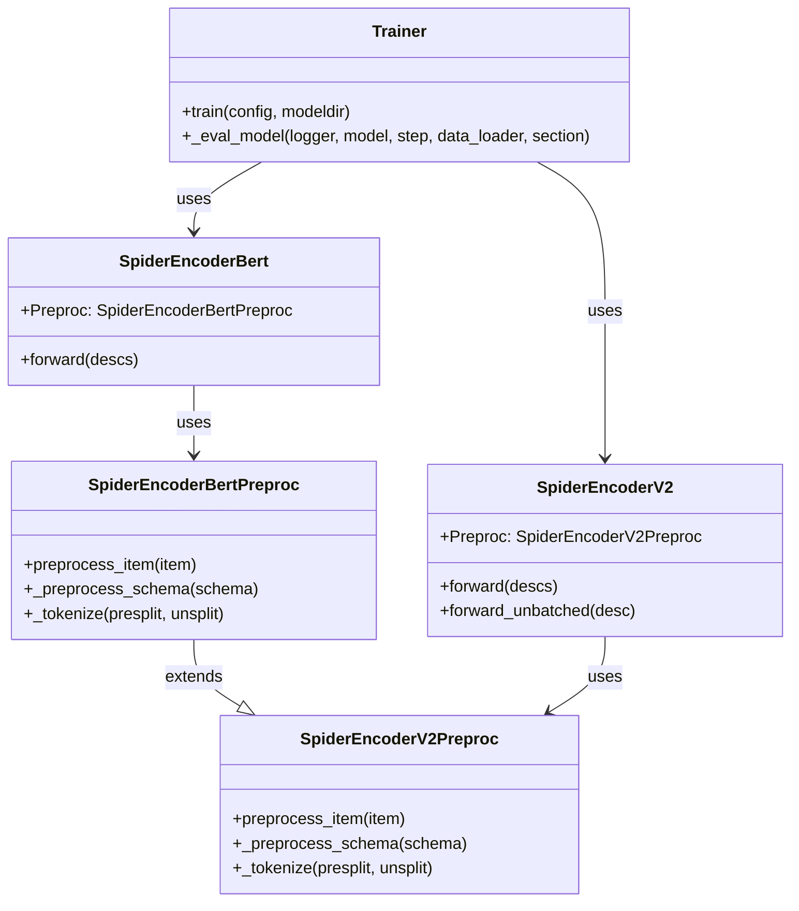

Sources: [ratsql/models/spider/spider_enc.py:129-263](), [ratsql/models/spider/spider_enc.py:264-542](), [ratsql/models/spider/spider_enc.py:645-749](), [ratsql/models/spider/spider_enc.py:751-948](), [ratsql/commands/train.py:78-244]()

## Docker Execution Environment

RAT-SQL operates within a containerized Docker environment to ensure consistent execution across different platforms.

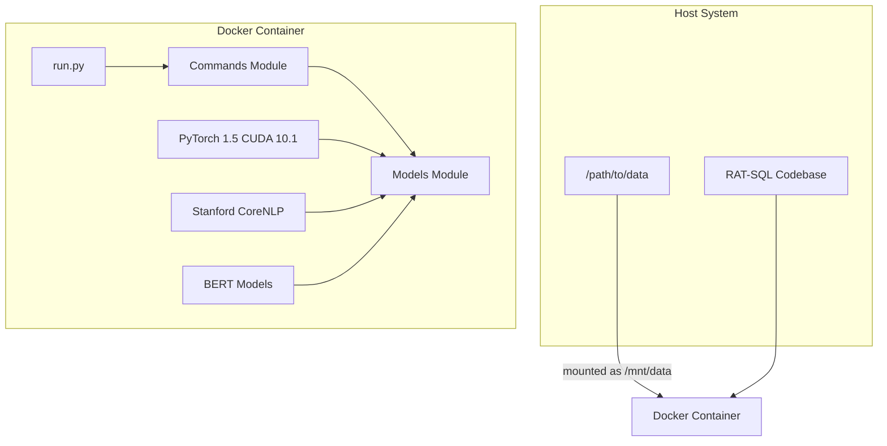

The Docker environment provides:
- All required dependencies (PyTorch, CoreNLP, BERT)
- Consistent execution environment
- Easy volume mounting for datasets
- GPU acceleration support

Sources: [README.md:55-76]()

## Execution Flow

This diagram illustrates the end-to-end execution flow for training and evaluating a model:

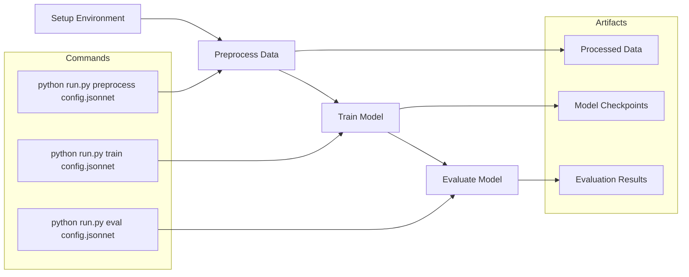

Sources: [README.md:79-93](), [run.py:48-106]()

## Summary

The RAT-SQL system architecture provides a flexible and modular approach to text-to-SQL translation. Key features include:

1. **Modular Design**: Clear separation between preprocessing, training, inference, and evaluation components
2. **Dual Encoder Support**: Support for both GloVe and BERT-based encoders
3. **Configuration-Driven**: Extensive use of JSONNET configuration files for experiment customization
4. **Relation-Aware Encoding**: Special handling of relationships between natural language and database schema elements
5. **Containerized Execution**: Docker-based execution environment for portability and reproducibility

This architecture enables RAT-SQL to achieve state-of-the-art performance on text-to-SQL translation tasks while maintaining flexibility for experimentation and extension.

---

# Page: Command-Line Interface

# Command-Line Interface

<details>
<summary>Relevant source files</summary>

The following files were used as context for generating this wiki page:

- [README.md](README.md)
- [run.py](run.py)

</details>


This page documents the command-line interface (CLI) of RAT-SQL, which serves as the primary entry point for interacting with the system. The CLI allows users to execute the three main pipeline stages: preprocessing data, training models, and evaluating trained models. Understanding the CLI is essential for effectively running experiments with RAT-SQL.

For information about the overall system architecture, see [System Architecture](#3).

## Overview

RAT-SQL's command-line interface is implemented in the `run.py` script, which parses arguments, loads configuration files, and dispatches commands to the appropriate modules. The CLI is designed around a three-stage workflow:

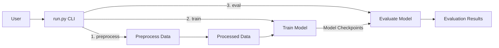

Sources: [run.py:1-109](), [README.md:80-86]()

## Command Line Syntax

The basic syntax for the RAT-SQL command-line interface is:

```
python run.py MODE EXPERIMENT_CONFIG_FILE [--model_config_args ARGS] [--logdir LOGDIR]
```

Where:
- `MODE` - One of: `preprocess`, `train`, or `eval`
- `EXPERIMENT_CONFIG_FILE` - Path to a JSONnet experiment configuration file
- `--model_config_args` (optional) - Overrides for model configuration arguments
- `--logdir` (optional) - Override for the log directory specified in the experiment config

Sources: [run.py:48-54]()

## Configuration System

The CLI uses a two-level configuration system:

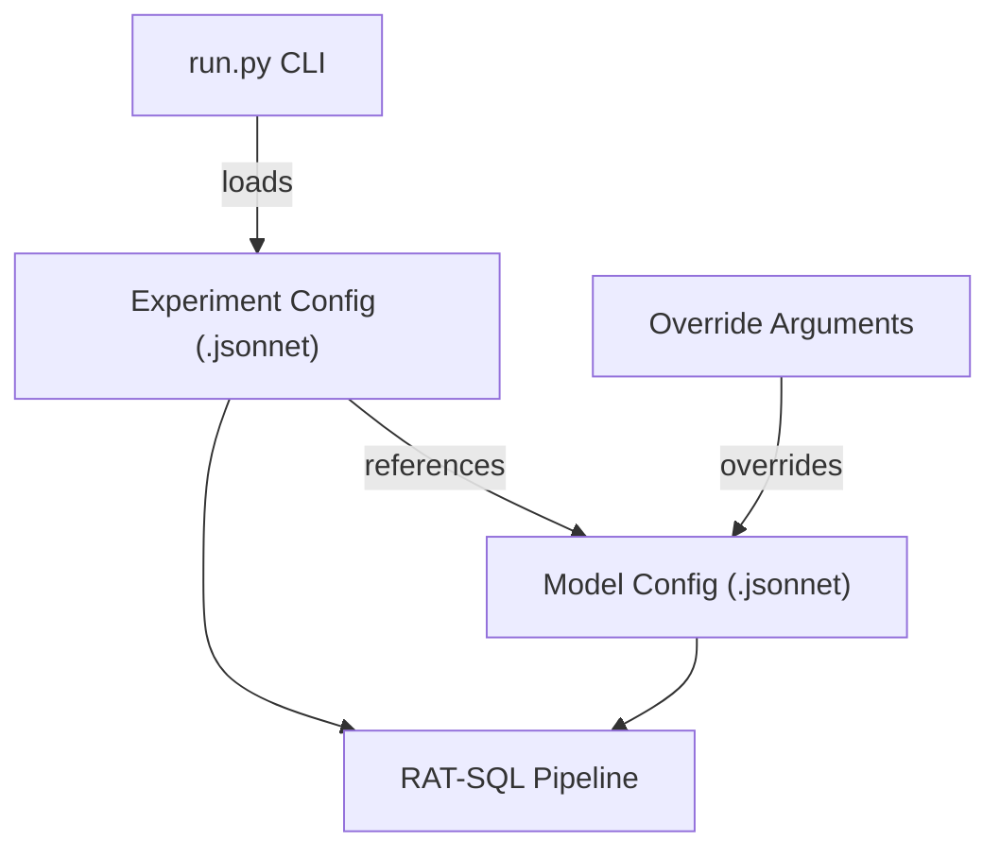

### Experiment Configuration
The experiment configuration files (e.g., `spider-glove-run.jsonnet`) define high-level execution parameters:
- Model configuration file path
- Model configuration arguments
- Log directory
- Evaluation parameters (section, beam size, output paths)

### Model Configuration
Model configuration files define the model architecture and hyperparameters, which are consumed by the specific modules during execution.

Sources: [run.py:56-69](), [README.md:88-92]()

## Main Commands

### Preprocess Command

```
python run.py preprocess EXPERIMENT_CONFIG_FILE
```

This command prepares the dataset for training by:
1. Loading the experiment configuration
2. Creating a `PreprocessConfig` object with model configuration details
3. Calling the preprocess module's main function

```mermaid
flowchart LR
    CLI["run.py preprocess"]
    JsonnetParser["JSONnet Parser"]
    ExpConfig["Experiment Config"]
    ModelConfig["Model Config"]
    PreprocessConfig["PreprocessConfig object"]
    PreprocessModule["preprocess.main()"]
    
    CLI --> JsonnetParser
    JsonnetParser --> ExpConfig
    ExpConfig --> |"loads"| ModelConfig
    CLI --> |"creates"| PreprocessConfig
    PreprocessConfig --> |"model_config_file\nmodel_config_args"| PreprocessModule
    PreprocessModule --> RawData["Raw Dataset"]
    PreprocessModule --> ProcessedData["Processed Dataset"]
```

Sources: [run.py:71-73]()

### Train Command

```
python run.py train EXPERIMENT_CONFIG_FILE
```

This command trains a model based on the processed data:
1. Loading the experiment configuration
2. Creating a `TrainConfig` object with model configuration details and log directory
3. Calling the train module's main function

```mermaid
flowchart LR
    CLI["run.py train"]
    JsonnetParser["JSONnet Parser"]
    ExpConfig["Experiment Config"]
    ModelConfig["Model Config"]
    TrainConfig["TrainConfig object"]
    TrainModule["train.main()"]
    
    CLI --> JsonnetParser
    JsonnetParser --> ExpConfig
    ExpConfig --> |"loads"| ModelConfig
    CLI --> |"creates"| TrainConfig
    TrainConfig --> |"model_config_file\nmodel_config_args\nlogdir"| TrainModule
    TrainModule --> ProcessedData["Processed Dataset"]
    TrainModule --> ModelCheckpoints["Model Checkpoints"]
```

Sources: [run.py:74-77]()

### Eval Command

```
python run.py eval EXPERIMENT_CONFIG_FILE
```

This command evaluates a trained model's performance:
1. Loading the experiment configuration
2. For each evaluation step specified in the config:
   a. Create an `InferConfig` object to generate SQL predictions
   b. Call the infer module's main function
   c. Create an `EvalConfig` object to evaluate the predictions
   d. Call the eval module's main function
   e. Output the exact match accuracy

```mermaid
flowchart TD
    CLI["run.py eval"]
    JsonnetParser["JSONnet Parser"]
    ExpConfig["Experiment Config"]
    ModelConfig["Model Config"]
    
    subgraph "For each evaluation step"
        InferConfig["InferConfig object"]
        InferModule["infer.main()"]
        EvalConfig["EvalConfig object"]
        EvalModule["eval.main()"]
    end
    
    CLI --> JsonnetParser
    JsonnetParser --> ExpConfig
    ExpConfig --> |"loads"| ModelConfig
    
    CLI --> InferConfig
    InferConfig --> |"model_config_file\nmodel_config_args\nlogdir\nsection\nbeam_size\noutput\nstep"| InferModule
    InferModule --> SqlPredictions["SQL Predictions"]
    
    CLI --> EvalConfig
    EvalConfig --> |"model_config_file\nmodel_config_args\nlogdir\nsection\ninferred\noutput"| EvalModule
    SqlPredictions --> EvalModule
    EvalModule --> EvalResults["Evaluation Results"]
    
    EvalResults --> |"exact match accuracy"| CLI
```

Sources: [run.py:78-105]()

## Configuration Objects

The CLI creates several configuration objects to pass parameters to the different modules:

| Configuration Class | Purpose | Fields |
|---------------------|---------|--------|
| `PreprocessConfig` | Configuration for preprocessing data | `config`, `config_args` |
| `TrainConfig` | Configuration for training models | `config`, `config_args`, `logdir` |
| `InferConfig` | Configuration for inference | `config`, `config_args`, `logdir`, `section`, `beam_size`, `output`, `step`, `use_heuristic`, `mode`, `limit`, `output_history` |
| `EvalConfig` | Configuration for evaluation | `config`, `config_args`, `logdir`, `section`, `inferred`, `output` |

Sources: [run.py:10-46]()

## Example Workflow

A typical RAT-SQL workflow involves running the three main commands in sequence:

```bash
# Step 1: Preprocess the data
python run.py preprocess experiments/spider-glove-run.jsonnet

# Step 2: Train a model
python run.py train experiments/spider-glove-run.jsonnet

# Step 3: Evaluate the results
python run.py eval experiments/spider-glove-run.jsonnet
```

The system provides several predefined experiment configurations:
- `experiments/spider-glove-run.jsonnet` - Spider dataset with GloVE embeddings
- `experiments/spider-bert-run.jsonnet` - Spider dataset with BERT embeddings
- `experiments/wikisql-glove-run.jsonnet` - WikiSQL dataset with GloVE embeddings

Sources: [README.md:80-94]()

## Integration with RAT-SQL Architecture

The CLI serves as the entry point that coordinates the execution of RAT-SQL's core components:

```mermaid
flowchart TD
    User["User"] --> CLI["run.py CLI"]
    
    subgraph "Command Modules"
        Preprocess["preprocess.py"]
        Train["train.py"]
        Infer["infer.py"]
        Eval["eval.py"]
    end
    
    subgraph "Model Architecture"
        SpiderEncoder["SpiderEncoder"]
        SpiderEncoderBert["SpiderEncoderBert"]
        Decoder["NL2CodeDecoder"]
    end
    
    subgraph "Data Processing"
        SpiderDataset["Spider Dataset"]
        WikiSQLDataset["WikiSQL Dataset"]
    end
    
    CLI --> |"preprocess command"| Preprocess
    CLI --> |"train command"| Train
    CLI --> |"eval command"| Infer
    CLI --> |"eval command"| Eval
    
    Preprocess --> SpiderDataset
    Preprocess --> WikiSQLDataset
    
    Train --> SpiderEncoder
    Train --> SpiderEncoderBert
    Train --> Decoder
    
    Infer --> SpiderEncoder
    Infer --> SpiderEncoderBert
    Infer --> Decoder
    
    SpiderDataset --> Preprocess
    WikiSQLDataset --> Preprocess
```

Sources: [run.py:8](), [README.md:88-92]()

## Command Execution Flow

The diagram below shows the detailed flow of command execution in the CLI:

```mermaid
sequenceDiagram
    participant User
    participant CLI as run.py
    participant JSONnet
    participant Modules as Command Modules
    participant Output as Results
    
    User->>CLI: python run.py [mode] [config_file]
    CLI->>JSONnet: Load and parse experiment config
    JSONnet-->>CLI: Experiment config object
    
    alt mode == "preprocess"
        CLI->>Modules: preprocess.main(PreprocessConfig)
        Modules-->>CLI: Preprocessing complete
    else mode == "train"
        CLI->>Modules: train.main(TrainConfig)
        Modules-->>CLI: Training complete
    else mode == "eval"
        loop for each eval_step
            CLI->>Modules: infer.main(InferConfig)
            Modules-->>CLI: Inference results
            CLI->>Modules: eval.main(EvalConfig)
            Modules-->>CLI: Evaluation results
            CLI->>Output: Print accuracy
        end
    end
    
    CLI-->>User: Command completed
```

Sources: [run.py:48-109]()

## Implementation Details

The CLI implementation in `run.py` consists of:

1. Configuration classes decorated with `@attr.s` to create data classes:
   - `PreprocessConfig`
   - `TrainConfig`
   - `InferConfig`
   - `EvalConfig`

2. A `main()` function that:
   - Sets up argument parsing with `argparse`
   - Loads experiment configuration with `_jsonnet`
   - Processes any configuration overrides
   - Dispatches to the appropriate command module based on the mode

The command modules (`preprocess`, `train`, `infer`, `eval`) are imported from the `ratsql.commands` package.

Sources: [run.py:1-109]()

## Common Usage Patterns

### Overriding Model Configuration

```bash
python run.py train experiments/spider-glove-run.jsonnet --model_config_args '{"train": {"batch_size": 16}}'
```

### Specifying a Custom Log Directory

```bash
python run.py train experiments/spider-glove-run.jsonnet --logdir ./custom_logs
```

Sources: [run.py:53-69]()

---

# Page: Model Architecture

# Model Architecture

<details>
<summary>Relevant source files</summary>

The following files were used as context for generating this wiki page:

- [README.md](README.md)
- [ratsql/models/spider/spider_enc.py](ratsql/models/spider/spider_enc.py)

</details>


This document provides a comprehensive explanation of the RAT-SQL model architecture, focusing on the encoder-decoder structure that powers the text-to-SQL translation process. The document covers the core model components, how they interact, and their implementation details.

For information about how the model is trained, see [Training System](#5). For dataset preprocessing, see [Preprocessing](#8).

## Overview

RAT-SQL uses a specialized encoder-decoder architecture designed specifically for text-to-SQL tasks. The model takes a natural language question and database schema as input and generates a SQL query that answers the question.

```mermaid
flowchart LR
    subgraph "Input"
        NLQ["Natural Language Question"]
        DBSchema["Database Schema"]
    end
    
    subgraph "Model Architecture"
        Encoder["SpiderEncoder"]
        Decoder["NL2Code Decoder"]
    end
    
    subgraph "Output"
        SQL["SQL Query"]
    end
    
    NLQ --> Encoder
    DBSchema --> Encoder
    Encoder --> |"SpiderEncoderState"| Decoder
    Decoder --> SQL
```

Sources: [ratsql/models/spider/spider_enc.py:23-38]()

## Encoder Architecture

The encoder is responsible for processing both the natural language question and the database schema. RAT-SQL implements two variants of encoders:

1. **SpiderEncoderV2**: Uses GloVe embeddings with BiLSTM networks
2. **SpiderEncoderBert**: Uses BERT embeddings with special tokenization and encoding

Both encoders output a `SpiderEncoderState` that contains the encoded representations needed by the decoder.

### SpiderEncoderState Structure

The `SpiderEncoderState` encapsulates the entire context needed for decoding:

```mermaid
classDiagram
    class SpiderEncoderState {
        state
        memory
        question_memory
        schema_memory
        words
        pointer_memories
        pointer_maps
        m2c_align_mat
        m2t_align_mat
    }
```

Sources: [ratsql/models/spider/spider_enc.py:23-38]()

### Encoder Components and Flow

The encoder uses separate sub-modules to process different parts of the input:

```mermaid
flowchart TD
    subgraph "Input Processing"
        NLQ["Natural Language Question"]
        Columns["Database Columns"]
        Tables["Database Tables"]
    end

    subgraph "Encoder Modules"
        QEnc["Question Encoder"]
        CEnc["Column Encoder"]
        TEnc["Table Encoder"]
        RelUpdate["Relational Transformer Update"]
    end

    subgraph "Encoded Output"
        QEncNew["Encoded Question"]
        CEncNew["Encoded Columns"]
        TEncNew["Encoded Tables"]
        Memory["Combined Memory"]
        EncoderState["SpiderEncoderState"]
    end

    NLQ --> QEnc
    Columns --> CEnc
    Tables --> TEnc
    
    QEnc --> |"q_enc"| RelUpdate
    CEnc --> |"c_enc"| RelUpdate
    TEnc --> |"t_enc"| RelUpdate
    
    RelUpdate --> QEncNew
    RelUpdate --> CEncNew
    RelUpdate --> TEncNew
    
    QEncNew --> Memory
    CEncNew --> Memory
    TEncNew --> Memory
    
    Memory --> EncoderState
    QEncNew --> EncoderState
    CEncNew --> EncoderState
    TEncNew --> EncoderState
```

Sources: [ratsql/models/spider/spider_enc.py:264-541]()

## SpiderEncoderV2 Implementation

The `SpiderEncoderV2` class is the primary encoder implementation that uses GloVe word embeddings:

```mermaid
classDiagram
    class SpiderEncoderV2 {
        +question_encoder
        +column_encoder
        +table_encoder
        +encs_update
        +forward()
        +forward_unbatched()
    }
```

The encoder processing pipeline consists of:

1. **Input Encoding**: Question, columns, and tables are encoded separately
2. **Relational Transformer**: Updates the encoded representations while considering relationships between them
3. **Memory Construction**: Combines the updated encodings into a unified memory representation

Sources: [ratsql/models/spider/spider_enc.py:264-541]()

### Question, Column, and Table Encoding

Each part of the input is processed through specialized modules. The encoder supports multiple encoding methods combined in sequence:

| Module Type | Description |
|-------------|-------------|
| emb | Word embedding lookup (GloVe) |
| bilstm | Bidirectional LSTM encoder |
| bilstm-summarize | BiLSTM with summarization |
| linear | Linear transformation of embeddings |

Sources: [ratsql/models/spider/spider_enc.py:318-356]()

## SpiderEncoderBert Implementation

For enhanced performance, RAT-SQL provides `SpiderEncoderBert`, which uses BERT embeddings instead of GloVe:

```mermaid
classDiagram
    class SpiderEncoderBert {
        +bert_model
        +tokenizer
        +encs_update
        +forward()
        -pad_sequence_for_bert_batch()
        -pad_single_sentence_for_bert()
    }
```

The BERT-based encoder:
1. Uses special tokenization for BERT
2. Handles the 512 token length limit of BERT
3. Processes schema elements and questions together to leverage BERT's contextualized embeddings

Sources: [ratsql/models/spider/spider_enc.py:751-1014]()

## Relational Transformer Update

A key innovation in RAT-SQL is the relational transformer that updates the encoded representations while accounting for relationships between different elements:

```mermaid
flowchart TD
    subgraph "Relational Transformer Input"
        QEnc["Question Encoding"]
        CEnc["Column Encoding"]
        TEnc["Table Encoding"]
    end
    
    subgraph "Schema Linking & Relations"
        SCLink["Schema-Question Links"]
        CVLink["Cell Value Links"]
        FKRel["Foreign Key Relations"]
        PKRel["Primary Key Relations"]
        C2T["Column-to-Table Relations"]
    end
    
    subgraph "Relational Transformer Output"
        QEncNew["Updated Question Encoding"]
        CEncNew["Updated Column Encoding"]
        TEncNew["Updated Table Encoding"]
    end
    
    QEnc --> RelTrans
    CEnc --> RelTrans
    TEnc --> RelTrans
    
    SCLink --> RelTrans
    CVLink --> RelTrans
    FKRel --> RelTrans
    PKRel --> RelTrans
    C2T --> RelTrans
    
    RelTrans["Relational Transformer Update"] --> QEncNew
    RelTrans --> CEncNew
    RelTrans --> TEncNew
```

Sources: [ratsql/models/spider/spider_enc.py:292-316]()

## NL2Code Decoder

The decoder in RAT-SQL is an NL2Code decoder that takes the encoder state and generates SQL queries. The decoder operates on the encoded representations to produce a sequence of SQL tokens.

```mermaid
flowchart LR
    subgraph "Decoder Input"
        EncState["SpiderEncoderState"]
    end
    
    subgraph "Decoder Modules"
        Attention["Attention Mechanism"]
        RNN["Decoder RNN"]
        PointerNet["Pointer Network"]
    end
    
    subgraph "Decoder Output"
        ActionSeq["Action Sequence"]
        SQL["SQL Query"]
    end
    
    EncState --> Attention
    Attention --> RNN
    RNN --> PointerNet
    
    PointerNet --> ActionSeq
    ActionSeq --> SQL
```

The decoder uses:
1. **Attention mechanism** over the encoded representations
2. **Pointer network** for copying schema elements directly
3. **Grammar-based action sequence** generation that ensures syntactically valid SQL

## Schema Linking and Representation

RAT-SQL employs schema linking to establish connections between natural language question tokens and database schema elements:

```mermaid
flowchart LR
    subgraph "Question"
        Q1["Token 1"]
        Q2["Token 2"]
        Q3["Token 3"]
    end
    
    subgraph "Schema Elements"
        C1["Column 1"]
        C2["Column 2"]
        T1["Table 1"]
    end
    
    subgraph "Linking Types"
        SC["Schema Linking"]
        CV["Cell Value Linking"]
    end
    
    Q1 --> |"matches"| C1
    Q2 --> |"matches"| T1
    Q3 --> |"value match"| C2
    
    SC --- Q1
    SC --- Q2
    CV --- Q3
```

Types of linking:
1. **Schema Linking (SC)**: Connects question tokens to schema elements
2. **Cell Value Linking (CV)**: Links question tokens to values in the database

Sources: [ratsql/models/spider/spider_enc.py:192-221]()

## End-to-End Information Flow

The following diagram illustrates the complete information flow from input to output:

```mermaid
flowchart TD
    NLQ["Natural Language Question"]
    DB["Database Schema"]
    
    QEmb["Question Embeddings"]
    CEmb["Column Embeddings"]
    TEmb["Table Embeddings"]
    
    QEnc["Encoded Question"]
    CEnc["Encoded Columns"]
    TEnc["Encoded Tables"]
    
    RelTrans["Relational Transformer"]
    
    EncState["SpiderEncoderState"]
    
    AttState["Attention State"]
    ActionGen["Action Generator"]
    PtrNet["Pointer Network"]
    
    SQLQuery["SQL Query"]
    
    NLQ --> QEmb
    DB --> CEmb
    DB --> TEmb
    
    QEmb --> QEnc
    CEmb --> CEnc
    TEmb --> TEnc
    
    QEnc --> RelTrans
    CEnc --> RelTrans
    TEnc --> RelTrans
    
    RelTrans --> EncState
    
    EncState --> AttState
    AttState --> ActionGen
    ActionGen --> PtrNet
    
    PtrNet --> SQLQuery
```

Sources: [ratsql/models/spider/spider_enc.py:358-428](), [ratsql/models/spider/spider_enc.py:798-947]()

## Preprocessing and Configuration

The encoders require preprocessing steps to convert raw inputs into the format expected by the model. This includes:

1. Tokenization of questions and schema elements
2. Schema linking computation
3. Cell value linking computation
4. Handling of special tokens and schema structure

The details of preprocessing are implemented in:
- `SpiderEncoderV2Preproc` for GloVe-based models
- `SpiderEncoderBertPreproc` for BERT-based models

Sources: [ratsql/models/spider/spider_enc.py:129-262](), [ratsql/models/spider/spider_enc.py:645-749]()

## Module Configuration

The model architecture is highly configurable through JSONnet configuration files. Key configuration options include:

| Configuration Parameter | Description |
|-------------------------|-------------|
| word_emb_size | Size of word embeddings |
| recurrent_size | Size of recurrent layers |
| question_encoder | List of modules for question encoding |
| column_encoder | List of modules for column encoding |
| table_encoder | List of modules for table encoding |
| update_config | Configuration for the relational transformer |
| include_in_memory | Which components to include in memory |
| bert_version | Which BERT model to use (for BERT-based encoder) |

Sources: [ratsql/models/spider/spider_enc.py:269-316](), [ratsql/models/spider/spider_enc.py:756-792]()

## Conclusion

The RAT-SQL model architecture is designed specifically for text-to-SQL tasks, with sophisticated components for processing both natural language questions and database schemas. The key innovations include:

1. Specialized encoders for questions and schema elements
2. Relational transformer for context-aware representations
3. Schema linking mechanisms for connecting language to database structures
4. Flexible configuration for different embedding types and model variants

This architecture enables RAT-SQL to achieve state-of-the-art performance on text-to-SQL benchmarks like Spider and WikiSQL.

---

# Page: Spider Encoder

# Spider Encoder

<details>
<summary>Relevant source files</summary>

The following files were used as context for generating this wiki page:

- [ratsql/models/spider/spider_enc.py](ratsql/models/spider/spider_enc.py)

</details>


The Spider Encoder is a critical component of RAT-SQL's architecture responsible for encoding both natural language questions and database schema elements into vector representations. These representations capture the semantic relationships between question elements and database schema components, enabling the SQL decoder to generate accurate SQL queries.

This page documents the Spider Encoder components, their architecture, and implementation details. For information about the SQL decoder that consumes the encoder output, see [NL2Code Decoder](#4.2).

## Overview

The Spider Encoder transforms natural language questions and database schemas into contextualized vector representations. Two main variants are implemented:

1. **SpiderEncoderV2**: Uses GloVe word embeddings as the foundation for encoding.
2. **SpiderEncoderBert**: Uses BERT-based embeddings for enhanced contextual understanding.

Both encoders share a similar high-level architecture but differ in their token handling and underlying embedding mechanisms.

```mermaid
flowchart TD
    subgraph "Input"
        NLQ["Natural Language Question"]
        DBS["Database Schema"]
        DBS --> Tables["Tables"]
        DBS --> Columns["Columns"]
    end

    subgraph "Spider Encoder"
        direction TB
        QEnc["Question Encoder"]
        CEnc["Column Encoder"]
        TEnc["Table Encoder"]
        
        RelTrans["Relational Transformer"]
        
        QEnc --> RelTrans
        CEnc --> RelTrans
        TEnc --> RelTrans
        
        RelTrans --> EncState["SpiderEncoderState"]
    end

    subgraph "Output to Decoder"
        EncState --> Memory["Memory for SQL Generation"]
        EncState --> PointerMaps["Pointer Maps"]
        EncState --> AlignMat["Alignment Matrices"]
    end

    NLQ --> QEnc
    Columns --> CEnc
    Tables --> TEnc
```

Sources: [ratsql/models/spider/spider_enc.py:23-38](), [ratsql/models/spider/spider_enc.py:264-541](), [ratsql/models/spider/spider_enc.py:751-1014]()

## Core Data Structures

### SpiderEncoderState

The `SpiderEncoderState` class maintains the output of the encoding process, serving as the interface between the encoder and decoder:

```mermaid
classDiagram
    class SpiderEncoderState {
        state
        memory
        question_memory
        schema_memory
        words
        pointer_memories
        pointer_maps
        m2c_align_mat
        m2t_align_mat
        find_word_occurrences()
    }
```

Key attributes:
- `memory`: Combined representation of all encoded elements
- `question_memory`: Encoded question representations
- `schema_memory`: Encoded schema (columns and tables) representations
- `pointer_memories`: Specific memories for pointing mechanisms
- `pointer_maps`: Mappings that allow the decoder to point to specific columns or tables
- `m2c_align_mat` and `m2t_align_mat`: Alignment matrices between memory and columns/tables

Sources: [ratsql/models/spider/spider_enc.py:23-38]()

### PreprocessedSchema

The `PreprocessedSchema` class stores the preprocessed database schema information:

```mermaid
classDiagram
    class PreprocessedSchema {
        column_names
        table_names
        table_bounds
        column_to_table
        table_to_columns
        foreign_keys
        foreign_keys_tables
        primary_keys
        normalized_column_names
        normalized_table_names
    }
```

This structure organizes schema elements into a format suitable for encoding, including normalization of names for schema linking.

Sources: [ratsql/models/spider/spider_enc.py:41-55]()

## Encoding Process

The encoding process consists of several stages:

1. **Preprocessing**: Transform raw questions and schema into tokenized formats
2. **Initial Encoding**: Encode questions, columns, and tables independently
3. **Relation-Aware Update**: Apply a relational transformer to capture interactions between elements
4. **Memory Construction**: Combine encodings into a unified memory representation

```mermaid
sequenceDiagram
    participant Input as Input Data
    participant Preproc as Preprocessor
    participant QEnc as Question Encoder
    participant CEnc as Column Encoder
    participant TEnc as Table Encoder
    participant RelTrans as Relational Transformer
    participant Output as SpiderEncoderState
    
    Input->>Preproc: Question & Schema
    Preproc->>QEnc: Tokenized Question
    Preproc->>CEnc: Tokenized Columns
    Preproc->>TEnc: Tokenized Tables
    
    QEnc->>RelTrans: Question Encodings
    CEnc->>RelTrans: Column Encodings
    TEnc->>RelTrans: Table Encodings
    
    RelTrans->>RelTrans: Self-Attention Update
    
    RelTrans->>Output: Updated Encodings
    Output->>Output: Construct Memory & Pointer Maps
```

Sources: [ratsql/models/spider/spider_enc.py:358-428](), [ratsql/models/spider/spider_enc.py:430-541](), [ratsql/models/spider/spider_enc.py:798-948]()

## SpiderEncoderV2

SpiderEncoderV2 uses GloVe embeddings and LSTM-based encoders to process the input data.

### Architecture

```mermaid
flowchart TB
    subgraph "SpiderEncoderV2 Components"
        direction LR
        Vocab["Vocabulary"]
        WordEmb["Word Embeddings"]
        LookupEmb["Lookup Embeddings Module"]
        BiLSTM["BiLSTM Module"]
        
        Vocab --> LookupEmb
        WordEmb --> LookupEmb
        LookupEmb --> BiLSTM
    end
    
    subgraph "Module Configuration"
        QEncModules["Question Encoder Modules"]
        CEncModules["Column Encoder Modules"]
        TEncModules["Table Encoder Modules"]
    end
    
    subgraph "Update Mechanism"
        RelTrans["Relational Transformer"]
    end
    
    QEncModules --> |configure| SpiderEncoderV2
    CEncModules --> |configure| SpiderEncoderV2
    TEncModules --> |configure| SpiderEncoderV2
    RelTrans --> |configure| SpiderEncoderV2
    
    Preprocessor["SpiderEncoderV2Preproc"] --> SpiderEncoderV2
    SpiderEncoderV2 --> Forward["forward() method"]
    Forward --> State["SpiderEncoderState"]
```

The encoder is constructed with flexible module configurations, supporting combinations of embedding layers and BiLSTM layers.

Sources: [ratsql/models/spider/spider_enc.py:264-356]()

### Preprocessing

The `SpiderEncoderV2Preproc` class handles:
- Tokenization of questions and schema elements
- Computation of schema linking between questions and schema
- Building vocabulary from training data
- Preprocessing and caching of database schemas

Key methods:
- `preprocess_item`: Processes a single item (question + schema)
- `_preprocess_schema`: Processes and caches database schemas
- `_tokenize`: Handles tokenization based on the configured word embeddings

Sources: [ratsql/models/spider/spider_enc.py:129-261]()

### Forward Pass

The forward pass processes a batch of inputs:
1. Encodes questions, columns, and tables independently
2. Creates pointer maps for referencing columns and tables
3. Updates encodings using the relational transformer
4. Constructs the final SpiderEncoderState

The encoder supports both batched and unbatched processing, with special handling for batched updates.

Sources: [ratsql/models/spider/spider_enc.py:358-428](), [ratsql/models/spider/spider_enc.py:430-541]()

## SpiderEncoderBert

SpiderEncoderBert leverages BERT's contextual embeddings for improved understanding of natural language and schema elements.

### Architecture

```mermaid
flowchart TB
    subgraph "SpiderEncoderBert Components"
        BertModel["BERT Model"]
        BertTokenizer["BERT Tokenizer"]
        
        BertTokenizer --> TokenProcessing["Token Processing"]
        BertModel --> Encoding["BERT Encoding"]
    end
    
    subgraph "Special Handling"
        SequencePadding["Sequence Padding"]
        TokenTyping["Token Type IDs"]
        AttentionMasks["Attention Masks"]
    end
    
    subgraph "Update Mechanism"
        RelTrans["Relational Transformer"]
    end
    
    Preprocessor["SpiderEncoderBertPreproc"] --> SpiderEncoderBert
    SequencePadding --> SpiderEncoderBert
    TokenTyping --> SpiderEncoderBert
    AttentionMasks --> SpiderEncoderBert
    RelTrans --> |configure| SpiderEncoderBert
    
    SpiderEncoderBert --> Forward["forward() method"]
    Forward --> State["SpiderEncoderState"]
```

The BERT-based encoder uses the BERT model to obtain contextualized embeddings, with specialized handling for schema elements.

Sources: [ratsql/models/spider/spider_enc.py:751-794]()

### Specialized Preprocessing

The `SpiderEncoderBertPreproc` class extends the base preprocessor with BERT-specific features:
- Uses BERT tokenizer for tokenization
- Adds special tokens for column types
- Handles sequence length limitations (maximum 512 tokens)
- Computes BERT-specific schema linking

The class includes `Bertokens` utility for handling BERT's wordpiece tokenization and maintaining alignment between original and tokenized text.

Sources: [ratsql/models/spider/spider_enc.py:544-642](), [ratsql/models/spider/spider_enc.py:645-748]()

### BERT-Specific Forward Pass

The forward pass in SpiderEncoderBert:
1. Prepares BERT input by concatenating question and schema tokens
2. Creates attention masks and token type IDs
3. Processes through the BERT model to get contextualized embeddings
4. Extracts representations for questions, columns, and tables
5. Updates these representations using the relational transformer
6. Constructs the final SpiderEncoderState

Special handling is included for:
- Padding sequences for batch processing
- Managing token types for segment embeddings
- Extracting representations for schema elements (using "first" or "avg" strategy)

Sources: [ratsql/models/spider/spider_enc.py:798-948](), [ratsql/models/spider/spider_enc.py:984-1014]()

## Schema Linking Mechanism

Schema linking is a crucial feature that helps connect natural language question elements to database schema components. This improves the model's ability to generate correct SQL queries.

### Schema Linking Process

```mermaid
flowchart LR
    subgraph "Schema Linking"
        NLQ["Question Tokens"]
        Schema["Schema Tokens"]
        
        ComputeLink["compute_schema_linking()"]
        
        NLQ --> ComputeLink
        Schema --> ComputeLink
        
        ComputeLink --> SCLink["Schema-Question Links"]
        SCLink --> |"q_col_match"| ColMatch["Column Matches"]
        SCLink --> |"q_tab_match"| TabMatch["Table Matches"]
    end
    
    subgraph "Cell Value Linking"
        NLQ2["Question Tokens"]
        DB["Database Content"]
        
        ComputeCV["compute_cell_value_linking()"]
        
        NLQ2 --> ComputeCV
        DB --> ComputeCV
        
        ComputeCV --> CVLink["Cell-Question Links"]
        CVLink --> |"num_date_match"| NumDateMatch["Number/Date Matches"]
        CVLink --> |"cell_match"| CellMatch["Cell Content Matches"]
    end
```

Schema linking computes matches between:
1. Question tokens and column names
2. Question tokens and table names
3. Question tokens and cell values (when enabled)

These links are then used by the relational transformer to better contextualize the relationship between question elements and schema components.

Sources: [ratsql/models/spider/spider_enc.py:193-206](), [ratsql/models/spider/spider_enc.py:612-627](), [ratsql/models/spider/spider_enc.py:629-642]()

## Integration with RAT-SQL

The Spider Encoder integrates with the broader RAT-SQL system as follows:

```mermaid
flowchart TB
    subgraph "RAT-SQL System"
        Preprocess["Preprocessing Pipeline"]
        
        subgraph "Training Process"
            Train["train.py"]
            Model["Model"]
            
            Train --> Model
        end
        
        subgraph "Spider Encoder Component"
            SEPreproc["Spider Encoder Preprocessor"]
            SEModel["Spider Encoder Model"]
            
            SEPreproc --> SEModel
        end
        
        subgraph "Decoder Component"
            Decoder["NL2Code Decoder"]
        end
        
        Preprocess --> SEPreproc
        SEModel --> EncoderState["SpiderEncoderState"]
        EncoderState --> Decoder
        Decoder --> SQL["SQL Generation"]
    end
```

The encoder is registered with the system's registry mechanism and is configured through experiment configuration files.

## Performance Considerations

- **SpiderEncoderV2**: Faster training and inference, but potentially less accurate for complex queries
- **SpiderEncoderBert**: Slower due to BERT's complexity, but provides better semantic understanding
- **Sequence Length**: BERT variant has a 512 token limit, requiring special handling for long sequences
- **Batching**: Both encoders support batched processing with appropriate padding and masking

## Conclusion

The Spider Encoder serves as the foundation for RAT-SQL's text-to-SQL capability by transforming natural language questions and database schemas into rich vector representations. The two variants (GloVe-based and BERT-based) offer different trade-offs between performance and accuracy, with the BERT variant typically achieving higher accuracy on complex queries at the cost of computational efficiency.

Understanding the Spider Encoder is crucial for developers who want to modify or extend RAT-SQL's capabilities, particularly for adapting to new domains or language features.

---

# Page: Schema Linking and Beam Search

# Schema Linking and Beam Search

<details>
<summary>Relevant source files</summary>

The following files were used as context for generating this wiki page:

- [ratsql/beam_search.py](ratsql/beam_search.py)
- [ratsql/models/spider/spider_enc.py](ratsql/models/spider/spider_enc.py)

</details>


## Purpose and Scope

This document explains two critical components in the RAT-SQL text-to-SQL system: Schema Linking and Beam Search. Schema Linking establishes connections between natural language questions and database schema elements (tables and columns), while Beam Search is used during SQL generation to efficiently explore the space of possible SQL queries. Together, these components significantly enhance the system's ability to accurately translate natural language questions to SQL queries.

For information about the overall model architecture, see [Model Architecture](#4), and for details specifically about the encoder architecture, see [Spider Encoder](#4.1).

## Schema Linking

### Overview

Schema linking is a preprocessing mechanism that identifies potential matches between tokens in the natural language question and elements in the database schema. This linking provides crucial information that helps the model decide which tables and columns to reference in the generated SQL query.

```mermaid
flowchart LR
    subgraph "Natural Language Space"
        Question["Natural Language Question"]
        Words["Tokenized Words"]
    end

    subgraph "Database Schema Space"
        Schema["Database Schema"]
        Tables["Table Names"]
        Columns["Column Names"]
        CellValues["Cell Values"]
    end

    subgraph "Linking Space"
        SCLink["Schema Linking (SC Link)"]
        CVLink["Cell Value Linking (CV Link)"]
    end

    Question --> Words
    Schema --> Tables
    Schema --> Columns
    Schema --> CellValues
    
    Words --> SCLink
    Tables --> SCLink
    Columns --> SCLink
    
    Words --> CVLink
    CellValues --> CVLink
    
    SCLink --> |"q_col_match"| ColumnMatches["Column Matches"]
    SCLink --> |"q_tab_match"| TableMatches["Table Matches"]
    CVLink --> |"num_date_match"| NumDateMatches["Number/Date Matches"]
    CVLink --> |"cell_match"| CellMatches["Cell Value Matches"]
```

Sources: [ratsql/models/spider/spider_enc.py:195-205]()

### Types of Schema Linking

RAT-SQL implements two types of schema linking:

1. **Schema Linking (SC Link)**: Links words in the natural language question to tables and columns in the database schema
   - `q_col_match`: Maps question tokens to column names
   - `q_tab_match`: Maps question tokens to table names

2. **Cell Value Linking (CV Link)**: Links words in the question to actual values in the database
   - `num_date_match`: Identifies numbers and dates in the question that match database values
   - `cell_match`: Maps question tokens to specific cell values in the database

### Implementation Details

The schema linking mechanism is implemented in the preprocessing stage and varies slightly between the standard encoder and the BERT-based encoder:

#### Standard Encoder (SpiderEncoderV2)

```mermaid
flowchart TD
    Question["Question Tokens"] --> |"compute_schema_linking()"| SCLink["Schema Linking"]
    ColumnNames["Column Names (without types)"] --> |"compute_schema_linking()"| SCLink
    TableNames["Table Names"] --> |"compute_schema_linking()"| SCLink
    
    Question --> |"compute_cell_value_linking()"| CVLink["Cell Value Linking"]
    Schema["Database Schema"] --> |"compute_cell_value_linking()"| CVLink
    
    SCLink --> Preprocessed["Preprocessed Item"]
    CVLink --> Preprocessed
    
    subgraph "SpiderEncoderV2Preproc.preprocess_item"
        SCLink
        CVLink
        Preprocessed
    end
```

Sources: [ratsql/models/spider/spider_enc.py:192-206]()

#### BERT-based Encoder (SpiderEncoderBert)

For the BERT-based encoder, an additional normalization step is performed to handle BERT's subword tokenization:

```mermaid
flowchart TD
    Question["BERT Question Tokens"] --> |"normalize_toks()"| NormalizedQ["Normalized Question Tokens"]
    Columns["BERT Column Tokens"] --> |"normalize_toks()"| NormalizedC["Normalized Column Tokens"]
    Tables["BERT Table Tokens"] --> |"normalize_toks()"| NormalizedT["Normalized Table Tokens"]
    
    NormalizedQ --> |"compute_schema_linking()"| SCLink["Schema Linking"]
    NormalizedC --> |"compute_schema_linking()"| SCLink
    NormalizedT --> |"compute_schema_linking()"| SCLink
    
    Question --> |"compute_cell_value_linking()"| CVLink["Cell Value Linking"]
    Schema["Database Schema"] --> |"compute_cell_value_linking()"| CVLink
    
    SCLink --> |"Map back to original tokens"| MappedSCLink["Mapped Schema Linking"]
    CVLink --> |"Map back to original tokens"| MappedCVLink["Mapped Cell Value Linking"]
    
    MappedSCLink --> Preprocessed["Preprocessed Item"]
    MappedCVLink --> Preprocessed
```

Sources: [ratsql/models/spider/spider_enc.py:611-642]()

### Schema Linking in Encoder Output

The computed schema linking information is stored in the encoder state and passed to the decoder:

```mermaid
flowchart LR
    subgraph "SpiderEncoderState"
        Memory["memory"]
        QuestionMemory["question_memory"]
        SchemaMemory["schema_memory"]
        PointerMaps["pointer_maps"]
        M2CAlign["m2c_align_mat (question-to-column)"]
        M2TAlign["m2t_align_mat (question-to-table)"]
    end
    
    SCLink["Schema Linking Results"] --> M2CAlign
    SCLink --> M2TAlign
    
    SpiderEncoderState --> Decoder["SQL Decoder"]
```

Sources: [ratsql/models/spider/spider_enc.py:523-540]()

## Beam Search

### Overview

Beam search is a heuristic search algorithm that explores a graph by expanding the most promising nodes in a limited set. In the context of RAT-SQL, beam search is used during the SQL generation process to efficiently explore the space of possible SQL queries.

```mermaid
flowchart TD
    Start["Begin Inference"] --> InitialHyp["Initial Hypothesis"]
    
    subgraph "Beam Search Loop"
        direction LR
        InitialHyp --> |"for each step"| ExpandHyps["Expand Current Hypotheses"]
        ExpandHyps --> ScoreExpansions["Score Expansions"]
        ScoreExpansions --> SelectTopK["Select Top-K Expansions"]
        SelectTopK --> CreateNewHyps["Create New Hypotheses"]
        CreateNewHyps --> |"Next step"| ExpandHyps
    end
    
    CreateNewHyps --> |"Complete hypotheses"| Finished["Finished Hypotheses"]
    Beam["Beam (active hypotheses)"] --> ExpandHyps
    CreateNewHyps --> Beam
    
    Finished --> |"Sort by score"| Result["Final SQL Query"]
```

Sources: [ratsql/beam_search.py:17-59]()

### Hypothesis Structure

Each hypothesis in the beam search represents a partial solution:

| Attribute | Description |
|-----------|-------------|
| `inference_state` | Current state of the inference process |
| `next_choices` | Possible next actions |
| `score` | Cumulative score of the hypothesis |
| `choice_history` | History of choices made |
| `score_history` | History of scores for each choice |

Sources: [ratsql/beam_search.py:7-14]()

### Beam Search Algorithm

The beam search algorithm maintains a list of active hypotheses (the "beam") and a list of finished hypotheses:

```mermaid
sequenceDiagram
    participant Model
    participant Beam as Active Beam
    participant Candidates
    participant Finished
    
    Model->>Beam: Initialize with start hypothesis
    
    loop For each step (max_steps)
        alt All beams finished
            Beam->>Finished: Exit loop
        end
        
        Beam->>Candidates: Expand each hypothesis with possible next choices
        Candidates->>Candidates: Score expansions
        Candidates->>Candidates: Sort by score
        Candidates->>Candidates: Select top-K candidates
        
        loop For each candidate
            Candidates->>Model: Step inference state with chosen action
            
            alt Next action is None (complete)
                Model->>Finished: Add complete hypothesis
            else More actions available
                Model->>Beam: Add to active beam
            end
        end
    end
    
    Finished->>Finished: Sort by final score
    Finished->>Model: Return best SQL queries
```

Sources: [ratsql/beam_search.py:17-59]()

## Integration of Schema Linking and Beam Search

### How Schema Linking Informs Beam Search

The schema linking information computed during preprocessing is used during the beam search process to guide the selection of tables and columns:

```mermaid
flowchart LR
    subgraph "Natural Language Question"
        NLQ["Question Text"]
    end
    
    subgraph "Encoder Processing"
        NLQ --> Tokenize["Tokenize"]
        Tokenize --> EncoderModel["SpiderEncoder/SpiderEncoderBert"]
        DBSchema["Database Schema"] --> SchemaPreproc["Preprocess Schema"]
        SchemaPreproc --> EncoderModel
        Tokenize --> |"compute_schema_linking()"| SchemaLinking["Schema Linking"]
        SchemaPreproc --> |"compute_schema_linking()"| SchemaLinking
        SchemaLinking --> EncoderModel
    end
    
    subgraph "Encoder Output"
        EncoderModel --> EncoderState["SpiderEncoderState"]
        EncoderState --> Memory["memory"]
        EncoderState --> PointerMaps["pointer_maps"]
        EncoderState --> AlignmentMatrices["m2c_align_mat, m2t_align_mat"]
    end
    
    subgraph "Decoder & Beam Search"
        EncoderState --> BeginInference["begin_inference()"]
        BeginInference --> BeamSearch["beam_search()"]
        BeamSearch --> ExpandHypothesis["Expand hypotheses"]
        ExpandHypothesis --> |"Schema-aware scoring"| ScoreExpansions["Score expansions"]
        ScoreExpansions --> SelectTopK["Select top-K"]
        SelectTopK --> NextStep["Next step"]
        NextStep --> |"Loop"| ExpandHypothesis
    end
    
    BeamSearch --> BestSQL["Best SQL Query"]
```

Sources: [ratsql/models/spider/spider_enc.py:358-428](), [ratsql/beam_search.py:17-59]()

### End-to-End Flow

The complete flow from natural language question to SQL query leverages both schema linking and beam search:

1. **Preprocessing**:
   - Tokenize the natural language question
   - Preprocess the database schema
   - Compute schema linking (SC link) and cell value linking (CV link)

2. **Encoding**:
   - Encode the question, columns, and tables
   - Update representations using schema linking information
   - Create the encoder state with alignment matrices

3. **Decoding with Beam Search**:
   - Initialize beam search with the encoder state
   - Generate SQL query incrementally, using schema linking to guide table/column selection
   - Score partial queries and keep the top-K at each step
   - Return the highest-scoring complete SQL query

## Performance Impact

The combination of schema linking and beam search significantly improves RAT-SQL's accuracy in translating natural language to SQL:

1. **Schema Linking Benefits**:
   - Helps resolve ambiguities in natural language questions
   - Identifies the most relevant tables and columns for the query
   - Provides strong signals for table/column selection even with limited training data

2. **Beam Search Benefits**:
   - Explores multiple possible SQL query structures in parallel
   - Allows the model to recover from local decision errors
   - Produces more reliable final queries than greedy decoding

Sources: [ratsql/models/spider/spider_enc.py:130-262](), [ratsql/beam_search.py:17-59]()

## Conclusion

Schema linking and beam search are two key components of RAT-SQL that work together to achieve high accuracy in text-to-SQL translation. Schema linking provides crucial connections between the natural language question and database schema, while beam search efficiently explores the space of possible SQL queries to find the most likely translation.

---

# Page: Training System

# Training System

<details>
<summary>Relevant source files</summary>

The following files were used as context for generating this wiki page:

- [ratsql/commands/train.py](ratsql/commands/train.py)
- [run.py](run.py)

</details>


This document explains the training system of RAT-SQL, focusing on how models are trained, evaluated, and persisted. The training system manages the entire process from model initialization through optimization and checkpointing. For information about model architecture, see [Model Architecture](#4), and for information about inference and evaluation, see [Inference and Evaluation](#7).

## Training System Overview

The RAT-SQL training system manages the complete training process for text-to-SQL models, coordinating optimization, periodic evaluation, checkpointing, and logging. Training is controlled through configuration files and is designed to support various model architectures.

```mermaid
flowchart TD
    subgraph "Training System Components"
        RunPy["run.py"]
        TrainPy["train.py"]
        
        RunPy -->|"initiates training"| TrainPy
        
        subgraph "Trainer Class"
            Init["Initialization\n- Model\n- Optimizer\n- DataLoaders"]
            TrainLoop["Training Loop\n- Compute Loss\n- Update Parameters"]
            Eval["Evaluation\n- Training Set\n- Validation Set"]
            Checkpoint["Checkpointing\n- Save Model\n- Save Optimizer"]
            
            Init --> TrainLoop
            TrainLoop --> Eval
            Eval --> Checkpoint
            Checkpoint -->|"next batch"| TrainLoop
        end
        
        TrainPy --> Init
        
        Logger["Logger\n- Console Output\n- Log File"]
        TrainLoop -->|"report metrics"| Logger
        Eval -->|"report stats"| Logger
    end
```

Sources: [run.py:74-77](), [ratsql/commands/train.py:78-214]()

## Configuration System

RAT-SQL training is controlled through a hierarchical configuration system. The experiment configuration file defines high-level parameters and references a model configuration file.

```mermaid
flowchart TD
    subgraph "Configuration Hierarchy"
        ExpConfig["Experiment Config\n(JSONNET File)"]
        ModelConfig["Model Config\n(JSONNET File)"]
        
        ExpConfig -->|"references"| ModelConfig
        
        subgraph "Train Configuration Parameters"
            TrainParams["TrainConfig class\n- eval_every_n\n- save_every_n\n- batch_size\n- max_steps\n- num_batch_accumulated\n- etc."]
        end
        
        ModelConfig -->|"includes"| TrainParams
        
        RunPy["run.py"]
        TrainPy["train.py"]
        Trainer["Trainer class"]
        
        ExpConfig -->|"parsed by"| RunPy
        RunPy -->|"calls"| TrainPy
        TrainPy -->|"instantiates"| Trainer
        TrainParams -->|"controls"| Trainer
    end
```

The `TrainConfig` class defines numerous parameters that control the training process:

| Parameter | Description | Default |
|-----------|-------------|---------|
| eval_every_n | Steps between evaluations | 100 |
| save_every_n | Steps between saving checkpoints | 100 |
| keep_every_n | Steps between keeping permanent checkpoints | 1000 |
| batch_size | Training batch size | 32 |
| max_steps | Maximum number of training steps | 100000 |
| data_seed | Seed for data shuffling RNG | None |
| init_seed | Seed for model initialization RNG | None |
| model_seed | Seed for model training RNG | None |
| num_batch_accumulated | Number of batches for gradient accumulation | 1 |
| clip_grad | Maximum gradient norm (None = no clipping) | None |

Sources: [ratsql/commands/train.py:31-54](), [run.py:16-20](), [run.py:49-69]()

## Training Workflow

The training process follows a specific sequence of operations, from initialization to final model saving.

```mermaid
sequenceDiagram
    participant RunPy as "run.py"
    participant TrainPy as "train.py"
    participant Trainer as "Trainer"
    participant Model as "Model"
    participant Optimizer as "Optimizer"
    participant DataLoader as "DataLoader"
    participant Saver as "Saver"
    participant Logger as "Logger"
    
    RunPy->>TrainPy: main(train_config)
    TrainPy->>Trainer: Initialize
    Trainer->>Model: Initialize model
    Trainer->>Trainer: Setup optimizer
    Trainer->>Saver: Initialize
    Trainer->>Saver: Restore checkpoint (if exists)
    Trainer->>DataLoader: Create data loaders
    
    loop Training Loop
        DataLoader->>Trainer: Next batch
        Trainer->>Model: compute_loss(batch)
        Model-->>Trainer: loss
        Trainer->>Optimizer: backward & step
        
        alt Every eval_every_n steps
            Trainer->>Model: eval_on_batch
            Model-->>Trainer: evaluation stats
            Trainer->>Logger: Report stats
        end
        
        alt Every save_every_n steps
            Trainer->>Saver: Save checkpoint
        end
        
        alt Reached max_steps
            Trainer->>Saver: Save final model
            Trainer-->>TrainPy: Return
        end
    end
```

Sources: [ratsql/commands/train.py:105-214](), [run.py:74-77]()

## Model Initialization and Data Loading

The Trainer initializes the model and data loaders with careful attention to random number generator (RNG) control for reproducibility.

```mermaid
flowchart TD
    subgraph "Initialization Process"
        TrainConstructor["Trainer.__init__"]
        
        TrainConstructor -->|"init_random context"| ModelPreproc["Model Preprocessor\nInitialization"]
        ModelPreproc -->|"loads data"| ModelConstruct["Model Construction"]
        
        TrainConstructor -->|"sets up"| RandomContexts["Random Contexts\n- data_random\n- model_random\n- init_random"]
        
        TrainMethod["Trainer.train"]
        TrainMethod -->|"init_random context"| OptimizerInit["Optimizer Initialization"]
        OptimizerInit -->|"constructs"| Optimizer["Optimizer\n(Standard or BertAdamW)"]
        
        TrainMethod -->|"data_random context"| DataLoaders["Create DataLoaders\n- train_data_loader\n- train_eval_data_loader\n- val_data_loader"]
    end
```

The training system provides special handling for BERT-based models with the `bertAdamw` optimizer, which uses different learning rates for BERT parameters and other model parameters.

Sources: [ratsql/commands/train.py:78-102](), [ratsql/commands/train.py:105-171]()

## Training Loop and Gradient Updates

The core training loop processes batches of data, computes loss, and updates model parameters.

```mermaid
flowchart TD
    subgraph "Training Loop"
        BatchGet["Get next batch"]
        
        subgraph "Gradient Computation"
            ModelRandom["model_random context"]
            ModelRandom -->|"controls"| LossCompute["model.compute_loss(batch)"]
            LossCompute --> Backward["norm_loss.backward()"]
        end
        
        GradClip["Gradient Clipping\n(if clip_grad is set)"]
        OptimizerStep["optimizer.step()"]
        LRUpdate["lr_scheduler.update_lr(step)"]
        ZeroGrad["optimizer.zero_grad()"]
        
        Report["Report metrics\n(if report_every_n)"]
        Eval["Evaluate model\n(if eval_every_n)"]
        Save["Save checkpoint\n(if save_every_n)"]
        
        BatchGet --> ModelRandom
        Backward --> GradClip
        GradClip --> OptimizerStep
        OptimizerStep --> LRUpdate
        LRUpdate --> ZeroGrad
        ZeroGrad --> Report
        Report --> Eval
        Eval --> Save
        Save --> |"next iteration"| BatchGet
    end
```

The training loop supports gradient accumulation through the `num_batch_accumulated` parameter, allowing effective batch sizes larger than what fits in GPU memory.

Sources: [ratsql/commands/train.py:174-214]()

## Evaluation During Training

The training system periodically evaluates the model on both training and validation data to track progress.

```mermaid
flowchart TD
    subgraph "Evaluation Process"
        EvalMethod["_eval_model method"]
        
        EvalMethod -->|"sets"| ModelEval["model.eval()"]
        ModelEval -->|"with torch.no_grad()"| BatchLoop["Loop through eval_batch"]
        
        BatchLoop -->|"for each batch"| EvalBatch["model.eval_on_batch(eval_batch)"]
        EvalBatch -->|"accumulate"| Stats["Aggregate Statistics"]
        
        Stats -->|"normalize by total"| Report["Report via Logger"]
        Report --> ModelTrain["model.train()"]
    end
```

Evaluation computes various metrics depending on the model, such as exact match accuracy, and logs these statistics for monitoring progress.

Sources: [ratsql/commands/train.py:222-243](), [ratsql/commands/train.py:180-187]()

## Checkpointing and Model Persistence

The training system uses a `Saver` to manage model checkpoints and support resuming training from interruptions.

```mermaid
flowchart TD
    subgraph "Checkpointing System"
        SaverInit["Saver Initialization\n{model, optimizer}"]
        
        SaverInit -->|"at start"| Restore["saver.restore\n(modeldir, map_location)"]
        Restore -->|"if pretrain config exists"| PretrainLoad["Load Pretrained Model"]
        
        subgraph "During Training"
            SaveInterval["Every save_every_n steps"]
            SaveInterval -->|"triggers"| SaveCheckpoint["saver.save(modeldir, step)"]
            
            KeepInterval["Every keep_every_n steps"]
            KeepInterval -->|"triggers"| PermanentSave["Keep Permanent Checkpoint"]
        end
        
        FinalStep["Training End"]
        FinalStep -->|"triggers"| FinalSave["Save Final Model"]
    end
```

The Saver manages:
1. Restoring previous training state
2. Loading pretrained models for fine-tuning
3. Regular checkpointing during training
4. Permanent checkpoints at specified intervals
5. Final model saving

Sources: [ratsql/commands/train.py:136-150](), [ratsql/commands/train.py:209-214]()

## Logging System

The Logger captures training progress, evaluation results, and configuration information.

```mermaid
flowchart TD
    subgraph "Logging System"
        LoggerInit["Logger Initialization\n(log_path, reopen_to_flush)"]
        
        LoggerInit -->|"creates"| LogFile["Log File\n(in logdir)"]
        
        ConfigLog["Save Configuration\n(JSON format)"]
        
        subgraph "During Training"
            LossLog["Loss Logging\n(every report_every_n steps)"]
            EvalLog["Evaluation Stats\n(every eval_every_n steps)"]
        end
        
        LogMethod["logger.log(msg)"]
        LogMethod -->|"writes to"| Console["Console Output"]
        LogMethod -->|"writes to"| LogFile
    end
```

The Logger timestamps all entries and can be configured to reopen the log file after each write to ensure outputs are flushed to disk (useful in distributed environments).

Sources: [ratsql/commands/train.py:57-75](), [ratsql/commands/train.py:255-277]()

## Training Entry Point and Command-Line Interface

The training system is primarily invoked through the main `run.py` script with the "train" command.

```mermaid
flowchart TD
    subgraph "Training Command Flow"
        RunPy["run.py"]
        RunPy -->|"parse arguments"| ArgsProcess["Process Arguments\n- exp_config_file\n- model_config_args\n- logdir"]
        
        ArgsProcess -->|"when mode=train"| TrainConfig["TrainConfig\n(model_config_file, model_config_args, logdir)"]
        TrainConfig -->|"passed to"| TrainMain["train.main()"]
        
        TrainMain -->|"creates"| Logger["Logger Instance"]
        TrainMain -->|"creates"| Trainer["Trainer Instance"]
        Trainer -->|"calls"| TrainMethod["trainer.train()"]
    end
```

Example usage:
```
python run.py train experiments/spider-glove-run.jsonnet
```

Sources: [run.py:48-77](), [ratsql/commands/train.py:246-282]()

## Integration with the Model Architecture

The training system is agnostic to the specific model architecture and interacts with models through a standard interface.

```mermaid
flowchart LR
    subgraph "Model Interface"
        ComputeLoss["compute_loss(batch)"]
        EvalOnBatch["eval_on_batch(batch)"]
        
        ComputeLoss -->|"used for"| TrainingUpdate["Parameter Updates"]
        EvalOnBatch -->|"used for"| Evaluation["Model Evaluation"]
    end
    
    subgraph "Encoder-Decoder Models"
        Encoder["Encoder\n(SpiderEncoderV2/SpiderEncoderBert)"]
        Decoder["Decoder\n(NL2Code)"]
        
        Encoder -->|"provides representations to"| Decoder
        Encoder -->|"implements"| ComputeLoss
        Decoder -->|"implements"| ComputeLoss
        Encoder -->|"implements"| EvalOnBatch
        Decoder -->|"implements"| EvalOnBatch
    end
```

Models must implement:
1. `compute_loss(batch)` - For training updates
2. `eval_on_batch(batch)` - For evaluation metrics

Sources: [ratsql/commands/train.py:99-102](), [ratsql/commands/train.py:193-195](), [ratsql/commands/train.py:228-229]()

## Training System Design Considerations

The RAT-SQL training system incorporates several important design considerations:

1. **Reproducibility**: Careful management of random seeds for initialization, data shuffling, and model training
2. **Resource Efficiency**: Gradient accumulation for effective larger batch sizes
3. **Monitoring**: Regular evaluation and metric reporting
4. **Persistence**: Flexible checkpointing system for resuming training
5. **Pre-training Support**: Ability to load pretrained models for fine-tuning
6. **BERT Integration**: Special handling for BERT-based models with separate learning rates

These design choices make the system robust for training complex text-to-SQL models on various datasets.

Sources: [ratsql/commands/train.py:86-89](), [ratsql/commands/train.py:115-134](), [ratsql/commands/train.py:191-202]()

---

# Page: Dataset Handling

# Dataset Handling

<details>
<summary>Relevant source files</summary>

The following files were used as context for generating this wiki page:

- [ratsql/datasets/__init__.py](ratsql/datasets/__init__.py)
- [ratsql/datasets/spider.py](ratsql/datasets/spider.py)

</details>


## Purpose and Scope

This document describes how RAT-SQL loads, processes, and manages datasets used for training and evaluating text-to-SQL models. It covers the data structures used to represent datasets, schema handling, database connections, and evaluation metrics. RAT-SQL primarily supports two datasets: Spider and WikiSQL. For specific implementation details about the Spider dataset, see [Spider Dataset](#6.1).

## Dataset Architecture Overview

### Dataset Handling Workflow

```mermaid
flowchart TD
    RawDataFiles["Raw Dataset Files (JSON)"] --> SchemaLoader["Schema Loader (load_tables)"]
    RawDataFiles --> DatasetLoader["Dataset Loader (SpiderDataset.__init__)"]
    
    SchemaLoader --> |"Creates"| SchemaObjects["Schema Objects (Tables, Columns)"]
    SchemaObjects --> DatasetLoader
    
    DBFiles["SQLite Database Files"] --> DBConnections["In-memory DB Connections"]
    DBConnections --> DatasetLoader
    
    DatasetLoader --> |"Creates"| DatasetInstance["Dataset Instance (SpiderDataset)"]
    
    DatasetInstance --> |"Provides data to"| ModelTraining["Model Training"]
    DatasetInstance --> |"Provides data to"| ModelEvaluation["Model Evaluation"]
    
    ModelEvaluation --> |"Uses"| Metrics["Evaluation Metrics (SpiderDataset.Metrics)"]
```

Sources: [ratsql/datasets/spider.py:126-169]()

## Data Structures

RAT-SQL uses a set of specialized classes to represent datasets and their elements. These structures provide an abstraction over the raw dataset files and make them more easily usable by the model.

### Core Data Classes

```mermaid
classDiagram
    class SpiderDataset {
        +List examples
        +Dict schemas
        +str db_path
        +Dict eval_foreign_key_maps
        +__init__(paths, tables_paths, db_path)
        +__getitem__(idx)
        +__len__()
    }
    
    class SpiderItem {
        +text
        +code
        +schema
        +orig
        +orig_schema
    }
    
    class Schema {
        +db_id
        +tables
        +columns
        +foreign_key_graph
        +orig
        +connection
    }
    
    class Table {
        +id
        +name
        +unsplit_name
        +orig_name
        +List columns
        +List primary_keys
    }
    
    class Column {
        +id
        +table
        +name
        +unsplit_name
        +orig_name
        +type
        +foreign_key_for
    }
    
    class Metrics {
        +dataset
        +foreign_key_maps
        +evaluator
        +results
        +add(item, inferred_code)
        +add_beams(item, inferred_codes)
        +finalize()
    }
    
    SpiderDataset --> "*" SpiderItem : contains
    SpiderDataset --> "*" Schema : contains
    SpiderItem --> "1" Schema : references
    Schema --> "*" Table : contains
    Schema --> "*" Column : contains
    Table --> "*" Column : contains
    Table --> "*" Column : primary_keys
    Column --> "0..1" Column : foreign_key_for
    SpiderDataset --> "1" Metrics : creates
```

Sources: [ratsql/datasets/spider.py:17-55](), [ratsql/datasets/spider.py:171-208]()

| Class | Purpose |
|-------|---------|
| `SpiderDataset` | Top-level dataset class that loads examples and schemas |
| `SpiderItem` | Represents a single example (question-SQL pair with schema) |
| `Schema` | Represents a database schema with tables and columns |
| `Table` | Represents a database table with columns and keys |
| `Column` | Represents a database column with type and relationship info |
| `Metrics` | Provides evaluation metrics for model predictions |

### Database Schema Representation

```mermaid
flowchart TD
    Schema["Schema (db_id: concerts)"] --> Table1["Table (id: 0, name: concerts)"]
    Schema --> Table2["Table (id: 1, name: artists)"]
    Schema --> Table3["Table (id: 2, name: stadiums)"]
    
    Table1 --> Column1["Column (id: 0, name: concert_id)"]
    Table1 --> Column2["Column (id: 1, name: artist_id)"]
    Table1 --> Column3["Column (id: 2, name: stadium_id)"]
    
    Table2 --> Column4["Column (id: 3, name: artist_id)"]
    Table2 --> Column5["Column (id: 4, name: name)"]
    
    Table3 --> Column6["Column (id: 5, name: stadium_id)"]
    Table3 --> Column7["Column (id: 6, name: location)"]
    
    Column2 -->|"foreign_key_for"| Column4
    Column3 -->|"foreign_key_for"| Column6
    
    FKGraph["Foreign Key Graph (nx.DiGraph)"] --> Edge1["Edge (Table1 → Table2)"]
    FKGraph --> Edge2["Edge (Table2 → Table1)"]
    FKGraph --> Edge3["Edge (Table1 → Table3)"]
    FKGraph --> Edge4["Edge (Table3 → Table1)"]
```

Sources: [ratsql/datasets/spider.py:47-54](), [ratsql/datasets/spider.py:61-123]()

## Dataset Loading Process

The dataset loading process consists of two main phases:

1. **Schema Loading**: Processing database schema definitions 
2. **Example Loading**: Loading the actual dataset examples (questions and SQL queries)

### Schema Loading

The `load_tables` function handles loading database schemas:

1. Reads schema definitions from JSON files
2. Creates `Table` and `Column` objects for each database element
3. Links columns to their respective tables
4. Sets up primary key information
5. Builds a graph of foreign key relationships using NetworkX
6. Returns a dictionary of schemas indexed by database ID

Source: [ratsql/datasets/spider.py:61-123]()

### Example Loading

The `SpiderDataset.__init__` method handles loading examples:

1. Calls `load_tables` to get schema information
2. Loads example data from JSON files
3. Creates `SpiderItem` instances for each example
4. Creates in-memory SQLite database connections

Source: [ratsql/datasets/spider.py:128-157]()

## From Natural Language to Database Query

```mermaid
flowchart LR
    NLQuestion["Natural Language Question"] --> SpiderItem["SpiderItem"]
    NLQuestion --> |"tokenized to"| QuestionTokens["Question Tokens (text field)"]
    QuestionTokens --> SpiderItem
    
    DBSchema["Database Schema Definition"] --> |"processed to"| SchemaObj["Schema Object"]
    SchemaObj --> SpiderItem
    
    SQLQuery["SQL Query"] --> |"stored as"| CodeField["code field"]
    CodeField --> SpiderItem
    
    DBConnection["SQLite Database Connection"] --> SchemaObj
    
    SpiderItem --> |"input to"| Encoder["Encoder"]
    SchemaObj --> |"provides schema info to"| Encoder
    
    Encoder --> |"encoded state"| Decoder["Decoder"]
    Decoder --> |"generates"| PredictedSQL["Predicted SQL"]
    
    PredictedSQL --> |"evaluated against"| CodeField
    PredictedSQL --> |"executed on"| DBConnection
```

Sources: [ratsql/datasets/spider.py:17-23](), [ratsql/datasets/spider.py:137-144]()

## Evaluation Metrics

The `SpiderDataset.Metrics` class provides functionality for evaluating model predictions:

1. Initializes an evaluator with database paths and foreign key maps
2. Adds evaluation results for individual predictions
3. Supports beam search evaluation (testing multiple predictions per question)
4. Generates final evaluation results with both per-item metrics and overall scores

Key methods include:
- `add`: Evaluates a single prediction against ground truth
- `add_beams`: Evaluates multiple predictions (beam search results)
- `finalize`: Computes final evaluation results

Source: [ratsql/datasets/spider.py:171-208]()

## Database Connections

RAT-SQL creates in-memory copies of SQLite databases for each database schema:

1. Connects to the on-disk SQLite database
2. Creates an in-memory copy using the `backup` method
3. Stores the connection in the `Schema.connection` field
4. Closes connections when the dataset is deleted

This approach provides efficient access to the databases during training and evaluation.

Sources: [ratsql/datasets/spider.py:149-157](), [ratsql/datasets/spider.py:166-169]()

## Supported Datasets

RAT-SQL supports two main datasets:

| Dataset | Module | Description |
|---------|--------|-------------|
| Spider | `spider.py` | A complex and cross-domain text-to-SQL benchmark |
| WikiSQL | `wikisql.py` | A large-scale dataset of questions and SQL queries |

The dataset modules are registered with the system using the `@registry.register('dataset', 'name')` decorator, allowing them to be referenced in configuration files.

Sources: [ratsql/datasets/__init__.py:1-2](), [ratsql/datasets/spider.py:126]()

## Name Processing

RAT-SQL processes table and column names to make them more suitable for natural language processing:

1. Original names are preserved in `orig_name` fields
2. Names are split into tokens (e.g., "customerID" becomes ["customer", "ID"])
3. Both the split and unsplit versions are stored
4. The `postprocess_original_name` function handles things like camelCase conversion

This processing helps with schema linking between natural language questions and database elements.

Source: [ratsql/datasets/spider.py:57-58]()

---

# Page: Spider Dataset

# Spider Dataset

<details>
<summary>Relevant source files</summary>

The following files were used as context for generating this wiki page:

- [ratsql/datasets/spider.py](ratsql/datasets/spider.py)
- [ratsql/datasets/spider_lib/README.md](ratsql/datasets/spider_lib/README.md)
- [ratsql/datasets/spider_lib/__init__.py](ratsql/datasets/spider_lib/__init__.py)
- [ratsql/datasets/spider_lib/evaluation.py](ratsql/datasets/spider_lib/evaluation.py)

</details>


## Purpose and Scope

This document provides technical documentation for the Spider dataset implementation in RAT-SQL. It covers the data structures, loading process, and evaluation metrics used when working with this dataset. For information about other dataset implementations like WikiSQL, see [Dataset Handling](#6).

The Spider dataset is a large-scale, complex, and cross-domain text-to-SQL dataset used for training and evaluating the RAT-SQL model's ability to generate SQL queries from natural language questions.

Sources: [ratsql/datasets/spider.py:1-209]()

## Data Structures

The Spider dataset implementation defines several key data structures to represent database elements and questions:

```mermaid
classDiagram
    class SpiderItem {
        text: List[str]
        code: Dict
        schema: Schema
        orig: Dict
        orig_schema: Dict
    }
    
    class Schema {
        db_id: str
        tables: List[Table]
        columns: List[Column]
        foreign_key_graph: DiGraph
        orig: Dict
        connection: sqlite3.Connection
    }
    
    class Table {
        id: int
        name: List[str]
        unsplit_name: str
        orig_name: str
        columns: List[Column]
        primary_keys: List[Column]
    }
    
    class Column {
        id: int
        table: Table
        name: List[str] 
        unsplit_name: str
        orig_name: str
        type: str
        foreign_key_for: Column
    }
    
    SpiderItem --> Schema
    Schema --> Table
    Schema --> Column
    Table --> Column
```

### Data Structure Description

- **SpiderItem**: Represents a single dataset example with:
  - `text`: Tokenized natural language question
  - `code`: The gold SQL query in dictionary representation
  - `schema`: Database schema associated with this question
  - `orig`: Original dataset entry
  - `orig_schema`: Original schema representation

- **Schema**: Represents a database schema with:
  - `db_id`: Database identifier
  - `tables`: List of tables in the database
  - `columns`: List of all columns across all tables
  - `foreign_key_graph`: NetworkX graph for foreign key relationships
  - `connection`: In-memory SQLite database connection

- **Table**: Represents a database table with:
  - `id`: Table identifier
  - `name`: Tokenized table name
  - `columns`: List of columns in the table
  - `primary_keys`: List of primary key columns

- **Column**: Represents a database column with:
  - `id`: Column identifier
  - `table`: Reference to the parent table
  - `name`: Tokenized column name
  - `type`: Data type of the column
  - `foreign_key_for`: Reference to foreign key column if applicable

Sources: [ratsql/datasets/spider.py:17-54]()

## Dataset Loading Process

The Spider dataset is loaded through a multi-stage process:

```mermaid
flowchart TD
    A["Initialize SpiderDataset"] --> B["Load Tables/Schemas"]
    B --> C["Load Examples"]
    C --> D["Create In-Memory DB Connections"]
    
    subgraph "Tables Loading"
        B1["Parse Schema JSON Files"] --> B2["Create Table Objects"]
        B2 --> B3["Create Column Objects"]
        B3 --> B4["Link Columns to Tables"]
        B4 --> B5["Register Primary Keys"]
        B5 --> B6["Build Foreign Key Graphs"]
    end
    
    subgraph "Example Loading"
        C1["Load JSON Examples"] --> C2["Create SpiderItem Objects"]
        C2 --> C3["Link Examples to Schemas"]
    end
    
    subgraph "In-Memory DB Setup"
        D1["For Each Schema"] --> D2["Open SQLite Connection"]
        D2 --> D3["Copy DB to Memory"]
        D3 --> D4["Store Connection in Schema"]
    end
    
    B --> B1
    C --> C1
    D --> D1
```

The dataset loading process involves:

1. **Schema and Table Loading**:
   - Parse database schema files to create a structured representation of tables, columns, and relationships
   - Build foreign key graphs to represent relationships between tables
   - Create mapping dictionaries for evaluation purposes

2. **Example Loading**:
   - Load example JSON files containing natural language questions and SQL queries
   - Create SpiderItem objects that link questions to their associated database schemas

3. **In-Memory Database Setup**:
   - Create in-memory copies of all SQLite databases for efficient access during training and evaluation
   - Connections are maintained for the lifetime of the dataset object

Sources: [ratsql/datasets/spider.py:61-157]()

## Schema Processing and Relationship Handling

The Spider dataset implementation handles database relationships through a graph-based representation:

```mermaid
flowchart LR
    subgraph "Foreign Key Graph Construction"
        FK1["Parse Foreign Keys"] --> FK2["Create NetworkX DiGraph"]
        FK2 --> FK3["Add Bidirectional Edges"]
        FK3 --> FK4["Store Column IDs on Edges"]
    end
    
    subgraph "Example"
        T1["Table: Student"] --- C1["Column: student_id (PK)"]
        T2["Table: Course"] --- C2["Column: course_id (PK)"]
        T3["Table: Enrollment"] --- C3["Column: student_id (FK)"]
        T3 --- C4["Column: course_id (FK)"]
        
        C3 -..-> C1
        C4 -..-> C2
    end
```

Key aspects of schema processing include:

1. **Foreign Key Handling**:
   - Foreign key relationships are represented as a bidirectional graph
   - Each edge contains the source and destination column IDs
   - This graph facilitates traversal of the schema during encoding

2. **Name Processing**:
   - Table and column names are tokenized and normalized
   - Original names are preserved for evaluation purposes
   - The `postprocess_original_name` function (line 57) handles formatting of names

3. **Schema Generation**:
   - The schema for each database is loaded once and shared across all examples
   - Primary key and foreign key information is extracted and stored explicitly

Sources: [ratsql/datasets/spider.py:61-123](), [ratsql/datasets/spider_lib/evaluation.py:817-863]()

## Evaluation System

The Spider Dataset provides a comprehensive evaluation system through its `Metrics` inner class:

```mermaid
flowchart TD
    E1["Initialize Metrics"] --> E2["Build Foreign Key Maps"]
    E2 --> E3["Create Evaluator"]
    
    E4["Add Prediction"] --> E5["Evaluate Single Prediction"]
    E4 --> E6["Add Beam Predictions"]
    
    E7["Finalize Results"] --> E8["Return Scores"]
    
    subgraph "Evaluation Components"
        EC1["Exact Match"]
        EC2["Component Matching"]
        EC3["Execution Accuracy"]
        
        EC2 --> EC21["SELECT Clauses"]
        EC2 --> EC22["WHERE Clauses"]
        EC2 --> EC23["GROUP BY Clauses"]
        EC2 --> EC24["ORDER BY Clauses"]
        EC2 --> EC25["JOIN Operations"]
    end
```

The evaluation system measures:

1. **Exact Match Accuracy**:
   - Determines if the predicted SQL query exactly matches the gold query structure
   - Takes into account table selections, conditions, and operations

2. **Component-wise Matching**:
   - Evaluates individual SQL components (SELECT, WHERE, GROUP BY, etc.)
   - Calculates precision, recall, and F1 score for each component

3. **Execution Accuracy** (optional):
   - Executes both the predicted and gold queries against the database
   - Compares the result sets to determine functional equivalence

4. **Difficulty Classification**:
   - Queries are classified as easy, medium, hard, or extra based on their complexity
   - Scores are calculated per difficulty level

The evaluation results include per-item scores as well as aggregated metrics.

Sources: [ratsql/datasets/spider.py:171-208](), [ratsql/datasets/spider_lib/evaluation.py:359-563]()

## Integration with RAT-SQL System

The Spider dataset integrates with the RAT-SQL system through the PyTorch Dataset interface:

```mermaid
flowchart LR
    subgraph "Dataset Registration"
        DR1["@registry.register"] --> DR2["SpiderDataset Class"]
    end
    
    subgraph "Training Pipeline"
        TP1["Data Loading"] --> TP2["Model Training"]
        TP2 --> TP3["Evaluation"]
    end
    
    subgraph "Inference"
        I1["Load Dataset"] --> I2["Get Schema"]
        I2 --> I3["Generate SQL"]
        I3 --> I4["Evaluate Results"]
    end
    
    DR2 -.-> TP1
    DR2 -.-> I1
```

Key integration points:

1. **Dataset Registration**:
   - The `@registry.register('dataset', 'spider')` decorator registers the dataset with RAT-SQL's registry system
   - This allows the dataset to be dynamically loaded based on configuration

2. **Training Integration**:
   - The dataset implements PyTorch's Dataset interface with `__len__` and `__getitem__` methods
   - This enables seamless integration with PyTorch's DataLoader for batch processing

3. **Evaluation Pipeline**:
   - The `Metrics` class provides evaluation functionality that integrates with the training and evaluation loops
   - Supports both single prediction evaluation and beam search results evaluation

4. **Database Connection Management**:
   - The class implements `__del__` to properly close database connections when the dataset is no longer needed

Sources: [ratsql/datasets/spider.py:126-169]()

## Spider Dataset Format

The Spider dataset consists of several key file components:

| Component | Description | Format |
|-----------|-------------|--------|
| Questions | Natural language questions paired with SQL | JSON |
| Database Schemas | Table and column definitions | JSON |
| SQLite Databases | Actual databases to execute queries against | SQLite files |
| Tables Data | Contents of the database tables | Various formats |

A typical Spider dataset example looks like:

```json
{
  "question_toks": ["List", "the", "names", "of", "singers", "who", "have", "more", "than", "3", "albums"],
  "query": "SELECT name FROM singer WHERE num_of_albums > 3",
  "db_id": "music_store",
  "sql": {
    "select": [false, [[0, [0, [0, 2, false], null]]]],
    "from": {"table_units": [[0, "singer"]], "conds": []},
    "where": [[false, 3, [0, [0, 6, false], null], "3", null]],
    "groupBy": [],
    "having": [],
    "orderBy": [],
    "limit": null,
    "intersect": null,
    "union": null,
    "except": null
  }
}
```

The evaluation system assesses model performance across different query complexity levels:

| Complexity | Description | Example |
|------------|-------------|---------|
| Easy | Simple queries with single conditions | SELECT name FROM students WHERE age > 20 |
| Medium | Queries with 2-3 conditions or basic joins | SELECT s.name FROM students s JOIN classes c ON s.id = c.student_id WHERE s.age > 20 |
| Hard | Multiple joins, aggregations, nested queries | SELECT dept_name, AVG(salary) FROM instructor GROUP BY dept_name HAVING AVG(salary) > 50000 |
| Extra | Very complex queries with multiple operations | SELECT * FROM instructor WHERE salary > (SELECT AVG(salary) FROM instructor) |

Sources: [ratsql/datasets/spider_lib/evaluation.py:49-54](), [ratsql/datasets/spider.py:135-144]()

## Resource Management

The Spider dataset implementation includes careful management of database connections:

1. **Connection Creation**:
   - SQLite databases are loaded from disk and copied to memory
   - In-memory connections provide faster access during model training and evaluation

2. **Connection Cleanup**:
   - The `__del__` method ensures proper cleanup of database connections
   - This prevents resource leaks when the dataset is no longer needed

3. **Memory Efficiency**:
   - Database schemas are loaded once and shared across all examples
   - This reduces memory overhead for datasets with many examples from the same database

Sources: [ratsql/datasets/spider.py:149-169]()

---

# Page: Inference and Evaluation

# Inference and Evaluation

<details>
<summary>Relevant source files</summary>

The following files were used as context for generating this wiki page:

- [ratsql/beam_search.py](ratsql/beam_search.py)
- [ratsql/commands/eval.py](ratsql/commands/eval.py)
- [ratsql/commands/infer.py](ratsql/commands/infer.py)
- [ratsql/datasets/spider_lib/evaluation.py](ratsql/datasets/spider_lib/evaluation.py)

</details>


This page documents the inference and evaluation systems in RAT-SQL. The inference system generates SQL queries from natural language questions using trained models, while the evaluation system assesses the quality of these predictions against gold standards. For information about model training, see [Training System](#5).

## Table of Contents
- [Overview](#overview)
- [Inference System](#inference-system)
  - [Inference Architecture](#inference-architecture)
  - [Beam Search](#beam-search)
  - [Heuristic-based Search](#heuristic-based-search)
- [Evaluation System](#evaluation-system)
  - [Evaluation Metrics](#evaluation-metrics)
  - [Component-wise Evaluation](#component-wise-evaluation)
  - [Hardness Classification](#hardness-classification)
- [Command Usage](#command-usage)
  - [Running Inference](#running-inference)
  - [Running Evaluation](#running-evaluation)
  - [Interpreting Results](#interpreting-results)

## Overview

The inference and evaluation pipeline in RAT-SQL follows a three-step process:

1. **Inference**: The trained model generates SQL predictions for input questions
2. **SQL Generation**: Beam search converts model outputs into executable SQL queries
3. **Evaluation**: Predictions are compared to gold standards using various metrics

```mermaid
flowchart LR
    subgraph "Natural Language Space"
        NL["Natural Language Question"]
    end
    
    subgraph "Model Inference"
        Encoder["Encoder (SpiderEncoderV2/Bert)"]
        Decoder["Decoder"]
        BeamSearch["Beam Search"]
    end
    
    subgraph "Evaluation Space"
        SQLPred["Predicted SQL"]
        SQLGold["Gold Standard SQL"]
        ExactMatch["Exact Match"]
        CompMatch["Component Match"]
        ExecMatch["Execution Match"]
    end
    
    NL --> Encoder
    Encoder --> |"encoded state"| Decoder
    Decoder --> |"token probabilities"| BeamSearch
    BeamSearch --> |"final SQL query"| SQLPred
    SQLPred --> ExactMatch
    SQLGold --> ExactMatch
    SQLPred --> CompMatch
    SQLGold --> CompMatch
    SQLPred --> ExecMatch
    SQLGold --> ExecMatch
```

Sources: [ratsql/commands/infer.py:56-102](), [ratsql/commands/eval.py:19-32](), [ratsql/datasets/spider_lib/evaluation.py:359-532]()

## Inference System

### Inference Architecture

The RAT-SQL inference system processes natural language questions to generate SQL queries through several components:

```mermaid
flowchart TD
    subgraph "InferenceSystem"
        direction TB
        Input["Input Item"]
        Model["RAT-SQL Model"]
        InferenceState["Inference State"]
        BeamSearch["beam_search function"]
        Hypothesis["Hypothesis objects"]
        Output["SQL Predictions"]
        
        Input --> |"preprocessing"| Model
        Model --> |"begin_inference"| InferenceState
        InferenceState --> BeamSearch
        BeamSearch --> |"builds"| Hypothesis
        Hypothesis --> |"step through"| BeamSearch
        BeamSearch --> |"finalize"| Output
    end
    
    subgraph "Code Entities"
        Inferer["Inferer class"]
        infer_one["_infer_one method"]
        Beam["beam_search module"]
        
        Inferer --> infer_one
        infer_one --> Beam
    end
    
    Inferer -.-> InferenceSystem
```

The `Inferer` class manages the inference process:

1. **Model Loading**: Loads a trained model from a checkpoint directory
2. **Preprocessing**: Applies the same preprocessing used during training
3. **Beam Search**: Generates candidate SQL queries using beam search
4. **Finalization**: Converts the highest-scoring candidates to SQL

Sources: [ratsql/commands/infer.py:27-93]()

### Beam Search

Beam search is the core algorithm used to generate SQL queries during inference. It explores multiple possible SQL queries in parallel and selects the highest-scoring ones.

```mermaid
sequenceDiagram
    participant Model
    participant BeamSearch as beam_search
    participant Hypothesis as Hypothesis objects
    
    Note over BeamSearch: Initialize with beam size and max steps
    Model->>BeamSearch: begin_inference(item)
    BeamSearch->>Hypothesis: Create initial hypothesis
    
    loop For each step
        alt If all beams are finished
            BeamSearch->>BeamSearch: Break loop
        end
        
        loop For each hypothesis in beam
            Hypothesis->>BeamSearch: Get next possible choices and scores
        end
        
        BeamSearch->>BeamSearch: Sort candidates by score
        BeamSearch->>BeamSearch: Keep top-K candidates
        
        loop For each candidate
            BeamSearch->>Hypothesis: Create new hypothesis
            Hypothesis->>Hypothesis: Step through choice
            
            alt If no more choices
                Hypothesis->>BeamSearch: Add to finished hypotheses
            else
                Hypothesis->>BeamSearch: Add to beam for next iteration
            end
        end
    end
    
    BeamSearch->>BeamSearch: Sort finished hypotheses by score
    BeamSearch->>Model: Return top hypotheses
```

The beam search algorithm maintains a list of partial solutions (hypotheses) and expands them incrementally, keeping only the top-K highest-scoring candidates at each step. The process continues until all hypotheses are finished or the maximum number of steps is reached.

Sources: [ratsql/beam_search.py:17-59]()

### Heuristic-based Search

RAT-SQL also implements a heuristic-enhanced beam search specifically for the Spider dataset. This variant uses domain-specific heuristics to guide the search process and improve SQL generation quality.

The system provides an option to use either standard beam search or heuristic-based beam search during inference:

```python
# Standard beam search
beams = beam_search.beam_search(model, data_item, preproc_item, beam_size=beam_size, max_steps=1000)

# Heuristic-based beam search
beams = spider_beam_search.beam_search_with_heuristics(model, data_item, preproc_item, 
                                                      beam_size=beam_size, max_steps=1000, from_cond=False)
```

Sources: [ratsql/commands/infer.py:94-115]()

## Evaluation System

### Evaluation Metrics

RAT-SQL uses three main types of metrics to evaluate the quality of generated SQL queries:

| Metric Type | Description | Implementation |
|-------------|-------------|----------------|
| **Exact Match** | Checks if the predicted SQL exactly matches the gold SQL structure | `eval_exact_match` |
| **Component Match** | Evaluates individual SQL components (SELECT, WHERE, etc.) | Various component evaluators |
| **Execution Match** | Verifies if executing the predicted SQL gives the same results as the gold SQL | `eval_exec_match` |

The evaluation system can be run in three modes:
- `all`: Compute all metrics
- `match`: Only compute structure matching metrics (exact and component)
- `exec`: Only compute execution matching metrics

Sources: [ratsql/datasets/spider_lib/evaluation.py:359-404](), [ratsql/datasets/spider_lib/evaluation.py:630-655]()

### Component-wise Evaluation

The evaluation system breaks down SQL queries into components and evaluates each separately:

```mermaid
flowchart TD
    subgraph "SQL Query Evaluation"
        SQLPred["Predicted SQL"]
        SQLGold["Gold SQL"]
        
        subgraph "Component Evaluators"
            Select["eval_sel()"]
            Where["eval_where()"]
            Group["eval_group()"]
            Having["eval_having()"]
            Order["eval_order()"]
            AndOr["eval_and_or()"]
            IUEN["eval_IUEN()"]
            Keywords["eval_keywords()"]
        end
        
        subgraph "Metrics"
            Accuracy["Accuracy"]
            Recall["Recall"]
            F1["F1 Score"]
        end
        
        SQLPred --> Component
        SQLGold --> Component
        Component --> Select
        Component --> Where
        Component --> Group
        Component --> Having
        Component --> Order
        Component --> AndOr
        Component --> IUEN
        Component --> Keywords
        
        Select --> Metrics
        Where --> Metrics
        Group --> Metrics
        Having --> Metrics
        Order --> Metrics
        AndOr --> Metrics
        IUEN --> Metrics
        Keywords --> Metrics
    end
```

For each component, the system calculates:
- **Accuracy**: Proportion of predicted elements that are correct
- **Recall**: Proportion of gold elements that are predicted correctly
- **F1 Score**: Harmonic mean of accuracy and recall

Sources: [ratsql/datasets/spider_lib/evaluation.py:111-299](), [ratsql/datasets/spider_lib/evaluation.py:405-456]()

### Hardness Classification

The Spider dataset classifies SQL queries into difficulty levels based on their complexity:

| Hardness Level | Criteria |
|----------------|----------|
| **Easy** | Simple queries with at most 1 condition and no aggregation or nesting |
| **Medium** | Queries with up to 2 conditions or up to 2 "other" components |
| **Hard** | Queries with more complex conditions or components |
| **Extra** | Very complex queries with multiple conditions, joins, and nested structures |

The evaluation system calculates separate metrics for each hardness level to provide a more nuanced assessment of model performance.

Sources: [ratsql/datasets/spider_lib/evaluation.py:304-402]()

## Command Usage

### Running Inference

To run inference on a trained model, use the `infer` command:

```bash
python run.py eval --config configs/spider-bert-run.jsonnet --logdir logs/spider-bert --section val --beam-size 5
```

Key parameters:
- `--config`: Path to the experiment configuration file
- `--logdir`: Directory containing model checkpoints
- `--section`: Dataset section to run inference on (train, val, test)
- `--beam-size`: Size of beam for beam search (larger = more candidates)
- `--output-history`: Whether to include decoding history in output
- `--use_heuristic`: Whether to use heuristic-based beam search

The inference command generates a JSON file containing predicted SQL queries for each input question.

Sources: [ratsql/commands/infer.py:128-168]()

### Running Evaluation

To evaluate the predictions against gold standards, use the `eval` command:

```bash
python run.py eval --config configs/spider-bert-run.jsonnet --section val --inferred output/spider-bert/val_pred.json
```

Key parameters:
- `--config`: Path to the experiment configuration file
- `--section`: Dataset section being evaluated
- `--inferred`: Path to the inference output file
- `--output`: Path to save evaluation results

The evaluation command computes metrics and outputs a JSON file with detailed results.

Sources: [ratsql/commands/eval.py:7-37]()

### Interpreting Results

The evaluation output contains the following information:

```json
{
  "per_item": [
    { 
      "predicted": "SELECT ...",
      "gold": "SELECT ...",
      "hardness": "medium",
      "exact": 1,
      "partial": { ... }
    },
    ...
  ],
  "total_scores": {
    "easy": { ... },
    "medium": { ... },
    "hard": { ... },
    "extra": { ... },
    "all": { ... }
  }
}
```

For each hardness level, the system reports:
- Exact match accuracy
- Component-wise accuracy, recall, and F1
- Execution match accuracy (if enabled)

These metrics help identify specific strengths and weaknesses in the model's SQL generation capabilities.

Sources: [ratsql/datasets/spider_lib/evaluation.py:573-627]()

---

# Page: Preprocessing

# Preprocessing

<details>
<summary>Relevant source files</summary>

The following files were used as context for generating this wiki page:

- [ratsql/ast_util.py](ratsql/ast_util.py)
- [ratsql/commands/preprocess.py](ratsql/commands/preprocess.py)
- [run.py](run.py)

</details>


## Overview

This document provides a detailed explanation of the preprocessing system in RAT-SQL, which is responsible for transforming raw dataset inputs into structured formats that can be efficiently consumed during model training and evaluation. The preprocessing system handles both the Spider and WikiSQL datasets, performing operations such as tokenization, schema linking, and vocabulary building.

The preprocessing step is a crucial first phase in the RAT-SQL pipeline that must be completed before training or evaluation can begin. For information about training models on the preprocessed data, see [Training System](#5).

Sources: [run.py:71-73](), [ratsql/commands/preprocess.py:20-35]()

## Preprocessing Workflow

The preprocessing workflow in RAT-SQL follows a straightforward pipeline architecture that prepares raw text and database schema inputs for training and evaluation.

```mermaid
flowchart TD
    Start["Start Preprocessing"] --> RunPy["run.py: preprocess command"]
    RunPy --> LoadConfig["Load Model Configuration"]
    LoadConfig --> InstPreproc["Instantiate Model-specific Preprocessor"]
    InstPreproc --> ClearItems["Clear Existing Preprocessed Items"]
    
    subgraph "Data Processing Loop"
        ClearItems --> |"For each dataset section"| LoadData["Load Dataset"]
        LoadData --> |"For each data item"| ValidateItem["Validate Item"]
        ValidateItem --> Decision{"Item Valid?"}
        Decision -->|"Yes"| AddItem["Add Item to Preprocessor"]
        Decision -->|"No"| NextItem["Skip to Next Item"]
        AddItem --> NextItem
        NextItem --> |"More items?"| LoadData
    end
    
    subgraph "Finalization"
        NextItem -->|"All sections processed"| SaveData["Save Processed Data"]
        SaveData --> End["End Preprocessing"]
    end
```

**Preprocessing Workflow Steps:**

1. **Command Execution**: The preprocessing starts when the user runs the `preprocess` command through `run.py`.
2. **Configuration Loading**: The system loads the model configuration from the specified JSONNET file.
3. **Preprocessor Initialization**: A model-specific preprocessor is instantiated based on the model configuration.
4. **Data Processing**: The system iterates through each dataset section (train, validation, test):
   - Loads the dataset
   - For each item in the dataset:
     - Validates the item
     - If valid, adds it to the preprocessor
5. **Data Saving**: After processing all items, the preprocessor saves the processed data to disk.

Sources: [run.py:71-73](), [ratsql/commands/preprocess.py:27-35]()

## Preprocessor Architecture

The preprocessing system utilizes a registry-based architecture to dynamically load and configure the appropriate preprocessor for the selected model.

```mermaid
classDiagram
    class Preprocessor {
        +config
        +model_preproc
        +__init__(config)
        +preprocess()
    }
    
    class ModelPreproc {
        <<interface>>
        +clear_items()
        +validate_item(item, section)
        +add_item(item, section, validation_info)
        +save()
    }
    
    class Registry {
        +lookup(registry_name, key)
        +instantiate(cls, config)
        +construct(registry_name, config)
    }
    
    class Dataset {
        <<interface>>
        +__iter__()
    }
    
    Preprocessor --> ModelPreproc : uses
    Preprocessor --> Registry : uses for lookup
    Registry --> ModelPreproc : instantiates
    Registry --> Dataset : constructs
    ModelPreproc ..> Dataset : processes items from
```

The main components in the preprocessor architecture:

1. **Preprocessor**: The main class that orchestrates the preprocessing workflow
2. **Model-specific Preprocessor**: Implemented by each model type to handle model-specific preprocessing
3. **Registry**: A central system for looking up and instantiating model and dataset classes
4. **Dataset**: Provides access to the raw data items to be processed

Sources: [ratsql/commands/preprocess.py:20-26](), [ratsql/commands/preprocess.py:9-17]()

## Data Transformation Flow

The preprocessing system transforms raw natural language questions and database schemas into model-ready inputs through a series of steps.

```mermaid
flowchart LR
    subgraph "Input Space"
        NL["Natural Language Question"]
        DBSchema["Database Schema"]
        SQL["SQL Query (Ground Truth)"]
    end
    
    subgraph "Preprocessing Transformations"
        Tokenization["Tokenization"]
        SchemaLinking["Schema Linking"]
        VocabBuilding["Vocabulary Building"]
        ASTParsing["SQL AST Parsing"]
    end
    
    subgraph "Output Space"
        TokenSequences["Token Sequences"]
        VocabMapping["Vocabulary Mapping"]
        SchemaGraph["Schema Graph"]
        AST["SQL AST"]
    end
    
    NL --> Tokenization
    DBSchema --> Tokenization
    DBSchema --> SchemaLinking
    SQL --> ASTParsing
    
    Tokenization --> TokenSequences
    Tokenization --> VocabBuilding
    SchemaLinking --> SchemaGraph
    VocabBuilding --> VocabMapping
    ASTParsing --> AST
```

The data transformation process includes:

1. **Tokenization**: Breaking down natural language questions and schema elements into tokens
2. **Schema Linking**: Establishing connections between question tokens and database schema elements
3. **Vocabulary Building**: Creating a vocabulary mapping for tokens
4. **AST Parsing**: Parsing SQL queries into abstract syntax trees

Sources: [ratsql/commands/preprocess.py:27-35](), [ratsql/ast_util.py:68-243]()

## Command Interface

The preprocessing command is executed through the `run.py` CLI, which handles loading configurations and launching the preprocessing process.

```mermaid
sequenceDiagram
    participant User
    participant RunPy as "run.py"
    participant PreprocessCmd as "preprocess.py"
    participant ModelPreproc as "Model-specific Preprocessor"
    participant Dataset as "Dataset Loader"
    
    User->>RunPy: python run.py preprocess exp_config_file
    RunPy->>RunPy: Parse arguments
    RunPy->>RunPy: Load experiment config
    RunPy->>RunPy: Create PreprocessConfig
    RunPy->>PreprocessCmd: Call main(preprocess_config)
    PreprocessCmd->>PreprocessCmd: Load full config
    PreprocessCmd->>PreprocessCmd: Create Preprocessor instance
    PreprocessCmd->>ModelPreproc: Instantiate via registry
    PreprocessCmd->>ModelPreproc: Call clear_items()
    
    loop For each dataset section
        PreprocessCmd->>Dataset: Construct dataset
        loop For each item in dataset
            Dataset->>PreprocessCmd: Yield item
            PreprocessCmd->>ModelPreproc: validate_item(item, section)
            ModelPreproc->>PreprocessCmd: return (to_add, validation_info)
            alt Item is valid
                PreprocessCmd->>ModelPreproc: add_item(item, section, validation_info)
            end
        end
    end
    
    PreprocessCmd->>ModelPreproc: save()
    PreprocessCmd->>RunPy: Return
    RunPy->>User: Complete
```

The CLI interface accepts the following parameters:

- `exp_config_file`: Path to the experiment configuration file (JSONNET)
- `--model_config_args`: Optional overrides for model configuration arguments

Sources: [run.py:47-73](), [ratsql/commands/preprocess.py:38-58]()

## Configuration System

The preprocessing system uses a configuration-driven approach, where settings are defined in JSONNET files and loaded at runtime.

```mermaid
flowchart TD
    subgraph "Configuration Files"
        ExpConfig["Experiment Configuration (.jsonnet)"]
        ModelConfig["Model Configuration (.jsonnet)"]
    end
    
    subgraph "Configuration Objects"
        ParsedExpConfig["Parsed Experiment Config"]
        ParsedModelConfig["Parsed Model Config"]
        PreprocessConfig["PreprocessConfig Object"]
    end
    
    subgraph "Registry System"
        ModelRegistry["Model Registry"]
        DatasetRegistry["Dataset Registry"]
    end
    
    ExpConfig --> |"_jsonnet.evaluate_file()"| ParsedExpConfig
    ParsedExpConfig --> |"Extract model_config"| ModelConfig
    ModelConfig --> |"_jsonnet.evaluate_file()"| ParsedModelConfig
    
    ParsedExpConfig --> |"Create"| PreprocessConfig
    ParsedModelConfig --> |"Populate"| PreprocessConfig
    
    PreprocessConfig --> |"lookup('model', config['model'])"| ModelRegistry
    ModelRegistry --> |"Return model class"| ModelPreproc["Model Preprocessor Class"]
    
    PreprocessConfig --> |"construct('dataset', config['data'][section])"| DatasetRegistry
    DatasetRegistry --> |"Return dataset instance"| DatasetInst["Dataset Instance"]
```

Example configuration structure for preprocessing:

| Configuration Section | Description | Example Settings |
|---|---|---|
| `model` | Specifies the model type | `"nl2code"`, `"rat"` |
| `model_config` | Path to model configuration file | `"configs/nl2code.jsonnet"` |
| `data` | Defines dataset sections | `train`, `dev`, `test` |
| `data.train` | Train dataset configuration | `name`, `paths`, `tables` |
| `data.dev` | Dev dataset configuration | Same as train |
| `data.test` | Test dataset configuration | Same as train |

Sources: [run.py:55-67](), [ratsql/commands/preprocess.py:46-50]()

## Model-Specific Preprocessing

Different models in RAT-SQL require different preprocessing steps. The system uses a registry pattern to select the appropriate preprocessor for each model type.

```mermaid
classDiagram
    class PreprocessorInterface {
        <<interface>>
        +clear_items()
        +validate_item(item, section)
        +add_item(item, section, validation_info)
        +save()
    }
    
    class SpiderEncoderV2Preproc {
        +preproc_items
        +vocab
        +grammar
        +schema_tokenizer
        +validate_item(item, section)
        +add_item(item, section, validation_info)
        +save()
    }
    
    class SpiderEncoderBertPreproc {
        +preproc_items
        +vocab
        +grammar
        +schema_tokenizer
        +bert_tokenizer
        +validate_item(item, section)
        +add_item(item, section, validation_info)
        +save()
    }
    
    PreprocessorInterface <|.. SpiderEncoderV2Preproc
    PreprocessorInterface <|.. SpiderEncoderBertPreproc
```

Key preprocessing operations performed by model-specific preprocessors:

1. **Tokenization**: Converting text into tokens
2. **Schema Encoding**: Processing database schema information
3. **Grammar Building**: Constructing grammar for SQL generation
4. **Vocabulary Creation**: Building model vocabulary
5. **Data Validation**: Ensuring data quality and completeness

Sources: [ratsql/commands/preprocess.py:23-25]()

## Preprocessing Output and Storage

After preprocessing is complete, the system saves the processed data to disk for later use during training and evaluation.

```mermaid
flowchart LR
    subgraph "Preprocessed Data"
        PreprocessedItems["Preprocessed Items"]
        Vocab["Vocabulary"]
        Grammar["Grammar"]
    end
    
    subgraph "Storage"
        PreprocessedData["Preprocessed Data Files"]
        VocabFile["Vocabulary File"]
        GrammarFile["Grammar File"]
    end
    
    subgraph "Consumers"
        TrainingSystem["Training System"]
        EvalSystem["Evaluation System"]
    end
    
    PreprocessedItems --> |"save()"| PreprocessedData
    Vocab --> |"save()"| VocabFile
    Grammar --> |"save()"| GrammarFile
    
    PreprocessedData --> TrainingSystem
    VocabFile --> TrainingSystem
    GrammarFile --> TrainingSystem
    
    PreprocessedData --> EvalSystem
    VocabFile --> EvalSystem
    GrammarFile --> EvalSystem
```

The preprocessed data typically includes:

1. **Item Representations**: Structured representations of natural language questions, database schemas, and SQL queries
2. **Vocabulary**: Mapping between tokens and indices
3. **Grammar**: Grammar rules for SQL generation
4. **Schema Information**: Processed database schema information

Sources: [ratsql/commands/preprocess.py:35]()

## Integration with RAT-SQL Pipeline

Preprocessing is the first step in the RAT-SQL pipeline, followed by training and evaluation.

```mermaid
flowchart TD
    subgraph "RAT-SQL Pipeline"
        PreprocessStep["Preprocessing"]
        TrainStep["Training"]
        EvalStep["Evaluation"]
        
        PreprocessStep --> TrainStep
        TrainStep --> EvalStep
    end
    
    subgraph "Preprocessing"
        DataLoading["Data Loading"]
        Validation["Data Validation"]
        TokenProcessing["Token Processing"]
        SchemaProcessing["Schema Processing"]
        DataSaving["Data Saving"]
        
        DataLoading --> Validation
        Validation --> TokenProcessing
        TokenProcessing --> SchemaProcessing
        SchemaProcessing --> DataSaving
    end
    
    subgraph "Data Flow"
        RawData["Raw Data (Spider/WikiSQL)"]
        ProcessedData["Preprocessed Data"]
        Model["Trained Model"]
        Results["Evaluation Results"]
        
        RawData --> PreprocessStep
        PreprocessStep --> ProcessedData
        ProcessedData --> TrainStep
        TrainStep --> Model
        Model --> EvalStep
        EvalStep --> Results
    end
```

The integration points between preprocessing and other pipeline stages:

1. **Input to Training**: Preprocessed data serves as input to the training process
2. **Configuration Consistency**: The same configuration is used across preprocessing, training, and evaluation
3. **Vocabulary and Grammar Sharing**: Vocabulary and grammar built during preprocessing are used in training and evaluation

Sources: [run.py:47-105]()

## Schema Linking and AST Processing

Two critical components of preprocessing are schema linking and SQL AST (Abstract Syntax Tree) processing.

```mermaid
flowchart TD
    subgraph "Schema Linking"
        NLQuestion["Natural Language Question"]
        TableNames["Table Names"]
        ColumnNames["Column Names"]
        
        NLQuestion --> |"Tokenize"| QuestionTokens["Question Tokens"]
        TableNames --> |"Tokenize"| TableTokens["Table Tokens"]
        ColumnNames --> |"Tokenize"| ColumnTokens["Column Tokens"]
        
        QuestionTokens --> |"Match"| Matches["Token Matches"]
        TableTokens --> |"Match"| Matches
        ColumnTokens --> |"Match"| Matches
        
        Matches --> SchemaLinks["Schema Links"]
    end
    
    subgraph "AST Processing"
        SQLQuery["SQL Query"]
        SQLQuery --> |"Parse"| SQLParser["SQL Parser"]
        SQLParser --> |"Convert to AST"| ASTNode["AST Node"]
        ASTNode --> |"Process with ASTWrapper"| ProcessedAST["Processed AST"]
    end
    
    SchemaLinks --> SchemaRepresentation["Schema Representation"]
    ProcessedAST --> QueryRepresentation["Query Representation"]
    
    SchemaRepresentation --> ModelInput["Model Input"]
    QueryRepresentation --> ModelInput
```

Schema linking involves:
1. Tokenizing natural language questions and schema elements
2. Identifying matches between question tokens and schema elements
3. Creating links between matched tokens

AST processing involves:
1. Parsing SQL queries into AST representation
2. Processing the AST with ASTWrapper
3. Creating a structured representation of the query

Sources: [ratsql/ast_util.py:68-243]()

## Best Practices and Common Issues

Below are some best practices and common issues encountered during preprocessing:

| Issue | Description | Solution |
|---|---|---|
| Missing schema information | Database schema information is incomplete | Ensure all tables and columns are properly defined |
| Vocabulary mismatch | Tokens in evaluation data not seen during training | Use preprocessing options that handle unknown tokens |
| Invalid SQL queries | SQL queries in the dataset are not valid | Use validation options to filter or fix invalid queries |
| Memory limitations | Processing large datasets consumes excessive memory | Use batch processing or filtering options |
| Preprocessing time | Preprocessing large datasets takes too long | Consider using cached preprocessing results |

Sources: [ratsql/commands/preprocess.py:32-34]()

## Conclusion

The preprocessing system in RAT-SQL is a critical component that transforms raw natural language questions and database schemas into structured inputs for model training and evaluation. It performs tasks such as tokenization, schema linking, vocabulary building, and AST parsing. By following a registry-based architecture, it provides flexibility to support different models and datasets.

To configure preprocessing, users can modify the JSONNET configuration files to specify model type, dataset paths, and preprocessing options. The processed data is saved to disk and subsequently used during training and evaluation.

For information about training models on the preprocessed data, refer to the [Training System](#5) documentation.

---

# Page: Package Structure

# Package Structure

<details>
<summary>Relevant source files</summary>

The following files were used as context for generating this wiki page:

- [README.md](README.md)
- [ratsql/__init__.py](ratsql/__init__.py)
- [ratsql/commands/__init__.py](ratsql/commands/__init__.py)

</details>


This document provides a comprehensive overview of the RAT-SQL repository package structure and organization. It explains the main packages, their relationships, and how they map to the system functionality described in the [System Architecture](#3) document. Understanding this package structure will help developers navigate the codebase effectively and locate relevant components when modifying or extending the system.

## Overview

RAT-SQL is organized as a Python package with a modular structure that separates the different functional components of the text-to-SQL system. The main package is `ratsql`, which contains several subpackages organized by functionality.

```mermaid
graph TD
    subgraph "Repository Root"
        run["run.py - Main Entry Point"]
        experiments["experiments/ - Configuration Files"]
        ratsql["ratsql/ - Main Package"]
        third_party["third_party/ - External Dependencies"]
    end
    
    subgraph "ratsql Package"
        commands["commands/ - CLI Commands"]
        models["models/ - Neural Models"]
        datasets["datasets/ - Dataset Processing"]
        utils["utils/ - Utilities"]
        preprocessors["preprocessors/ - Data Preparation"]
        resources["resources/ - Static Resources"]
    end
    
    run -->|uses| ratsql
    experiments -->|configures| run
    
    ratsql --> commands
    ratsql --> models
    ratsql --> datasets
    ratsql --> utils
    ratsql --> preprocessors
    ratsql --> resources
```

Sources: [README.md:78-86](), [ratsql/__init__.py](), [ratsql/commands/__init__.py]()

## Main Package Structure

The `ratsql` package is the core of the system and contains the following main subpackages:

| Package | Description |
|---------|-------------|
| `commands` | Contains the command handlers for preprocessing, training, evaluation, and inference operations |
| `models` | Houses the model architecture components, including encoders and decoders |
| `datasets` | Manages dataset loading, processing, and conversions for Spider and WikiSQL |
| `utils` | General utility functions and helpers used throughout the codebase |
| `preprocessors` | Data preprocessing logic for transforming raw inputs into model-ready formats |
| `resources` | Static resources and configuration files used by the system |

## Command Package Structure

The command package implements the main operations exposed through the CLI interface. Each command corresponds to a specific operation in the pipeline.

```mermaid
graph TD
    subgraph "commands Package"
        init["__init__.py"]
        preprocess["preprocess.py"]
        train["train.py"]
        infer["infer.py"]
        eval["eval.py"]
    end
    
    subgraph "CLI Interface"
        run["run.py"]
        run -->|"run.py preprocess"| preprocess
        run -->|"run.py train"| train
        run -->|"run.py eval"| infer
        run -->|"run.py eval"| eval
    end
    
    preprocess -->|produces| preprocessed[("Preprocessed Data")]
    train -->|reads| preprocessed
    train -->|produces| model[("Model Checkpoints")]
    infer -->|uses| model
    infer -->|produces| predictions[("SQL Predictions")]
    eval -->|evaluates| predictions
```

Sources: [ratsql/commands/__init__.py](), [README.md:83-86]()

## Model Package Structure

The models package contains the neural network architecture components, including the encoder and decoder variants.

```mermaid
graph TD
    subgraph "models Package"
        base["base.py - Base Model Classes"]
        nl2code["nl2code/ - Decoder Implementation"]
        spider["spider/ - Spider Encoders"]
        spider_enc["spider/spider_enc.py - Base Spider Encoder"]
        spider_enc_v2["spider/spider_enc_v2.py - GloVe Encoder"]
        spider_bert["spider/spider_bert_enc.py - BERT Encoder"]
    end
    
    subgraph "Model Interface"
        model_interface["Model Interface"]
        model_interface --> spider_enc
        model_interface --> nl2code
    end
    
    base --> spider_enc
    spider_enc --> spider_enc_v2
    spider_enc --> spider_bert
    
    subgraph "Decoder Implementation"
        nl2code_base["nl2code/decoder.py - NL2Code Decoder"]
        nl2code_train["nl2code/train.py - Training Logic"]
        nl2code_infer["nl2code/infer.py - Inference Logic"]
    end
    
    nl2code --> nl2code_base
    nl2code --> nl2code_train
    nl2code --> nl2code_infer
```

Sources: [README.md:88-92]()

## Dataset Package Structure

The dataset package handles the loading, processing, and manipulation of the Spider and WikiSQL datasets.

```mermaid
graph TD
    subgraph "datasets Package"
        spider_data["spider/ - Spider Dataset Handling"]
        wikisql_data["wikisql/ - WikiSQL Dataset Handling"]
        dataset["dataset.py - Base Dataset Classes"]
    end
    
    subgraph "Spider Dataset Processing"
        spider_vocab["spider/vocab.py - Vocabulary Building"]
        spider_process["spider/process_sql.py - SQL Processing"]
        spider_load["spider/load_spider.py - Data Loading"]
    end
    
    subgraph "WikiSQL Dataset Processing"
        wikisql_vocab["wikisql/vocab.py - Vocabulary Building"]
        wikisql_process["wikisql/process_sql.py - SQL Processing"]
        wikisql_load["wikisql/load_wikisql.py - Data Loading"]
    end
    
    dataset --> spider_data
    dataset --> wikisql_data
    
    spider_data --> spider_vocab
    spider_data --> spider_process
    spider_data --> spider_load
    
    wikisql_data --> wikisql_vocab
    wikisql_data --> wikisql_process
    wikisql_data --> wikisql_load
```

Sources: [README.md:30-53]()

## Runtime Data Flow Between Packages

This diagram illustrates how data flows between different packages during the execution of RAT-SQL processing pipeline:

```mermaid
flowchart LR
    subgraph "External Data"
        spider[("Spider Dataset")]
        wikisql[("WikiSQL Dataset")]
    end
    
    subgraph "ratsql Packages"
        direction TB
        preproc["preprocessors"]
        dataset_pkg["datasets"]
        models_pkg["models"]
        commands_pkg["commands"]
        utils_pkg["utils"]
    end
    
    subgraph "Processing Flow"
        preprocess_cmd["commands.preprocess"]
        train_cmd["commands.train"]
        infer_cmd["commands.infer"]
        eval_cmd["commands.eval"]
    end
    
    spider --> dataset_pkg
    wikisql --> dataset_pkg
    
    dataset_pkg --> preproc
    preproc --> preprocess_cmd
    
    preprocess_cmd --> |"Processed Data"| train_cmd
    train_cmd --> |"Model Checkpoint"| infer_cmd
    infer_cmd --> |"SQL Predictions"| eval_cmd
    
    models_pkg --> train_cmd
    models_pkg --> infer_cmd
    
    utils_pkg --> preprocess_cmd
    utils_pkg --> train_cmd
    utils_pkg --> infer_cmd
    utils_pkg --> eval_cmd
```

Sources: [README.md:83-86]()

## Configuration Files Organization

The configuration system in RAT-SQL uses JSONNET files to define experiment settings and model architectures. These files are organized in the `experiments` directory.

```mermaid
graph TD
    subgraph "experiments/ Directory"
        spider_glove["spider-glove-run.jsonnet"]
        spider_bert["spider-bert-run.jsonnet"]
        wikisql_glove["wikisql-glove-run.jsonnet"]
    end
    
    subgraph "Model Configurations"
        nl2code_glove["nl2code-glove.jsonnet"]
        nl2code_bert["nl2code-bert.jsonnet"]
        nl2code_base["nl2code-base.libsonnet"]
    end
    
    subgraph "run.py Interface"
        run["run.py"]
    end
    
    spider_glove -->|references| nl2code_glove
    spider_bert -->|references| nl2code_bert
    wikisql_glove -->|references| nl2code_base
    
    nl2code_glove -->|inherits from| nl2code_base
    nl2code_bert -->|inherits from| nl2code_base
    
    run -->|loads| spider_glove
    run -->|loads| spider_bert
    run -->|loads| wikisql_glove
```

Sources: [README.md:88-92]()

## Code-to-Entity Mapping

This diagram maps the main code entities (classes and modules) to their corresponding system components, bridging the gap between the natural language descriptions and the actual code implementation:

```mermaid
graph TD
    subgraph "Natural Language Space"
        nl_encoder["Encoder Component"]
        nl_decoder["Decoder Component"]
        nl_preprocess["Preprocessing Pipeline"]
        nl_train["Training System"]
    end
    
    subgraph "Code Entity Space"
        SpiderEncoderV2["SpiderEncoderV2 (models.spider.spider_enc_v2)"]
        SpiderEncoderBert["SpiderEncoderBert (models.spider.spider_bert_enc)"]
        NL2CodeDecoder["NL2CodeDecoder (models.nl2code.decoder)"]
        Preprocessor["BatchPreproc (preprocessors.spider)"]
        Trainer["TrainModel (commands.train)"]
    end
    
    nl_encoder --> SpiderEncoderV2
    nl_encoder --> SpiderEncoderBert
    nl_decoder --> NL2CodeDecoder
    nl_preprocess --> Preprocessor
    nl_train --> Trainer
```

Sources: [README.md:90-92]()

## File Organization for RAT-SQL Components

This diagram shows how the different RAT-SQL components map to specific files in the repository structure:

```mermaid
graph TD
    subgraph "RAT-SQL Components"
        component_cli["Command-Line Interface"]
        component_encoder["Encoder Architecture"]
        component_decoder["Decoder Architecture"]
        component_dataset["Dataset Processing"]
        component_train["Training System"]
        component_eval["Evaluation System"]
    end
    
    subgraph "Repository Files"
        file_run["run.py"]
        file_spider_enc["ratsql/models/spider/spider_enc.py"]
        file_spider_encv2["ratsql/models/spider/spider_enc_v2.py"]
        file_spider_bert["ratsql/models/spider/spider_bert_enc.py"]
        file_nl2code["ratsql/models/nl2code/decoder.py"]
        file_spider_ds["ratsql/datasets/spider/"]
        file_wikisql_ds["ratsql/datasets/wikisql/"]
        file_train["ratsql/commands/train.py"]
        file_eval["ratsql/commands/eval.py"]
    end
    
    component_cli --> file_run
    component_encoder --> file_spider_enc
    component_encoder --> file_spider_encv2
    component_encoder --> file_spider_bert
    component_decoder --> file_nl2code
    component_dataset --> file_spider_ds
    component_dataset --> file_wikisql_ds
    component_train --> file_train
    component_eval --> file_eval
```

Sources: [README.md:83-92]()

## Package Dependencies

This diagram illustrates the dependencies between the main packages in RAT-SQL:

```mermaid
graph LR
    subgraph "External Dependencies"
        pytorch["PyTorch"]
        corenlp["Stanford CoreNLP"]
        bert["BERT Models"]
        nltk["NLTK"]
    end
    
    subgraph "RAT-SQL Packages"
        commands["ratsql.commands"]
        models["ratsql.models"]
        datasets["ratsql.datasets"]
        utils["ratsql.utils"]
        preprocessors["ratsql.preprocessors"]
    end
    
    pytorch --> models
    corenlp --> preprocessors
    bert --> models
    nltk --> preprocessors
    
    models --> commands
    datasets --> commands
    datasets --> preprocessors
    preprocessors --> commands
    utils --> commands
    utils --> models
    utils --> datasets
    utils --> preprocessors
```

Sources: [README.md:74-75]()

## Summary

The RAT-SQL package structure follows a modular design that separates concerns based on functionality. The `ratsql` package contains subpackages for commands, models, datasets, utilities, and preprocessing. This organization facilitates maintenance, extension, and customization of the system. The package structure maps directly to the system architecture described in the [System Architecture](#3) document, with clear separation between the preprocessing, training, and evaluation components.

---

# Page: License and Community Guidelines

# License and Community Guidelines

<details>
<summary>Relevant source files</summary>

The following files were used as context for generating this wiki page:

- [CODE_OF_CONDUCT.md](CODE_OF_CONDUCT.md)
- [LICENSE](LICENSE)
- [SECURITY.md](SECURITY.md)

</details>


This document outlines the licensing terms, security reporting procedures, and community conduct expectations for the RAT-SQL project. Understanding these guidelines is essential for anyone using, modifying, or contributing to the codebase.

## License Information

RAT-SQL is distributed under the MIT License, a permissive open-source license that allows for broad use while providing liability protection for the authors.

### MIT License Terms

The MIT License grants the following permissions:

- Use the software for any purpose
- Modify the software
- Distribute the software
- Sublicense the software
- Sell copies of the software

The only requirement is that the original copyright notice and license text must be included in all copies or substantial portions of the software.

#### License Application Diagram

```mermaid
flowchart TD
    License["MIT License"] --> |"governs"| Codebase["RAT-SQL Codebase"]
    License --> |"states"| Copyright["Copyright © Microsoft"]
    License --> |"provides"| Rights["User Rights"]
    
    subgraph "User Rights"
        Use["Use"]
        Modify["Modify"]
        Distribute["Distribute"]
        Sublicense["Sublicense"]
        Sell["Sell"]
    end
    
    subgraph "Conditions"
        IncludeNotice["Include License & Copyright Notice"]
    end
    
    subgraph "Limitations"
        NoWarranty["No Warranty"]
        NoLiability["No Liability"]
    end
    
    Rights --> Conditions
    License --> Limitations
```

Sources: [LICENSE:1-21]()

## Security Guidelines

Microsoft takes the security of its software products seriously, including all source code repositories managed through GitHub organizations.

### Security Reporting Process

**Important**: Do not report security vulnerabilities through public GitHub issues.

Instead, please report security vulnerabilities to the Microsoft Security Response Center (MSRC) through one of these channels:

- Submit at [https://msrc.microsoft.com/create-report](https://msrc.microsoft.com/create-report)
- Email secure@microsoft.com (optionally encrypted with MSRC's PGP key)

#### Security Reporting Workflow

```mermaid
sequenceDiagram
    participant Researcher as "Security Researcher"
    participant MSRC as "Microsoft Security Response Center"
    participant Team as "RAT-SQL Team"
    
    Researcher->>Researcher: Discover vulnerability
    Researcher->>MSRC: Report vulnerability (NOT via GitHub issues)
    Note over Researcher,MSRC: Include vulnerability details, reproduction steps, etc.
    MSRC->>MSRC: Triage report
    MSRC->>Team: Notify about vulnerability
    Team->>Team: Develop fix
    Team->>MSRC: Provide fix details
    MSRC->>Researcher: Acknowledge report
    Team->>Team: Implement and deploy fix
    MSRC->>Researcher: Notify of resolution
```

When reporting a vulnerability, please include:
- Type of issue (e.g., SQL injection, cross-site scripting)
- Full paths of affected source files
- Location of affected code (tag/branch/commit)
- Special configuration required to reproduce
- Step-by-step reproduction instructions
- Proof-of-concept code (if possible)
- Potential impact and exploitation methods

Microsoft follows the principle of Coordinated Vulnerability Disclosure, working with reporters to address issues before public disclosure.

Sources: [SECURITY.md:1-40]()

## Code of Conduct

RAT-SQL has adopted the Microsoft Open Source Code of Conduct, which establishes expectations for participation in Microsoft-managed open source communities.

### Community Standards Framework

```mermaid
flowchart LR
    CoC["Microsoft Open Source\nCode of Conduct"] --> Governs["Governs All Interactions"]
    
    subgraph "Project Spaces"
        Issues["GitHub Issues"]
        PRs["Pull Requests"]
        Discussions["Discussions"]
        Code["Code Contributions"]
    end
    
    Governs --> Project Spaces
    
    CoC --> Resources["Resources"]
    
    subgraph "Resources"
        FAQ["Code of Conduct FAQ"]
        Contact["Contact: opencode@microsoft.com"]
    end
```

By participating in this project, you agree to abide by its terms. The Code of Conduct helps create a welcoming and inclusive environment for all contributors.

For more information:
- Microsoft Open Source Code of Conduct
- Microsoft Code of Conduct FAQ

Questions or concerns about the Code of Conduct can be directed to opencode@microsoft.com.

Sources: [CODE_OF_CONDUCT.md:1-10]()

## Contribution Process

When contributing to RAT-SQL, all contributors must adhere to the licensing terms, security guidelines, and code of conduct outlined above.

### Contribution Workflow Diagram

```mermaid
flowchart TD
    Start["Start Contributing"] --> Understand["Understand Guidelines"]
    
    subgraph "Guidelines"
        License["MIT License Terms"]
        Security["Security Protocols"]
        CoC["Code of Conduct"]
    end
    
    Understand --> Guidelines
    Guidelines --> Development["Make Code Changes"]
    Development --> PR["Submit Pull Request"]
    PR --> Review["Code Review"]
    Review --> Merge["Changes Merged"]
    
    subgraph "Governance Documents"
        LicenseFile["LICENSE file"]
        SecurityFile["SECURITY.md"]
        CoCFile["CODE_OF_CONDUCT.md"]
    end
    
    LicenseFile -.->|"defines"| License
    SecurityFile -.->|"defines"| Security
    CoCFile -.->|"defines"| CoC
```

All contributions to RAT-SQL are subject to review by project maintainers to ensure they meet the project's standards and guidelines. All contributed code becomes part of the MIT-licensed codebase.

Sources: [LICENSE:1-21](), [SECURITY.md:1-40](), [CODE_OF_CONDUCT.md:1-10]()

## Summary

This document provides an overview of the three key governance documents for the RAT-SQL project:

| Document | Purpose | Key Points |
|----------|---------|------------|
| LICENSE | Define usage terms | MIT License: permissive with attribution requirement |
| SECURITY.md | Security processes | Report privately to MSRC, not via public issues |
| CODE_OF_CONDUCT.md | Community standards | Microsoft Open Source Code of Conduct applies |

Understanding and following these guidelines ensures a productive, secure, and respectful environment for all RAT-SQL users and contributors.