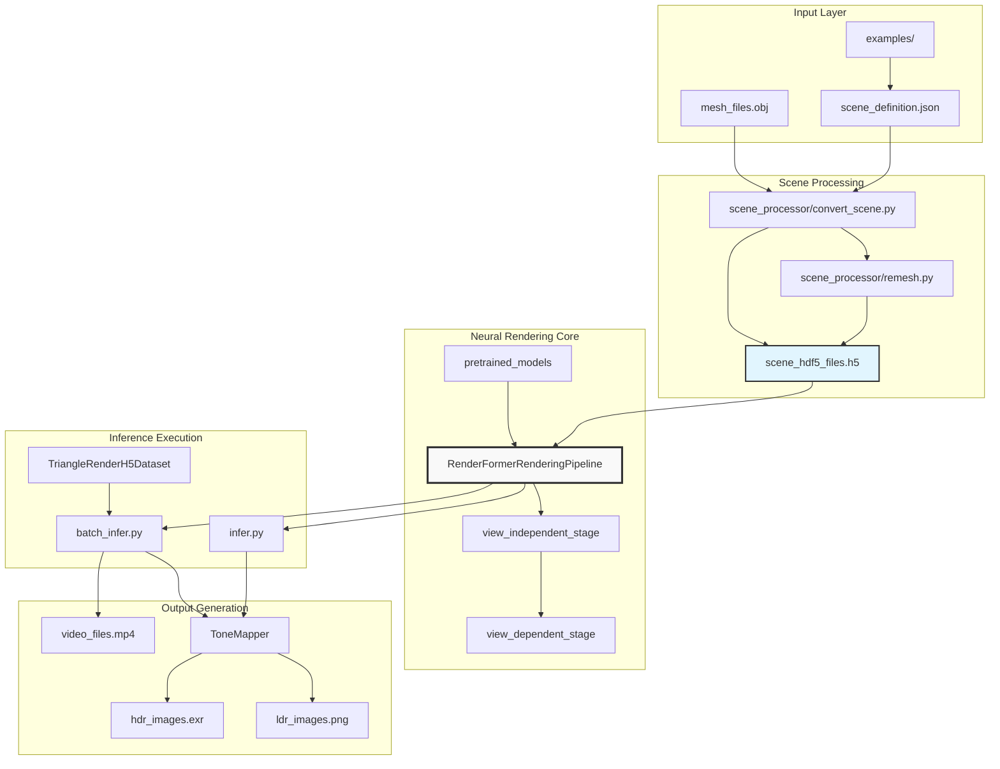
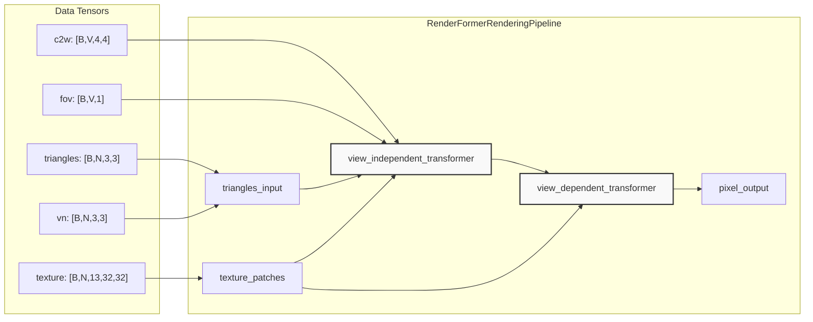
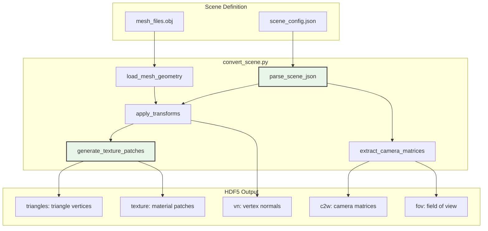
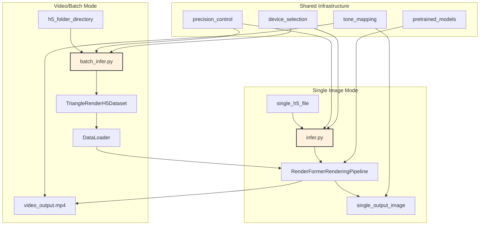

<!-- source: DeepWiki mcp.deepwiki.com · repo microsoft/renderformer · page 1 Overview · fetched 2026-10-26 -->

# Overview

Relevant source files

The following files were used as context for generating this wiki page:

- [README.md](README.md)

## Purpose and Scope

This document provides a high-level overview of the RenderFormer neural rendering system, a transformer-based pipeline that renders triangle meshes with global illumination effects. RenderFormer converts 3D triangle-based scene representations directly to photorealistic images without requiring per-scene training or fine-tuning.

For detailed installation and setup instructions, see [Installation & Setup](#3.1). For comprehensive usage examples, see [Basic Usage](#3.2). For scene definition specifications, see [JSON Scene Format](#5.1).

## System Architecture

The RenderFormer system follows a modular architecture with distinct processing stages:

**RenderFormer System Architecture**
- Input scenes defined in JSON format are processed through scene conversion pipeline
- Neural rendering core implements two-stage transformer architecture
- Multiple inference modes support single image and video generation
- Output supports both HDR and LDR formats with tone mapping

Sources: [README.md:1-362](), [scene_processor/convert_scene.py](), [infer.py](), [batch_infer.py]()

## Core Components

### Neural Rendering Pipeline

The `RenderFormerRenderingPipeline` class serves as the central component implementing the transformer-based neural renderer:

| Component | Class/Module | Purpose |
|-----------|--------------|---------|
| Main Pipeline | `RenderFormerRenderingPipeline` | Orchestrates two-stage rendering process |
| View-Independent Stage | `view_independent_stage` | Models triangle-to-triangle light transport |
| View-Dependent Stage | `view_dependent_stage` | Transforms ray bundles to pixel values |
| Scene Dataset | `TriangleRenderH5Dataset` | Loads and batches HDF5 scene data |

**Neural Pipeline Data Flow**
- Input tensors represent triangle geometry, texture patches, and camera parameters
- Two-stage transformer processes scene tokens to generate pixel values
- Output maintains spatial relationships for global illumination effects

Sources: [README.md:149-189](), [renderformer/pipelines/rendering_pipeline.py]()

### Scene Processing System

The scene processing pipeline converts user-defined scenes into the neural rendering format:

**Scene Processing Pipeline**
- JSON scene definitions specify geometry, materials, and camera configurations
- Processing pipeline triangulates meshes and generates texture representations
- Output HDF5 files contain structured data ready for neural rendering

Sources: [README.md:109-116](), [scene_processor/convert_scene.py](), [scene_processor/to_h5.py:1-289]()

## Data Flow and Tensor Shapes

The system processes data through specific tensor formats optimized for transformer architectures:

| Data Type | Tensor Shape | Description |
|-----------|--------------|-------------|
| Triangle Vertices | `[B, N, 3, 3]` | Batch × Triangles × Vertices × Coordinates |
| Texture Patches | `[B, N, 13, 32, 32]` | Batch × Triangles × Channels × Height × Width |
| Vertex Normals | `[B, N, 3, 3]` | Batch × Triangles × Vertices × Normal Vector |
| Camera Matrices | `[B, V, 4, 4]` | Batch × Views × Transform Matrix |
| Output Images | `[B, V, 512, 512, 3]` | Batch × Views × Height × Width × RGB |

## Inference Modes

RenderFormer supports two primary inference modes for different use cases:

**Inference Mode Comparison**
- Single image mode processes individual scenes through `infer.py`
- Batch mode enables video generation through `batch_infer.py` with dataset loading
- Both modes share core pipeline and infrastructure components

Sources: [README.md:117-133](), [README.md:192-203](), [infer.py](), [batch_infer.py]()

## Key Capabilities

### Global Illumination Effects
RenderFormer renders complex lighting phenomena including specular reflections, soft shadows, diffuse indirect lighting, and glossy reflections without physics-based simulation.

### Hardware Acceleration
The system supports multiple compute backends:
- NVIDIA CUDA GPUs with Flash Attention optimization
- Apple Metal Performance Shaders (MPS)
- CPU fallback for cross-platform compatibility

### Precision Control
Inference supports multiple precision modes (`fp16`, `bf16`, `fp32`) for memory and performance optimization.

### Output Formats
- HDR output in `.exr` format for professional workflows
- LDR output with tone mapping (`agx`, `filmic`, `pbr_neutral`)
- Video generation in `.mp4` format for animation sequences

Sources: [README.md:40-41](), [README.md:75-78](), [README.md:125-131](), [README.md:139-147]()

---

