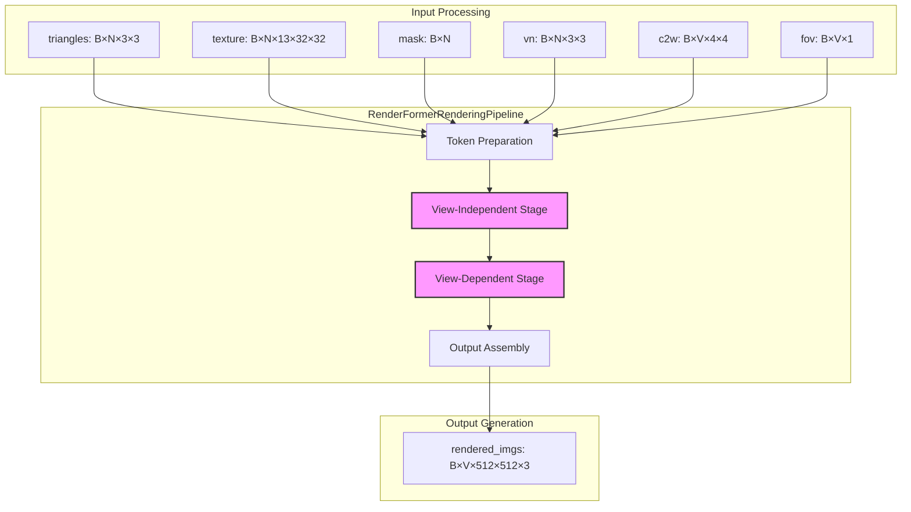
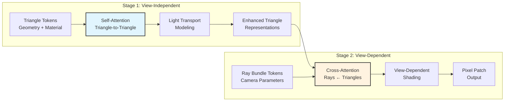
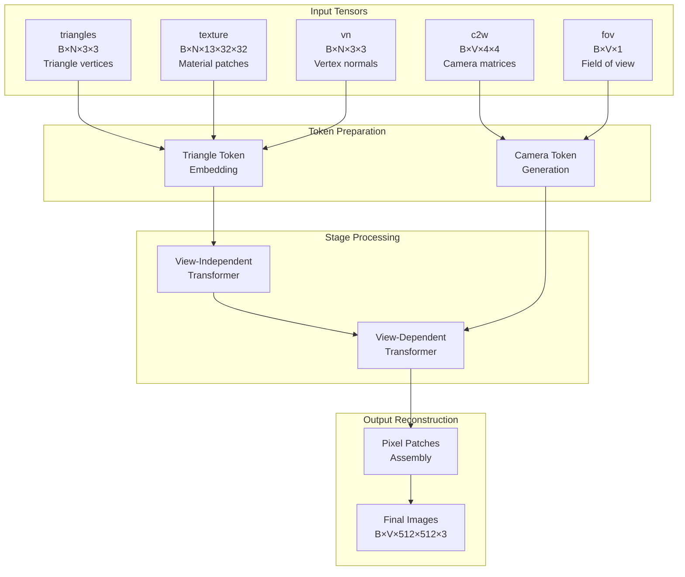
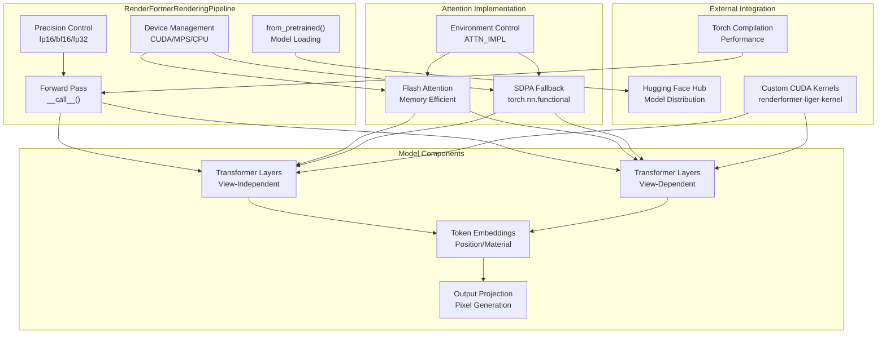

<!-- source: DeepWiki mcp.deepwiki.com · repo microsoft/renderformer · page 2 Core Architecture · fetched 2026-10-26 -->

# Core Architecture

Relevant source files

The following files were used as context for generating this wiki page:

- [README.md](README.md)

This document covers the neural rendering pipeline architecture of RenderFormer, focusing on the transformer-based two-stage design and core data flow. For information about scene processing and data format preparation, see [Scene Processing](#2.2). For details about the specific data structures and tensor formats, see [Data Formats](#2.3).

RenderFormer implements a sequence-to-sequence neural rendering approach where triangle mesh representations are transformed into rendered images through a two-stage transformer pipeline. The architecture treats rendering as a token transformation problem, converting triangle tokens with material properties into pixel patch outputs.

## Pipeline Overview

The `RenderFormerRenderingPipeline` class serves as the central orchestrator for the neural rendering process, coordinating data flow between the view-independent and view-dependent transformer stages.

**RenderFormer Pipeline Architecture**

Sources: [README.md:155-187](), [README.md:40-41]()

## Two-Stage Transformer Architecture

The core innovation of RenderFormer lies in its two-stage transformer design that separates view-independent light transport modeling from view-dependent ray-to-pixel transformation.

**Two-Stage Processing Flow**

The view-independent stage processes triangle tokens through self-attention mechanisms to model inter-triangle light transport without considering camera viewpoints. This stage captures global illumination effects like indirect lighting and inter-reflections that are consistent regardless of viewing angle.

The view-dependent stage takes the enhanced triangle representations from stage one and combines them with ray bundle tokens derived from camera parameters. Cross-attention mechanisms allow ray tokens to query relevant triangle information for view-dependent effects like specular reflections and occlusion.

Sources: [README.md:40-41]()

## Data Flow and Tensor Transformations

The pipeline processes batched data through well-defined tensor transformations, maintaining consistent shapes throughout the neural rendering process.

**Tensor Flow Diagram**

Key tensor dimensions:
- `B`: Batch size
- `N`: Number of triangles (up to 4096 in training, 8192 in inference)
- `V`: Number of camera views
- Triangle vertices are stored as 3×3 matrices (three 3D points)
- Texture patches are 13-channel 32×32 patches encoding material properties
- Camera-to-world matrices follow Blender coordinate system (-Z forward, +Y up, +X right)

Sources: [README.md:168-174](), [README.md:280-285]()

## Core Component Integration

The `RenderFormerRenderingPipeline` integrates multiple subsystems to achieve end-to-end neural rendering functionality.

**Component Integration Architecture**

The pipeline provides several key integration points:

| Component | Purpose | Configuration |
|-----------|---------|---------------|
| Model Loading | Loads pre-trained weights from Hugging Face | `model_id` parameter |
| Device Management | Handles CUDA/MPS/CPU placement | Automatic detection |
| Precision Control | Manages fp16/bf16/fp32 inference | `torch_dtype` parameter |
| Attention Backend | Selects Flash Attention or SDPA | `ATTN_IMPL` environment variable |

The pipeline automatically handles model compilation, attention implementation selection, and device placement while exposing a simple interface for batch inference.

Sources: [README.md:149-189](), [README.md:125-131](), [renderformer/pipelines/rendering_pipeline.py]()

---

