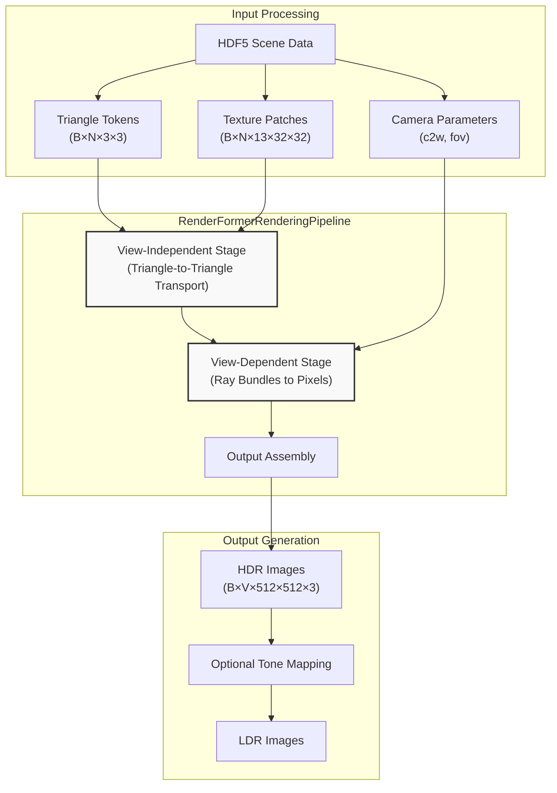
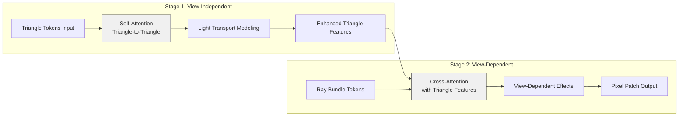
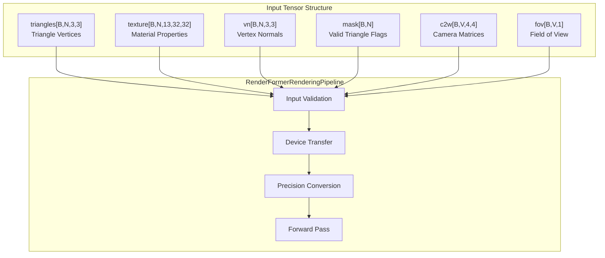
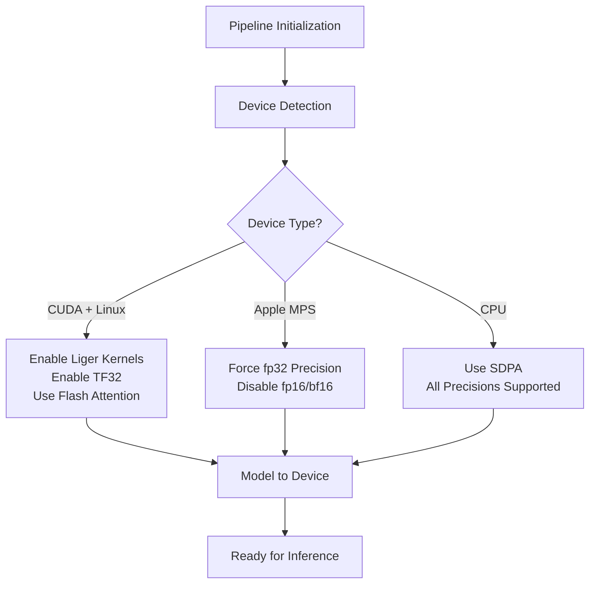
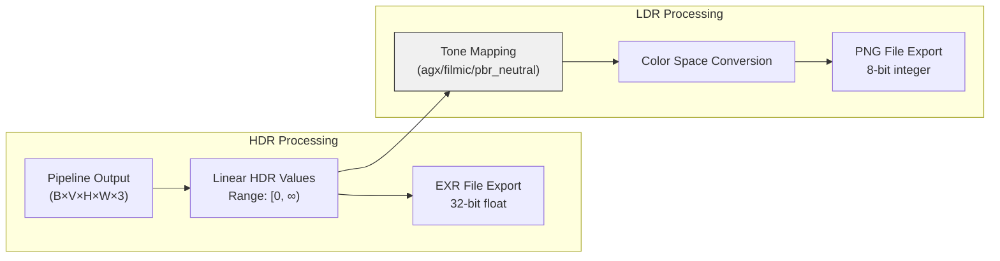
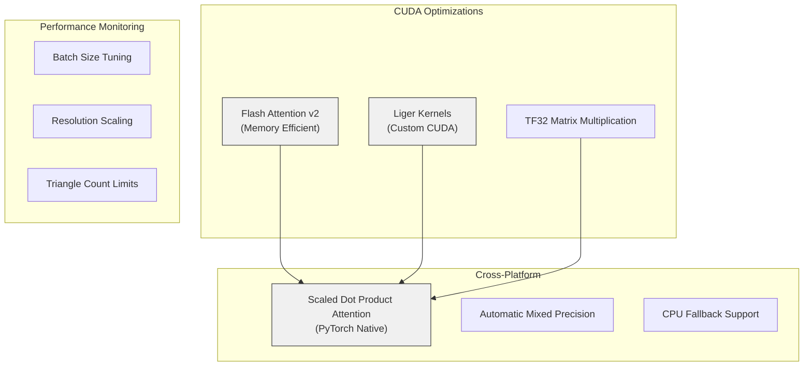

<!-- source: DeepWiki mcp.deepwiki.com · repo microsoft/renderformer · page 2.1 Rendering Pipeline · fetched 2026-10-26 -->

# Rendering Pipeline

<details>
<summary>Relevant source files</summary>

The following files were used as context for generating this wiki page:

- [README.md](README.md)
- [batch_infer.py](batch_infer.py)
- [infer.py](infer.py)

</details>


This document explains the core `RenderFormerRenderingPipeline` class and its two-stage transformer architecture that performs neural rendering of triangle meshes. For information about scene data preparation and HDF5 format specifications, see [Data Formats](#2.3). For details about the scene conversion process, see [Scene Processing](#2.2).

## Pipeline Overview

The RenderFormer rendering pipeline implements a neural approach to physically-based rendering using transformer architectures. Instead of traditional ray-tracing methods, it treats rendering as a sequence-to-sequence transformation problem where triangle tokens are converted to pixel patch tokens.



**Pipeline Architecture Overview**

The pipeline consists of two main transformer stages that work together to simulate global illumination effects without requiring per-scene training.

Sources: [README.md:40-41](), [README.md:149-189](), [infer.py:75-84]()

## Two-Stage Transformer Architecture

The RenderFormer pipeline implements a novel two-stage approach to neural rendering, where each stage handles different aspects of the light transport simulation.



**Two-Stage Transformer Process**

### View-Independent Stage

The first stage processes triangle tokens using self-attention mechanisms to model triangle-to-triangle light transport relationships. This stage captures global illumination effects such as:

- Inter-reflections between surfaces
- Diffuse indirect lighting
- Shadow casting relationships
- Light transport paths

### View-Dependent Stage

The second stage takes the enhanced triangle features from stage one and combines them with view-specific ray bundle tokens. This stage handles:

- Camera perspective transformations  
- Specular reflections
- View-dependent lighting effects
- Final pixel value computation

Sources: [README.md:40-41]()

## Input Data Format

The `RenderFormerRenderingPipeline` expects specific tensor formats for all input data. The following table describes the required input parameters:

| Parameter | Shape | Data Type | Description |
|-----------|-------|-----------|-------------|
| `triangles` | `(B, N, 3, 3)` | `torch.float32` | Triangle vertex coordinates |
| `texture` | `(B, N, 13, 32, 32)` | `torch.float32` | Material texture patches per triangle |
| `mask` | `(B, N)` | `torch.bool` | Valid triangle mask for padding |
| `vn` | `(B, N, 3, 3)` | `torch.float32` | Vertex normals per triangle |
| `c2w` | `(B, V, 4, 4)` | `torch.float32` | Camera-to-world transformation matrices |
| `fov` | `(B, V, 1)` | `torch.float32` | Field of view angles in degrees |

Where:
- `B` = Batch size
- `N` = Number of triangles per scene
- `V` = Number of camera views
- `13` = Material property channels (diffuse RGB, specular RGB, roughness, etc.)
- `32` = Texture patch resolution



**Input Data Processing Flow**

Sources: [README.md:168-174](), [infer.py:67-74](), [batch_infer.py:125-130]()

## Rendering Process

The rendering process in `RenderFormerRenderingPipeline` follows a structured workflow that handles model loading, device management, and inference execution.

### Model Initialization

The pipeline supports loading pre-trained models from Hugging Face Hub or local paths:

```python
pipeline = RenderFormerRenderingPipeline.from_pretrained("microsoft/renderformer-v1.1-swin-large")
```

### Device and Precision Management

The system automatically detects and configures optimal compute settings:

| Device Type | Precision Support | Optimizations |
|-------------|------------------|---------------|
| CUDA GPU | `fp16`, `bf16`, `fp32` | Flash Attention, TF32, Liger Kernels |  
| Apple MPS | `fp32` only | Automatic fallback from fp16/bf16 |
| CPU | `fp16`, `bf16`, `fp32` | Scaled Dot Product Attention |



**Device Configuration Flow**

### Inference Execution

The core rendering call processes all input tensors through both transformer stages:

```python
rendered_imgs = pipeline(
    triangles=triangles,
    texture=texture, 
    mask=mask,
    vn=vn,
    c2w=c2w,
    fov=fov,
    resolution=512,
    torch_dtype=torch.float16
)
```

The output tensor has shape `(B, V, H, W, 3)` representing HDR RGB images for each batch item and camera view.

Sources: [infer.py:45-55](), [batch_infer.py:81-92](), [README.md:125-130]()

## Output Generation

The pipeline generates HDR (High Dynamic Range) images as primary output, with optional tone mapping for LDR (Low Dynamic Range) display.

### HDR Output Format

All rendered images are initially produced in linear HDR format with:
- **File Format**: OpenEXR (`.exr`)
- **Color Space**: Linear RGB
- **Data Type**: `float32`
- **Value Range**: Unbounded (can exceed 1.0 for bright regions)

### Tone Mapping Options

For display purposes, HDR images can be converted to LDR using various tone mappers:

| Tone Mapper | Configuration | Use Case |
|-------------|---------------|----------|
| `none` | Direct clipping at [0,1] | Basic visualization |
| `agx` | AGX tone mapping | Cinematic look |
| `filmic` | Filmic tone mapping | Photography-style |
| `pbr_neutral` | Khronos PBR Neutral | PBR-compliant rendering |



**Output Processing Pipeline**

### File Output Structure

For each rendered view, the system generates both HDR and LDR outputs:

```
output_directory/
├── scene_name_view_0.exr    # HDR linear RGB
├── scene_name_view_0.png    # LDR tone-mapped
├── scene_name_view_1.exr
├── scene_name_view_1.png
└── ...
```

Sources: [infer.py:93-106](), [batch_infer.py:152-163](), [README.md:123-124]()

## Performance Considerations

The RenderFormer pipeline includes several optimization strategies for efficient inference across different hardware configurations.

### Memory Optimization

- **Padding Strategy**: Variable triangle counts are handled using boolean masks and optional padding to fixed lengths
- **Batch Processing**: Supports configurable batch sizes for memory-constrained environments
- **Precision Control**: Lower precision (fp16/bf16) reduces memory usage by ~50%

### Compute Acceleration

The system leverages hardware-specific optimizations:



**Hardware Optimization Stack**

### Attention Implementation Selection

The pipeline automatically selects the best available attention implementation:

1. **Flash Attention** (CUDA): Most memory efficient for long sequences
2. **SDPA** (All platforms): PyTorch native implementation with good performance
3. **Environment Override**: `ATTN_IMPL=sdpa` forces SDPA usage

### Scaling Recommendations

| Scene Complexity | Recommended Settings |
|------------------|---------------------|
| Simple (< 1K triangles) | Batch size: 8-16, Resolution: 512-1024 |
| Medium (1K-4K triangles) | Batch size: 4-8, Resolution: 512 |
| Complex (4K+ triangles) | Batch size: 1-4, Resolution: 512, fp16 precision |

Sources: [batch_infer.py:83-91](), [README.md:125-130](), [infer.py:47-55]()

---

