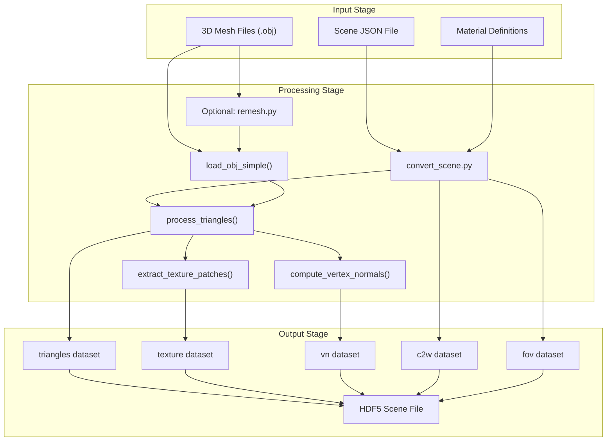
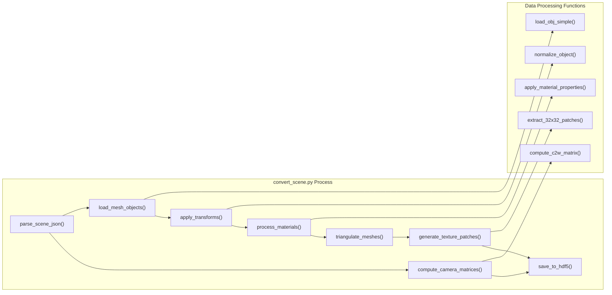
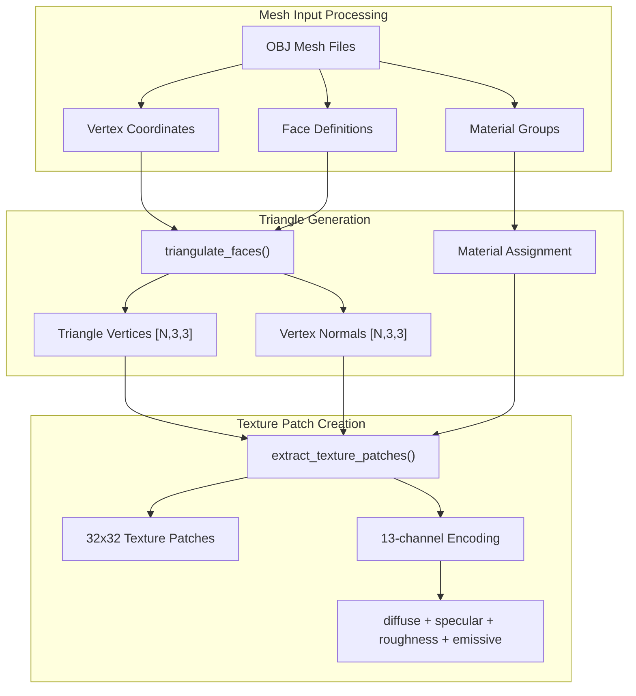
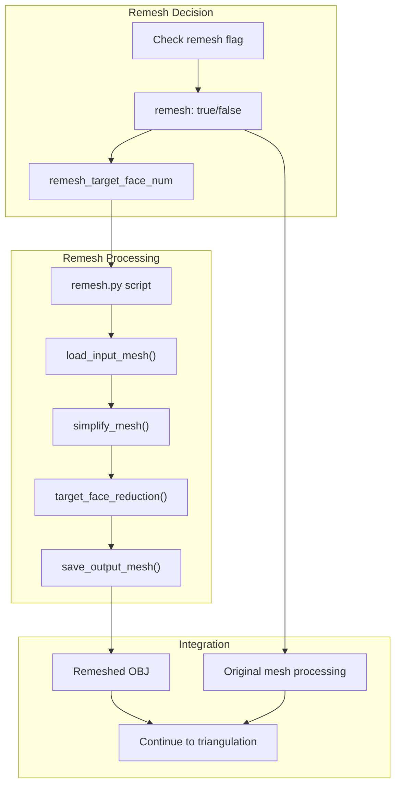
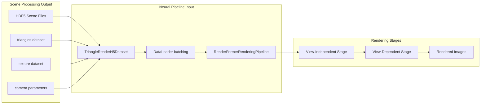

<!-- source: DeepWiki mcp.deepwiki.com · repo microsoft/renderformer · page 2.2 Scene Processing · fetched 2026-10-26 -->

# Scene Processing

<details>
<summary>Relevant source files</summary>

The following files were used as context for generating this wiki page:

- [README.md](README.md)
- [examples/cbox.json](examples/cbox.json)

</details>


## Purpose and Scope

This document covers the scene processing pipeline in RenderFormer, which converts user-defined scenes from JSON format into the HDF5 format required by the neural rendering pipeline. The scene processing system handles mesh loading, triangulation, texture preparation, material property encoding, and data organization for efficient neural rendering.

For information about the JSON scene definition format, see [Scene Definition](#5). For details about the HDF5 data structures used by the rendering pipeline, see [Data Formats](#2.3).

## Scene Processing Pipeline Overview

The scene processing pipeline transforms human-readable scene descriptions into optimized data structures for neural rendering. The pipeline consists of several stages that handle geometry processing, material encoding, and data serialization.

### Pipeline Architecture



Sources: [README.md:109-115](), [README.md:276-288]()

## JSON to HDF5 Conversion Process

The core conversion process is handled by the `convert_scene.py` script, which orchestrates the transformation from scene definition to neural rendering format.

### Conversion Workflow



Sources: [README.md:113-115](), [scene_processor/convert_scene.py]()

### Scene Object Processing

The conversion process handles multiple object types and applies various transformations:

| Processing Step | Function | Purpose |
|-----------------|----------|---------|
| Mesh Loading | `load_obj_simple()` | Parse OBJ files and extract vertices/faces |
| Transformation | `apply_transforms()` | Apply translation, rotation, scale, normalization |
| Material Encoding | `process_materials()` | Convert material properties to texture format |
| Triangulation | `triangulate_meshes()` | Ensure all geometry is triangle-based |
| Patch Extraction | `generate_texture_patches()` | Create 32×32 texture patches per triangle |

Sources: [README.md:241-262](), [examples/cbox.json:1-320]()

## Mesh Processing and Triangulation

The scene processor handles various mesh formats and ensures compatibility with the neural rendering pipeline through standardized triangulation and texture extraction.

### Triangle and Texture Processing



Sources: [README.md:280-285](), [README.md:246-254]()

### Material Property Encoding

The system encodes material properties into a standardized 13-channel format for each triangle:

| Channel Range | Content | Source |
|---------------|---------|---------|
| 0-2 | Diffuse RGB | `material.diffuse` |
| 3-5 | Specular RGB | `material.specular` |
| 6 | Roughness | `material.roughness` |
| 7-9 | Emissive RGB | `material.emissive` |
| 10-12 | Additional Properties | Computed values |

Sources: [README.md:246-254](), [examples/cbox.json:25-45]()

## Remeshing Capabilities

The scene processor includes optional remeshing functionality to optimize mesh density and triangle distribution for neural rendering.

### Remeshing Pipeline



Sources: [README.md:290-298](), [README.md:260-261]()

### Remeshing Configuration

The remeshing process can be controlled through scene JSON configuration:

```json
{
  "remesh": true,
  "remesh_target_face_num": 1024
}
```

Or invoked directly via command line:
```bash
python3 scene_processor/remesh.py --input mesh.obj --output remeshed.obj --target_face_num 1024
```

Sources: [README.md:296-298](), [README.md:260-261]()

## HDF5 Data Format Specification

The scene processor outputs data in HDF5 format with specific datasets required by the neural rendering pipeline.

### HDF5 Dataset Structure

| Dataset Name | Shape | Data Type | Description |
|--------------|-------|-----------|-------------|
| `triangles` | `[N, 3, 3]` | float32 | Triangle vertex coordinates |
| `texture` | `[N, 13, 32, 32]` | float32 | Material property patches |
| `vn` | `[N, 3, 3]` | float32 | Vertex normals per triangle |
| `c2w` | `[V, 4, 4]` | float32 | Camera-to-world matrices |
| `fov` | `[V]` | float32 | Field of view per camera |

Where `N` is the number of triangles and `V` is the number of camera views.

Sources: [README.md:280-285]()

### Coordinate System Convention

The scene processor uses Blender's coordinate system convention:
- **-Z**: View direction (forward)
- **+Y**: Up direction  
- **+X**: Right direction

This coordinate system is maintained throughout the conversion process for camera matrices and geometry positioning.

Sources: [README.md:286-287]()

## Integration with Rendering Pipeline

The processed HDF5 files serve as input to the RenderFormer neural rendering pipeline, providing the structured data required for transformer-based rendering.

### Pipeline Integration Flow



Sources: [README.md:114-115](), [README.md:149-189]()

The scene processing pipeline ensures that all geometric and material data is properly formatted and optimized for efficient neural rendering, maintaining the quality and accuracy required for high-fidelity image synthesis.

---

