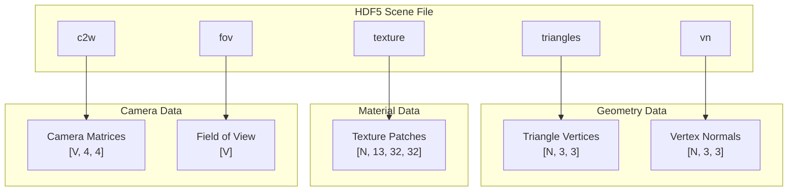
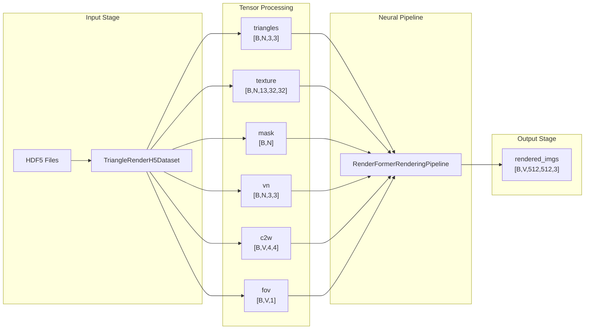
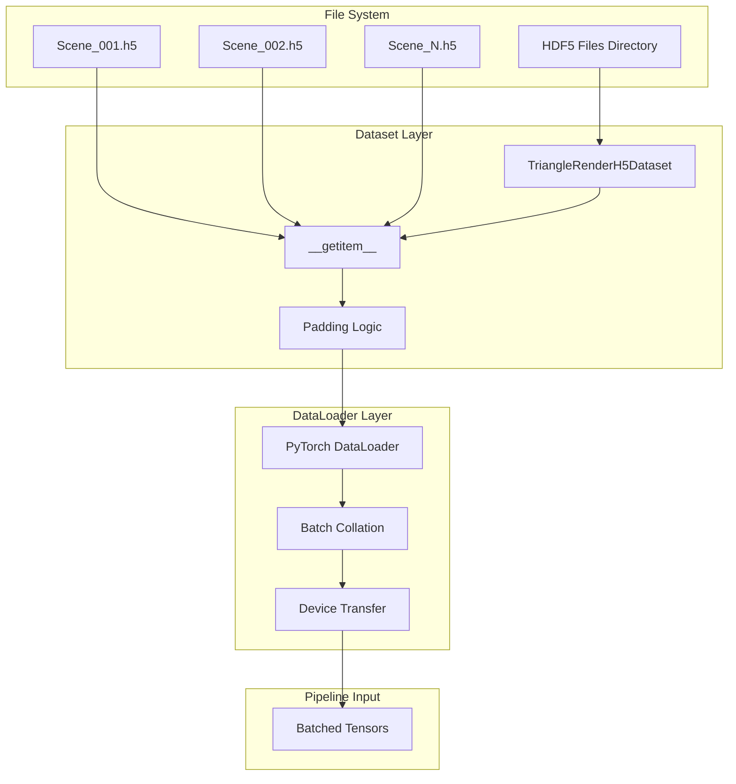

<!-- source: DeepWiki mcp.deepwiki.com · repo microsoft/renderformer · page 2.3 Data Formats · fetched 2026-10-26 -->

# Data Formats

<details>
<summary>Relevant source files</summary>

The following files were used as context for generating this wiki page:

- [README.md](README.md)
- [batch_infer.py](batch_infer.py)

</details>


This document describes the data formats and structures used throughout the RenderFormer neural rendering pipeline. It covers the HDF5 scene format, tensor shapes during neural processing, and data loading mechanisms. For information about scene definition and JSON input formats, see [Scene Definition](/5). For details about the neural rendering pipeline architecture, see [Rendering Pipeline](/2.1).

## HDF5 Scene Format

The core data format used by RenderFormer is HDF5, which stores preprocessed scene geometry, materials, and camera information. This format is created by the scene conversion process and consumed by both inference scripts.

### Primary Data Fields

The HDF5 files contain the following required fields:

| Field | Shape | Type | Description |
|-------|-------|------|-------------|
| `triangles` | `[N, 3, 3]` | `float32` | Triangle vertex positions in world coordinates |
| `texture` | `[N, 13, 32, 32]` | `float32` | Per-triangle texture patches with material properties |
| `vn` | `[N, 3, 3]` | `float32` | Vertex normals for each triangle |
| `c2w` | `[V, 4, 4]` | `float32` | Camera-to-world transformation matrices |
| `fov` | `[V]` | `float32` | Field of view values for each camera view |

Where `N` is the number of triangles and `V` is the number of camera views.

**HDF5 Data Structure**


Sources: [README.md:276-284](), [batch_infer.py:29-35]()

### Texture Patch Encoding

The `texture` field uses a 13-channel encoding per triangle, stored as 32×32 patches:

- **Channels 0-2**: Diffuse RGB values
- **Channels 3-5**: Specular RGB values  
- **Channel 6**: Roughness parameter
- **Channels 7-9**: Emissive RGB values
- **Channels 10-12**: Additional material properties

Each triangle gets its own 32×32 texture patch, allowing the neural network to process material information spatially.

Sources: [README.md:281](), [batch_infer.py:32]()

## Tensor Data Flow

Data flows through the RenderFormer pipeline with specific tensor shapes at each stage. The system supports batching for efficient processing.

### Pipeline Input Tensors

When data enters the `RenderFormerRenderingPipeline`, it follows this structure:

| Tensor | Shape | Description |
|--------|-------|-------------|
| `triangles` | `[B, N, 3, 3]` | Batched triangle vertices |
| `texture` | `[B, N, 13, 32, 32]` | Batched texture patches |
| `mask` | `[B, N]` | Boolean mask for valid triangles |
| `vn` | `[B, N, 3, 3]` | Batched vertex normals |
| `c2w` | `[B, V, 4, 4]` | Batched camera matrices |
| `fov` | `[B, V, 1]` | Batched field of view values |

Where `B` is batch size, `N` is number of triangles, and `V` is number of views.

**Data Flow Through Pipeline**


Sources: [README.md:168-173](), [batch_infer.py:125-143]()

### Output Tensor Format

The pipeline outputs rendered images with shape `[B, V, H, W, 3]` where:
- `B`: Batch size
- `V`: Number of views per scene
- `H`, `W`: Image height and width (typically 512×512)
- `3`: RGB color channels

The output represents linear HDR images that require tone mapping for display.

Sources: [README.md:185-186](), [batch_infer.py:152]()

## Data Loading and Batching

The `TriangleRenderH5Dataset` class handles loading and batching of HDF5 scene data for efficient processing.

### Dataset Implementation

The dataset provides automatic padding for batch processing when triangles counts vary:

```python
# Simplified data loading process from TriangleRenderH5Dataset
triangles = torch.from_numpy(np.array(f['triangles'])).float()
texture = torch.from_numpy(np.array(f['texture'])).float()
vn = torch.from_numpy(np.array(f['vn'])).float()
c2w = np.array(f['c2w']).astype(np.float32)
fov = np.array(f['fov']).astype(np.float32)
```

**Data Loading Architecture**


Sources: [batch_infer.py:17-58](), [batch_infer.py:102-110]()

### Padding Strategy

When `padding_length` is specified, the dataset pads shorter sequences to a fixed length:

- **Triangle data**: Padded with zeros to `[padding_length, 3, 3]`
- **Texture data**: Padded with zeros to `[padding_length, 13, 32, 32]`  
- **Normal data**: Padded with zeros to `[padding_length, 3, 3]`
- **Mask**: Boolean mask indicating valid triangles (True for real data, False for padding)

This enables efficient batch processing of scenes with varying triangle counts.

Sources: [batch_infer.py:37-47]()

## Input and Output Formats

### JSON Scene Definition

Input scenes are defined in JSON format and converted to HDF5 via `scene_processor/convert_scene.py`. The JSON format supports:

- Object geometry and material definitions
- Camera positioning and parameters
- Lighting configurations
- Transform hierarchies

The conversion process triangulates meshes, generates texture patches, and computes camera matrices.

Sources: [README.md:230-295]()

### Image Output Formats

RenderFormer produces two types of image outputs:

| Format | Extension | Description | Usage |
|--------|-----------|-------------|-------|
| HDR | `.exr` | Linear color space, float32 | Post-processing, compositing |
| LDR | `.png` | Tone-mapped, 8-bit RGB | Display, web usage |

The tone mapping process converts linear HDR to display-ready LDR using configurable tone mappers (`agx`, `filmic`, `pbr_neutral`).

Sources: [README.md:123](), [batch_infer.py:153-157]()

### Video Output

For video sequences, individual frames are collected and encoded into MP4 format:

- **Frame rate**: 24 fps
- **Quality**: Configurable (default: 9)
- **Format**: H.264 encoded MP4

The video assembly process handles frame ordering and timing automatically.

Sources: [batch_infer.py:170-174]()

---

