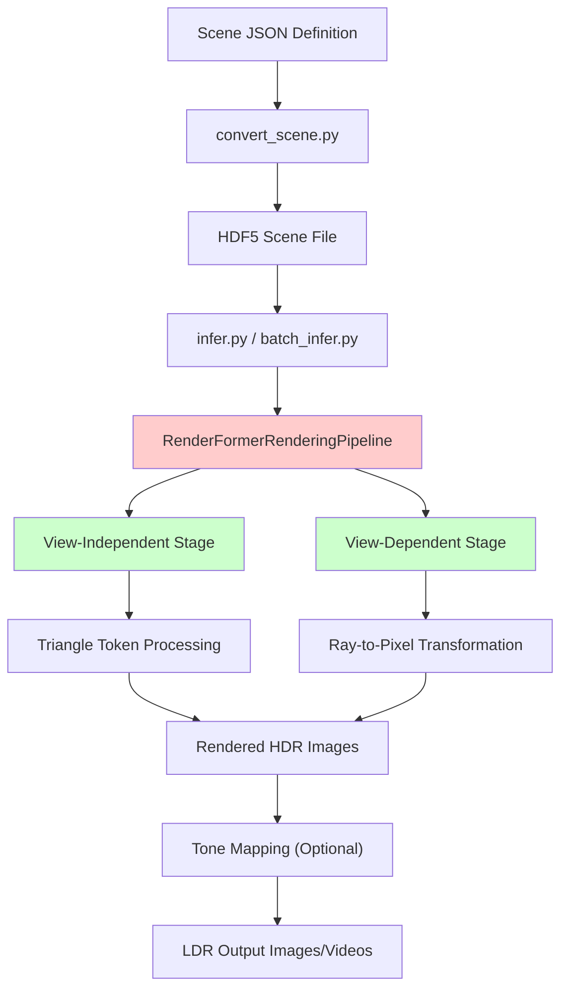
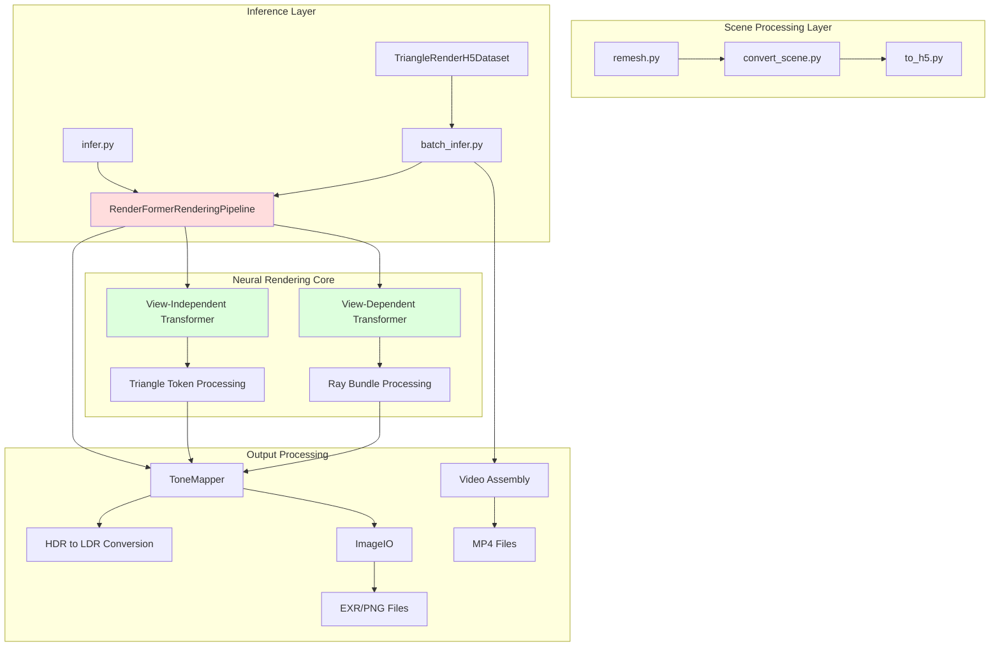

<!-- source: DeepWiki mcp.deepwiki.com · repo microsoft/renderformer · page 3 Getting Started · fetched 2026-10-26 -->

# Getting Started

<details>
<summary>Relevant source files</summary>

The following files were used as context for generating this wiki page:

- [README.md](README.md)

</details>


This page provides an overview of how to install and use RenderFormer for neural rendering of 3D scenes. It covers the essential concepts, workflow, and initial setup required to render your first images using the transformer-based neural rendering pipeline.

For detailed installation instructions, see [Installation & Setup](#3.1). For step-by-step usage examples, see [Basic Usage](#3.2). For batch processing and video generation, see [Video Rendering](#3.3).

## Prerequisites and System Requirements

RenderFormer supports cross-platform deployment with the following requirements:

| Component | Requirement |
|-----------|-------------|
| **Operating System** | Linux, macOS, Windows |
| **Hardware** | NVIDIA CUDA GPUs, Apple Metal GPUs, or CPU fallback |
| **GPU Memory** | Minimum 8GB VRAM |
| **Python** | PyTorch 2.0+ |
| **Optional** | Flash Attention for memory efficiency |

The system automatically detects available hardware and selects the appropriate compute backend (CUDA, MPS, or CPU).

Sources: [README.md:76-77]()

## Core Workflow Overview

RenderFormer follows a two-stage process from scene definition to rendered output:

**RenderFormer Workflow Diagram**


Sources: [README.md:109-123](), [README.md:40-41]()

## Key Components and Code Structure

The system architecture maps to specific code entities that handle different stages of the rendering pipeline:

**Core Code Components Diagram**


Sources: [README.md:189](), [renderformer/pipelines/rendering_pipeline.py](), [scene_processor/to_h5.py:288]()

## Essential Data Formats

RenderFormer uses specific tensor formats for neural processing:

| Data Type | Shape | Description |
|-----------|-------|-------------|
| `triangles` | `[B×N×3×3]` | Triangle vertex coordinates |
| `texture` | `[B×N×13×32×32]` | Texture patch data per triangle |
| `vn` | `[B×N×3×3]` | Vertex normals |
| `c2w` | `[B×V×4×4]` | Camera-to-world transformation matrices |
| `fov` | `[B×V×1]` | Field of view parameters |

The system processes scenes through the `RenderFormerRenderingPipeline` class, which accepts these tensor inputs and returns rendered images with shape `[B×V×512×512×3]`.

Sources: [README.md:278-284](), [README.md:175-186]()

## Quick Start Steps

### 1. Scene Conversion
Convert a scene definition to the internal HDF5 format:
```bash
python3 scene_processor/convert_scene.py examples/cbox.json --output_h5_path tmp/cbox/cbox.h5
```

### 2. Single Image Rendering
Render a single image using the inference script:
```bash
python3 infer.py --h5_file tmp/cbox/cbox.h5 --output_dir output/cbox/
```

### 3. Programmatic Usage
Use the `RenderFormerRenderingPipeline` class directly for batch processing:
```python
from renderformer import RenderFormerRenderingPipeline
pipeline = RenderFormerRenderingPipeline.from_pretrained("microsoft/renderformer-v1.1-swin-large")
```

Sources: [README.md:113-121](), [README.md:149-189]()

## Model Selection

RenderFormer provides pre-trained models with different complexity levels:

| Model | Parameters | Hugging Face ID |
|-------|------------|-----------------|
| RenderFormer-V1-Base | 205M | `microsoft/renderformer-v1-base` |  
| RenderFormer-V1.1-Large | 483M | `microsoft/renderformer-v1.1-swin-large` |

Models are automatically downloaded from Hugging Face Hub when first used. The system supports multiple precision modes (`fp16`, `bf16`, `fp32`) and attention implementations (Flash Attention, SDPA).

Sources: [README.md:94-97](), [README.md:125-130]()

## Output Formats and Tone Mapping

The pipeline generates HDR linear output in `.exr` format and optionally applies tone mapping for LDR `.png` output. Available tone mappers include:

- `none`: No tone mapping (HDR output only)
- `agx`: AGX tone mapping
- `filmic`: Filmic tone mapping  
- `pbr_neutral`: PBR neutral tone mapping

Sources: [README.md:123-124](), [README.md:145-146]()

## Next Steps

After completing the basic setup, you can:

- Follow detailed installation procedures in [Installation & Setup](#3.1)
- Learn step-by-step rendering workflows in [Basic Usage](#3.2) 
- Explore video generation capabilities in [Video Rendering](#3.3)
- Create custom scenes using the JSON format documented in [Scene Definition](#5)
- Optimize performance using guidelines in [Performance Optimization](#4.3)

Sources: [README.md:42-70]()

---

