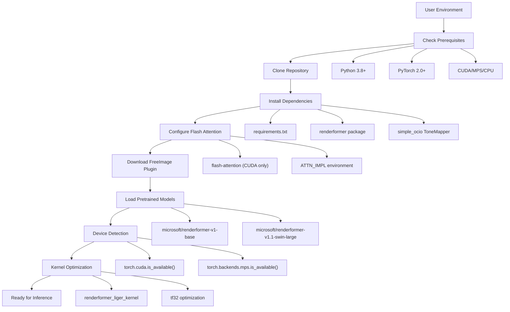
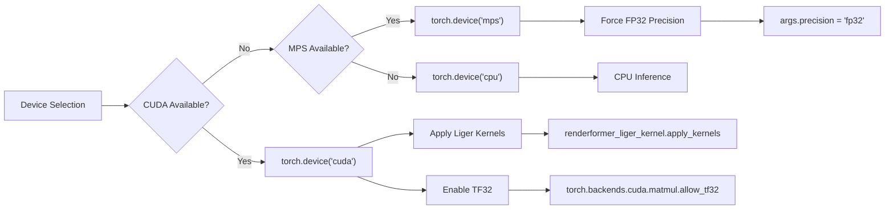
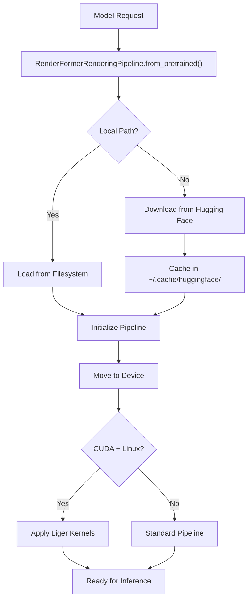

<!-- source: DeepWiki mcp.deepwiki.com · repo microsoft/renderformer · page 3.1 Installation & Setup · fetched 2026-10-26 -->

# Installation & Setup

<details>
<summary>Relevant source files</summary>

The following files were used as context for generating this wiki page:

- [README.md](README.md)
- [infer.py](infer.py)

</details>


This document covers the installation and initial setup of RenderFormer, including system requirements, dependency management, environment configuration, and model downloads. For information about basic usage after installation, see [Basic Usage](#3.2). For development setup and contribution guidelines, see [Development Setup](#9.3).

## System Requirements

RenderFormer supports multiple platforms and hardware configurations with specific minimum requirements:

| Component | Requirement | Notes |
|-----------|-------------|-------|
| **Operating System** | Linux, macOS, Windows | Tested across all platforms |
| **GPU Memory** | 8GB minimum | Required for model inference |
| **GPU Support** | NVIDIA CUDA, Apple Metal | CPU fallback available |
| **Python** | 3.8+ | With PyTorch 2.0+ support |

**Hardware Acceleration Priority:**
1. NVIDIA CUDA GPUs (recommended)
2. Apple Metal GPUs (MPS)
3. CPU (fallback, slower performance)

Sources: [README.md:76-77](), [infer.py:43]()

## Installation Flow



**Installation Dependencies and Code References**

Sources: [README.md:72-103](), [infer.py:43-55]()

## Step-by-Step Installation

### 1. Repository Setup

```bash
git clone https://github.com/microsoft/renderformer
cd renderformer
```

### 2. Dependency Installation

Install core dependencies through the requirements file:

```bash
pip install -r requirements.txt
```

The `requirements.txt` includes essential packages for:
- `torch` - Core PyTorch framework
- `transformers` - Hugging Face model loading
- `h5py` - HDF5 scene file processing
- `imageio` - Image I/O operations
- `numpy` - Numerical computations

### 3. HDR Image Support

Download the FreeImage plugin for HDR image processing:

```bash
python3 -c "import imageio; imageio.plugins.freeimage.download()"
```

This enables `.exr` format support used in [infer.py:103]() for HDR output.

### 4. Flash Attention (CUDA Optional)

For CUDA users, install Flash Attention for memory-efficient attention:

```bash
# From https://github.com/Dao-AILab/flash-attention
pip install flash-attn --no-build-isolation
```

The system automatically falls back to PyTorch SDPA if Flash Attention is unavailable, as implemented in the pipeline.

Sources: [README.md:81-89](), [infer.py:125-130]()

## Device Configuration

### Device Detection Flow



**Device-Specific Optimizations**

The system applies different optimizations based on detected hardware:

| Device | Optimizations | Code Reference |
|--------|---------------|----------------|
| CUDA | Liger kernels, TF32 acceleration | [infer.py:47-51]() |
| MPS | Force FP32 (fp16/bf16 cause errors) | [infer.py:52-54]() |
| CPU | Standard PyTorch operations | [infer.py:43]() |

### Attention Implementation Selection

Control attention implementation via environment variable:

```bash
# Force SDPA usage
ATTN_IMPL=sdpa python3 infer.py --h5_file scene.h5 --output_dir output/

# Default: automatic selection (Flash Attention if available)
python3 infer.py --h5_file scene.h5 --output_dir output/
```

Sources: [infer.py:43-55](), [README.md:125-130]()

## Model Configuration

### Available Pretrained Models

| Model | Parameters | Hugging Face ID | Use Case |
|-------|------------|-----------------|----------|
| RenderFormer-V1-Base | 205M | `microsoft/renderformer-v1-base` | Lightweight inference |
| RenderFormer-V1.1-Large | 483M | `microsoft/renderformer-v1.1-swin-large` | Best quality (default) |

### Model Loading Process



**Model Loading Implementation**

The `RenderFormerRenderingPipeline` class handles model initialization and device placement as shown in [infer.py:45]().

Sources: [README.md:94-97](), [infer.py:36-55]()

## Verification Steps

### 1. Basic Import Test

```python
import torch
from renderformer import RenderFormerRenderingPipeline
print("RenderFormer imported successfully")
```

### 2. Device Detection Test

```python
device = torch.device('cuda' if torch.cuda.is_available() else 
                     'mps' if torch.backends.mps.is_available() else 'cpu')
print(f"Using device: {device}")
```

### 3. Model Loading Test

```python
pipeline = RenderFormerRenderingPipeline.from_pretrained("microsoft/renderformer-v1.1-swin-large")
print("Model loaded successfully")
```

### 4. Scene Processing Test

Convert an example scene to verify the complete pipeline:

```bash
python3 scene_processor/convert_scene.py examples/cbox.json --output_h5_path tmp/test.h5
python3 infer.py --h5_file tmp/test.h5 --output_dir tmp/
```

Sources: [README.md:113-123](), [infer.py:33-110]()

## Common Issues and Solutions

### Flash Attention Installation

**Issue**: Flash Attention compilation errors on some systems.

**Solution**: Use environment variable to force SDPA:
```bash
ATTN_IMPL=sdpa python3 infer.py [args...]
```

### Memory Issues

**Issue**: Out of memory errors during inference.

**Symptoms**: CUDA/MPS memory allocation failures.

**Solutions**:
- Reduce batch size in batch inference
- Use lower precision (`--precision fp16`)
- Enable gradient checkpointing for large scenes

### Model Download Issues

**Issue**: Slow or failed model downloads from Hugging Face.

**Solution**: Pre-download models or use local cache:
```bash
# Pre-download
huggingface-cli download microsoft/renderformer-v1.1-swin-large

# Use local path
python3 infer.py --model_id /path/to/local/model [args...]
```

### Precision Compatibility

**Issue**: Precision errors on Apple Silicon.

**Auto-fix**: System automatically forces FP32 on MPS devices as implemented in [infer.py:52-54]().

Sources: [infer.py:47-55](), [README.md:125-130]()

---

