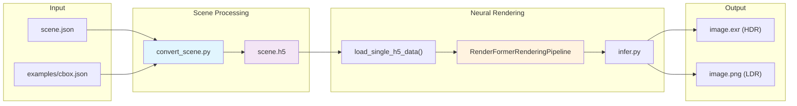
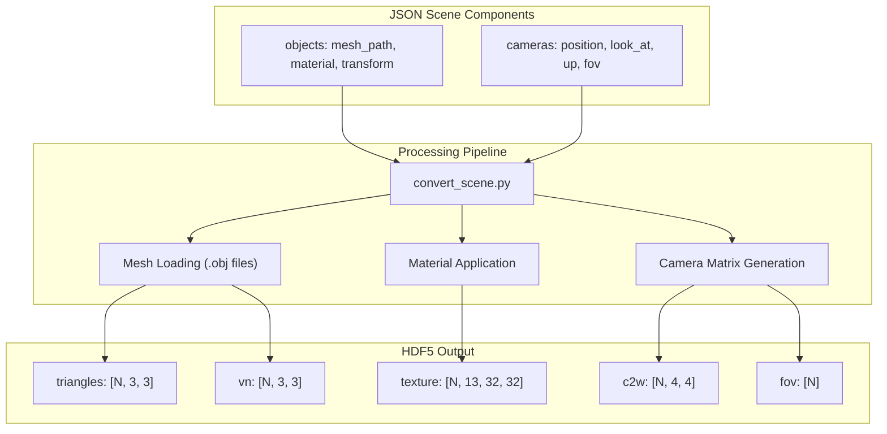
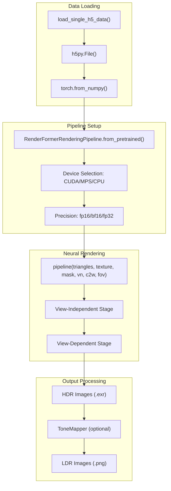
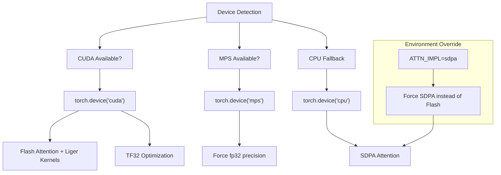

<!-- source: DeepWiki mcp.deepwiki.com · repo microsoft/renderformer · page 3.2 Basic Usage · fetched 2026-10-26 -->

# Basic Usage

<details>
<summary>Relevant source files</summary>

The following files were used as context for generating this wiki page:

- [README.md](README.md)
- [examples/cbox.json](examples/cbox.json)
- [infer.py](infer.py)

</details>


This page covers the essential workflow for rendering your first image with RenderFormer, from scene definition to final output. It provides step-by-step instructions for the most common use case: converting a JSON scene definition to a rendered image using the single image inference pipeline.

For installation and environment setup, see [Installation & Setup](#3.1). For batch processing and video generation, see [Video Rendering](#3.3). For detailed scene definition syntax, see [JSON Scene Format](#5.1).

## Basic Workflow Overview

The RenderFormer rendering process follows a two-step pipeline that transforms JSON scene definitions into neural-rendered images:

**Basic Workflow: JSON Scene to Rendered Image**


Sources: [README.md:109-123](), [infer.py:1-110]()

## Step-by-Step Instructions

### Step 1: Scene Conversion

Convert your JSON scene definition to RenderFormer's HDF5 format using the `convert_scene.py` script:

```bash
python3 scene_processor/convert_scene.py examples/cbox.json --output_h5_path tmp/cbox/cbox.h5
```

This process loads the scene definition, processes mesh files, applies materials and transforms, and packages everything into an HDF5 file with the required data fields: `triangles`, `texture`, `vn`, `c2w`, and `fov`.

**Scene Conversion Data Flow**


Sources: [README.md:109-115](), [README.md:276-285]()

### Step 2: Image Rendering

Render the scene using the `infer.py` script with your converted HDF5 file:

```bash
python3 infer.py --h5_file tmp/cbox/cbox.h5 --output_dir output/cbox/
```

**Core Rendering Pipeline Components**


Sources: [infer.py:12-30](), [infer.py:43-84](), [infer.py:87-106]()

### Step 3: Understanding Outputs

The rendering process generates two output formats for each camera view:

| Output Type | Format | Description | Usage |
|-------------|--------|-------------|-------|
| HDR | `.exr` | Linear HDR values from neural network | Post-processing, compositing |
| LDR | `.png` | Tone-mapped 8-bit RGB | Direct viewing, web display |

For a scene with multiple cameras, outputs are named with view indices: `scene_view_0.exr`, `scene_view_1.exr`, etc.

Sources: [infer.py:91-106](), [README.md:123]()

## Common Configuration Options

### Model Selection

Specify different pre-trained models using the `--model_id` parameter:

```bash
# Use the larger, more accurate model (default)
python3 infer.py --h5_file scene.h5 --model_id microsoft/renderformer-v1.1-swin-large

# Use the smaller, faster model
python3 infer.py --h5_file scene.h5 --model_id microsoft/renderformer-v1-base
```

### Precision Control

Control computational precision for performance vs. quality trade-offs:

```bash
# High precision (slower, more accurate)
python3 infer.py --h5_file scene.h5 --precision fp32

# Standard precision (default)
python3 infer.py --h5_file scene.h5 --precision fp16

# Brain float precision (CUDA only)
python3 infer.py --h5_file scene.h5 --precision bf16
```

### Tone Mapping

Apply tone mapping for better visual results in LDR outputs:

```bash
# AGX tone mapper (Blender-style)
python3 infer.py --h5_file scene.h5 --tone_mapper agx

# Filmic tone mapper
python3 infer.py --h5_file scene.h5 --tone_mapper filmic

# PBR Neutral tone mapper
python3 infer.py --h5_file scene.h5 --tone_mapper pbr_neutral
```

Sources: [infer.py:36-40](), [README.md:134-147]()

## Device and Attention Configuration

RenderFormer automatically selects the best available device and attention implementation:

**Device and Attention Selection Logic**


Override attention implementation manually:
```bash
ATTN_IMPL=sdpa python3 infer.py --h5_file scene.h5 --output_dir output/
```

Sources: [infer.py:43-55](), [README.md:125-131]()

## Troubleshooting Common Issues

### Memory Issues
- Reduce `--resolution` from default 512 to 256 or 128
- Use `--precision fp16` instead of `fp32`
- Ensure minimum 8GB GPU memory

### Platform-Specific Considerations
- **macOS/MPS**: Automatically forces `fp32` precision due to numerical precision issues
- **Windows**: Liger kernel optimizations may not be available
- **Linux/CUDA**: Full optimization features available

### Output Verification
Check that both HDR and LDR outputs are generated:
- HDR files should have realistic brightness ranges
- LDR files should display properly without tone mapping artifacts

Sources: [infer.py:52-54](), [README.md:77]()

---

