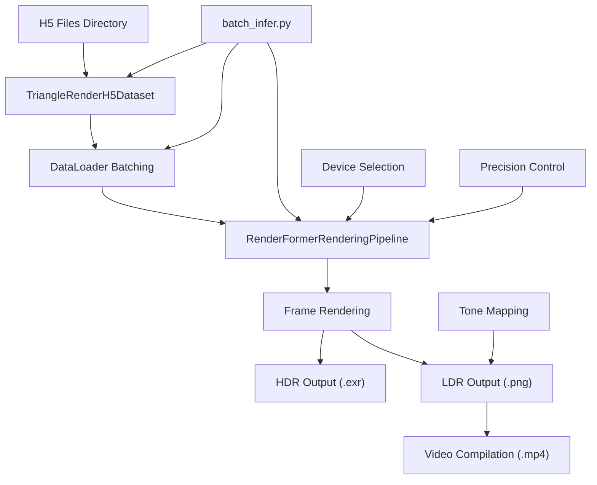
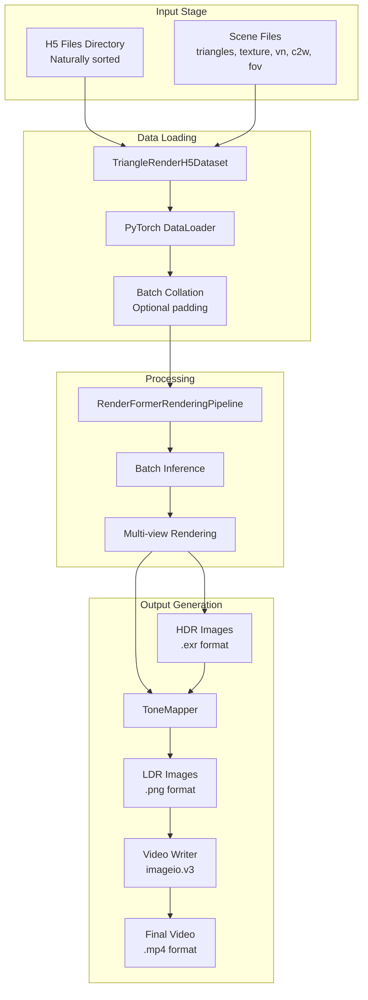
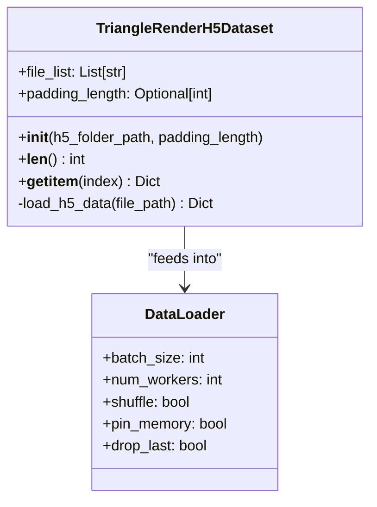
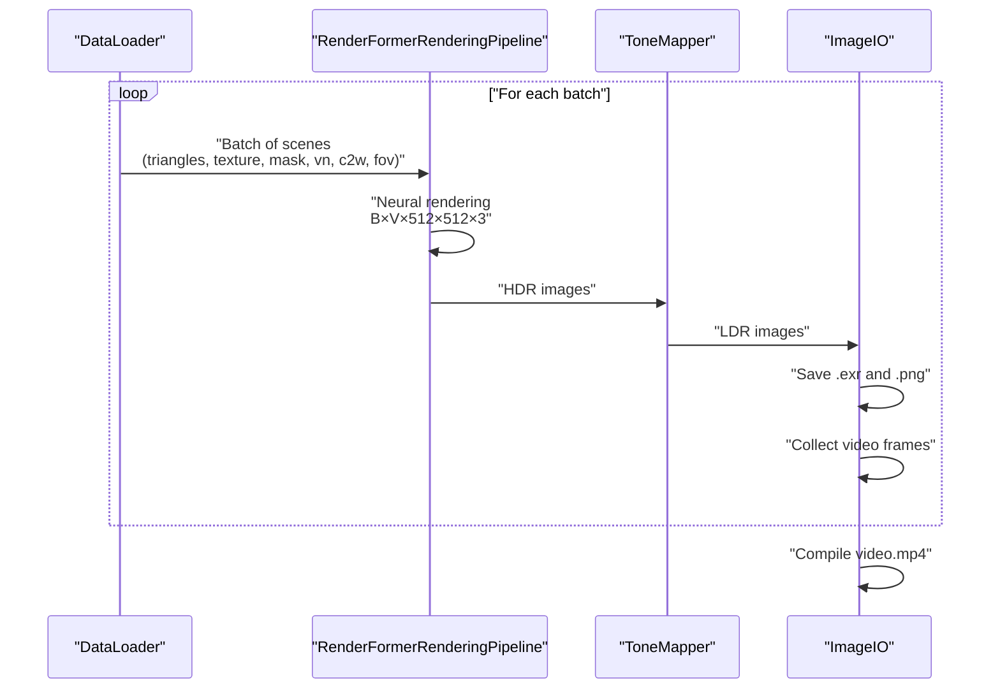
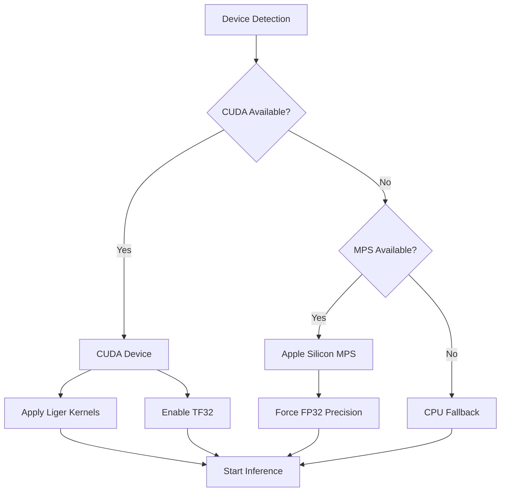

<!-- source: DeepWiki mcp.deepwiki.com · repo microsoft/renderformer · page 3.3 Video Rendering · fetched 2026-10-26 -->

# Video Rendering

<details>
<summary>Relevant source files</summary>

The following files were used as context for generating this wiki page:

- [README.md](README.md)
- [batch_infer.py](batch_infer.py)

</details>


This document covers batch processing and video generation using RenderFormer's batch inference pipeline. Video rendering allows you to process multiple scene files sequentially and compile the rendered frames into video files.

For single image rendering, see [Basic Usage](#3.2). For advanced performance tuning, see [Performance Optimization](#4.3).

## Video Rendering Workflow

Video rendering in RenderFormer follows a batch processing pipeline that loads multiple HDF5 scene files, renders them sequentially, and optionally compiles the output frames into a video file.

### High-Level Process Flow



Sources: [batch_infer.py:1-179](), [README.md:191-227]()

### Data Flow Architecture



Sources: [batch_infer.py:17-58](), [batch_infer.py:101-175]()

## Dataset and Data Loading

### TriangleRenderH5Dataset Class

The `TriangleRenderH5Dataset` class handles loading and preprocessing of multiple HDF5 scene files for batch processing.

| Component | Purpose | Implementation |
|-----------|---------|----------------|
| File Discovery | Locate all H5 files in directory | `glob.glob()` with natural sorting |
| Data Loading | Load scene data from H5 files | `h5py.File()` for each scene |
| Padding | Uniform sequence lengths | Optional zero-padding to `padding_length` |
| Masking | Valid triangle indicators | Boolean masks for padded sequences |



The dataset loads the following tensors from each H5 file:

| Tensor | Shape | Description |
|--------|-------|-------------|
| `triangles` | `[N, 3, 3]` | Triangle vertices |
| `texture` | `[N, 13, 32, 32]` | Texture patches |
| `vn` | `[N, 3, 3]` | Vertex normals |
| `c2w` | `[V, 4, 4]` | Camera-to-world matrices |
| `fov` | `[V]` | Field of view values |
| `mask` | `[N]` | Valid triangle indicators |

Sources: [batch_infer.py:17-58]()

### File Organization and Loading

Video rendering expects a directory structure with numbered HDF5 files:

```
video_sequence/
├── frame_0000.h5
├── frame_0001.h5
├── frame_0002.h5
└── ...
```

The dataset uses natural sorting to ensure proper frame ordering:

Sources: [batch_infer.py:19-22]()

## Batch Processing Pipeline

### Core Inference Loop

The batch processing pipeline processes multiple scenes simultaneously using PyTorch's DataLoader for efficient GPU utilization.



### Pipeline Integration

The batch inference script integrates with `RenderFormerRenderingPipeline` for neural rendering:

| Parameter | Purpose | Default |
|-----------|---------|---------|
| `batch_size` | Number of scenes per batch | 8 |
| `resolution` | Output image resolution | 512 |
| `precision` | Floating point precision | fp16 |
| `padding_length` | Fixed sequence length | None |
| `num_workers` | Data loading workers | 0 |

Sources: [batch_infer.py:62-75](), [batch_infer.py:134-143]()

### Device and Optimization

The script automatically selects the best available device and applies optimizations:



Sources: [batch_infer.py:77-92]()

## Output Generation

### Multi-Format Output

Each rendered frame is saved in both HDR and LDR formats:

| Format | Extension | Purpose | Precision |
|--------|-----------|---------|-----------|
| HDR | `.exr` | High dynamic range | 32-bit float |
| LDR | `.png` | Display/video use | 8-bit integer |

### Video Compilation

When `--save_video` is enabled, the script collects all LDR frames and compiles them into an MP4 video:


### Tone Mapping Integration

The script supports multiple tone mapping operators for HDR to LDR conversion:

| Tone Mapper | Purpose | Implementation |
|-------------|---------|----------------|
| `none` | Linear clipping | `np.clip(hdr, 0, 1)` |
| `agx` | Filmic response | `ToneMapper('agx')` |
| `filmic` | Cinematic look | `ToneMapper('filmic')` |
| `pbr_neutral` | Neutral rendering | `ToneMapper('Khronos PBR Neutral')` |

Sources: [batch_infer.py:94-100](), [batch_infer.py:153-167](), [batch_infer.py:170-174]()

## Performance and Configuration

### Batch Size Optimization

Optimal batch size depends on available GPU memory and scene complexity:

| GPU Memory | Recommended Batch Size | Notes |
|------------|----------------------|-------|
| 8GB | 2-4 | Minimal viable setup |
| 16GB | 4-8 | Balanced performance |
| 24GB+ | 8-16 | Maximum throughput |

### Padding Strategy

For sequences with varying triangle counts, padding ensures uniform batch processing:

- Without padding: Variable batch sizes, dynamic shapes
- With padding: Fixed batch sizes, masked computation
- Recommended: Use padding for consistent performance

### Memory Optimization

The pipeline includes several memory optimization features:

| Feature | Purpose | Configuration |
|---------|---------|---------------|
| Pin Memory | Faster GPU transfer | `pin_memory=True` |
| Mixed Precision | Reduced memory usage | `--precision fp16` |
| Gradient Checkpointing | Lower memory footprint | Automatic |
| Flash Attention | Efficient attention | Auto-detected |

Sources: [batch_infer.py:101-110](), [batch_infer.py:83-91]()

---

