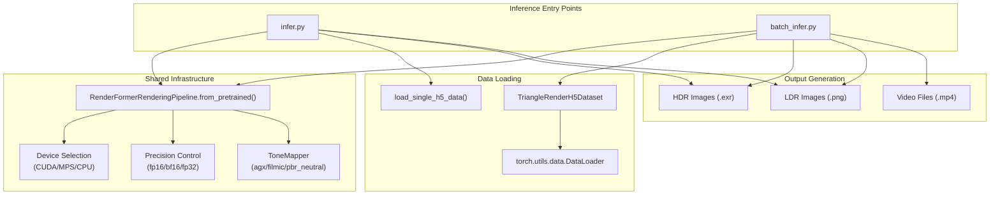
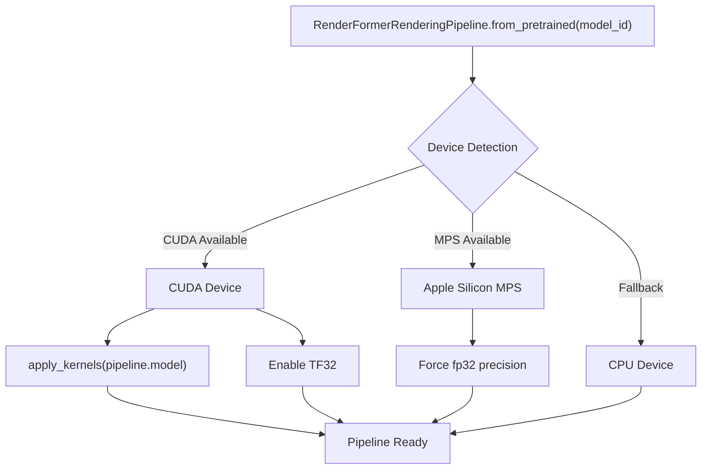
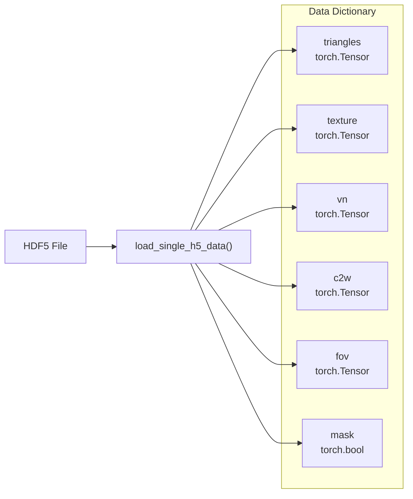
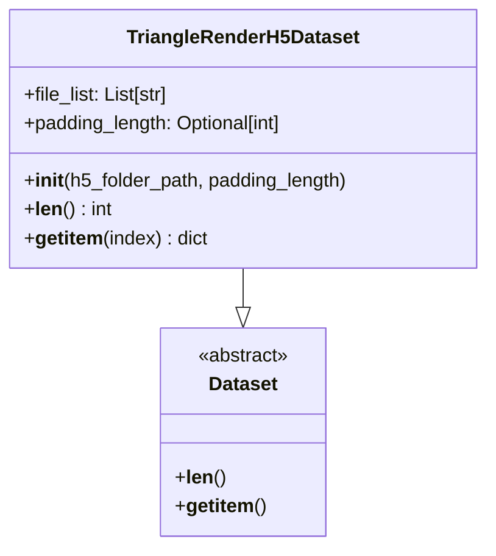
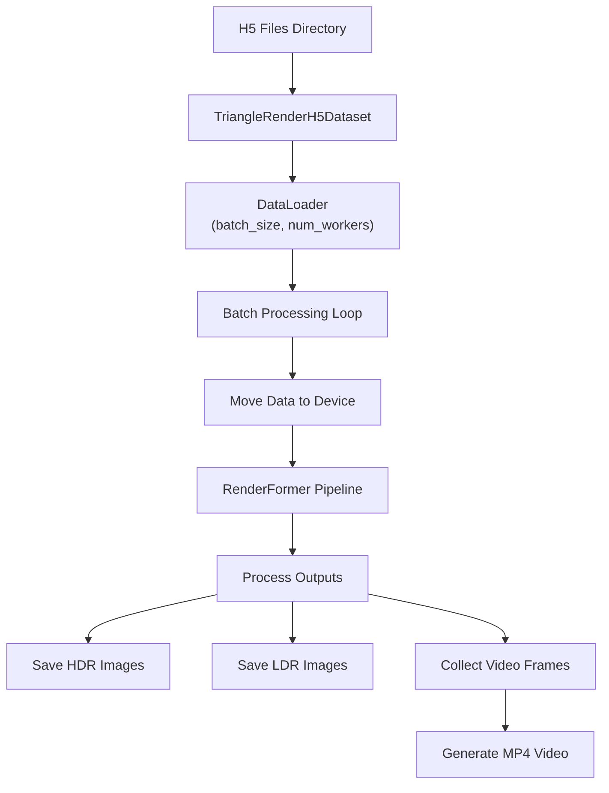

<!-- source: DeepWiki mcp.deepwiki.com · repo microsoft/renderformer · page 4 Inference Scripts · fetched 2026-10-26 -->

# Inference Scripts

Relevant source files

The following files were used as context for generating this wiki page:

- [batch_infer.py](batch_infer.py)
- [infer.py](infer.py)

This document covers the inference tools provided by RenderFormer for rendering individual images and generating videos from preprocessed scene data. The inference scripts serve as the primary interface for users to generate rendered outputs from HDF5 scene files using pre-trained RenderFormer models.

For information about the core rendering pipeline architecture, see [Core Architecture](#2). For scene preprocessing and data format details, see [Scene Processing](#2.2) and [Data Formats](#2.3).

## Overview

RenderFormer provides two main inference scripts that handle different rendering workflows:

| Script | Purpose | Input | Output |
|--------|---------|-------|--------|
| `infer.py` | Single image rendering | Single HDF5 file | HDR/LDR image pair per view |
| `batch_infer.py` | Batch processing and video generation | Directory of HDF5 files | Images and optional MP4 video |

Both scripts share common infrastructure for model loading, device management, precision control, and tone mapping, but differ in their data handling and output workflows.

**Sources:** [infer.py:1-111](), [batch_infer.py:1-179]()

## Shared Components

Both inference scripts utilize common components that handle model initialization, device management, and output processing.

### Model Loading and Device Management

The scripts use identical patterns for loading pre-trained models and configuring device-specific optimizations:

The CUDA optimization path includes loading custom kernels from `renderformer_liger_kernel` and enabling TF32 operations for improved performance [infer.py:47-51](), [batch_infer.py:83-87](). On Apple Silicon devices, the scripts automatically force `fp32` precision to avoid numerical errors with lower precision types [infer.py:52-54](), [batch_infer.py:88-90]().

### Tone Mapping Pipeline

Both scripts support identical tone mapping workflows using the `ToneMapper` class:

| Tone Mapper | Description | Usage |
|-------------|-------------|-------|
| `none` | No tone mapping, simple clipping | Default behavior |
| `agx` | AgX tone mapping | Professional color grading |
| `filmic` | Filmic tone mapping | Cinematic look |
| `pbr_neutral` | Khronos PBR Neutral | Physically-based rendering standard |

The tone mapping process converts HDR images to LDR format while preserving visual quality [infer.py:94-98](), [batch_infer.py:153-157]().

**Sources:** [infer.py:45-62](), [batch_infer.py:81-99]()

## Single Image Inference

The `infer.py` script provides a straightforward interface for rendering individual scenes from HDF5 files.

### Data Loading Workflow

The `load_single_h5_data()` function extracts all necessary components from an HDF5 file:

The function creates a boolean mask covering all triangles and converts numpy arrays to PyTorch tensors with appropriate data types [infer.py:12-30]().

### Inference Process

The single image inference follows this pipeline:

1. **Data Preparation**: Load HDF5 data and add batch dimensions [infer.py:65-73]()
2. **Pipeline Execution**: Call the RenderFormer pipeline with all required inputs [infer.py:75-84]()
3. **Output Processing**: Generate both HDR and LDR versions of each view [infer.py:91-106]()

The script automatically handles multiple camera views if present in the scene data, generating separate output files for each view with the naming pattern `{base_name}_view_{i}.{ext}`.

**Sources:** [infer.py:33-110]()

## Batch Inference

The `batch_infer.py` script enables efficient processing of multiple scenes and video generation through the `TriangleRenderH5Dataset` class and PyTorch DataLoader integration.

### Dataset Implementation

The `TriangleRenderH5Dataset` class extends PyTorch's `Dataset` interface to handle collections of HDF5 files:

The dataset supports optional padding to handle scenes with varying triangle counts, ensuring consistent batch processing [batch_infer.py:37-47](). Files are sorted using `natsorted` to maintain proper sequence ordering for video generation [batch_infer.py:19-20]().

### Batch Processing Pipeline

The batch inference workflow leverages PyTorch's DataLoader for efficient parallel processing:

The DataLoader configuration includes memory pinning for efficient GPU transfer and configurable worker processes for parallel data loading [batch_infer.py:103-110]().

### Video Generation

When `--save_video` is enabled, the script collects all rendered frames and assembles them into an MP4 video file using `imageio.v3.imwrite()` with 24 FPS and high quality settings [batch_infer.py:170-174]().

**Sources:** [batch_infer.py:17-58](), [batch_infer.py:101-174]()

## Performance Optimization

Both inference scripts include several performance optimization features:

### Precision Control

| Precision | Description | Performance | Accuracy |
|-----------|-------------|-------------|----------|
| `fp32` | Full precision | Baseline | Highest |
| `fp16` | Half precision | ~2x faster | Good |
| `bf16` | Brain float 16 | ~2x faster | Better than fp16 |

The precision setting affects both memory usage and computational speed, with lower precision types providing significant performance benefits on modern hardware [infer.py:37](), [batch_infer.py:65]().

### Hardware-Specific Optimizations

The scripts automatically apply hardware-specific optimizations:

- **CUDA**: Custom kernels via `renderformer_liger_kernel` and TF32 acceleration
- **Apple Silicon**: Forced `fp32` precision to avoid MPS numerical issues  
- **CPU**: Standard PyTorch execution without additional optimizations

### Memory Management

The batch inference script supports configurable batch sizes and worker processes to balance memory usage with processing speed. The `padding_length` parameter enables consistent memory allocation across batches when scenes have varying complexity [batch_infer.py:69]().

**Sources:** [infer.py:47-54](), [batch_infer.py:83-90](), [batch_infer.py:103-110]()

---

