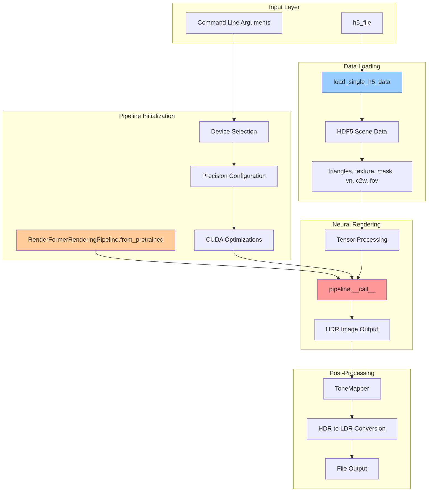
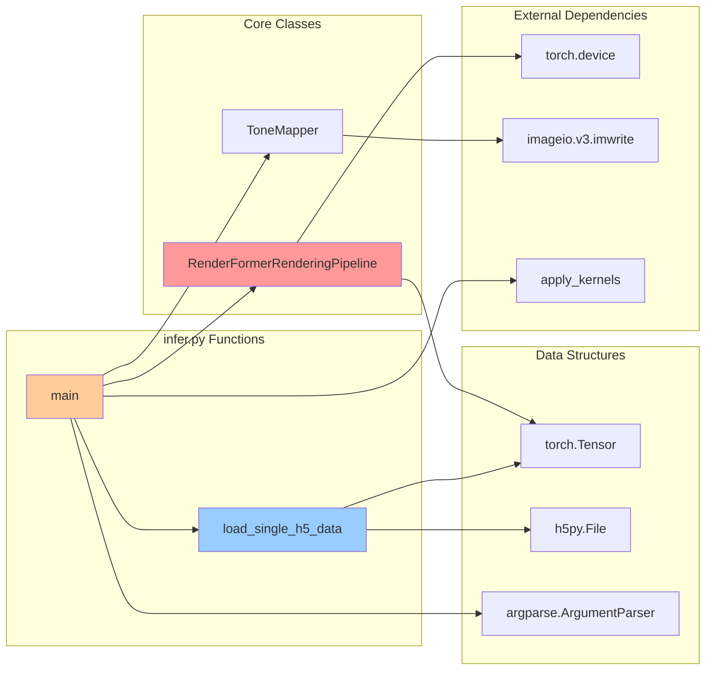
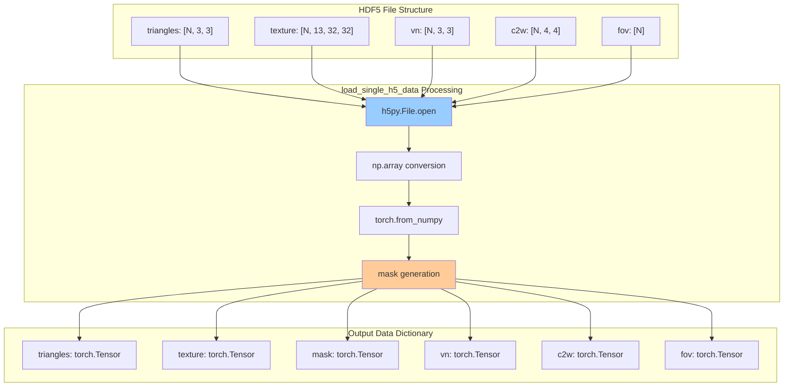
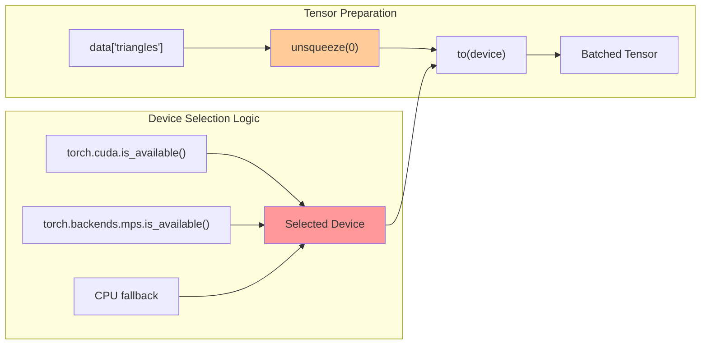
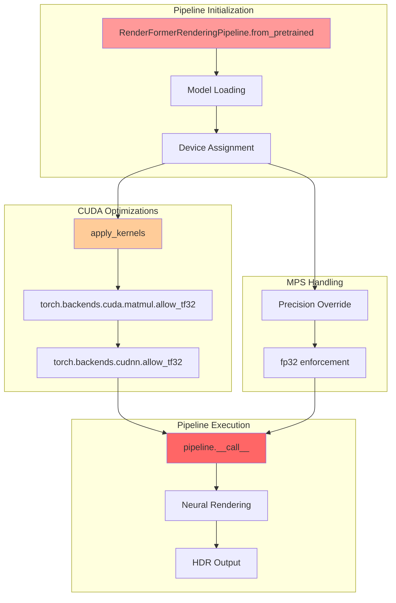
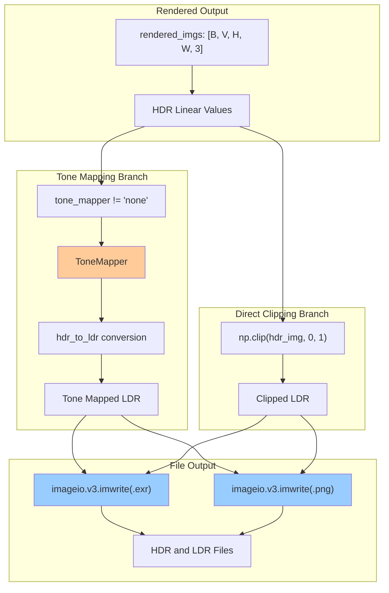
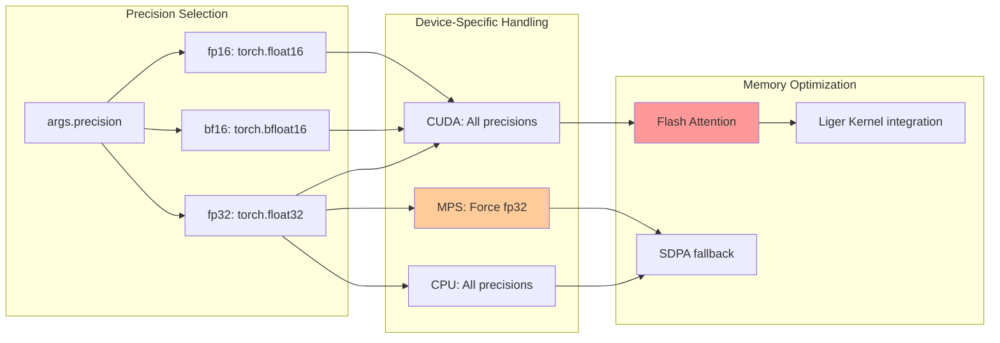

<!-- source: DeepWiki mcp.deepwiki.com · repo microsoft/renderformer · page 4.1 Single Image Inference · fetched 2026-10-26 -->

# Single Image Inference

<details>
<summary>Relevant source files</summary>

The following files were used as context for generating this wiki page:

- [README.md](README.md)
- [infer.py](infer.py)

</details>


The single image inference system provides a command-line interface for rendering individual images from HDF5 scene files using the RenderFormer neural rendering pipeline. This page covers the `infer.py` script, its parameters, data flow, and output handling.

For batch processing and video rendering workflows, see [Batch Inference](#4.2). For details about the underlying neural rendering architecture, see [Rendering Pipeline](#2.1). For scene data preparation, see [Scene Processing](#2.2).

## Overview

The single image inference workflow transforms preprocessed scene data into rendered images through the RenderFormer neural rendering pipeline. The system supports multiple output formats, precision settings, and tone mapping options for different use cases.

### Single Image Inference Architecture



**Sources:** [infer.py:1-111](), [README.md:117-148]()

### Code Entity Mapping



**Sources:** [infer.py:12-30](), [infer.py:33-110]()

## Command Line Interface

The `infer.py` script provides a comprehensive command-line interface for single image rendering with the following argument structure:

| Argument | Type | Default | Description |
|----------|------|---------|-------------|
| `--h5_file` | str | Required | Path to input HDF5 scene file |
| `--model_id` | str | `microsoft/renderformer-v1.1-swin-large` | Hugging Face model ID or local path |
| `--precision` | str | `fp16` | Inference precision: `bf16`, `fp16`, `fp32` |
| `--resolution` | int | `512` | Output image resolution |
| `--output_dir` | str | Same as input | Output directory for rendered images |
| `--tone_mapper` | str | `none` | Tone mapping: `none`, `agx`, `filmic`, `pbr_neutral` |

### Usage Examples

```bash
# Basic single image rendering
python3 infer.py --h5_file tmp/cbox/cbox.h5 --output_dir output/cbox/

# High resolution rendering with tone mapping
python3 infer.py --h5_file scene.h5 --resolution 1024 --tone_mapper agx

# Local model with specific precision
python3 infer.py --h5_file scene.h5 --model_id ./local_model --precision fp32
```

**Sources:** [infer.py:34-41](), [README.md:136-147]()

## Data Loading and Processing

### HDF5 Data Loading

The `load_single_h5_data` function extracts scene data from HDF5 files and converts it to PyTorch tensors:



**Sources:** [infer.py:12-30]()

### Tensor Batch Processing

The system adds batch dimensions and moves tensors to the appropriate device:



**Sources:** [infer.py:43-73]()

## Pipeline Execution

### Model Loading and Optimization

The inference script initializes the rendering pipeline with device-specific optimizations:



**Sources:** [infer.py:45-55](), [infer.py:75-84]()

### Rendering Parameters

The pipeline receives the following tensor inputs:

| Parameter | Shape | Description |
|-----------|-------|-------------|
| `triangles` | `[B, N, 3, 3]` | Triangle vertex coordinates |
| `texture` | `[B, N, 13, 32, 32]` | Texture patches per triangle |
| `mask` | `[B, N]` | Valid triangle mask |
| `vn` | `[B, N, 3, 3]` | Vertex normals |
| `c2w` | `[B, V, 4, 4]` | Camera-to-world matrices |
| `fov` | `[B, V, 1]` | Field of view values |

**Sources:** [infer.py:75-84]()

## Output Processing

### HDR and LDR Generation

The system generates both HDR (.exr) and LDR (.png) outputs with optional tone mapping:



**Sources:** [infer.py:91-106]()

### Tone Mapping Options

The system supports multiple tone mapping algorithms:

| Tone Mapper | Configuration | Use Case |
|-------------|---------------|----------|
| `none` | Direct clipping | Linear HDR preservation |
| `agx` | AgX tone mapping | Cinematic look |
| `filmic` | Filmic tone mapping | Film-like rendering |
| `pbr_neutral` | Khronos PBR Neutral | PBR-compliant output |

**Sources:** [infer.py:58-62](), [README.md:145]()

## Performance Configuration

### Precision and Memory Management

The system provides precision control for memory efficiency and performance:



**Sources:** [infer.py:52-54](), [infer.py:47-51]()

### Environment Variables

The system supports attention implementation control via environment variables:

```bash
# Force SDPA usage
ATTN_IMPL=sdpa python3 infer.py --h5_file scene.h5

# Default behavior (Flash Attention if available)
python3 infer.py --h5_file scene.h5
```

**Sources:** [README.md:125-130]()

---

