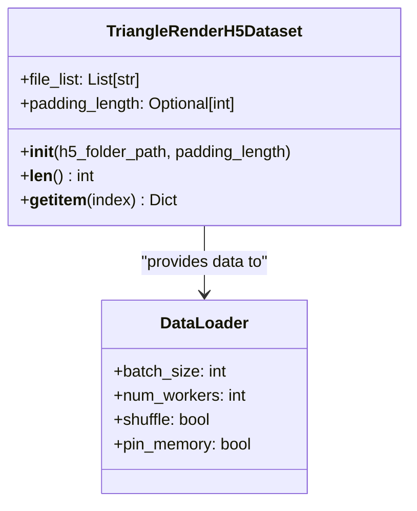
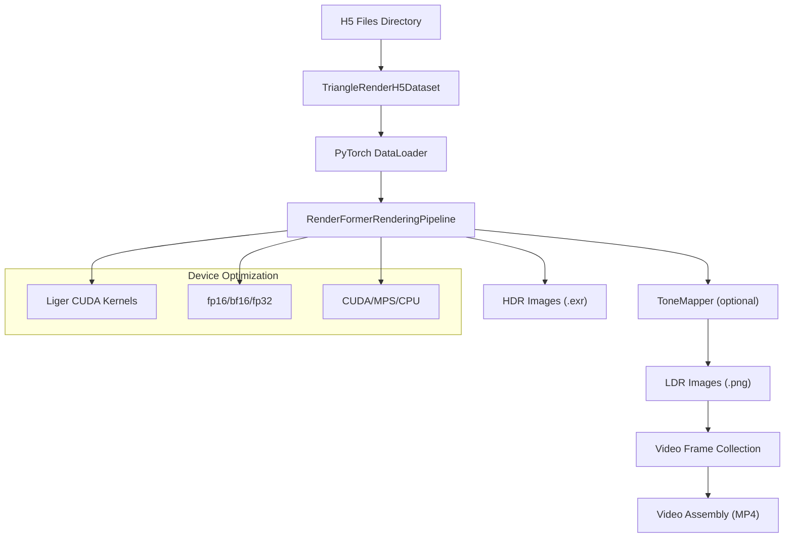
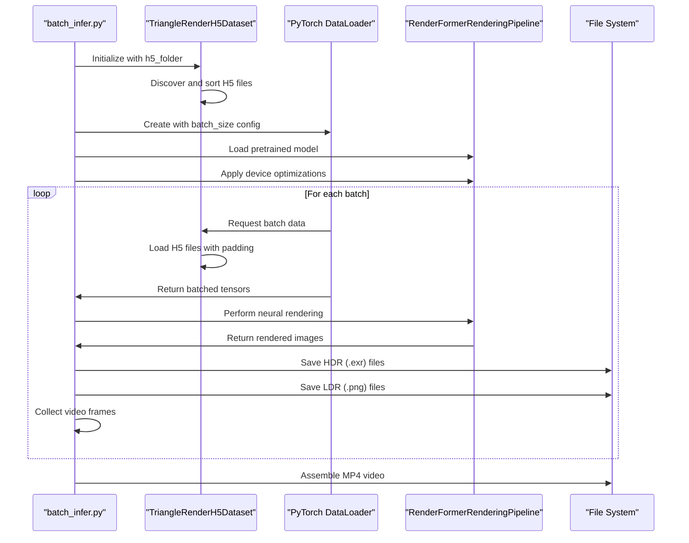
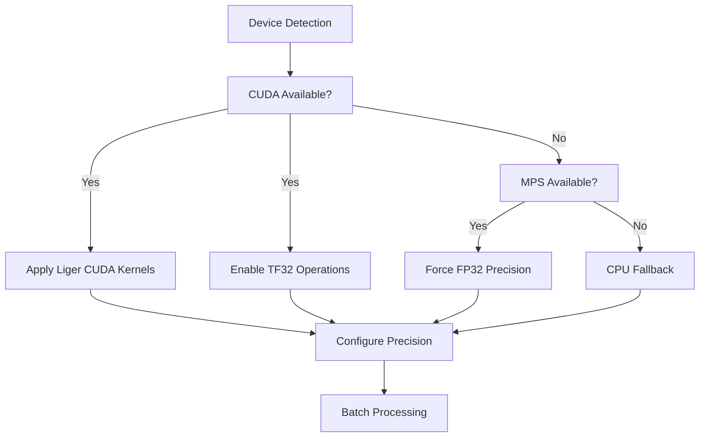

<!-- source: DeepWiki mcp.deepwiki.com · repo microsoft/renderformer · page 4.2 Batch Inference · fetched 2026-10-26 -->

# Batch Inference

Relevant source files

The following files were used as context for generating this wiki page:

- [README.md](README.md)
- [batch_infer.py](batch_infer.py)

This document covers the batch inference system in RenderFormer, which enables efficient video rendering and multi-scene processing workflows. The batch inference system processes multiple HDF5 scene files sequentially or in batches to generate video sequences with consistent neural rendering quality.

For single image rendering, see [Single Image Inference](#4.1). For performance optimization techniques, see [Performance Optimization](#4.3).

## Overview

The batch inference system is implemented in [`batch_infer.py`](batch_infer.py:1-179)() and provides functionality for:

- Loading and processing multiple HDF5 scene files from a directory
- Batched neural rendering using `RenderFormerRenderingPipeline`
- Automatic video assembly from rendered frame sequences
- Memory-efficient processing with configurable batch sizes and padding
- Tone mapping and HDR/LDR output generation

Sources: [batch_infer.py:1-179](), [README.md:191-227]()

## Core Components

### TriangleRenderH5Dataset

The `TriangleRenderH5Dataset` class handles loading multiple HDF5 files for batch processing:

The dataset implementation includes:

- **File Discovery**: Automatically finds all `.h5` files in the specified directory using natural sorting via `natsorted`
- **Padding Support**: Optional triangle count padding to enable efficient batching of scenes with different triangle counts
- **Memory Management**: Loads data on-demand to minimize memory usage

Key data loading logic at [batch_infer.py:27-58]():

| Field | Shape | Description |
|-------|-------|-------------|
| `triangles` | `[N, 3, 3]` | Triangle vertex coordinates |
| `texture` | `[N, 13, 32, 32]` | Texture patch data |
| `vn` | `[N, 3, 3]` | Vertex normals |
| `c2w` | `[V, 4, 4]` | Camera-to-world matrices |
| `fov` | `[V]` | Field of view values |
| `mask` | `[N]` | Triangle validity mask |

Sources: [batch_infer.py:17-58]()

### Batch Processing Pipeline

The batch inference workflow integrates with the core rendering pipeline:

The pipeline processes batches through the main inference loop at [batch_infer.py:119-167](), handling:

- **Device Transfer**: Moving tensor data to GPU/MPS/CPU as appropriate
- **Batch Rendering**: Processing multiple scenes simultaneously when memory permits
- **Output Generation**: Saving both HDR and tone-mapped LDR versions

Sources: [batch_infer.py:119-167](), [batch_infer.py:81-92]()

## Command Line Interface

The batch inference script provides comprehensive configuration options:

### Core Arguments

| Argument | Type | Default | Description |
|----------|------|---------|-------------|
| `--h5_folder` | str | Required | Input directory containing HDF5 files |
| `--model_id` | str | `microsoft/renderformer-v1.1-swin-large` | HuggingFace model identifier |
| `--output_dir` | str | Same as input | Output directory for rendered images |

### Performance Configuration

| Argument | Type | Default | Description |
|----------|------|---------|-------------|  
| `--batch_size` | int | 8 | Number of scenes processed simultaneously |
| `--padding_length` | int | None | Triangle count for padding (enables batching) |
| `--num_workers` | int | 0 | Data loader worker processes |
| `--precision` | str | fp16 | Inference precision (bf16/fp16/fp32) |
| `--resolution` | int | 512 | Output image resolution |

### Output Options

| Argument | Type | Default | Description |
|----------|------|---------|-------------|
| `--save_video` | flag | True | Generate MP4 video from frames |
| `--tone_mapper` | str | none | Tone mapping method (agx/filmic/pbr_neutral) |

Sources: [batch_infer.py:62-75]()

## Batch Processing Workflow

The complete batch inference process follows this sequence:

Key processing stages:

1. **Initialization**: Model loading and device optimization at [batch_infer.py:81-92]()
2. **Data Loading**: Batch preparation with optional padding at [batch_infer.py:101-110]()
3. **Inference Loop**: Neural rendering for each batch at [batch_infer.py:121-143]()
4. **Output Generation**: File saving and video assembly at [batch_infer.py:145-174]()

Sources: [batch_infer.py:61-178]()

## Memory and Performance Optimization

### Device-Specific Optimizations

The batch inference system includes several performance optimizations:

Device-specific configurations at [batch_infer.py:83-91]():

- **CUDA**: Enables Liger kernel optimizations and TF32 acceleration
- **MPS**: Forces FP32 precision to avoid numerical instability
- **CPU**: Uses standard PyTorch operations with configurable precision

### Memory Management

The system provides several memory optimization strategies:

- **Padding Length**: Uniform triangle counts enable efficient batching but increase memory usage
- **Batch Size**: Configurable batch size balances throughput and memory consumption  
- **Data Loading**: On-demand loading minimizes peak memory usage
- **Pin Memory**: Accelerates GPU transfers when enabled

Sources: [batch_infer.py:83-91](), [batch_infer.py:37-47]()

## Video Generation

The batch inference system automatically assembles rendered frames into video sequences:

### Frame Collection

Individual rendered images are collected during the inference loop at [batch_infer.py:165-166]():

- LDR frames are stored in memory as NumPy arrays
- Frames maintain temporal ordering based on input file sorting
- Multiple camera views generate separate frame sequences

### Video Assembly

Final video generation occurs at [batch_infer.py:170-174]() with the following specifications:

| Parameter | Value | Description |
|-----------|-------|-------------|
| Format | MP4 | Container format |
| FPS | 24 | Frames per second |
| Quality | 9 | Compression quality setting |
| Codec | Default | Determined by imageio |

The video assembly process:

1. **Frame Stacking**: Convert list of frames to NumPy array
2. **Video Encoding**: Use `imageio.v3.imwrite` with MP4 format
3. **Output**: Save to `video.mp4` in the output directory

Sources: [batch_infer.py:165-174]()

## Integration with Core Pipeline

The batch inference system leverages the same `RenderFormerRenderingPipeline` used for single image rendering, ensuring consistent quality and feature support:

- **Model Loading**: Uses `from_pretrained()` for HuggingFace integration
- **Tensor Processing**: Same input/output tensor formats as single inference
- **Device Support**: Identical CUDA, MPS, and CPU compatibility
- **Precision Control**: Same floating-point precision options

This architectural consistency ensures that batch processing produces identical results to single image inference while enabling efficient multi-scene workflows.

Sources: [batch_infer.py:81](), [batch_infer.py:134-143]()

---

