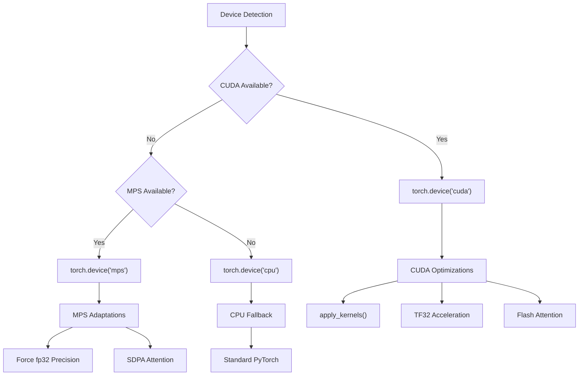
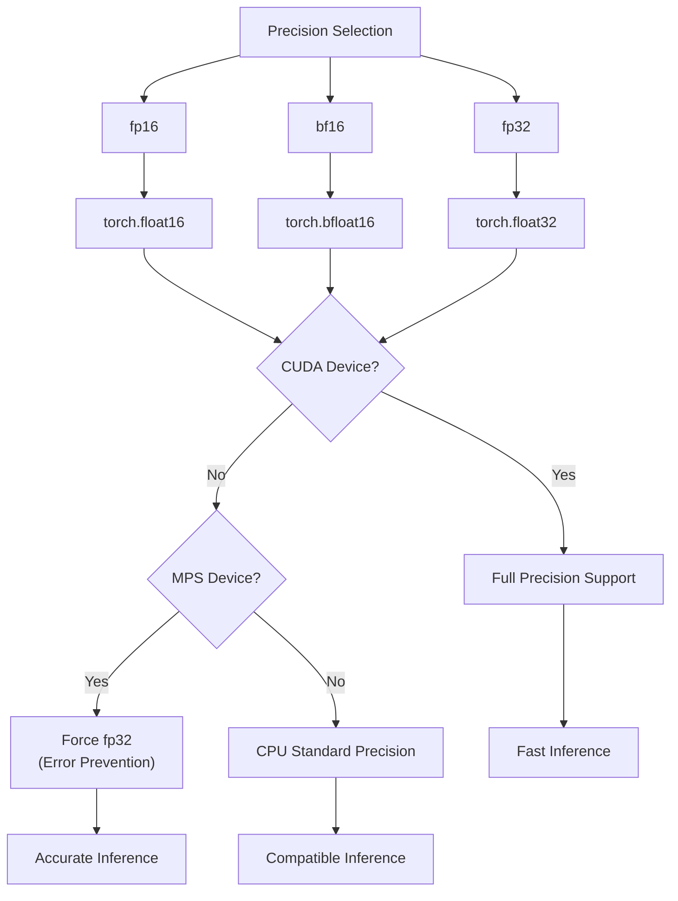
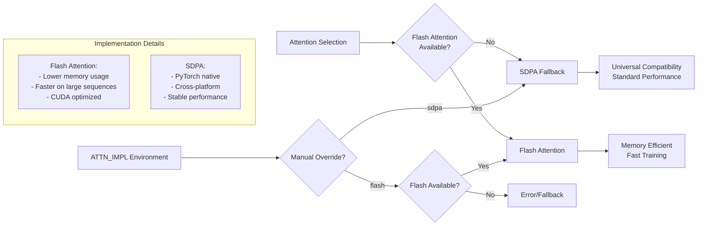
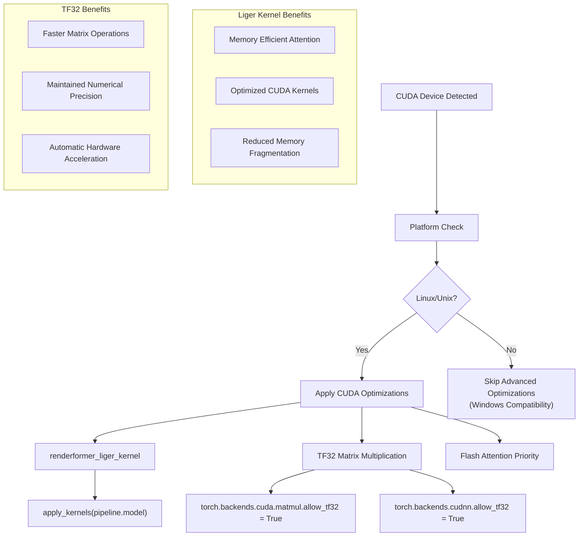
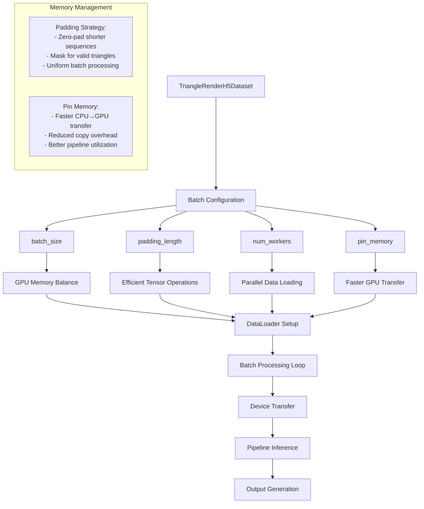
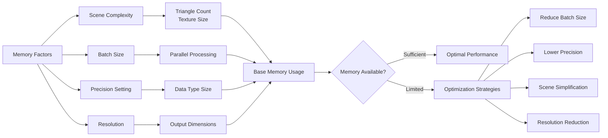
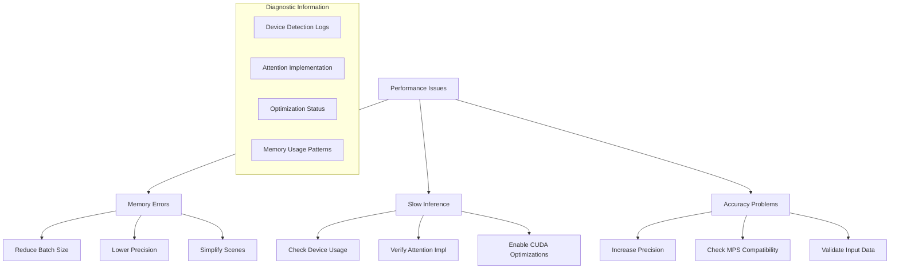

<!-- source: DeepWiki mcp.deepwiki.com · repo microsoft/renderformer · page 4.3 Performance Optimization · fetched 2026-10-26 -->

# Performance Optimization

<details>
<summary>Relevant source files</summary>

The following files were used as context for generating this wiki page:

- [README.md](README.md)
- [batch_infer.py](batch_infer.py)
- [infer.py](infer.py)

</details>


This page covers performance tuning techniques, hardware acceleration options, and optimization strategies for RenderFormer inference. It focuses on maximizing rendering throughput and managing computational resources effectively during both single image and batch inference workflows.

For basic usage instructions, see [Basic Usage](#3.2). For video rendering workflows, see [Video Rendering](#3.3).

## Device Selection and Hardware Acceleration

RenderFormer automatically detects and selects the optimal computational device based on available hardware. The device selection follows a priority hierarchy to maximize performance.



**Device Selection Priority and Optimizations**

| Device | Detection Method | Optimizations Applied |
|--------|------------------|----------------------|
| CUDA | `torch.cuda.is_available()` | Liger kernels, TF32, Flash Attention |
| MPS | `torch.backends.mps.is_available()` | Forced fp32 precision, SDPA |
| CPU | Fallback | Standard PyTorch operations |

The device selection logic is implemented in both inference scripts:

Sources: [infer.py:43-54](), [batch_infer.py:77-91]()

## Precision Control

RenderFormer supports multiple precision modes to balance computational speed and numerical accuracy. Different devices have varying precision support and performance characteristics.



**Precision Performance Characteristics**

| Precision | Memory Usage | Speed | Accuracy | CUDA | MPS | CPU |
|-----------|--------------|-------|----------|------|-----|-----|
| `fp16` | Lowest | Fastest | Good | ✓ | ✗ | ✓ |
| `bf16` | Low | Fast | Better | ✓ | ✗ | ✓ |
| `fp32` | Highest | Slower | Best | ✓ | ✓ | ✓ |

The precision is controlled via the `--precision` argument and automatically converted to the appropriate PyTorch dtype during pipeline execution.

Sources: [infer.py:37,83](), [batch_infer.py:65,89-90,142]()

## Attention Implementation Selection

RenderFormer supports two attention mechanisms: Flash Attention for memory efficiency and Scaled Dot Product Attention (SDPA) for compatibility. The selection can be controlled via environment variables or automatic fallback.



**Attention Implementation Control**

The attention mechanism can be explicitly controlled using the `ATTN_IMPL` environment variable:

```bash
# Force SDPA usage
ATTN_IMPL=sdpa python3 infer.py --h5_file scene.h5

# Use Flash Attention (if available)
ATTN_IMPL=flash python3 infer.py --h5_file scene.h5
```

Sources: [README.md:125-130]()

## CUDA Optimization Features

When running on CUDA devices, RenderFormer applies several GPU-specific optimizations to maximize performance and reduce memory usage.



**CUDA Optimization Implementation**

The CUDA optimizations are conditionally applied based on device and platform detection:

```python
if device == torch.device('cuda') and os.name == 'posix':  # avoid windows
    from renderformer_liger_kernel import apply_kernels
    apply_kernels(pipeline.model)
    torch.backends.cuda.matmul.allow_tf32 = True
    torch.backends.cudnn.allow_tf32 = True
```

Sources: [infer.py:47-51](), [batch_infer.py:83-87]()

## Batch Processing Optimization

For video rendering and high-throughput scenarios, RenderFormer provides batch processing capabilities with configurable parameters to optimize memory usage and processing speed.



**Batch Processing Parameters**

| Parameter | Purpose | Impact | Recommended Values |
|-----------|---------|--------|-------------------|
| `batch_size` | Number of scenes per batch | GPU memory usage | 4-16 depending on VRAM |
| `padding_length` | Max triangles per scene | Memory efficiency | Scene-dependent |
| `num_workers` | Data loading threads | I/O parallelism | 0-4 for most systems |
| `pin_memory` | Memory allocation strategy | Transfer speed | `True` for GPU inference |

Sources: [batch_infer.py:17-58,103-110]()

## Memory Requirements and Scaling

RenderFormer's memory usage scales with scene complexity, batch size, and precision settings. Understanding these relationships helps optimize performance for available hardware.



**Memory Usage Guidelines**

| GPU Memory | Recommended Batch Size | Max Triangles | Precision |
|------------|----------------------|---------------|-----------|
| 8GB | 1-2 | 4096 | fp16 |
| 16GB | 4-8 | 8192 | fp16/bf16 |
| 24GB+ | 8-16 | 8192+ | Any |

Sources: [README.md:77-78]()

## Performance Monitoring and Troubleshooting

RenderFormer provides various indicators and fallback mechanisms to help diagnose and resolve performance issues during inference.



**Common Performance Issues and Solutions**

| Issue | Symptoms | Solutions |
|-------|----------|-----------|
| Out of Memory | CUDA OOM errors | Reduce `batch_size`, use fp16 precision |
| Slow Inference | Long processing times | Enable Flash Attention, use CUDA optimizations |
| Accuracy Loss | Visual artifacts | Use fp32 precision, especially on MPS |
| Import Errors | Missing dependencies | Install Flash Attention, check CUDA setup |

Sources: [infer.py:47-54](), [batch_infer.py:83-91]()

---

