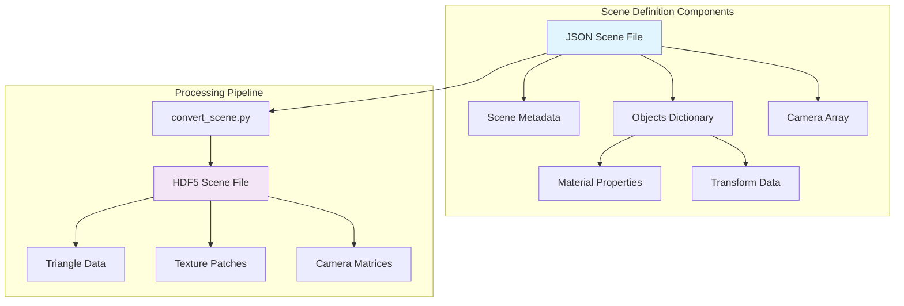
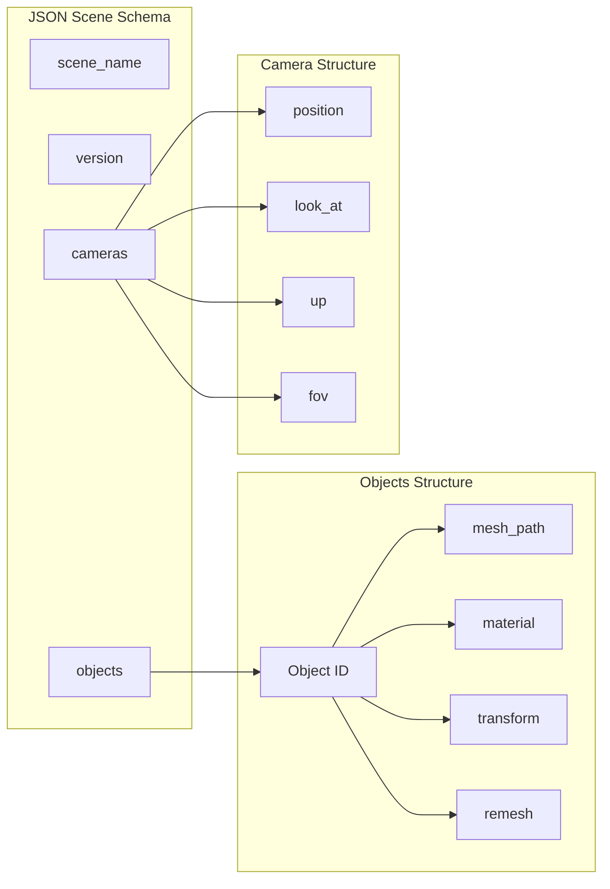
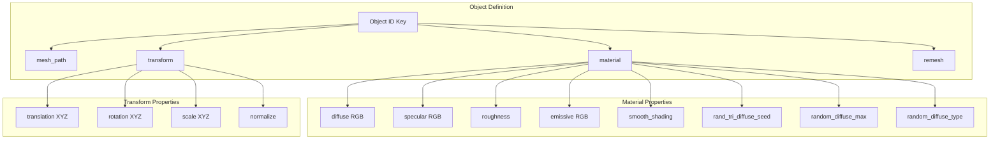
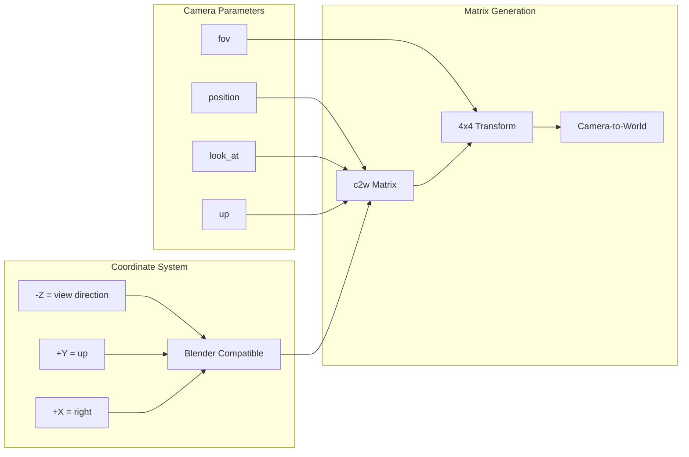
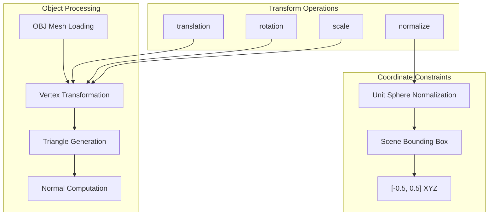
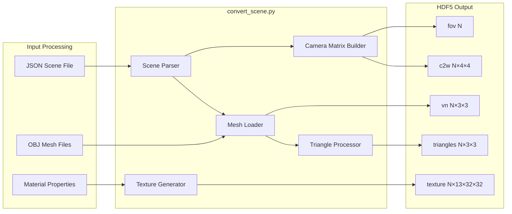
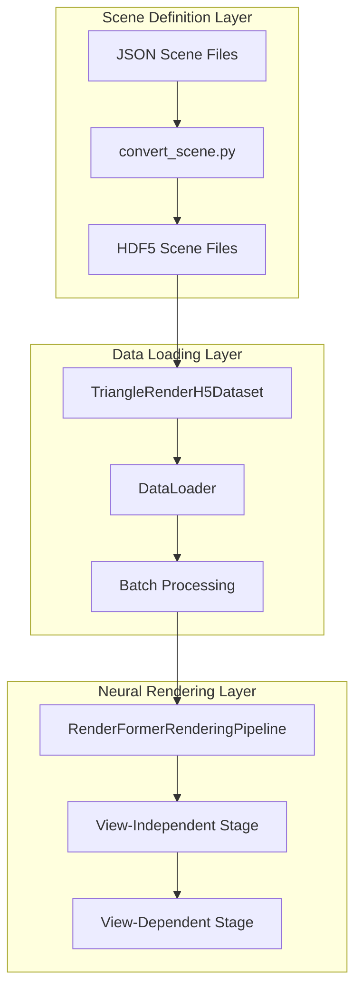

<!-- source: DeepWiki mcp.deepwiki.com · repo microsoft/renderformer · page 5 Scene Definition · fetched 2026-10-26 -->

# Scene Definition

Relevant source files

The following files were used as context for generating this wiki page:

- [README.md](README.md)
- [examples/cbox.json](examples/cbox.json)

This document covers RenderFormer's scene definition system, which uses a JSON-based format to describe 3D scenes including geometry, materials, lighting, and camera configurations. The scene definition serves as the primary input to the RenderFormer neural rendering pipeline and is converted to HDF5 format for processing.

For information about the scene processing pipeline that converts these definitions, see [Scene Processing](#2.2). For details on the underlying data formats used during rendering, see [Data Formats](#2.3).

## Scene Definition Overview

RenderFormer uses a hierarchical JSON-based scene description format that defines all aspects of a 3D scene. The system follows a structured approach where scenes are composed of objects, materials, cameras, and transformations that are processed into a format suitable for neural rendering.

**Scene Definition to Processing Flow**

Sources: [README.md:230-288](), [examples/cbox.json:1-320]()

## JSON Scene Structure

The scene definition follows a standardized JSON schema with four primary components organized in a hierarchical structure.

| Component | Purpose | Required |
|-----------|---------|----------|
| `scene_name` | Descriptive identifier for the scene | Yes |
| `version` | Scene format version (currently "1.0") | Yes |
| `objects` | Dictionary of scene objects and lighting | Yes |
| `cameras` | Array of camera configurations | Yes |

**JSON Scene Schema Structure**

Sources: [README.md:234-240](), [examples/cbox.json:1-10]()

## Object and Material System

Each object in the scene requires specific configuration for geometry, materials, and spatial positioning. The material system supports physically-based rendering properties with constraints on energy conservation.

### Object Configuration

**Object and Material Configuration Structure**

### Material Property Constraints

The material system enforces specific constraints for physical plausibility:

| Property | Range | Constraint |
|----------|-------|------------|
| `diffuse` | [0.0, 1.0] per channel | diffuse + specular ≤ 1.0 |
| `specular` | [0.0, 1.0] per channel | Currently white only |
| `roughness` | [0.01, 1.0] | Surface microsurface roughness |
| `emissive` | [0.0, ∞] per channel | Light source only, white only |
| `smooth_shading` | boolean | Vertex normal interpolation |

Sources: [README.md:241-262](), [examples/cbox.json:25-46]()

## Camera Configuration System

Camera configuration defines the viewpoint and projection parameters for rendering. The system uses a standard camera model with position, orientation, and field of view parameters.

**Camera Configuration and Coordinate System**

### Camera Parameter Specification

| Parameter | Type | Description |
|-----------|------|-------------|
| `position` | [x, y, z] | Camera world position |
| `look_at` | [x, y, z] | Target point for camera orientation |
| `up` | [x, y, z] | Up vector for camera orientation |
| `fov` | float | Field of view in degrees |

The system uses Blender's coordinate convention where -Z is the view direction, +Y is up, and +X is right.

Sources: [README.md:264-271](), [README.md:286-287](), [examples/cbox.json:300-319]()

## Transform and Coordinate System

The transform system handles object positioning, orientation, and scaling within the scene coordinate space. Objects can be transformed through translation, rotation, scaling, and normalization operations.

**Transform System and Coordinate Processing**

### Transform Parameters

| Parameter | Type | Description |
|-----------|------|-------------|
| `translation` | [x, y, z] | Object position offset |
| `rotation` | [x, y, z] | Rotation in degrees per axis |
| `scale` | [x, y, z] | Scale factors per axis |
| `normalize` | boolean | Normalize to unit sphere |

Sources: [README.md:255-261](), [examples/cbox.json:175-192]()

## Scene Processing Pipeline

The scene definition undergoes conversion from JSON format to HDF5 format through the `convert_scene.py` processor. This conversion handles mesh loading, material processing, and data preparation for neural rendering.

**Scene Processing Pipeline Flow**

### HDF5 Data Structure

The conversion process generates HDF5 files with specific data arrays:

| Field | Shape | Description |
|-------|-------|-------------|
| `triangles` | [N, 3, 3] | Triangle vertex coordinates |
| `texture` | [N, 13, 32, 32] | Material texture patches |
| `vn` | [N, 3, 3] | Vertex normal vectors |
| `c2w` | [N, 4, 4] | Camera-to-world matrices |
| `fov` | [N] | Field of view values |

Sources: [README.md:276-285](), [README.md:109-115]()

## Scene Configuration Constraints

RenderFormer has specific constraints based on its training data distribution. These constraints ensure optimal performance within the model's learned domain.

### Training Data Constraints

| Component | Constraint | Range |
|-----------|------------|-------|
| Camera Distance | Scene center distance | [1.5, 2.0] units |
| Field of View | Camera FOV | [30, 60] degrees |
| Scene Bounds | Bounding box | [-0.5, 0.5] XYZ |
| Light Sources | Triangle count | Up to 8 triangles |
| Light Scale | Light source scale | [2.0, 2.5] units |
| Light Distance | Distance to center | [2.1, 2.7] units |
| Light Emission | Summed emission | [2500, 5000] units |
| Total Triangles | Scene triangle count | Up to 4096 (8192 during inference) |

### Mesh Quality Requirements

- Water-tight meshes preferred
- Uniform triangle sizes recommended
- QSlim simplification suggested
- Remeshing tools available via [scene_processor/remesh.py]()

Sources: [README.md:304-313](), [README.md:290-298]()

## Integration with Rendering Pipeline

The scene definition system integrates with the broader RenderFormer architecture through the HDF5 conversion process and dataset loading mechanisms.

**Scene Definition Integration Architecture**

The scene definition system serves as the foundational input layer that feeds into the neural rendering pipeline through standardized data formats and processing workflows.

Sources: [README.md:149-189](), [README.md:192-227]()

---

