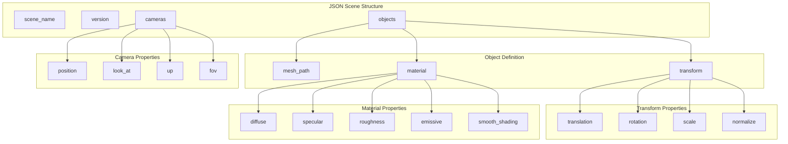
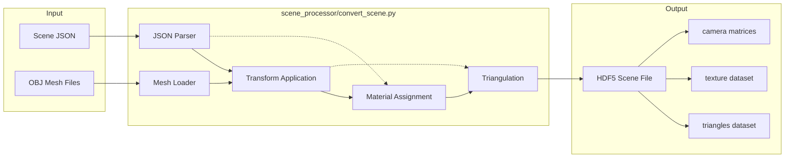

<!-- source: DeepWiki mcp.deepwiki.com · repo microsoft/renderformer · page 5.1 JSON Scene Format · fetched 2026-10-26 -->

# JSON Scene Format

<details>
<summary>Relevant source files</summary>

The following files were used as context for generating this wiki page:

- [examples/cbox-bunny.json](examples/cbox-bunny.json)
- [examples/cbox.json](examples/cbox.json)
- [examples/init-template.json](examples/init-template.json)

</details>


This document specifies the JSON scene definition format used by RenderFormer to describe 3D scenes. The JSON format serves as the primary input for scene definition, containing geometry references, material properties, transformations, and camera configurations that are processed into the neural rendering pipeline.

For information about specific object and material properties, see [Objects and Materials](#5.2). For advanced scene composition features, see [Advanced Scene Features](#5.3).

## Schema Overview

The JSON scene format follows a structured schema that defines all components necessary for neural rendering. The format is processed by the scene conversion pipeline to generate HDF5 files for the RenderFormer neural renderer.



*Sources: [examples/cbox.json:1-320](), [examples/cbox-bunny.json:1-278](), [examples/init-template.json:1-236]()*

## Top-Level Properties

The JSON scene format contains four required top-level properties:

| Property | Type | Description | Example |
|----------|------|-------------|---------|
| `scene_name` | string | Human-readable scene identifier | `"cornell box"` |
| `version` | string | Scene format version | `"1.0"` |
| `objects` | object | Dictionary of scene objects | See Objects section |
| `cameras` | array | Array of camera definitions | See Cameras section |

```json
{
    "scene_name": "cornell box",
    "version": "1.0",
    "objects": { ... },
    "cameras": [ ... ]
}
```

*Sources: [examples/cbox.json:1-4](), [examples/cbox-bunny.json:1-4]()*

## Objects Section

The `objects` section contains a dictionary where each key is a unique object identifier and each value defines the object's properties. Objects are the fundamental building blocks of scenes, combining geometry, transformations, and materials.

### Object Structure

Each object contains three required sections:

| Property | Type | Description |
|----------|------|-------------|
| `mesh_path` | string | Relative path to OBJ mesh file |
| `transform` | object | Spatial transformation parameters |
| `material` | object | Material and shading properties |

### Transform Properties

| Property | Type | Description | Default |
|----------|------|-------------|---------|
| `translation` | [x, y, z] | 3D translation vector | `[0.0, 0.0, 0.0]` |
| `rotation` | [x, y, z] | Euler rotation angles in degrees | `[0.0, 0.0, 0.0]` |
| `scale` | [x, y, z] | 3D scaling factors | `[1.0, 1.0, 1.0]` |
| `normalize` | boolean | Whether to normalize mesh to unit scale | `false` |

### Material Properties

| Property | Type | Description | Range |
|----------|------|-------------|-------|
| `diffuse` | [r, g, b] | Base color reflectance | [0.0, 1.0] |
| `specular` | [r, g, b] | Specular reflectance | [0.0, 1.0] |
| `roughness` | number | Surface roughness | [0.0, 1.0] |
| `emissive` | [r, g, b] | Emissive light contribution | [0.0, ∞] |
| `smooth_shading` | boolean | Enable smooth normal interpolation | `true`/`false` |
| `random_diffuse_max` | number | Maximum random diffuse variation | [0.0, 1.0] |
| `rand_tri_diffuse_seed` | number\|null | Random seed for diffuse variation | Optional |

*Sources: [examples/cbox.json:4-256](), [examples/cbox-bunny.json:4-214]()*

## Cameras Section

The `cameras` section defines viewpoint configurations as an array of camera objects. Each camera specifies the viewing parameters for rendering.

### Camera Properties

| Property | Type | Description |
|----------|------|-------------|
| `position` | [x, y, z] | Camera world position |
| `look_at` | [x, y, z] | Target point to look at |
| `up` | [x, y, z] | Up vector for camera orientation |
| `fov` | number | Field of view angle in degrees |

```json
"cameras": [
    {
        "position": [0.0, -2.0, 0.0],
        "look_at": [0.0, 0.0, 0.0],
        "up": [0.0, 0.0, 1.0],
        "fov": 37.5
    }
]
```

*Sources: [examples/cbox.json:300-319](), [examples/cbox-bunny.json:258-277]()*

## Processing Pipeline Integration

The JSON scene format serves as input to the scene processing pipeline, which converts scenes into the HDF5 format required by the neural renderer.



*Sources: Based on scene processing pipeline architecture*

## Example Scene Structure

Here is a complete example showing the structure of a Cornell box scene with multiple objects:

```json
{
    "scene_name": "cornell box",
    "version": "1.0",
    "objects": {
        "background_0": {
            "mesh_path": "templates/backgrounds/plane.obj",
            "transform": {
                "translation": [0.0, 0.0, 0.0],
                "rotation": [0.0, 0.0, 0.0],
                "scale": [0.5, 0.5, 0.5],
                "normalize": false
            },
            "material": {
                "diffuse": [0.4, 0.4, 0.4],
                "specular": [0.01, 0.01, 0.01],
                "roughness": 0.99,
                "emissive": [0.0, 0.0, 0.0],
                "smooth_shading": true
            }
        },
        "light_0": {
            "mesh_path": "templates/lighting/tri.obj",
            "transform": {
                "translation": [0.0, 0.0, 2.1],
                "scale": [2.5, 2.5, 2.5]
            },
            "material": {
                "emissive": [5000.0, 5000.0, 5000.0],
                "smooth_shading": false
            }
        }
    },
    "cameras": [
        {
            "position": [0.0, -2.0, 0.0],
            "look_at": [0.0, 0.0, 0.0],
            "up": [0.0, 0.0, 1.0],
            "fov": 37.5
        }
    ]
}
```

*Sources: [examples/cbox.json:1-320](), [examples/init-template.json:1-236]()*

## Object Categories

The example scenes demonstrate common object categories used in RenderFormer scenes:

| Category | Purpose | Example Objects |
|----------|---------|-----------------|
| Background | Scene environment | `background_0`, `background_1`, `wall0.obj`, `plane.obj` |
| Geometry | Primary scene objects | `bunny`, `tall_box`, `short_box` |
| Lighting | Emissive light sources | `light_0`, `tri.obj` |

Each category uses the same JSON structure but differs in mesh paths, material properties, and typical usage patterns.

*Sources: [examples/cbox.json:4-298](), [examples/cbox-bunny.json:4-256]()*

---

