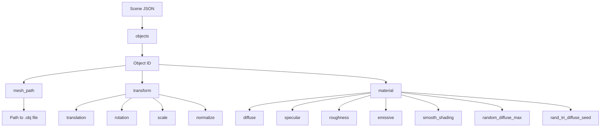
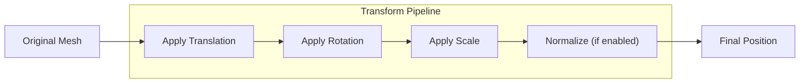
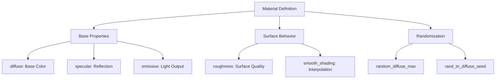
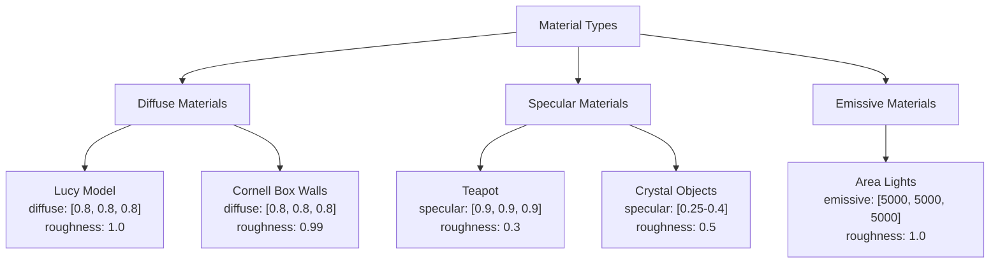
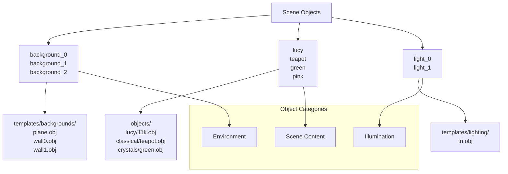
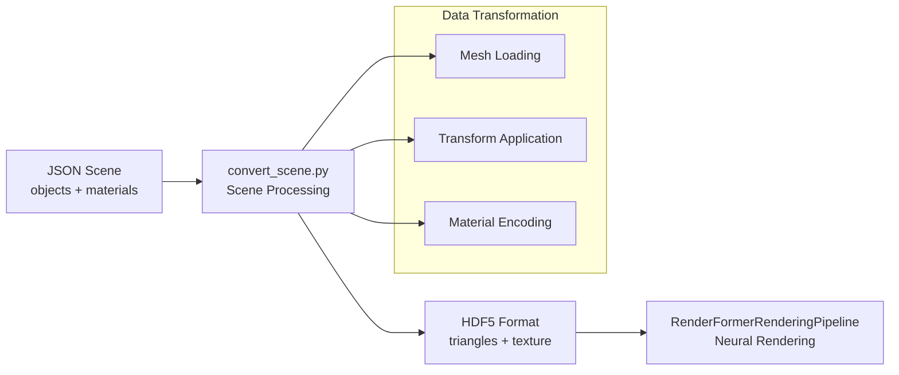

<!-- source: DeepWiki mcp.deepwiki.com · repo microsoft/renderformer · page 5.2 Objects and Materials · fetched 2026-10-26 -->

# Objects and Materials

Relevant source files

The following files were used as context for generating this wiki page:

- [examples/cbox-lucy.json](examples/cbox-lucy.json)
- [examples/cbox-teapot.json](examples/cbox-teapot.json)
- [examples/crystals.json](examples/crystals.json)

This page documents the structure and properties of objects and materials within RenderFormer's JSON scene definition format. Objects define the 3D geometry and spatial positioning, while materials control the visual appearance and rendering properties of surfaces.

For information about the overall JSON scene structure and cameras, see [JSON Scene Format](#5.1). For advanced material features and complex scene composition, see [Advanced Scene Features](#5.3).

## Object Structure Overview

Objects in RenderFormer scenes are defined within the `objects` dictionary, where each object consists of three main components: mesh geometry reference, spatial transform, and material properties.

**Object Definition Flow**
Sources: [examples/cbox-lucy.json:4-256](), [examples/cbox-teapot.json:4-256](), [examples/crystals.json:4-298]()

## Object Properties

### Mesh Reference

The `mesh_path` property specifies the path to the 3D geometry file relative to the scene definition:

| Property | Type | Description |
|----------|------|-------------|
| `mesh_path` | string | Relative path to .obj geometry file |

Common mesh categories include:
- `templates/backgrounds/` - Scene backgrounds and walls
- `templates/lighting/` - Light source geometry
- `objects/` - Primary scene objects

### Transform Properties

The `transform` object controls the spatial positioning and scaling of objects:

| Property | Type | Range | Description |
|----------|------|-------|-------------|
| `translation` | [x, y, z] | Any float | Object position offset |
| `rotation` | [x, y, z] | 0-360° | Rotation angles in degrees |
| `scale` | [x, y, z] | > 0 | Scaling factors per axis |
| `normalize` | boolean | true/false | Auto-fit object to unit scale |

**Transform Processing Pipeline**
Sources: [examples/cbox-lucy.json:175-191](), [examples/cbox-teapot.json:175-191]()

## Material Properties

Materials in RenderFormer use a simplified physically-based rendering model with the following properties:

### Core Material Properties

| Property | Type | Range | Description |
|----------|------|-------|-------------|
| `diffuse` | [r, g, b] | 0.0-1.0 | Base surface color |
| `specular` | [r, g, b] | 0.0-1.0 | Reflective surface color |
| `roughness` | float | 0.0-1.0 | Surface roughness (0=mirror, 1=matte) |
| `emissive` | [r, g, b] | 0.0+ | Light emission values |

### Shading Control

| Property | Type | Description |
|----------|------|-------------|
| `smooth_shading` | boolean | Enable smooth vs flat shading |
| `random_diffuse_max` | float | Maximum randomization for diffuse color |
| `rand_tri_diffuse_seed` | int/null | Seed for triangle color randomization |

**Material Property Categories**
Sources: [examples/cbox-lucy.json:25-45](), [examples/cbox-teapot.json:193-213](), [examples/crystals.json:67-87]()

## Material Types and Examples

### Diffuse Materials
Matte surfaces with minimal reflection:
- High `diffuse` values (0.5-0.8)
- Low `specular` values (0.01-0.1)  
- High `roughness` (0.8-1.0)

### Specular Materials
Reflective surfaces like metals or glass:
- Low `diffuse` values (0.0-0.2)
- High `specular` values (0.5-0.9)
- Low `roughness` (0.0-0.3)

### Emissive Materials
Light-emitting surfaces:
- High `emissive` values (1000.0+)
- Used for area lights and illumination

**Material Type Examples**
Sources: [examples/cbox-lucy.json:193-213](), [examples/cbox-teapot.json:193-213](), [examples/crystals.json:277-297]()

## Object Categorization

RenderFormer scenes typically organize objects into functional categories:

### Background Objects
Scene environment and walls:
- Prefix: `background_N`
- Mesh paths: `templates/backgrounds/`
- Materials: Neutral diffuse colors

### Primary Objects  
Main scene elements:
- Custom names: `lucy`, `teapot`, `green`, `pink`
- Mesh paths: `objects/`
- Materials: Varied based on desired appearance

### Light Objects
Illumination sources:
- Prefix: `light_N`
- Mesh paths: `templates/lighting/`
- Materials: High emissive values

**Scene Object Organization**
Sources: [examples/cbox-lucy.json:4-256](), [examples/cbox-teapot.json:4-256](), [examples/crystals.json:4-298]()

## Processing Pipeline Integration

Objects and materials defined in JSON are processed through the scene conversion pipeline before neural rendering:

**Scene Processing Integration**
Sources: [examples/cbox-lucy.json:1-278](), [examples/cbox-teapot.json:1-278](), [examples/crystals.json:1-320]()

---

