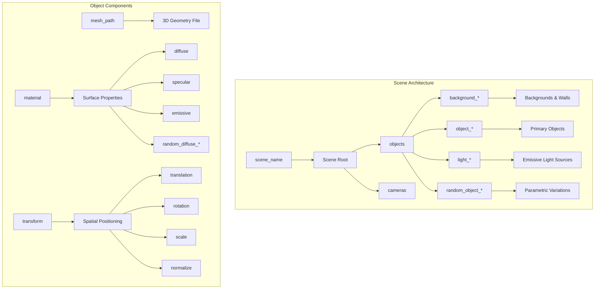
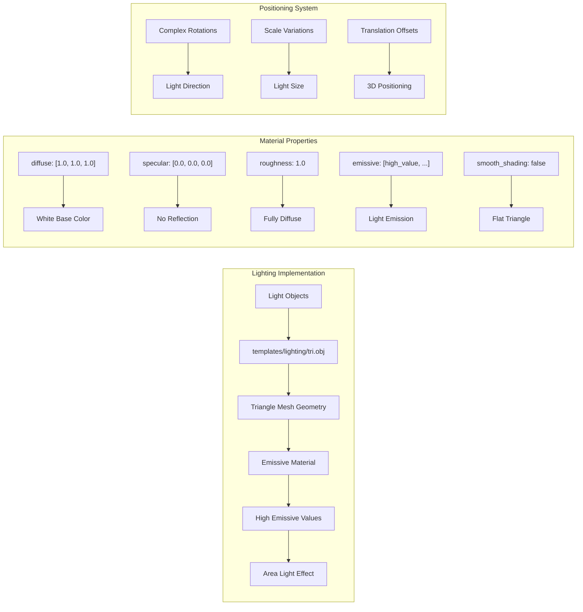
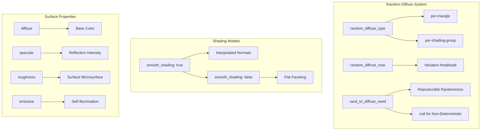
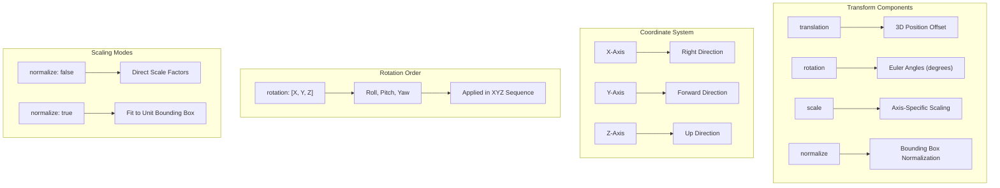
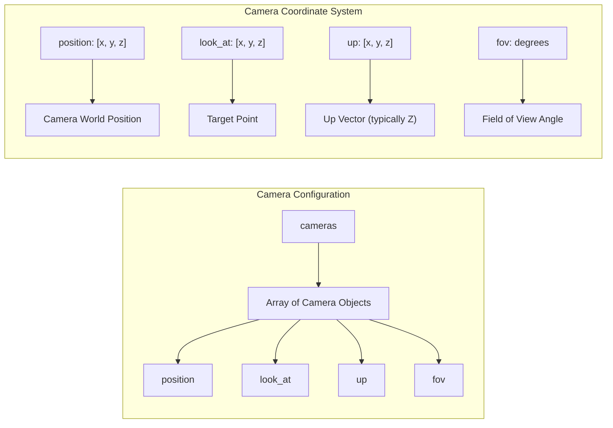

<!-- source: DeepWiki mcp.deepwiki.com · repo microsoft/renderformer · page 5.3 Advanced Scene Features · fetched 2026-10-26 -->

# Advanced Scene Features

<details>
<summary>Relevant source files</summary>

The following files were used as context for generating this wiki page:

- [examples/compose-scene.json](examples/compose-scene.json)
- [examples/constant-width.json](examples/constant-width.json)
- [examples/fox-in-the-wild.json](examples/fox-in-the-wild.json)

</details>


This document covers advanced scene composition techniques and complex material properties for RenderFormer scenes. It focuses on multi-object scenes, sophisticated lighting setups, advanced material properties, and complex geometric transformations. For basic scene format structure, see [JSON Scene Format](#5.1). For fundamental object and material definitions, see [Objects and Materials](#5.2).

## Complex Scene Composition

Advanced RenderFormer scenes typically involve multiple objects with coordinated materials, lighting, and positioning to create compelling visual compositions. The scene architecture supports sophisticated arrangements through structured object hierarchies and systematic naming conventions.



**Multi-Object Scene Structure**

Complex scenes use systematic object naming patterns to organize different functional groups:

| Object Type | Naming Pattern | Purpose |
|-------------|----------------|---------|
| Background Elements | `background_0`, `background_1` | Scene environments, walls, floors |
| Primary Objects | `object_0`, `object_1`, `object_2` | Main scene content |
| Light Sources | `light_0`, `light_1`, `light_2` | Emissive lighting geometry |
| Variations | `random_object_0`, `random_object_1` | Parametric object instances |

Sources: [examples/compose-scene.json:4-306](), [examples/constant-width.json:4-435](), [examples/fox-in-the-wild.json:4-257]()

## Advanced Lighting Systems

RenderFormer implements lighting through emissive materials on geometric objects rather than traditional light primitives. This approach enables complex lighting scenarios with area lights, multiple light sources, and realistic light falloff patterns.



**Emissive Light Configuration**

Light objects use standardized material configurations with high emissive values:

```json
"material": {
    "diffuse": [1.0, 1.0, 1.0],
    "specular": [0.0, 0.0, 0.0], 
    "roughness": 1.0,
    "emissive": [633.1068437359679, 633.1068437359679, 633.1068437359679],
    "smooth_shading": false,
    "random_diffuse_max": 0.0
}
```

The `emissive` values typically range from 600-1300 units, creating realistic lighting intensities. The `smooth_shading: false` setting ensures sharp light boundaries, while zero `specular` values prevent unwanted reflections from light sources themselves.

Sources: [examples/compose-scene.json:220-305](), [examples/constant-width.json:220-434](), [examples/fox-in-the-wild.json:215-256]()

## Advanced Material Properties

RenderFormer supports sophisticated material systems including stochastic surface variations, per-triangle randomization, and advanced shading models that create realistic surface appearance variations.

**Stochastic Material Variations**



**Material Randomization Patterns**

| Property | Type | Effect |
|----------|------|--------|
| `random_diffuse_type: "per-triangle"` | Triangle-level | Each triangle gets unique color variation |
| `random_diffuse_type: "per-shading-group"` | Group-level | Coherent variation across mesh regions |
| `rand_tri_diffuse_seed: 42` | Deterministic | Reproducible random patterns |
| `rand_tri_diffuse_seed: null` | Non-deterministic | Different results each conversion |

**Surface Finish Configurations**

Common material archetypes used in complex scenes:

```json
// Metallic Surface
{
    "diffuse": [0.1, 0.1, 0.1],
    "specular": [0.8, 0.8, 0.8], 
    "roughness": 0.01,
    "smooth_shading": true
}

// Matte Diffuse
{
    "diffuse": [0.7, 0.3, 0.3],
    "specular": [0.05, 0.05, 0.05],
    "roughness": 0.99,
    "smooth_shading": true
}

// Glossy Plastic
{
    "diffuse": [0.3, 0.3, 0.6],
    "specular": [0.25, 0.25, 0.25],
    "roughness": 0.5,
    "smooth_shading": true
}
```

Sources: [examples/compose-scene.json:7-28, 50-70, 93-113](), [examples/constant-width.json:93-113, 136-156]()

## Complex Geometric Transforms

Advanced scenes require sophisticated object positioning through multi-axis rotations, non-uniform scaling, and coordinate system transformations. The transform system supports both absolute positioning and normalization-based scaling.



**Complex Transform Examples**

Light positioning often requires sophisticated transforms to achieve desired illumination angles:

```json
"transform": {
    "translation": [-1.8, -0.34037638631336636, 1.0],
    "rotation": [123.92335502433075, -5.352786763315667, 89.60311887692926],
    "scale": [2.1086832414263728, 2.4971117998814916, 2.4351061547225124],
    "normalize": false
}
```

Object instancing with parametric variations:

```json
"transform": {
    "translation": [-0.2, -0.2, 0.2],
    "rotation": [90, 90, 180],
    "scale": [0.4, 0.4, 0.4], 
    "normalize": true
}
```

**Transform Processing Pipeline**

1. **Normalization** (if `normalize: true`): Object scaled to unit bounding box
2. **Scaling**: Applied per-axis multiplication 
3. **Rotation**: Euler angle rotation in X→Y→Z order
4. **Translation**: Final position offset in world space

Sources: [examples/compose-scene.json:244-261, 287-304](), [examples/constant-width.json:158-175, 201-218]()

## Multi-Camera Scene Setup

While most example scenes use single cameras, the scene format supports multiple camera configurations for different viewing angles and field-of-view settings.



**Camera Positioning Strategies**

| Scene Type | Position Strategy | FOV Range |
|------------|------------------|-----------|
| Object Focus | Close positioning, centered look_at | 30-40° |
| Environmental | Wider positioning, scene overview | 40-60° |
| Detail Views | Tight positioning, specific features | 20-30° |

Standard camera configuration:

```json
"cameras": [{
    "position": [0.0, -1.35, 0.8],
    "look_at": [0.0, 0.0, 0.0],
    "up": [0.0, 0.0, 1.0],
    "fov": 40
}]
```

Sources: [examples/compose-scene.json:307-326](), [examples/constant-width.json:436-455](), [examples/fox-in-the-wild.json:258-277]()

## Scene Optimization Strategies

Advanced scenes require careful balance between visual complexity and computational efficiency. Scene organization and material choices significantly impact rendering performance and memory usage.

**Object Count Management**

- **Background elements**: 1-2 objects for environmental context
- **Primary objects**: 3-5 objects for main scene content  
- **Light sources**: 2-5 lights for adequate illumination
- **Total triangles**: Monitor through scene conversion process

**Material Complexity Balance**

- Use `smooth_shading: false` for geometric objects requiring crisp edges
- Apply `random_diffuse_*` selectively to avoid excessive stochastic computation
- Balance `roughness` values between 0.01 (mirror) and 1.0 (matte) for realistic surfaces
- Keep `emissive` values proportional to scene scale (typically 500-1500 range)

Sources: [examples/compose-scene.json:1-327](), [examples/constant-width.json:1-456](), [examples/fox-in-the-wild.json:1-278]()

---

