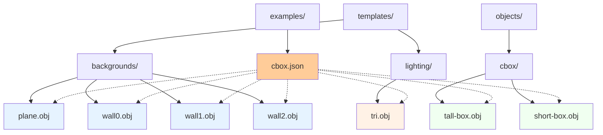
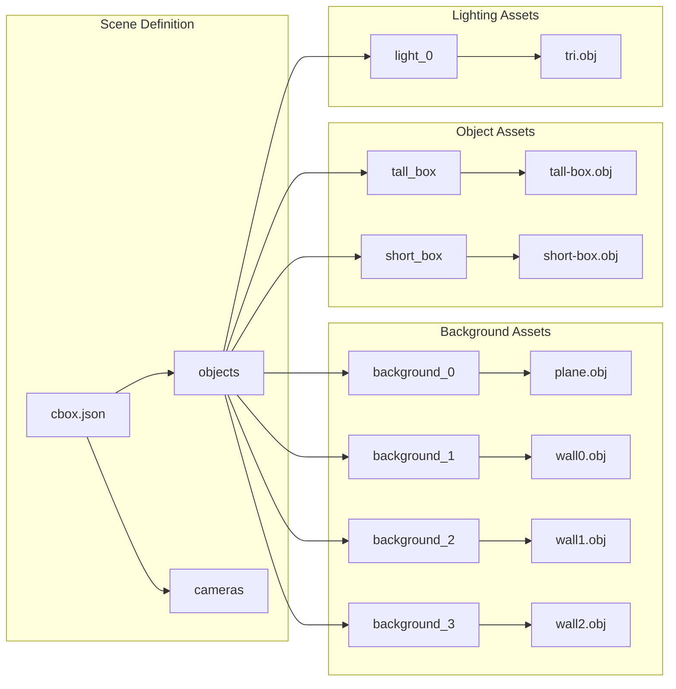
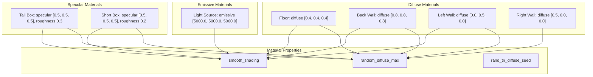
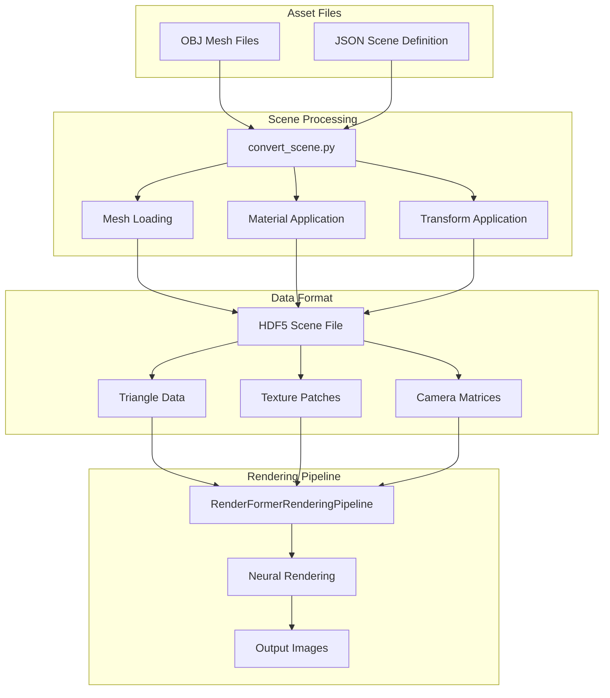

<!-- source: DeepWiki mcp.deepwiki.com · repo microsoft/renderformer · page 6 Examples & Assets · fetched 2026-10-26 -->

# Examples & Assets

<details>
<summary>Relevant source files</summary>

The following files were used as context for generating this wiki page:

- [examples/cbox.json](examples/cbox.json)
- [examples/objects/classical/bunny.obj](examples/objects/classical/bunny.obj)

</details>


This page documents the example scenes and 3D model assets included with RenderFormer. These resources demonstrate the system's capabilities and provide ready-to-use content for testing and experimentation. The examples range from classic rendering test scenes to more complex compositions, showcasing different material properties, lighting setups, and geometric configurations.

For information about creating custom scenes, see [Scene Definition](#5). For details about the scene processing pipeline, see [Scene Processing](#2.2).

## Asset Organization Structure

RenderFormer includes a structured collection of 3D models and example scenes organized into logical categories. The asset hierarchy supports modular scene composition through reusable components.

### Asset Directory Structure



This diagram shows how scene JSON files reference distributed 3D model assets through relative paths, enabling modular scene composition.

**Sources:** [examples/cbox.json:1-320]()

### Scene Component Mapping

The relationship between JSON scene definitions and their corresponding 3D assets follows a structured referencing system that enables flexible scene composition.



This mapping demonstrates how scene objects reference their corresponding mesh files through the `mesh_path` property in the JSON structure.

**Sources:** [examples/cbox.json:4-298]()

## Cornell Box Scene Analysis

The Cornell Box is a classic computer graphics test scene that provides a controlled environment for evaluating rendering algorithms. RenderFormer's implementation demonstrates material variety, lighting setup, and geometric complexity.

### Scene Composition

| Component | Mesh File | Material Properties | Purpose |
|-----------|-----------|-------------------|---------|
| Floor | `templates/backgrounds/plane.obj` | Neutral gray diffuse | Base surface |
| Back Wall | `templates/backgrounds/wall0.obj` | White diffuse | Background |
| Left Wall | `templates/backgrounds/wall1.obj` | Green diffuse | Color reference |
| Right Wall | `templates/backgrounds/wall2.obj` | Red diffuse | Color reference |
| Tall Box | `objects/cbox/tall-box.obj` | Specular, low roughness | Reflective object |
| Short Box | `objects/cbox/short-box.obj` | Specular, very low roughness | Highly reflective |
| Light Source | `templates/lighting/tri.obj` | High emissive values | Area light |

**Sources:** [examples/cbox.json:4-298]()

### Material Configuration Details

The Cornell Box scene showcases different material types and their rendering characteristics:



The material system supports both physically-based properties and procedural variations through randomization parameters.

**Sources:** [examples/cbox.json:25-297]()

### Camera Configuration

The Cornell Box uses a single camera positioned to capture the classic view of the scene:

| Parameter | Value | Description |
|-----------|-------|-------------|
| Position | `[0.0, -2.0, 0.0]` | Camera location in world space |
| Look At | `[0.0, 0.0, 0.0]` | Target point for camera direction |
| Up Vector | `[0.0, 0.0, 1.0]` | Camera orientation reference |
| Field of View | `37.5` | Viewing angle in degrees |

**Sources:** [examples/cbox.json:300-319]()

## Asset Integration Workflow

The process of using example assets in RenderFormer follows a clear pipeline from asset files to rendered output.



This workflow demonstrates how static assets are processed through the scene conversion pipeline to become inputs for neural rendering.

**Sources:** [examples/cbox.json:1-320]()

## Usage Examples

### Loading Example Scenes

Example scenes can be processed using the scene conversion tools:

```bash
python scene_processor/convert_scene.py examples/cbox.json --output cbox.h5
```

The converted HDF5 file can then be used with the inference scripts:

```bash
python infer.py --scene cbox.h5 --output rendered_cbox.png
```

### Asset Path Resolution

Scene JSON files use relative paths to reference 3D models. The path resolution follows these patterns:

- `templates/backgrounds/` - Environmental geometry
- `templates/lighting/` - Light source geometry  
- `objects/[category]/` - Scene objects organized by type

Transform parameters in the JSON allow positioning, rotating, and scaling assets without modifying the original mesh files.

**Sources:** [examples/cbox.json:6-298]()

---

