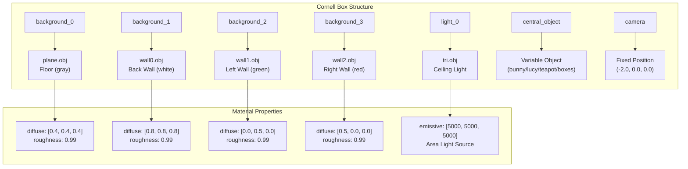
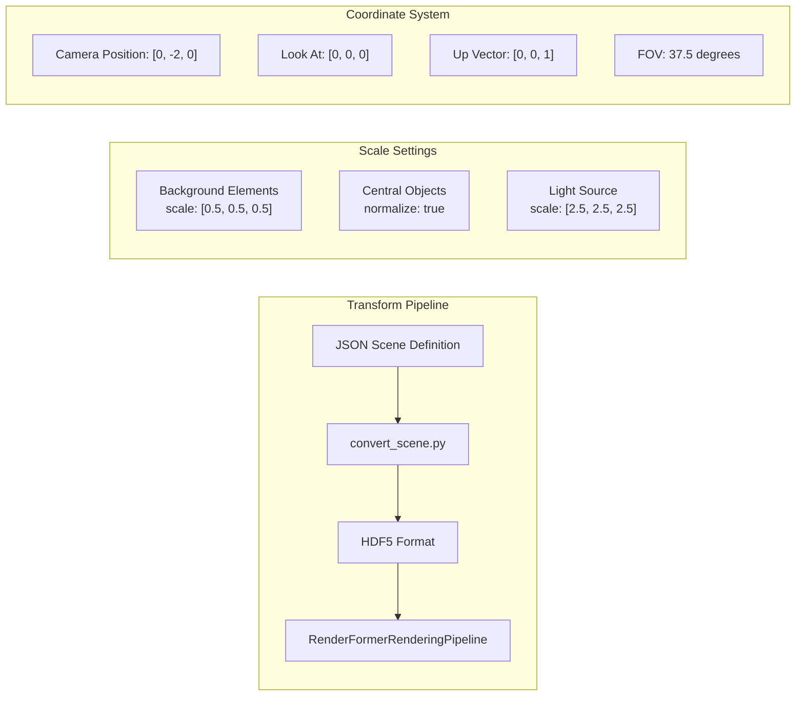
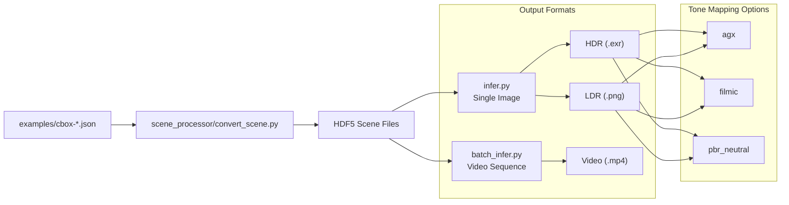

<!-- source: DeepWiki mcp.deepwiki.com · repo microsoft/renderformer · page 6.1 Cornell Box Scenes · fetched 2026-10-26 -->

# Cornell Box Scenes

<details>
<summary>Relevant source files</summary>

The following files were used as context for generating this wiki page:

- [examples/cbox-bunny.json](examples/cbox-bunny.json)
- [examples/cbox-lucy.json](examples/cbox-lucy.json)
- [examples/cbox-teapot.json](examples/cbox-teapot.json)
- [examples/cbox.json](examples/cbox.json)

</details>


This document covers the Cornell Box example scenes included with RenderFormer, which serve as classic computer graphics test cases for validating rendering algorithms and demonstrating different material properties. These scenes provide standardized configurations for testing the neural rendering pipeline with known reference outputs.

For information about creating custom scenes, see [JSON Scene Format](#5.1). For details about the rendering pipeline that processes these scenes, see [Rendering Pipeline](#2.1).

## Overview

The Cornell Box scenes are located in the `examples/` directory and represent the classic Cornell Box setup - a simple room with colored walls and various objects inside. RenderFormer includes four variants that demonstrate different geometric complexity and material properties:

| Scene File | Central Object | Mesh Path | Material Properties |
|------------|----------------|-----------|-------------------|
| `cbox.json` | Two boxes | `objects/cbox/tall-box.obj`, `objects/cbox/short-box.obj` | Specular surfaces with different roughness |
| `cbox-bunny.json` | Stanford Bunny | `objects/classical/bunny.obj` | Highly reflective surface (specular: 0.9) |
| `cbox-lucy.json` | Lucy statue | `objects/lucy/11k.obj` | Diffuse surface (11k triangle mesh) |
| `cbox-teapot.json` | Utah Teapot | `objects/classical/teapot.obj` | Semi-reflective surface (roughness: 0.3) |

## Scene Architecture

All Cornell Box scenes share a common structural foundation consisting of background geometry, lighting, and camera configuration, with only the central object varying between scenes.

### Common Scene Structure



Sources: [examples/cbox.json:1-320](), [examples/cbox-bunny.json:1-278](), [examples/cbox-lucy.json:1-278](), [examples/cbox-teapot.json:1-278]()

### Transform and Scale Configuration



Sources: [examples/cbox.json:7-23](), [examples/cbox-bunny.json:175-192](), [examples/cbox-lucy.json:175-192](), [examples/cbox-teapot.json:175-192]()

## Scene Variants

### Classic Cornell Box (`cbox.json`)

The original Cornell Box configuration featuring two boxes with different heights and material properties. This scene tests basic geometric occlusion and specular reflection.

**Central Objects:**
- `tall_box`: Uses `objects/cbox/tall-box.obj` with moderate specularity (0.5) and roughness (0.3)
- `short_box`: Uses `objects/cbox/short-box.obj` with higher specularity (0.5) and lower roughness (0.2)

Both boxes use `random_diffuse_max: 0.5` to introduce material variation across triangle faces.

Sources: [examples/cbox.json:173-256]()

### Bunny Variant (`cbox-bunny.json`)

Features the Stanford Bunny model to test complex organic geometry and high-frequency specular highlights.

**Material Configuration:**
```json
"material": {
    "diffuse": [0.0, 0.0, 0.0],
    "specular": [0.9, 0.9, 0.9],
    "roughness": 0.1
}
```

The bunny uses `normalize: true` to fit within the scene bounds and demonstrates highly reflective surfaces with minimal diffuse contribution.

Sources: [examples/cbox-bunny.json:173-214]()

### Lucy Variant (`cbox-lucy.json`)

Contains a high-resolution Lucy statue (11k triangles) to test complex diffuse surfaces and fine geometric detail.

**Key Properties:**
- Mesh: `objects/lucy/11k.obj` (high-resolution scan data)
- Material: Primarily diffuse with `random_diffuse_max: 0.5` for surface variation
- Demonstrates the system's handling of dense triangle meshes

Sources: [examples/cbox-lucy.json:173-214]()

### Teapot Variant (`cbox-teapot.json`)

Uses the Utah Teapot to test curved surfaces and moderate specularity.

**Material Balance:**
- Zero diffuse component: `[0.0, 0.0, 0.0]`
- High specularity: `[0.9, 0.9, 0.9]` 
- Medium roughness: `0.3` (between bunny and boxes)

Sources: [examples/cbox-teapot.json:173-214]()

## Usage with RenderFormer

### Processing Pipeline



Sources: [examples/cbox.json:1-320](), [examples/cbox-bunny.json:1-278](), [examples/cbox-lucy.json:1-278](), [examples/cbox-teapot.json:1-278]()

### Command Line Usage

To render a Cornell Box scene:

```bash
# Convert scene to HDF5 format
python scene_processor/convert_scene.py examples/cbox-bunny.json

# Render single image
python infer.py cbox-bunny.h5 --tone_mapper agx

# Generate video sequence
python batch_infer.py /path/to/scene/directory --output_video cornell_box.mp4
```

## Technical Specifications

### Common Camera Configuration

All Cornell Box scenes use identical camera settings:

| Parameter | Value | Purpose |
|-----------|--------|---------|
| `position` | `[0.0, -2.0, 0.0]` | View from negative Y axis |
| `look_at` | `[0.0, 0.0, 0.0]` | Center scene at origin |
| `up` | `[0.0, 0.0, 1.0]` | Z-axis up orientation |
| `fov` | `37.5` degrees | Moderate field of view |

Sources: [examples/cbox.json:300-319](), [examples/cbox-bunny.json:258-277]()

### Lighting Setup

The ceiling light uses an emissive triangle with high intensity:

- **Mesh**: `templates/lighting/tri.obj`
- **Position**: `[0.0, 0.0, 2.1]` (above scene)
- **Scale**: `[2.5, 2.5, 2.5]` (area light source)
- **Emissive**: `[5000.0, 5000.0, 5000.0]` (white light, high intensity)

This configuration provides uniform illumination suitable for testing both diffuse and specular material responses.

Sources: [examples/cbox.json:257-298](), [examples/cbox-bunny.json:215-256]()

---

