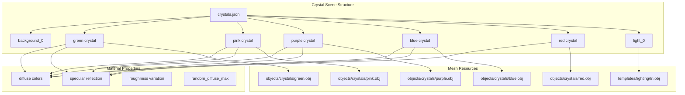
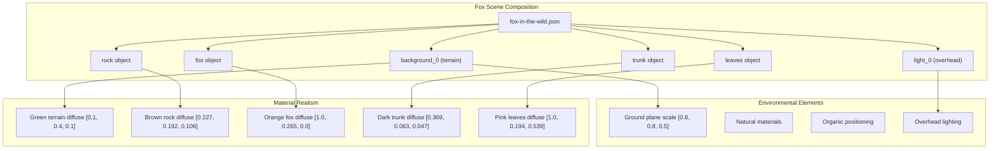
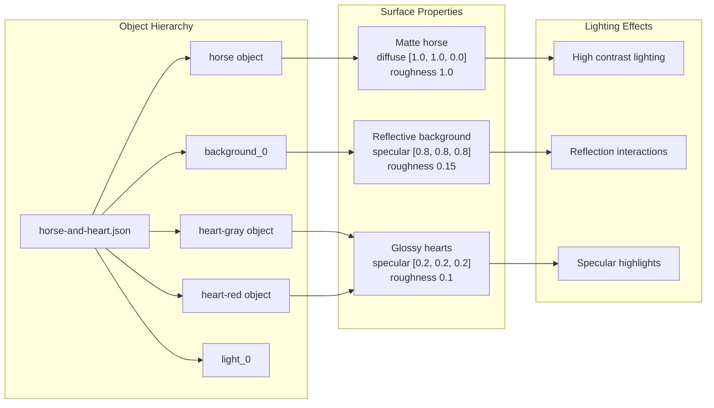
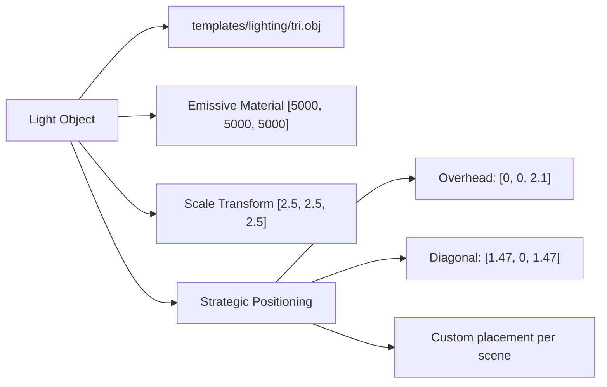

<!-- source: DeepWiki mcp.deepwiki.com · repo microsoft/renderformer · page 6.2 Complex Scene Examples · fetched 2026-10-26 -->

# Complex Scene Examples

Relevant source files

The following files were used as context for generating this wiki page:

- [examples/crystals.json](examples/crystals.json)
- [examples/fox-in-the-wild.json](examples/fox-in-the-wild.json)
- [examples/horse-and-heart.json](examples/horse-and-heart.json)

This page demonstrates advanced scene composition techniques using RenderFormer's JSON scene format. The examples showcase multi-object scenes with sophisticated lighting, material properties, and geometric arrangements that go beyond basic rendering tests.

For basic scene setup and Cornell box examples, see [Cornell Box Scenes](#6.1). For the fundamental JSON scene format specification, see [JSON Scene Format](#5.1).

## Multi-Object Crystal Collection

The crystals scene demonstrates complex material interactions with multiple objects sharing similar geometric properties but different material characteristics. This scene features five crystal objects with varying diffuse colors, specular properties, and roughness values.

### Material Diversity Patterns

The crystal scene demonstrates systematic material variation across similar objects:

| Object | Diffuse Color | Specular | Roughness | Material Type |
|--------|---------------|----------|-----------|---------------|
| Green Crystal | `[0.312, 0.749, 0.175]` | `[0.25, 0.25, 0.25]` | `0.5` | Semi-glossy |
| Pink Crystal | `[0.618, 0.272, 0.675]` | `[0.3, 0.3, 0.3]` | `0.5` | Semi-glossy |
| Purple Crystal | `[0.338, 0.119, 0.568]` | `[0.4, 0.4, 0.4]` | `0.5` | Glossy |
| Blue Crystal | `[0.115, 0.466, 0.699]` | `[0.3, 0.3, 0.3]` | `0.5` | Semi-glossy |
| Red Crystal | `[1.0, 0.071, 0.071]` | `[0.0, 0.0, 0.0]` | `1.0` | Matte |

The scene uses a single light source positioned at `[1.47, 0.0, 1.47]` with high emissive values `[5000.0, 5000.0, 5000.0]` to illuminate the crystal arrangement.

**Sources:** [examples/crystals.json:1-320]()

## Natural Environment Scene

The fox-in-the-wild scene demonstrates organic object composition with environmental elements including terrain, vegetation, and wildlife models.

### Scene Positioning Strategy

This scene demonstrates careful spatial arrangement with environmental context:

- **Camera Position**: `[0.0, -2.0, 0.26]` provides a low-angle view simulating ground-level perspective
- **Camera Target**: `[0.0, -0.6, 0.0]` focuses on the central scene area
- **Field of View**: `30.0` degrees creates a telephoto effect for wildlife photography aesthetic
- **Light Placement**: `[0.0, 0.0, 2.1]` simulates overhead sunlight

The leaves object includes a slight vertical translation `[0.0, 0.0, 0.1]` to create natural layering above the trunk.

**Sources:** [examples/fox-in-the-wild.json:1-278]()

## Figurine Collection Scene

The horse-and-heart scene showcases object material contrast and reflective surface techniques using a dark, reflective background with bright figurines.

### Advanced Material Techniques

This scene demonstrates sophisticated material property usage:

#### Reflective Background Surface
The background uses near-black diffuse `[0.0, 0.0, 0.0]` with high specular `[0.8, 0.8, 0.8]` and low roughness `0.15` to create a mirror-like surface that reflects the figurines.

#### Material Contrast Strategy
- **Horse**: Bright yellow `[1.0, 1.0, 0.0]` with zero specular for pure diffuse appearance
- **Gray Heart**: Mid-tone `[0.5, 0.5, 0.5]` with moderate specular for subtle reflections  
- **Red Heart**: Deep red `[0.6, 0.0, 0.0]` with matching specular properties

#### Random Diffuse Variation
All objects except the light source use `random_diffuse_max: 0.4` to add surface variation and prevent uniform appearance.

**Sources:** [examples/horse-and-heart.json:1-236]()

## Common Scene Construction Patterns

### Lighting Configuration Standards

All complex scenes follow consistent lighting patterns:

### Background Plane Usage

Every complex scene includes a background plane object with specific characteristics:

- **Mesh Source**: `templates/backgrounds/plane.obj` 
- **Transform Scale**: Varies per scene (`[0.5, 0.5, 0.5]` to `[0.8, 0.8, 0.5]`)
- **Material Role**: Provides environmental context and surface interactions
- **Lighting Interaction**: Configured for ambient reflection or high contrast

### Camera Positioning Strategies

Complex scenes employ advanced camera techniques:

| Scene Type | Position Strategy | FOV Range | Look-at Target |
|------------|------------------|-----------|----------------|
| Crystal Display | Mid-distance angled | `37.5°` | Object center |
| Natural Environment | Ground-level telephoto | `30.0°` | Scene focus |
| Figurine Collection | Elevated perspective | `37.5°` | Below object center |

**Sources:** [examples/crystals.json:300-319](), [examples/fox-in-the-wild.json:258-277](), [examples/horse-and-heart.json:216-235]()

## Technical Implementation Notes

### Object Organization

Complex scenes require careful object naming and organization within the JSON structure. Each object entry in the `objects` dictionary contains:

- **Unique identifier keys**: Descriptive names like `"green"`, `"fox"`, `"heart-red"`
- **Mesh path references**: Organized in scene-specific subdirectories under `objects/`
- **Transform hierarchies**: Consistent coordinate system usage across all objects
- **Material property sets**: Complete material definitions with all required fields

### Performance Considerations

Multi-object scenes impact rendering performance through:

- **Triangle count scaling**: Each additional object contributes to the total triangle budget
- **Material diversity**: Varying material properties increase shader complexity
- **Lighting interactions**: Multiple objects create more complex light transport
- **Memory usage**: Scene complexity affects HDF5 file size and loading time

Complex scenes benefit from the remeshing capabilities described in the scene processing pipeline to optimize triangle counts while preserving visual quality.

**Sources:** [examples/crystals.json:4-298](), [examples/fox-in-the-wild.json:4-256](), [examples/horse-and-heart.json:4-214]()

---

