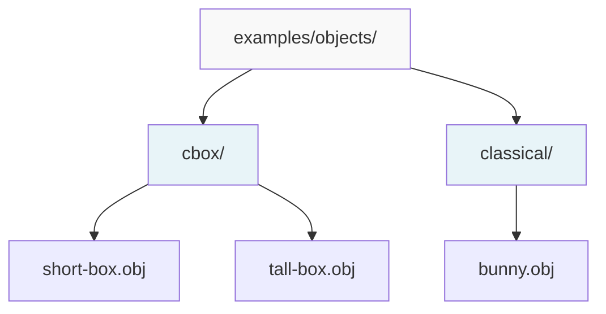
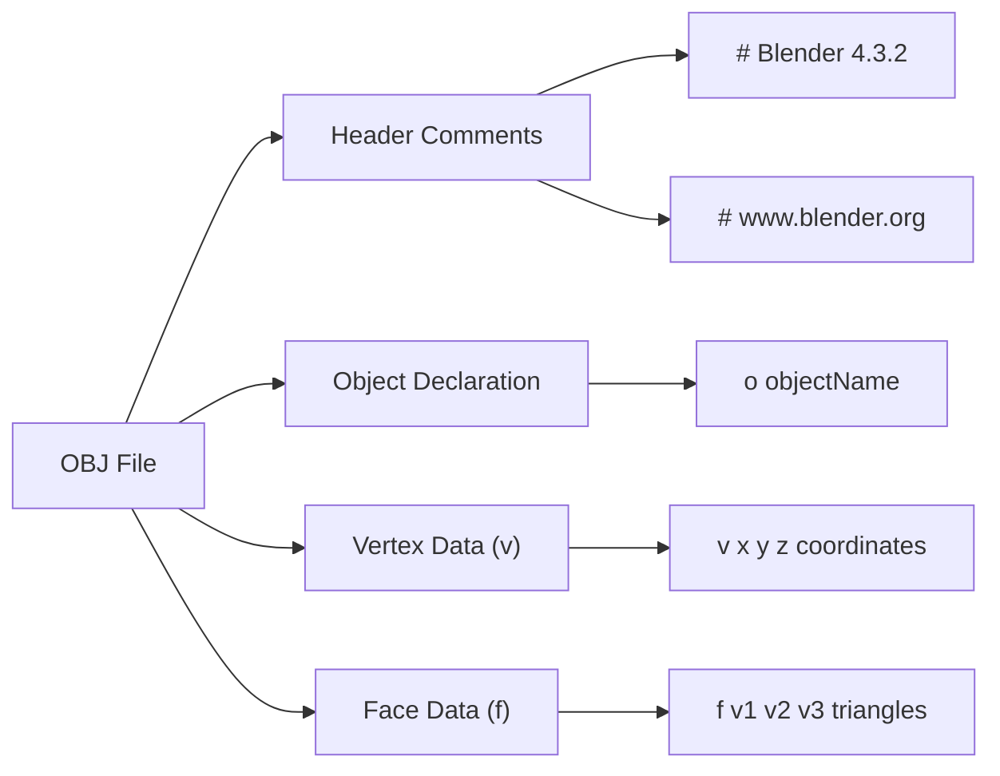
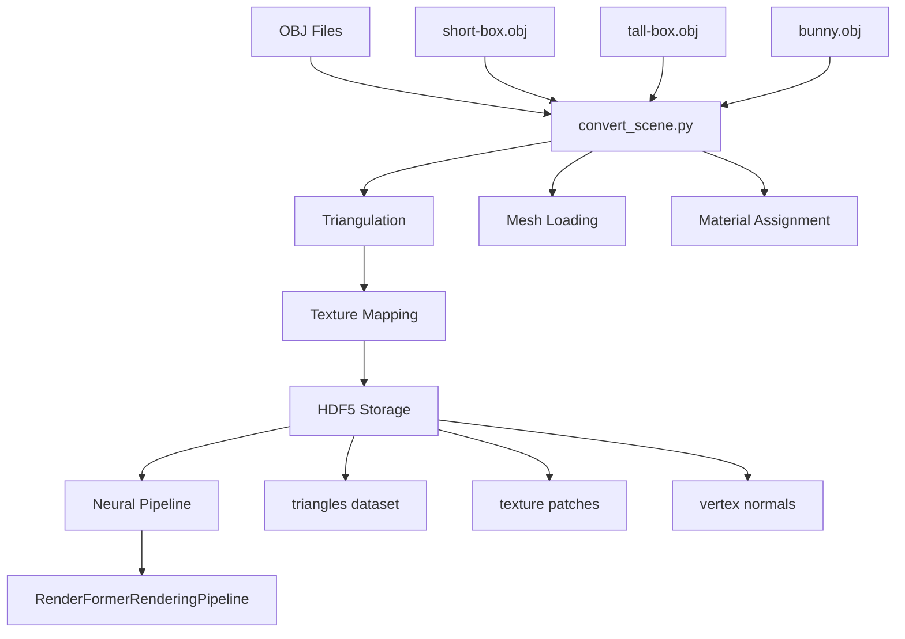
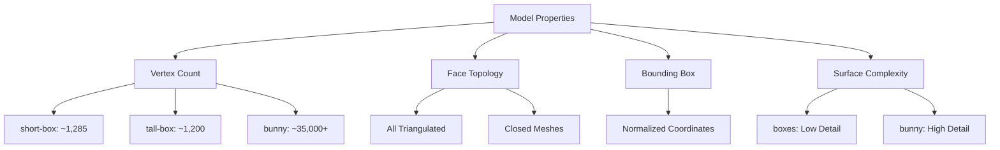

<!-- source: DeepWiki mcp.deepwiki.com · repo microsoft/renderformer · page 6.3 3D Model Assets · fetched 2026-10-26 -->

# 3D Model Assets

Relevant source files

The following files were used as context for generating this wiki page:

- [examples/objects/cbox/short-box.obj](examples/objects/cbox/short-box.obj)
- [examples/objects/cbox/tall-box.obj](examples/objects/cbox/tall-box.obj)
- [examples/objects/classical/bunny.obj](examples/objects/classical/bunny.obj)
- [examples/objects/classical/teapot.obj](examples/objects/classical/teapot.obj)

This page documents the 3D model assets included with RenderFormer and their usage in neural rendering scenes. These assets provide ready-to-use geometry for testing and demonstrating the system's capabilities.

For information about how these models are used in complete scene definitions, see [Cornell Box Scenes](#6.1) and [Complex Scene Examples](#6.2). For details on how mesh data is processed and converted, see [Scene Processing](#2.2).

## Asset Organization

The 3D model assets are organized in the `examples/objects/` directory with categorical subdirectories:

**Model Categories**:
- **`cbox/`**: Cornell box scene components for classic rendering tests
- **`classical/`**: Well-known computer graphics reference models

Sources: [examples/objects/cbox/short-box.obj:1-10](), [examples/objects/cbox/tall-box.obj:1-10](), [examples/objects/classical/bunny.obj:1-10]()

## Available Models

### Cornell Box Components

| Model | File | Purpose | Vertices | Complexity |
|-------|------|---------|----------|------------|
| Short Box | `short-box.obj` | Cornell box geometry | 1,285 | Low |
| Tall Box | `tall-box.obj` | Cornell box geometry | ~1,200 | Low |

The Cornell box models provide simple geometric primitives for testing lighting and material properties:

- **Short Box**: Compact rectangular geometry for foreground placement
- **Tall Box**: Taller rectangular geometry for depth composition

### Classical Reference Models

| Model | File | Purpose | Vertices | Complexity |
|-------|------|---------|----------|------------|
| Stanford Bunny | `bunny.obj` | Reference geometry | ~35,000+ | High |

The Stanford bunny is a standard test model in computer graphics research, providing complex organic geometry with detailed surface features.

Sources: [examples/objects/cbox/short-box.obj:1-1680](), [examples/objects/cbox/tall-box.obj:1-1200](), [examples/objects/classical/bunny.obj:1-800]()

## File Format Specifications

All models use the Wavefront OBJ format with standard structure:

**Format Details**:
- **Header**: Generated by Blender 4.3.2
- **Vertices**: 3D coordinates in object space
- **Faces**: Triangulated geometry (all faces are triangles)
- **Normals**: Automatically computed during scene processing

Sources: [examples/objects/cbox/short-box.obj:1-3](), [examples/objects/cbox/tall-box.obj:1-3](), [examples/objects/classical/bunny.obj:1-3]()

## Integration with Scene Pipeline

The 3D model assets integrate into the RenderFormer pipeline through the scene processing system:

**Processing Steps**:
1. **Mesh Loading**: OBJ files parsed for vertex and face data
2. **Triangulation**: Ensures all faces are triangular
3. **Material Assignment**: Links geometry to material properties
4. **HDF5 Conversion**: Transforms to neural pipeline format

Sources: [scene_processor/convert_scene.py](), [renderformer/pipeline.py]()

## Model Characteristics

### Geometric Properties

**Coordinate Systems**:
- All models use right-handed coordinate system
- Y-axis typically represents vertical direction
- Models are pre-scaled for appropriate scene composition

### Usage Patterns

The models serve different purposes in the rendering pipeline:

| Usage | Models | Scene Types |
|-------|--------|-------------|
| Lighting Tests | Cornell boxes | Simple illumination studies |
| Material Studies | All models | Surface property evaluation |
| Geometry Complexity | Stanford bunny | Neural network stress testing |
| Composition | Mixed | Complex scene construction |

Sources: [examples/objects/cbox/short-box.obj:4-20](), [examples/objects/classical/bunny.obj:4-20]()

## Asset Extension

To add new 3D models to the system:

1. **Format Requirements**: Use Wavefront OBJ format with triangulated faces
2. **Directory Structure**: Place in appropriate `examples/objects/` subdirectory
3. **Scene Integration**: Reference in JSON scene definitions
4. **Processing**: Models automatically processed by `convert_scene.py`

The system supports arbitrary OBJ files as long as they conform to the standard format and contain valid triangulated geometry.

Sources: [scene_processor/convert_scene.py](), [examples/]()

---

