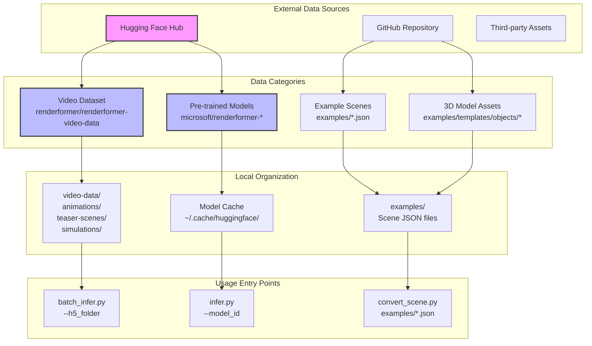
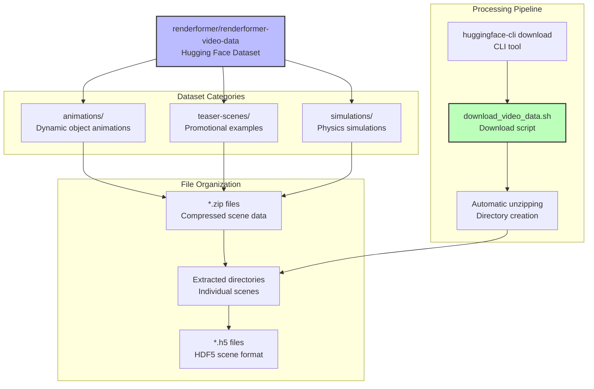
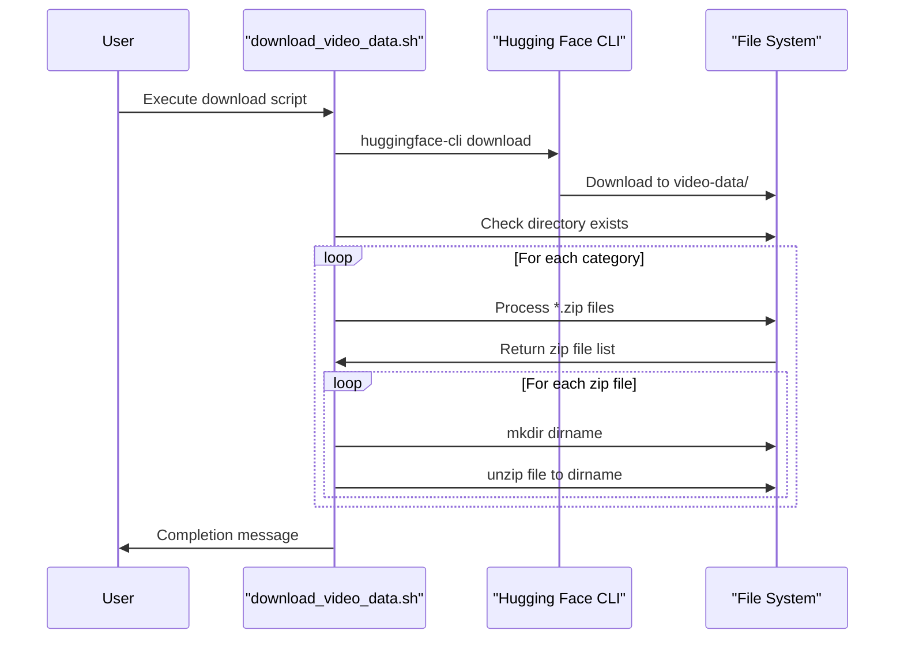
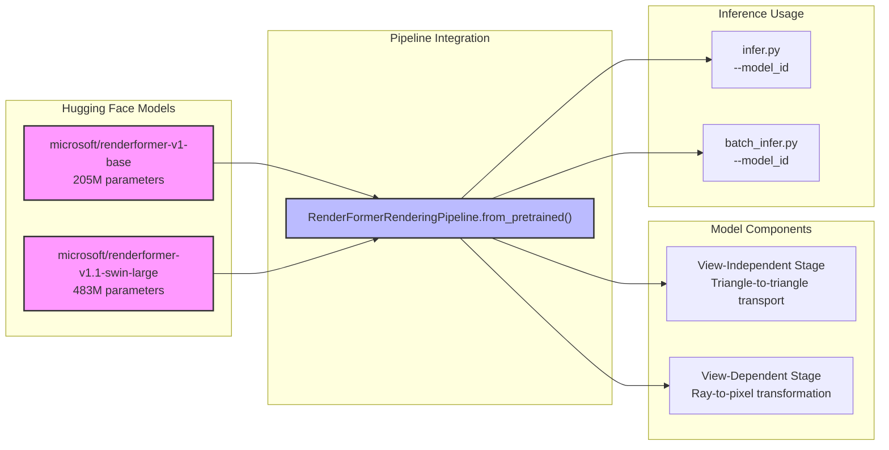
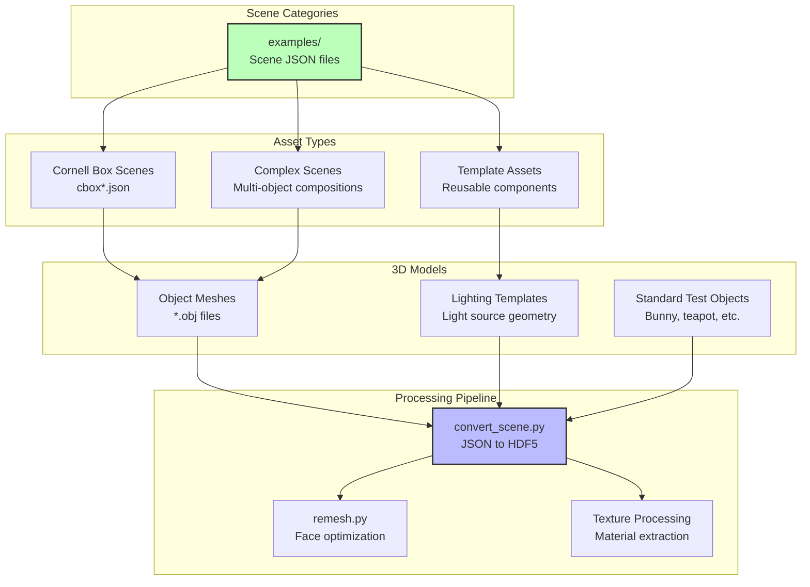
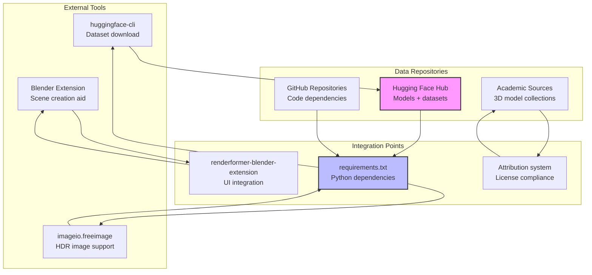

<!-- source: DeepWiki mcp.deepwiki.com · repo microsoft/renderformer · page 7 Data & Resources · fetched 2026-10-26 -->

# Data & Resources

<details>
<summary>Relevant source files</summary>

The following files were used as context for generating this wiki page:

- [README.md](README.md)
- [download_video_data.sh](download_video_data.sh)

</details>


This document covers the external datasets, pre-trained models, example assets, and other resources available for use with RenderFormer. It includes information about downloading and organizing video datasets, accessing pre-trained models from Hugging Face, and utilizing example scenes and 3D assets.

For information about scene definition formats and creating your own scenes, see [Scene Definition](#5). For details about the internal HDF5 data format, see [Data Formats](#2.3).

## Dataset Overview

RenderFormer provides access to multiple types of data resources through different channels. The system relies on external datasets for video rendering examples, pre-trained transformer models for inference, and a collection of example scenes with 3D assets.



Sources: [README.md:93-98](), [README.md:194-196](), [README.md:322-342]()

## Video Dataset

The RenderFormer video dataset is hosted on Hugging Face and contains pre-rendered scene sequences for video generation examples. The dataset includes various scene types organized into categories.

### Dataset Structure



Sources: [README.md:194-196](), [download_video_data.sh:1-44]()

### Download Process

The video dataset can be downloaded using the provided shell script, which handles both downloading and extraction:

| Component | Purpose | Location |
|-----------|---------|----------|
| `huggingface-cli` | Command-line tool for downloading | System dependency |
| `download_video_data.sh` | Automated download script | [download_video_data.sh:1-44]() |
| Local storage | Extracted video data | `video-data/` directory |

The download script performs these operations:
1. Downloads dataset using `huggingface-cli download --repo-type dataset renderformer/renderformer-video-data`
2. Creates organized directory structure
3. Extracts ZIP files into named subdirectories
4. Processes animations, teaser-scenes, and simulations categories



Sources: [download_video_data.sh:2-3](), [download_video_data.sh:10-36]()

### Usage with Batch Inference

The downloaded video data is designed for use with the batch inference pipeline:

```bash
python3 batch_infer.py --h5_folder renderformer-video-data/submission-videos/cbox-roughness/ --output_dir output/videos/cbox-roughness
```

The `TriangleRenderH5Dataset` class in the batch inference system reads the HDF5 files from these directories and processes them for video rendering.

Sources: [README.md:199-201]()

## Pre-trained Models

RenderFormer provides pre-trained transformer models through Hugging Face Hub, offering different parameter sizes for various computational requirements.

### Available Models

| Model Name | Parameters | Hugging Face ID | Purpose |
|------------|------------|-----------------|---------|
| RenderFormer-V1-Base | 205M | `microsoft/renderformer-v1-base` | Lightweight inference |
| RenderFormer-V1.1-Large | 483M | `microsoft/renderformer-v1.1-swin-large` | High-quality rendering |

### Model Architecture Mapping



Sources: [README.md:94-98](), [README.md:138](), [README.md:210]()

### Model Loading Process

The models are automatically downloaded and cached when first accessed through the `RenderFormerRenderingPipeline.from_pretrained()` method. The system handles model loading, device placement, and precision configuration.

Sources: [README.md:159]()

## Example Scenes and Assets

The repository includes a comprehensive collection of example scenes and 3D model assets for testing and demonstration purposes.

### Scene Organization



Sources: [README.md:111-115](), [README.md:274](), [README.md:292-298]()

### Asset Attribution

The repository includes 3D models from various sources with proper attribution:

| Source | Assets | Usage |
|--------|--------|-------|
| Stanford Repository | Bunny, Lucy | Standard test geometry |
| Cornell University | Cornell Box | Classic rendering test |
| Mitsuba Gallery | Shader Ball | Material testing |
| Objaverse | Various objects | Scene composition |
| Microsoft | Custom models | Demonstration scenes |

The complete attribution list includes licensing information and source URLs for all included 3D assets.

Sources: [README.md:322-342]()

## External Dependencies and Resources

RenderFormer integrates with several external resources and tools that provide additional functionality.

### Resource Integration Map



Sources: [README.md:300-302](), [README.md:87-90](), [README.md:314-342]()

### Setup Requirements

The external resources require specific setup steps:

1. **HDR Image Support**: `python3 -c "import imageio; imageio.plugins.freeimage.download()"`
2. **Hugging Face CLI**: Required for dataset downloads
3. **Blender Extension**: Optional UI tool for scene creation

These dependencies are managed through the installation process and provide extended functionality for data handling and user interaction.

Sources: [README.md:89](), [download_video_data.sh:2]()

---

