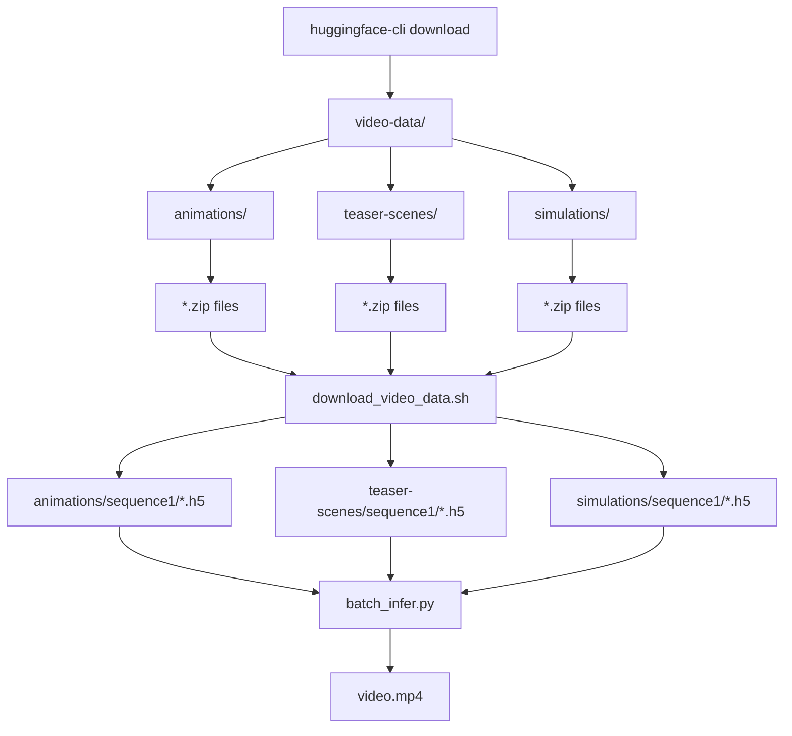
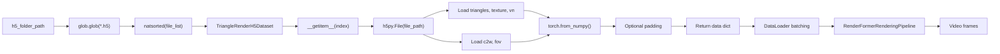

<!-- source: DeepWiki mcp.deepwiki.com · repo microsoft/renderformer · page 7.1 Video Dataset · fetched 2026-10-26 -->

# Video Dataset

<details>
<summary>Relevant source files</summary>

The following files were used as context for generating this wiki page:

- [batch_infer.py](batch_infer.py)
- [download_video_data.sh](download_video_data.sh)

</details>


This document describes the RenderFormer video dataset, which provides pre-processed HDF5 scene files for generating video sequences using the batch inference pipeline. The dataset contains multiple categories of animated scenes that demonstrate RenderFormer's neural rendering capabilities across different types of content.

For information about scene creation and HDF5 format specification, see [Data Formats](#2.3). For batch processing and video generation workflows, see [Batch Inference](#4.2).

## Dataset Overview

The RenderFormer video dataset is hosted on Hugging Face as `renderformer/renderformer-video-data` and contains pre-processed scene sequences organized into three main categories:

| Category | Description | Content Type |
|----------|-------------|--------------|
| `animations` | Object animations and transformations | Animated geometry and materials |
| `teaser-scenes` | Demonstration scenes for showcasing | Complex rendered scenes |
| `simulations` | Physics-based scene sequences | Dynamic simulations |

Each category contains ZIP archives that expand into directories of HDF5 files, where each file represents a single frame in a video sequence.

## Dataset Download and Setup

### Download Script

The repository provides [`download_video_data.sh`]() for automated dataset retrieval and extraction:

```bash
#!/bin/bash
huggingface-cli download --repo-type dataset renderformer/renderformer-video-data --local-dir video-data
```

The script performs the following operations:
1. Downloads the complete dataset to a `video-data/` directory
2. Processes ZIP files in each subdirectory
3. Extracts HDF5 sequences for immediate use

### Dataset Structure Workflow



**Dataset Download and Processing Workflow**

Sources: [download_video_data.sh:1-44]()

### Extraction Process

The download script includes a `process_directory()` function that handles ZIP file extraction:

```bash
process_directory() {
    local dir=$1
    for zipfile in "$dir"/*.zip; do
        dirname=$(basename "$zipfile" .zip)
        mkdir -p "$dir/$dirname"
        unzip -q "$zipfile" -d "$dir/$dirname"
    done
}
```

This creates a hierarchical structure where each ZIP file becomes a directory containing an HDF5 sequence.

Sources: [download_video_data.sh:11-36]()

## Dataset Loading and Processing

### TriangleRenderH5Dataset Class

The [`TriangleRenderH5Dataset`]() class in [`batch_infer.py`]() provides the data loading interface for video sequences:

```python
class TriangleRenderH5Dataset(Dataset):
    def __init__(self, h5_folder_path: str, padding_length: Optional[int] = None)
```

**Key Functionality:**
- Automatically discovers HDF5 files using `glob.glob()` pattern matching
- Sorts files using `natsorted()` for correct sequence ordering  
- Supports optional padding for batch processing consistency
- Returns structured data dictionaries for each frame

### HDF5 Data Structure

Each HDF5 file contains the following datasets:

| Dataset | Shape | Type | Description |
|---------|-------|------|-------------|
| `triangles` | `(N, 3, 3)` | float32 | Triangle vertex coordinates |
| `texture` | `(N, 13, 32, 32)` | float32 | Texture patch data |
| `vn` | `(N, 3)` | float32 | Vertex normals |
| `c2w` | `(V, 4, 4)` | float32 | Camera-to-world matrices |
| `fov` | `(V,)` | float32 | Field of view per camera |

Where `N` is the number of triangles and `V` is the number of camera views per frame.

Sources: [batch_infer.py:28-58]()

### Data Loading Pipeline



**HDF5 Data Loading and Processing Pipeline**

Sources: [batch_infer.py:17-58]()

## Batch Inference Integration

### Video Generation Workflow

The dataset integrates with the batch inference system through the following process:

1. **Dataset Initialization**: [`TriangleRenderH5Dataset`]() scans the target directory
2. **DataLoader Creation**: PyTorch `DataLoader` handles batching and parallel loading
3. **Batch Processing**: [`RenderFormerRenderingPipeline`]() processes multiple frames simultaneously
4. **Frame Collection**: Individual rendered images are collected for video assembly
5. **Video Output**: Final MP4 video is generated using `imageio`

### Configuration Parameters

The batch inference script supports several dataset-related parameters:

| Parameter | Type | Default | Description |
|-----------|------|---------|-------------|
| `--h5_folder` | str | Required | Path to HDF5 sequence directory |
| `--batch_size` | int | 8 | Number of frames processed simultaneously |
| `--padding_length` | int | None | Triangle count for consistent batching |
| `--num_workers` | int | 0 | DataLoader worker processes |

Sources: [batch_infer.py:62-75]()

## Performance Considerations

### Memory Management

The dataset implementation includes several optimizations for video processing:

- **Lazy Loading**: HDF5 files are opened only when accessed via `__getitem__()`
- **Tensor Conversion**: NumPy arrays are converted to PyTorch tensors efficiently
- **Optional Padding**: Triangle count normalization for consistent batch processing
- **Pin Memory**: DataLoader uses `pin_memory=True` for GPU transfer optimization

### Sequence Ordering

File discovery uses `natsorted()` to ensure correct temporal ordering:

```python
self.file_list = glob.glob(os.path.join(h5_folder_path, '*.h5'))
self.file_list = natsorted(self.file_list)
```

This handles numeric sequences correctly (e.g., `frame_1.h5`, `frame_2.h5`, `frame_10.h5`).

Sources: [batch_infer.py:19-21]()

## Usage Examples

### Basic Video Rendering

```bash
python batch_infer.py \
    --h5_folder video-data/animations/sequence1 \
    --batch_size 4 \
    --save_video
```

### Advanced Configuration

```bash
python batch_infer.py \
    --h5_folder video-data/simulations/physics_demo \
    --batch_size 8 \
    --padding_length 10000 \
    --num_workers 4 \
    --tone_mapper agx
```

The dataset provides the foundation for efficient video generation workflows, enabling researchers and developers to create high-quality neural rendered videos from pre-processed scene sequences.

Sources: [batch_infer.py:61-178](), [download_video_data.sh:1-44]()

---

