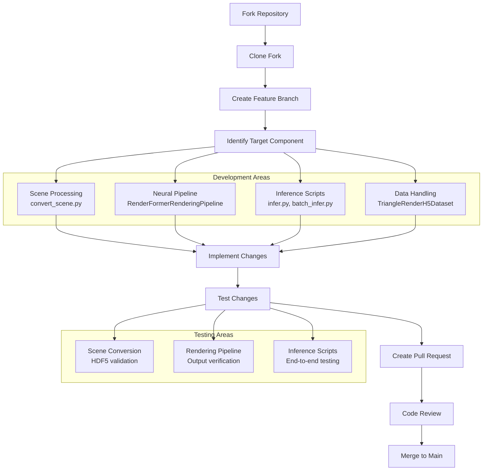
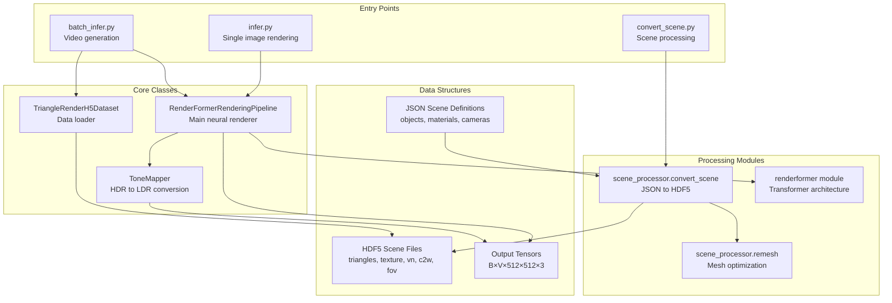
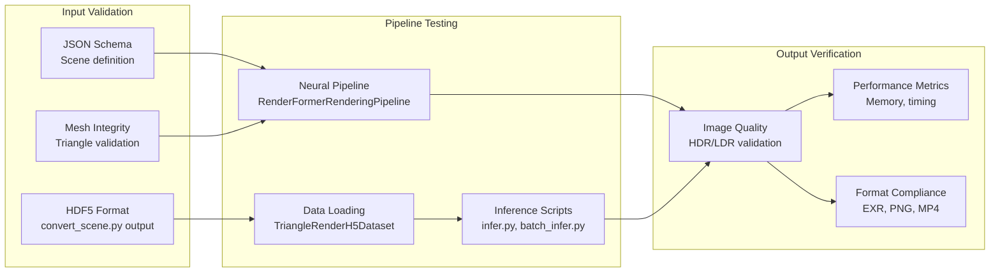

<!-- source: DeepWiki mcp.deepwiki.com · repo microsoft/renderformer · page 8 Development & Contribution · fetched 2026-10-26 -->

# Development & Contribution

Relevant source files

The following files were used as context for generating this wiki page:

- [CODE_OF_CONDUCT.md](CODE_OF_CONDUCT.md)
- [SUPPORT.md](SUPPORT.md)

This document provides guidelines for contributing to the RenderFormer project and outlines development practices for extending the neural rendering system. It covers the contribution workflow, code organization for developers, and references to community guidelines.

For specific support procedures, see [Getting Support](#8.1). For security vulnerability reporting, see [Security Policy](#8.2). For community guidelines, see [Code of Conduct](#8.3).

## Contribution Overview

RenderFormer welcomes contributions across multiple system components, from scene processing improvements to neural architecture enhancements. The project follows standard GitHub workflows with Microsoft Open Source guidelines.

### Key Contribution Areas

| Component | Files | Description |
|-----------|-------|-------------|
| Scene Processing | `scene_processor/convert_scene.py`, `scene_processor/remesh.py` | JSON to HDF5 conversion, mesh optimization |
| Neural Pipeline | `renderformer/` module | Transformer architecture, rendering pipeline |
| Inference Tools | `infer.py`, `batch_infer.py` | Single image and batch rendering scripts |
| Data Handling | `TriangleRenderH5Dataset` class | HDF5 data loading and processing |
| Examples | `examples/` directory | Scene definitions and 3D assets |

## Development Workflow

The development process involves understanding the data flow from scene definition through neural rendering to output generation.

### Contribution Process Flow

Sources: [SUPPORT.md:1-14](), [CODE_OF_CONDUCT.md:1-10]()

## Code Architecture for Contributors

Understanding the system architecture is essential for effective contributions. The codebase is organized into distinct layers with clear interfaces.

### Core System Components

Sources: Based on system architecture analysis

## Development Environment Setup

### Prerequisites

Contributors need a Python environment with PyTorch and the following key dependencies:

- **PyTorch**: Core deep learning framework
- **Hugging Face Transformers**: Model loading and management
- **Flash Attention**: Memory-efficient attention computation
- **HDF5**: Scene data storage format
- **OpenEXR**: HDR image output support

### Key Development Files

| File Pattern | Purpose | Key Classes/Functions |
|-------------|---------|----------------------|
| `renderformer/*.py` | Neural architecture | `RenderFormerRenderingPipeline` |
| `scene_processor/*.py` | Data preparation | `convert_scene()`, `remesh()` |
| `infer.py` | Single inference | `main()`, argument parsing |
| `batch_infer.py` | Batch processing | `TriangleRenderH5Dataset`, `DataLoader` |
| `examples/*.json` | Scene definitions | JSON schema validation |

## Testing and Validation

### Testing Strategy

Contributors should validate changes across the complete pipeline from scene definition to rendered output.

Sources: Based on inference pipeline analysis

### Validation Checklist

1. **Scene Processing**: Verify [scene_processor/convert_scene.py]() correctly handles new scene features
2. **Neural Pipeline**: Test [RenderFormerRenderingPipeline]() with different precision settings
3. **Data Loading**: Validate [TriangleRenderH5Dataset]() handles edge cases
4. **Inference**: Run [infer.py]() and [batch_infer.py]() with test scenes
5. **Output**: Verify HDR/LDR conversion and tone mapping

## Community Guidelines

### Issue Reporting

The project uses GitHub Issues for bug reports and feature requests. Before filing new issues, search existing issues to avoid duplicates. When reporting issues:

- Provide clear reproduction steps
- Include system information (GPU, PyTorch version)
- Attach relevant scene files or error logs
- Specify which component is affected (scene processing, neural pipeline, inference)

### Pull Request Process

1. **Fork and Branch**: Create feature branches for specific changes
2. **Clear Scope**: Focus pull requests on single features or bug fixes
3. **Documentation**: Update relevant wiki pages for new features
4. **Testing**: Include validation for changed components
5. **Code Style**: Follow existing patterns in the codebase

## Related Resources

- [Getting Support](#8.1): Detailed support procedures and issue reporting
- [Security Policy](#8.2): Security vulnerability reporting guidelines
- [Code of Conduct](#8.3): Community standards and behavior expectations
- [Development Setup](#9.3): Detailed development environment configuration

Sources: [SUPPORT.md:1-14](), [CODE_OF_CONDUCT.md:1-10]()

---

