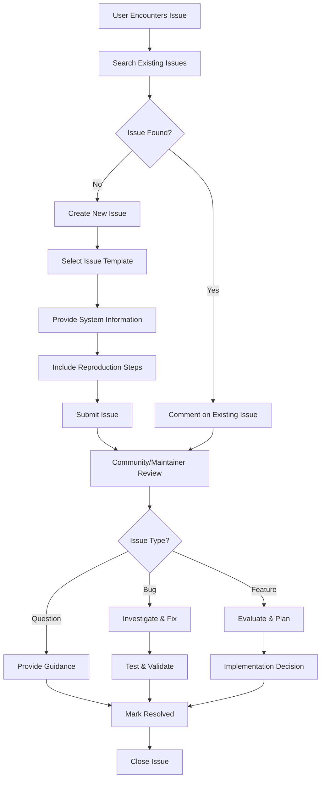
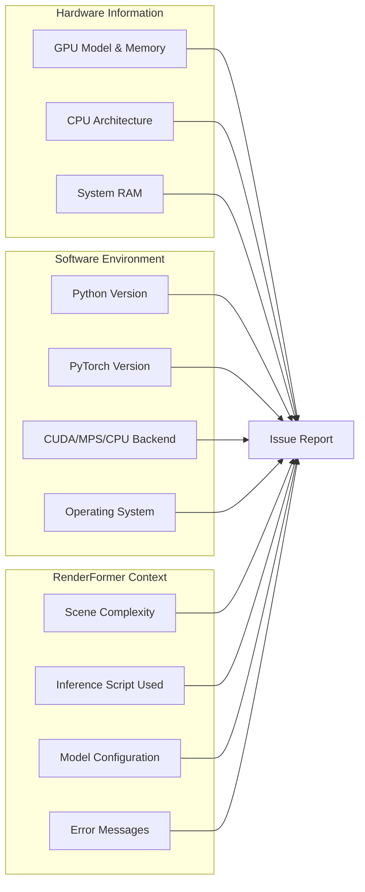
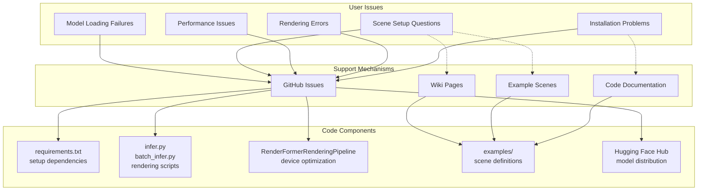

<!-- source: DeepWiki mcp.deepwiki.com · repo microsoft/renderformer · page 8.1 Getting Support · fetched 2026-10-26 -->

# Getting Support

Relevant source files

The following files were used as context for generating this wiki page:

- [SUPPORT.md](SUPPORT.md)

This document explains how to get help, report bugs, and request features for the RenderFormer neural rendering system. It covers the GitHub Issues workflow, Microsoft's support policy, and best practices for effective issue reporting.

For information about contributing code or development practices, see [Development & Contribution](#8).

## GitHub Issues Process

RenderFormer uses GitHub Issues as the primary support mechanism for tracking bugs, feature requests, and user questions. The project follows a structured approach to issue management outlined in [SUPPORT.md:5-7]().

### Filing New Issues

Before creating a new issue, search the existing issues to avoid duplicates. The supported issue types include:

| Issue Type | Purpose | Examples |
|------------|---------|----------|
| Bug Report | System malfunctions or errors | Rendering failures, installation problems |
| Feature Request | New functionality proposals | Additional tone mappers, export formats |
| Question/Help | Usage guidance and support | Scene setup, performance optimization |

All issues should be filed as new GitHub Issues in the repository, as specified in [SUPPORT.md:6-7]().

### Support Workflow

**Issue Lifecycle Management**

Sources: [SUPPORT.md:5-9]()

## Microsoft Support Policy

Microsoft provides limited support for RenderFormer as an open-source research project. The support scope is explicitly defined in [SUPPORT.md:11-13]():

- Support is limited to the resources available through GitHub Issues
- No dedicated customer support channels
- Community-driven support model with maintainer oversight

This policy reflects the project's nature as a research tool rather than a commercial product.

Sources: [SUPPORT.md:11-13]()

## Effective Issue Reporting

### System Information Requirements

When reporting issues, include comprehensive system details to enable effective troubleshooting:

**System Context for Issue Reports**

### Component-Specific Reporting Guidelines

Different RenderFormer components require specific diagnostic information:

| Component | Key Information | Relevant Files |
|-----------|----------------|----------------|  
| `infer.py` | Command-line arguments, scene file path, output errors | Single image rendering issues |
| `batch_infer.py` | Dataset structure, batch size, memory usage | Video rendering problems |
| `convert_scene.py` | Scene JSON format, mesh file paths, conversion errors | Scene processing failures |
| `RenderFormerRenderingPipeline` | Model loading, transformer stages, tensor shapes | Core pipeline issues |

### Reproduction Steps Format

Structure reproduction steps to enable maintainers to replicate issues:

1. **Environment Setup**: Python version, dependency installation method
2. **Data Preparation**: Scene files, model downloads, preprocessing steps  
3. **Command Execution**: Exact command-line invocation with parameters
4. **Expected vs Actual Results**: Clear description of the problem
5. **Error Output**: Complete error messages and stack traces

Sources: [SUPPORT.md:5-9]()

## Support Channel Mapping

**Support Channel to Code Component Mapping**

This diagram shows how different types of user issues map to specific support mechanisms and the underlying code components that may need investigation.

Sources: [SUPPORT.md:1-13]()

## Community Guidelines

When participating in GitHub Issues discussions:

- **Be Specific**: Reference exact file paths, function names, and line numbers when possible
- **Provide Context**: Include relevant portions of scene JSON files, command outputs, and error messages  
- **Follow Up**: Update issues with additional information or confirm when problems are resolved
- **Search First**: Check closed issues for similar problems and solutions

The support system is designed to efficiently connect user problems with the appropriate code components and maintainer expertise, ensuring effective resolution of issues across the RenderFormer neural rendering pipeline.

Sources: [SUPPORT.md:5-9]()

---

