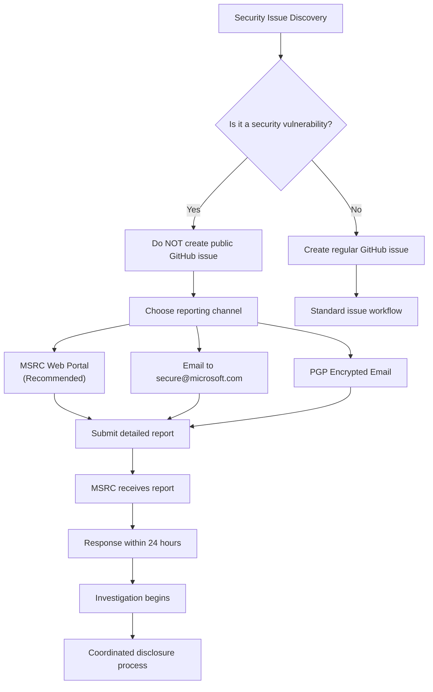
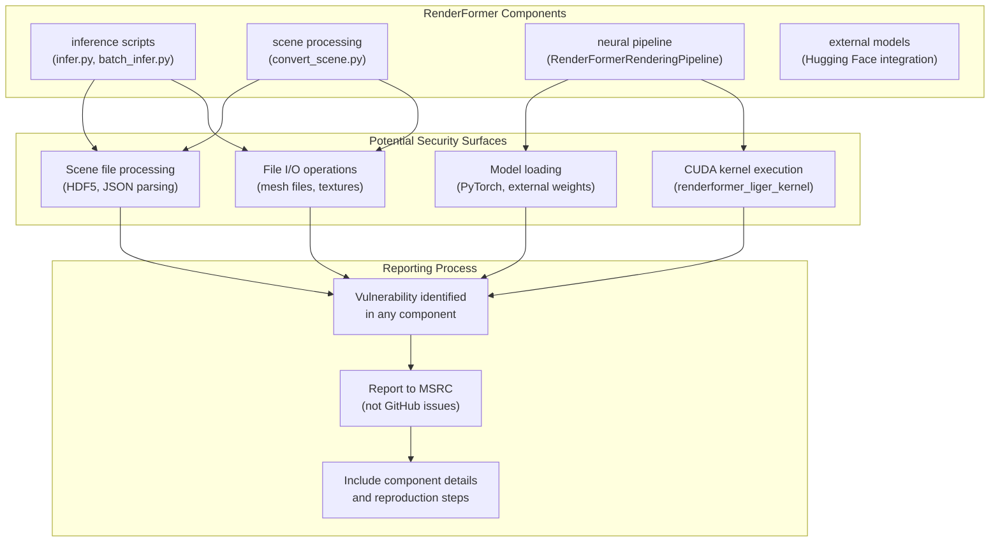
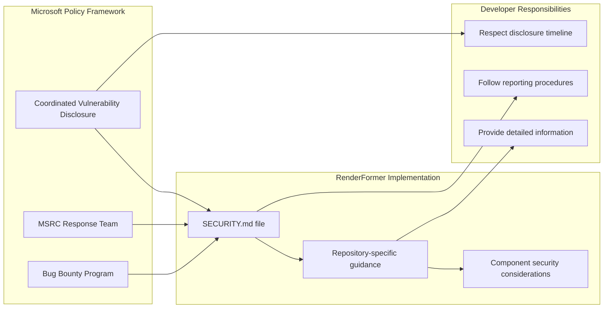

<!-- source: DeepWiki mcp.deepwiki.com · repo microsoft/renderformer · page 8.2 Security Policy · fetched 2026-10-26 -->

# Security Policy

Relevant source files

The following files were used as context for generating this wiki page:

- [SECURITY.md](SECURITY.md)

This document outlines the security vulnerability reporting procedures and responsible disclosure guidelines for the RenderFormer project. It defines how to report security issues, the expected response process, and Microsoft's approach to handling security vulnerabilities in this repository.

For information about getting general support and reporting non-security issues, see [Getting Support](#8.1).

## Overview

Microsoft takes the security of RenderFormer and all software products seriously. The RenderFormer project follows Microsoft's standard security policy for coordinated vulnerability disclosure, which ensures that security issues are handled responsibly and efficiently.

Sources: [SECURITY.md:1-42]()

## Security Vulnerability Reporting Process

### Reporting Channels

Security vulnerabilities should **not** be reported through public GitHub issues. Instead, use one of the following secure channels:

| Channel | Method | Details |
|---------|--------|---------|
| **Primary** | Web Portal | [Microsoft Security Response Center (MSRC)](https://msrc.microsoft.com/create-report) |
| **Alternative** | Email | secure@microsoft.com |
| **Encrypted** | PGP Email | Use [Microsoft Security Response Center PGP Key](https://aka.ms/security.md/msrc/pgp) |

**Security Reporting Workflow**

Sources: [SECURITY.md:10-17]()

### Required Information for Security Reports

When reporting a security vulnerability, include as much of the following information as possible to help with triage and resolution:

**Essential Details**
- **Type of issue**: Buffer overflow, injection vulnerability, authentication bypass, etc.
- **Affected files**: Full paths of source files related to the issue
- **Location**: Specific tag, branch, commit, or direct URL to affected code
- **Configuration**: Any special setup required to reproduce the issue

**Reproduction Information**
- **Step-by-step instructions**: Detailed reproduction steps
- **Proof-of-concept**: Working exploit code if available
- **Impact assessment**: How an attacker might exploit the vulnerability

**RenderFormer Security Context Diagram**

Sources: [SECURITY.md:19-29]()

## Response Process

### Timeline and Communication

Microsoft follows these response guidelines for security reports:

1. **Initial Response**: Within 24 hours of report submission
2. **Follow-up**: If no response received, follow up via email
3. **Investigation**: MSRC team begins security assessment
4. **Resolution**: Coordinated vulnerability disclosure process

### Bug Bounty Program

Security reports may be eligible for Microsoft's Bug Bounty Program. More complete and detailed reports can contribute to higher bounty awards. Visit the [Microsoft Bug Bounty Program](https://aka.ms/security.md/msrc/bounty) for active program details.

Sources: [SECURITY.md:17-31]()

## Policy Framework

### Coordinated Vulnerability Disclosure

Microsoft follows the principle of **Coordinated Vulnerability Disclosure (CVD)**, which ensures:

- Responsible handling of security vulnerabilities
- Coordination between researchers and Microsoft
- Appropriate timing for public disclosure
- Protection of users during the resolution process

### Communication Preferences

- **Language**: All communications should be in English
- **Confidentiality**: Security reports are handled confidentially
- **Updates**: Regular communication during investigation process

**Security Policy Implementation**

Sources: [SECURITY.md:33-40]()

## Implementation Details

The security policy for RenderFormer is implemented through the standard Microsoft security framework:

- **Policy File**: [SECURITY.md:1-42]() contains the complete security policy
- **Template Version**: Microsoft SECURITY.MD V0.0.9 BLOCK
- **Scope**: Applies to all Microsoft-owned repositories including RenderFormer
- **Contact Points**: MSRC web portal and secure@microsoft.com

### Repository Context

As a neural rendering system, RenderFormer processes various input formats and executes machine learning models. Security considerations include:

- **Input Validation**: Scene files (JSON, HDF5) and mesh data (OBJ files)
- **Model Security**: Pre-trained models loaded from Hugging Face
- **Execution Environment**: CUDA kernels and PyTorch operations
- **File Operations**: Image output and video generation

Sources: [SECURITY.md:1-42]()

---

