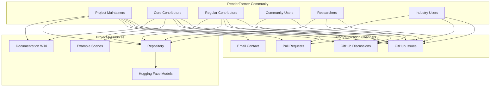
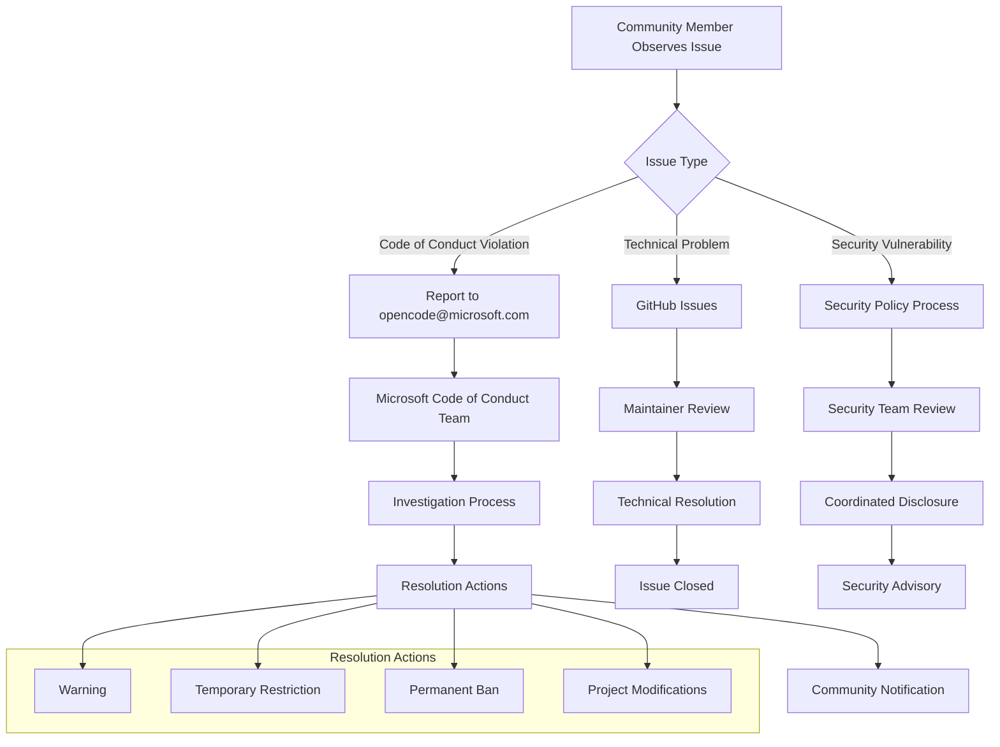
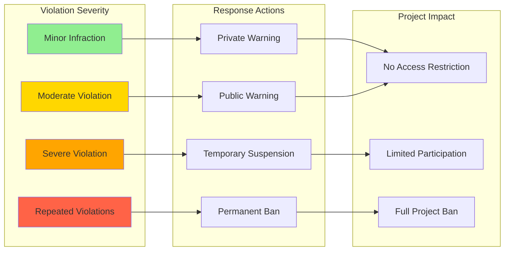

<!-- source: DeepWiki mcp.deepwiki.com · repo microsoft/renderformer · page 8.3 Code of Conduct · fetched 2026-10-26 -->

# Code of Conduct

Relevant source files

The following files were used as context for generating this wiki page:

- [CODE_OF_CONDUCT.md](CODE_OF_CONDUCT.md)

This document establishes the community guidelines and expected behavior standards for all contributors, users, and participants in the RenderFormer project. The code of conduct applies to all project spaces including GitHub repositories, discussions, issues, and any RenderFormer-related communications.

For information about reporting security vulnerabilities, see [Security Policy](#8.2). For general support and questions, see [Getting Support](#8.1).

## Microsoft Open Source Code of Conduct

The RenderFormer project has adopted the [Microsoft Open Source Code of Conduct](https://opensource.microsoft.com/codeofconduct/), which provides comprehensive guidelines for fostering an open and welcoming environment for all participants.

### Core Principles

The Microsoft Open Source Code of Conduct is built on these fundamental principles:

| Principle | Description |
|-----------|-------------|
| **Respectful** | Treat all community members with respect and courtesy |
| **Inclusive** | Welcome people of all backgrounds and skill levels |
| **Professional** | Maintain professional conduct in all interactions |
| **Constructive** | Provide helpful feedback and collaborate effectively |
| **Responsible** | Take accountability for actions and their impact |

### Scope of Application

The code of conduct applies to all RenderFormer project spaces and activities:

- GitHub repository interactions (issues, pull requests, discussions)
- Code contributions and reviews
- Documentation contributions
- Community forums and discussions
- Email communications with project maintainers
- Any public representation of the project

Sources: [CODE_OF_CONDUCT.md:1-10]()

## Community Structure

This diagram illustrates the RenderFormer community structure, showing how different participant types interact through various communication channels and contribute to project resources.

Sources: [CODE_OF_CONDUCT.md:1-10]()

## Expected Behavior Standards

### Positive Behaviors

Contributors and community members are expected to demonstrate these behaviors:

- **Technical Excellence**: Provide well-tested code, clear documentation, and thoughtful technical discussions
- **Collaborative Spirit**: Work constructively with others, accept feedback gracefully, and offer help to newcomers
- **Inclusive Communication**: Use welcoming language and be patient with users of different experience levels
- **Professional Conduct**: Maintain appropriate boundaries and focus discussions on technical merits
- **Constructive Criticism**: Provide specific, actionable feedback that helps improve the project

### Unacceptable Behaviors

The following behaviors are not tolerated in the RenderFormer community:

- Harassment, discrimination, or intimidation of any kind
- Offensive comments related to personal characteristics or technical choices
- Deliberate disruption of discussions or project activities
- Sharing private information without explicit permission
- Any conduct that creates an unsafe or unwelcoming environment

## Issue Reporting and Resolution Process

This workflow diagram shows how different types of issues are reported and resolved within the RenderFormer community, with appropriate escalation paths for each category.

Sources: [CODE_OF_CONDUCT.md:3-9]()

## Reporting Mechanisms

### Code of Conduct Violations

For code of conduct violations, use the official Microsoft reporting channels:

| Contact Method | Purpose | Response Time |
|---------------|---------|---------------|
| `opencode@microsoft.com` | Primary contact for code of conduct issues | Within 48 hours |
| [Microsoft Code of Conduct FAQ](https://opensource.microsoft.com/codeofconduct/faq/) | Common questions and guidance | Self-service |
| GitHub Repository Issues | Technical problems and feature requests | Varies by maintainer availability |

### Technical Issues

For technical problems, questions, or feature requests:

1. **Search Existing Issues**: Check GitHub issues for similar problems
2. **Create New Issue**: Use appropriate issue templates when available
3. **Provide Context**: Include RenderFormer version, system information, and reproduction steps
4. **Follow Up**: Respond to maintainer questions promptly

## Enforcement Guidelines

This enforcement matrix shows how violation severity maps to appropriate response actions and their impact on project participation.

Sources: [CODE_OF_CONDUCT.md:1-10]()

## Community Guidelines for RenderFormer

### Technical Contributions

When contributing to RenderFormer, follow these community-specific guidelines:

- **Scene Examples**: When sharing example scenes in [examples/](examples/) or discussions, ensure they use appropriate content and respect intellectual property rights
- **Model Usage**: Follow responsible AI practices when using or discussing the neural rendering models
- **Performance Claims**: Support performance assertions with reproducible benchmarks and system specifications
- **Documentation**: Maintain clear, accurate documentation that serves users across different experience levels

### Research and Academic Use

RenderFormer serves both industry and research communities:

- **Citation Requirements**: Properly cite RenderFormer and related work (see [Citation](#9.2))
- **Research Collaboration**: Share findings and improvements that benefit the broader community
- **Open Science**: Encourage reproducible research practices when using RenderFormer

### Commercial and Industry Use

For commercial applications:

- **License Compliance**: Ensure all usage complies with the MIT license terms (see [License](#9.1))
- **Contribution Back**: Consider contributing improvements back to the open source project
- **Community Support**: Help answer questions from other users when possible

## Resources and Contact Information

### Microsoft Resources

- [Microsoft Open Source Code of Conduct](https://opensource.microsoft.com/codeofconduct/)
- [Microsoft Code of Conduct FAQ](https://opensource.microsoft.com/codeofconduct/faq/)
- Email: `opencode@microsoft.com`

### Project-Specific Resources

- GitHub Issues: Technical problems and feature requests
- GitHub Discussions: General questions and community interaction
- Documentation Wiki: Comprehensive usage guides and reference materials

Sources: [CODE_OF_CONDUCT.md:5-9]()

---

