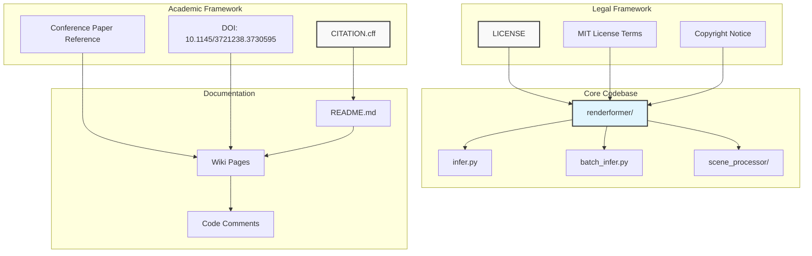
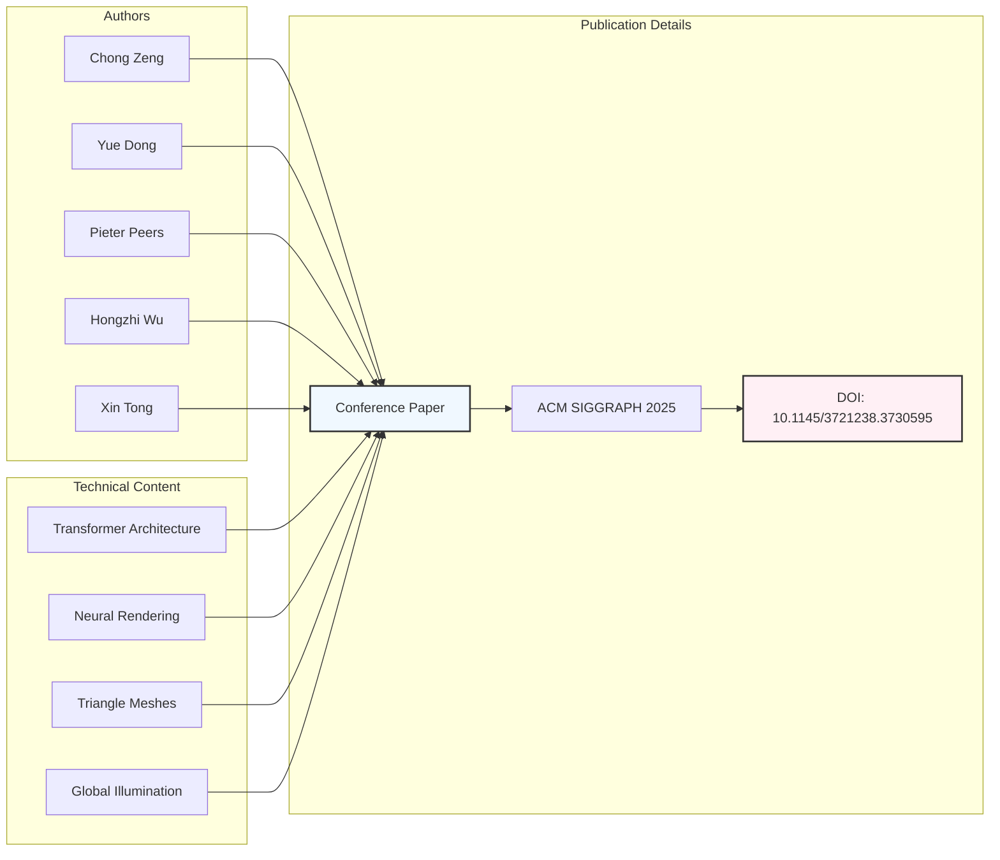

<!-- source: DeepWiki mcp.deepwiki.com · repo microsoft/renderformer · page 9 Reference · fetched 2026-10-26 -->

# Reference

<details>
<summary>Relevant source files</summary>

The following files were used as context for generating this wiki page:

- [CITATION.cff](CITATION.cff)
- [LICENSE](LICENSE)

</details>


This page provides reference materials for the RenderFormer project, including licensing information, citation guidelines, and technical specifications. This documentation covers the legal and academic aspects of using RenderFormer in research and commercial applications.

For installation and setup instructions, see [Installation & Setup](#3.1). For development environment configuration, see [Development Setup](#9.3).

## Project Information

RenderFormer is a transformer-based neural rendering system developed by Microsoft Corporation. The project implements neural rendering of triangle meshes with global illumination capabilities, representing a significant advancement in the field of computer graphics and neural rendering.

### Repository Structure

The following diagram illustrates how reference materials integrate with the codebase structure:

**Reference Materials Integration**



Sources: [LICENSE:1-22](), [CITATION.cff:1-21]()

## Licensing

RenderFormer is released under the MIT License, providing broad permissions for use, modification, and distribution.

### License Terms

The MIT License grants the following permissions:
- **Use**: Use the software for any purpose
- **Modify**: Modify the source code
- **Distribute**: Distribute copies of the software
- **Sublicense**: Include in proprietary software
- **Sell**: Use in commercial applications

### Copyright Information

- **Copyright Holder**: Microsoft Corporation
- **License Type**: MIT License
- **Year**: Not specified in license file

The complete license text is available in [LICENSE:1-22]().

### License Requirements

When using RenderFormer, you must:
1. Include the copyright notice in all copies
2. Include the license text in all substantial portions
3. Acknowledge that the software is provided "as is" without warranty

Sources: [LICENSE:1-22]()

## Citation

### Academic Citation Format

When citing RenderFormer in academic work, use the following citation format:

```
Chong Zeng, Yue Dong, Pieter Peers, Hongzhi Wu, and Xin Tong. 2025. 
RenderFormer: Transformer-based Neural Rendering of Triangle Meshes with Global Illumination. 
In ACM SIGGRAPH 2025 Conference Papers. DOI: 10.1145/3721238.3730595
```

### Citation Metadata

The following diagram shows the structured citation information:

**Citation Structure**



Sources: [CITATION.cff:4-21]()

### Citation File Format

The project includes a Citation File Format (CFF) file that provides machine-readable citation information:

- **CFF Version**: 1.2.0
- **Repository URL**: https://github.com/microsoft/renderformer
- **Publication Type**: Conference paper
- **Publication Year**: 2025

The CFF format enables automated citation generation in various academic formats and reference management systems.

## Technical Specifications

### System Requirements

Based on the codebase structure, RenderFormer requires:

| Component | Requirement |
|-----------|-------------|
| Python | 3.8+ (inferred from modern syntax usage) |
| PyTorch | Recent version with transformer support |
| CUDA | Optional for GPU acceleration |
| Memory | Sufficient for transformer model inference |
| Storage | Space for HDF5 scene files and model weights |

### Key Technical Components

The following table summarizes the main technical components and their purposes:

| Component | File Path | Purpose |
|-----------|-----------|---------|
| Inference Scripts | `infer.py`, `batch_infer.py` | Single image and batch rendering |
| Scene Processing | `scene_processor/` | Convert scenes to neural format |
| Core Pipeline | `renderformer/` | Neural rendering architecture |
| Model Weights | Hugging Face Hub | Pre-trained transformer models |

### Data Format Specifications

RenderFormer uses specific data formats for different components:

- **Scene Format**: HDF5 files containing triangle meshes, textures, and camera parameters
- **Image Output**: HDR (EXR) and LDR (PNG) formats
- **Video Output**: MP4 format for animation sequences
- **Model Format**: PyTorch state dictionaries via Hugging Face Hub

Sources: [CITATION.cff:1-21](), [LICENSE:1-22]()

## Research Context

### Academic Contribution

RenderFormer represents a significant contribution to the field of neural rendering, specifically in the area of transformer-based approaches for triangle mesh rendering with global illumination. The work builds upon recent advances in:

- Transformer architectures for computer graphics
- Neural rendering techniques
- Global illumination simulation
- Real-time rendering systems

### Publication Venue

The research was accepted at ACM SIGGRAPH 2025, one of the premier conferences in computer graphics. This indicates the high quality and significance of the technical contribution.

### Research Impact

The availability of both the research paper and the open-source implementation enables:
- Reproducible research in neural rendering
- Extension and improvement of the base techniques
- Integration into other graphics and rendering systems
- Educational use in computer graphics courses

Sources: [CITATION.cff:17-20]()

## Usage Guidelines

### Commercial Use

The MIT License permits commercial use of RenderFormer without licensing fees. Commercial users should:
1. Include the license and copyright notice
2. Consider citing the academic paper in technical documentation
3. Ensure compliance with any dependencies' licenses

### Academic Use

Researchers using RenderFormer should:
1. Cite the original paper in publications
2. Include the repository URL for reproducibility
3. Consider contributing improvements back to the project

### Attribution Requirements

While not legally required beyond the license terms, proper attribution includes:
- Acknowledging Microsoft Corporation as the copyright holder
- Citing the academic paper when using the techniques
- Referencing the GitHub repository for the implementation

Sources: [LICENSE:5-21](), [CITATION.cff:2-3]()

---

