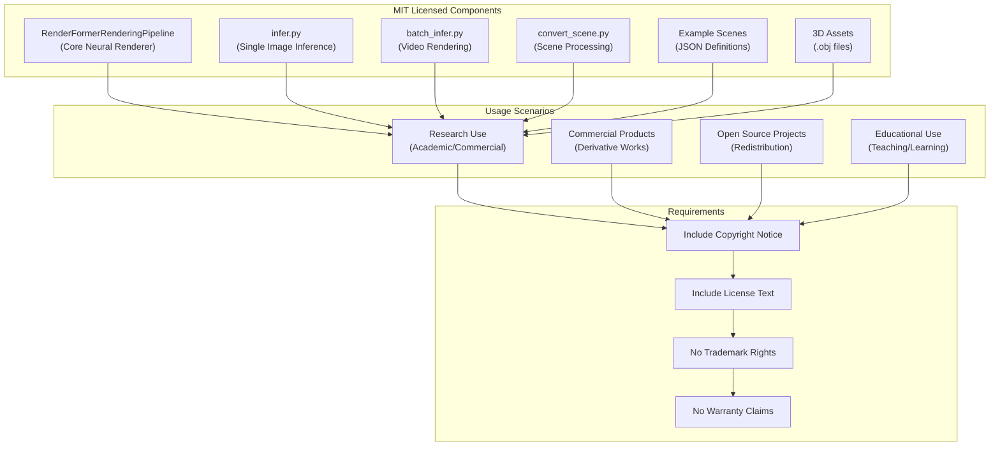

<!-- source: DeepWiki mcp.deepwiki.com · repo microsoft/renderformer · page 9.1 License · fetched 2026-10-26 -->

# License

<details>
<summary>Relevant source files</summary>

The following files were used as context for generating this wiki page:

- [LICENSE](LICENSE)

</details>


This page documents the licensing terms and conditions for the RenderFormer neural rendering system. It covers the MIT License under which the software is distributed and explains the practical implications for users, researchers, and contributors.

For information about citing RenderFormer in academic work, see [Citation](#9.2). For contribution guidelines, see [Development & Contribution](#8).

## License Overview

RenderFormer is released under the MIT License with Microsoft Corporation as the copyright holder. This is a permissive open-source license that allows broad usage rights with minimal restrictions.

**License Type**: MIT License  
**Copyright Holder**: Microsoft Corporation  
**License File**: [LICENSE:1-22]()

## MIT License Terms

The complete license text is maintained in the repository root as specified in [LICENSE:1-22](). The key components of this MIT License include:

### Copyright Notice
```
Copyright (c) Microsoft Corporation.
```

### Permissions Granted
The license grants the following rights to any person obtaining a copy of the software:
- Use the software without restriction
- Modify the software and create derivative works
- Publish and distribute the software
- Sublicense the software
- Sell copies of the software

### Required Conditions
Users must include:
- The copyright notice [LICENSE:3]()
- The permission notice [LICENSE:10-13]()

### Warranty Disclaimer
The software is provided "AS IS" without warranties of any kind, as specified in [LICENSE:15-21]().

Sources: [LICENSE:1-22]()

## License Application Scope

The following diagram illustrates how the MIT License applies to different components and usage scenarios in the RenderFormer ecosystem:

License Coverage and Application


Sources: [LICENSE:1-22]()

## Practical Usage Guidelines

### For Researchers and Academics
- Use RenderFormer freely in research projects
- Include proper attribution and license notices
- No restrictions on publishing research results
- Can be used in both academic and commercial research

### For Commercial Applications
- Incorporate RenderFormer into commercial products
- Modify the codebase for proprietary applications
- Redistribute as part of larger software packages
- Must retain copyright and license notices

### For Open Source Contributors
- Fork and modify the repository
- Submit pull requests and contributions
- Create derivative works and extensions
- Follow the same MIT License terms for distributions

### For Educational Institutions
- Use in coursework and educational materials
- Teach neural rendering concepts using the codebase
- Allow students to modify and experiment with the code
- No licensing fees or usage restrictions

Sources: [LICENSE:1-22]()

## License Compliance Requirements

The following table summarizes the compliance requirements for different usage scenarios:

| Usage Type | Copyright Notice Required | License Text Required | Attribution Required | Commercial Use Allowed |
|------------|---------------------------|----------------------|---------------------|----------------------|
| Research Use | ✓ | ✓ | Recommended | ✓ |
| Commercial Product | ✓ | ✓ | Required | ✓ |
| Open Source Distribution | ✓ | ✓ | Required | ✓ |
| Educational Use | ✓ | ✓ | Recommended | ✓ |
| Internal Company Use | ✓ | ✓ | Not Required | ✓ |
| Modified Versions | ✓ | ✓ | Required | ✓ |

Sources: [LICENSE:3](), [LICENSE:10-13]()

## Dependencies and Third-Party Licenses

While RenderFormer itself is MIT licensed, users should be aware that the system depends on various third-party libraries that may have different licensing terms:

### Core Dependencies
- **PyTorch**: BSD-3-Clause License
- **Hugging Face Transformers**: Apache 2.0 License
- **NumPy**: BSD License
- **OpenEXR/ImageIO**: Various licenses

### Optional Dependencies
- **Flash Attention**: BSD License
- **CUDA Toolkit**: NVIDIA Software License Agreement (for GPU acceleration)

Users should review the licenses of all dependencies when distributing applications that include RenderFormer.

## License Verification

To verify the current license status and ensure compliance:

1. **Check License File**: Always reference the canonical [LICENSE:1-22]() file in the repository
2. **Include in Distributions**: Copy the complete license text when redistributing
3. **Maintain Attribution**: Preserve the Microsoft Corporation copyright notice
4. **Update Documentation**: Include license information in derivative works

Sources: [LICENSE:1-22]()

## Disclaimer and Legal Notes

The MIT License provides the software "AS IS" without warranty of any kind. Microsoft Corporation and contributors are not liable for any damages arising from the use of RenderFormer, as explicitly stated in [LICENSE:15-21]().

This documentation provides factual information about the license terms but does not constitute legal advice. Users should consult with legal counsel for specific compliance questions or complex licensing scenarios.

Sources: [LICENSE:15-21]()

---

