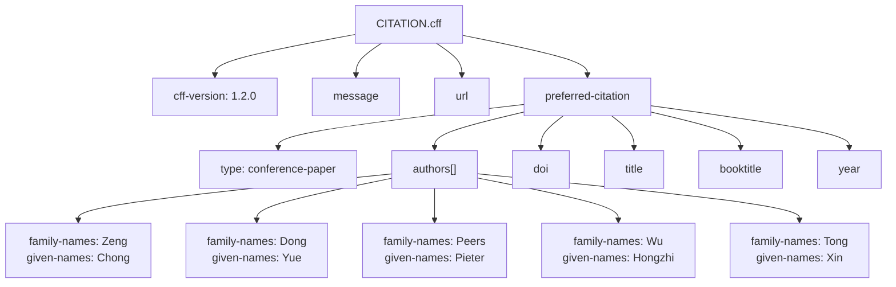
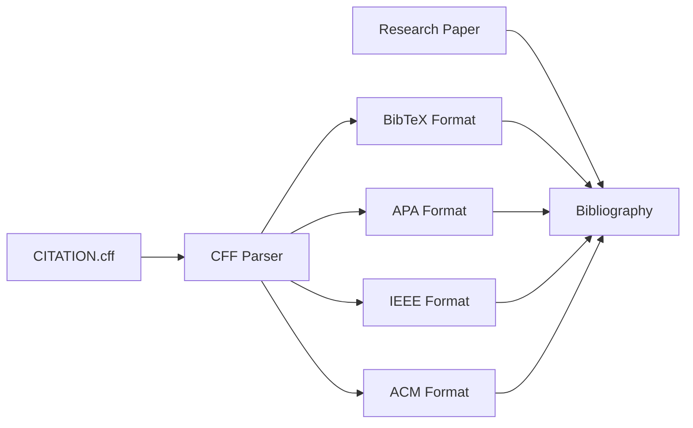

<!-- source: DeepWiki mcp.deepwiki.com · repo microsoft/renderformer · page 9.2 Citation · fetched 2026-10-26 -->

# Citation

<details>
<summary>Relevant source files</summary>

The following files were used as context for generating this wiki page:

- [CITATION.cff](CITATION.cff)

</details>


This page provides information on how to properly cite RenderFormer in academic papers, research publications, and other scholarly work. It explains the citation format requirements and provides examples in common academic citation styles.

## Citation Requirements

RenderFormer should be cited when used in academic research, publications, or any scholarly work. The project provides a standardized citation through the Citation File Format (CFF) specification.

### Primary Citation

The primary citation for RenderFormer references the original research paper published at ACM SIGGRAPH 2025:

**Title:** RenderFormer: Transformer-based Neural Rendering of Triangle Meshes with Global Illumination  
**Authors:** Chong Zeng, Yue Dong, Pieter Peers, Hongzhi Wu, Xin Tong  
**Conference:** ACM SIGGRAPH 2025 Conference Papers  
**Year:** 2025  
**DOI:** 10.1145/3721238.3730595

## Citation File Format Structure

RenderFormer includes a formal citation specification in the repository root using the Citation File Format (CFF) standard.

### CFF File Structure



Sources: [CITATION.cff:1-21]()

### Citation Workflow



Sources: [CITATION.cff:1-21]()

## Citation Formats

### BibTeX Format

```bibtex
@inproceedings{zeng2025renderformer,
  author = {Zeng, Chong and Dong, Yue and Peers, Pieter and Wu, Hongzhi and Tong, Xin},
  title = {RenderFormer: Transformer-based Neural Rendering of Triangle Meshes with Global Illumination},
  booktitle = {ACM SIGGRAPH 2025 Conference Papers},
  year = {2025},
  doi = {10.1145/3721238.3730595}
}
```

### APA Format

Zeng, C., Dong, Y., Peers, P., Wu, H., & Tong, X. (2025). RenderFormer: Transformer-based Neural Rendering of Triangle Meshes with Global Illumination. *ACM SIGGRAPH 2025 Conference Papers*. https://doi.org/10.1145/3721238.3730595

### IEEE Format

C. Zeng, Y. Dong, P. Peers, H. Wu, and X. Tong, "RenderFormer: Transformer-based Neural Rendering of Triangle Meshes with Global Illumination," in *ACM SIGGRAPH 2025 Conference Papers*, 2025, doi: 10.1145/3721238.3730595.

## Citation File Details

The citation information is maintained in the repository's `CITATION.cff` file, which follows the Citation File Format specification version 1.2.0.

| Field | Value | Description |
|-------|-------|-------------|
| `cff-version` | 1.2.0 | CFF specification version |
| `message` | "Cite as below if you find this repository is helpful to your project" | Citation request message |
| `url` | https://github.com/microsoft/renderformer | Repository URL |
| `type` | conference-paper | Publication type |
| `doi` | 10.1145/3721238.3730595 | Digital Object Identifier |
| `year` | 2025 | Publication year |
| `booktitle` | ACM SIGGRAPH 2025 Conference Papers | Conference proceedings |

Sources: [CITATION.cff:1-21]()

## Author Information

The RenderFormer paper has five authors listed in the citation file:

| Position | Family Name | Given Name |
|----------|-------------|------------|
| 1 | Zeng | Chong |
| 2 | Dong | Yue |
| 3 | Peers | Pieter |
| 4 | Wu | Hongzhi |
| 5 | Tong | Xin |

Sources: [CITATION.cff:6-16]()

## Usage Guidelines

When citing RenderFormer:

1. **Always include the DOI** when available in digital publications
2. **Use the complete title** as specified in the citation file
3. **List all authors** in the order provided
4. **Reference the conference proceedings** correctly as "ACM SIGGRAPH 2025 Conference Papers"
5. **Include the publication year** (2025)

## Repository Citation

For citing the software repository specifically (as opposed to the research paper), include the GitHub URL:

```
RenderFormer. (2025). Microsoft. Retrieved from https://github.com/microsoft/renderformer
```

Sources: [CITATION.cff:3]()

---

