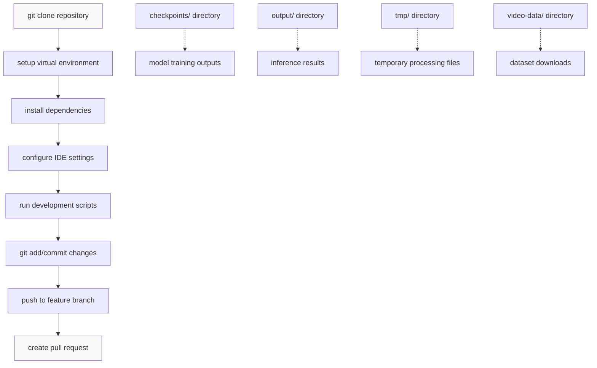
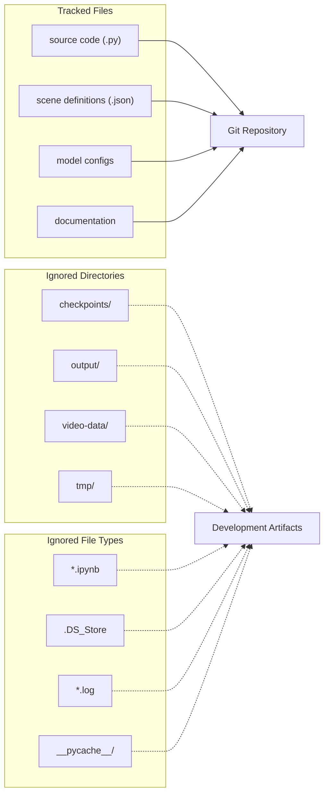
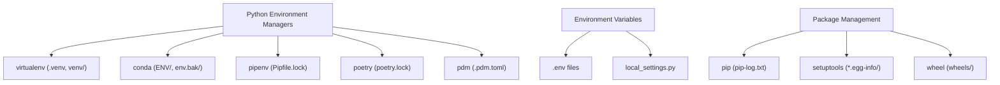

<!-- source: DeepWiki mcp.deepwiki.com · repo microsoft/renderformer · page 9.3 Development Setup · fetched 2026-10-26 -->

# Development Setup

<details>
<summary>Relevant source files</summary>

The following files were used as context for generating this wiki page:

- [.gitattributes](.gitattributes)
- [.gitignore](.gitignore)

</details>


This document provides comprehensive guidance for setting up a development environment for contributing to the RenderFormer codebase. It covers Git configuration, development environment setup, and file organization best practices.

For general installation and usage instructions, see [Installation & Setup](#3.1). For contribution guidelines and support, see [Getting Support](#8.1), [Security Policy](#8.2), and [Code of Conduct](#8.3).

## Git Configuration

The RenderFormer repository includes specific Git configurations to ensure consistent development practices across contributors.

### Line Ending Normalization

The repository uses automatic line ending detection and normalization through the `.gitattributes` configuration:

```
* text=auto
```

This setting ensures that:
- Text files are automatically detected
- Line endings are normalized to LF on commit
- Line endings are converted to the platform-appropriate format on checkout
- Binary files are left unchanged

**Sources:** [.gitattributes:1-3]()

### Repository Structure and Ignored Files

The development environment excludes several categories of files from version control to maintain a clean repository state.

## Development Environment Workflow



**Sources:** [.gitignore:165-170]()

## File Categories and Ignore Patterns

The repository maintains a comprehensive `.gitignore` configuration that excludes development artifacts while preserving essential source code and configuration files.

### Python Development Artifacts

| Category | Patterns | Purpose |
|----------|----------|---------|
| Bytecode | `__pycache__/`, `*.py[cod]` | Compiled Python files |
| Distribution | `build/`, `dist/`, `*.egg-info/` | Package build artifacts |
| Testing | `.pytest_cache/`, `coverage.xml` | Test execution artifacts |
| Virtual Environments | `.venv`, `venv/`, `ENV/` | Python environment isolation |

### Project-Specific Exclusions



### Key Ignored Components

- **`checkpoints/`**: Model training checkpoints and saved states
- **`output/`**: Generated images, videos, and inference results  
- **`video-data/`**: Downloaded dataset files
- **`tmp/`**: Temporary processing files
- **`*.ipynb`**: Jupyter notebook files used for experimentation

**Sources:** [.gitignore:165-170]()

## IDE and Tool Configuration

The `.gitignore` includes patterns for common development tools and IDEs:

### Supported Development Environments

| Tool Category | Ignored Patterns | Description |
|---------------|------------------|-------------|
| JetBrains IDEs | `#.idea/` | PyCharm, IntelliJ configurations |
| Jupyter | `.ipynb_checkpoints`, `*.ipynb` | Notebook artifacts |
| VS Code | Not explicitly listed | Would typically ignore `.vscode/` |
| mypy | `.mypy_cache/` | Type checking cache |

### Python Environment Management

The configuration supports multiple Python environment managers:



**Sources:** [.gitignore:90-130]()

## Development Best Practices

### File Organization

When developing for RenderFormer, follow these file organization principles:

1. **Source Code**: Keep all Python modules in appropriate package directories
2. **Experiments**: Store Jupyter notebooks in a separate experiments directory (not tracked)
3. **Outputs**: Use the `output/` directory for inference results (automatically ignored)
4. **Models**: Store model checkpoints in `checkpoints/` (automatically ignored)
5. **Data**: Place datasets in `video-data/` directory (automatically ignored)

### Platform Considerations

The configuration includes platform-specific exclusions:

- **macOS**: `.DS_Store` files are ignored
- **Windows**: No specific patterns, but standard Python patterns apply
- **Linux**: Standard Python and development tool patterns

### Security Considerations

Environment files containing sensitive information are automatically excluded:

- `.env` files containing API keys or credentials
- Local configuration files (`local_settings.py`)
- Database files (`db.sqlite3`)

**Sources:** [.gitignore:58-63](), [.gitignore:122-129](), [.gitignore:162-164]()

## Troubleshooting Development Setup

### Common Issues

1. **Line Ending Problems**: The `text=auto` setting in `.gitattributes` should handle cross-platform line ending issues automatically
2. **Ignored Files**: If important files aren't being tracked, check against the `.gitignore` patterns
3. **Environment Conflicts**: Ensure your Python environment directory matches one of the ignored patterns

### Verification Steps

To verify your development setup:

1. Check that temporary files are properly ignored: `git status` should not show `__pycache__/` or `.pyc` files
2. Confirm environment isolation: Your virtual environment directory should not appear in `git status`
3. Test line endings: Files should maintain consistent line endings across platforms

**Sources:** [.gitignore:1-170](), [.gitattributes:1-3]()