# Page: Overview

# Overview

<details>
<summary>Relevant source files</summary>

The following files were used as context for generating this wiki page:

- [README.md](README.md)

</details>


## Purpose and Scope

This document provides a high-level overview of the RenderFormer neural rendering system, a transformer-based pipeline that renders triangle meshes with global illumination effects. RenderFormer converts 3D triangle-based scene representations directly to photorealistic images without requiring per-scene training or fine-tuning.

For detailed installation and setup instructions, see [Installation & Setup](#3.1). For comprehensive usage examples, see [Basic Usage](#3.2). For scene definition specifications, see [JSON Scene Format](#5.1).

## System Architecture

The RenderFormer system follows a modular architecture with distinct processing stages:

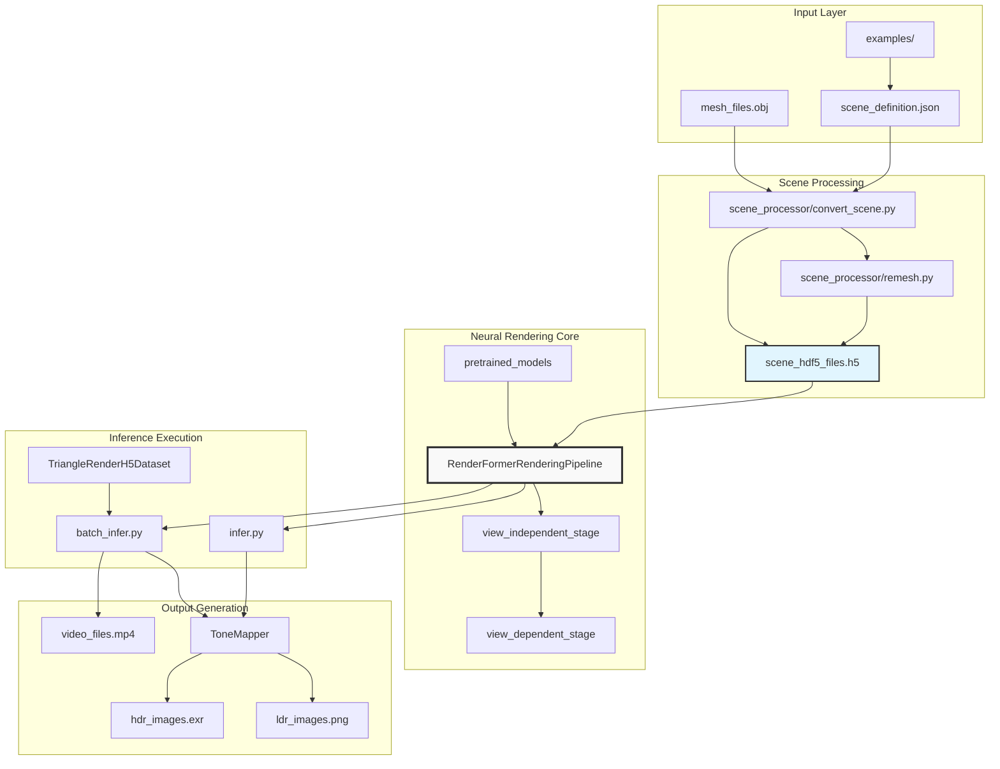

**RenderFormer System Architecture**
- Input scenes defined in JSON format are processed through scene conversion pipeline
- Neural rendering core implements two-stage transformer architecture
- Multiple inference modes support single image and video generation
- Output supports both HDR and LDR formats with tone mapping

Sources: [README.md:1-362](), [scene_processor/convert_scene.py](), [infer.py](), [batch_infer.py]()

## Core Components

### Neural Rendering Pipeline

The `RenderFormerRenderingPipeline` class serves as the central component implementing the transformer-based neural renderer:

| Component | Class/Module | Purpose |
|-----------|--------------|---------|
| Main Pipeline | `RenderFormerRenderingPipeline` | Orchestrates two-stage rendering process |
| View-Independent Stage | `view_independent_stage` | Models triangle-to-triangle light transport |
| View-Dependent Stage | `view_dependent_stage` | Transforms ray bundles to pixel values |
| Scene Dataset | `TriangleRenderH5Dataset` | Loads and batches HDF5 scene data |

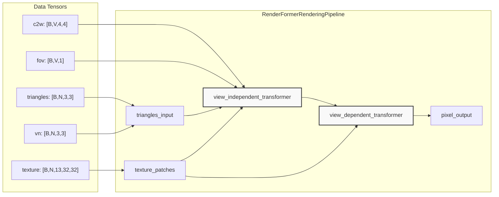

**Neural Pipeline Data Flow**
- Input tensors represent triangle geometry, texture patches, and camera parameters
- Two-stage transformer processes scene tokens to generate pixel values
- Output maintains spatial relationships for global illumination effects

Sources: [README.md:149-189](), [renderformer/pipelines/rendering_pipeline.py]()

### Scene Processing System

The scene processing pipeline converts user-defined scenes into the neural rendering format:

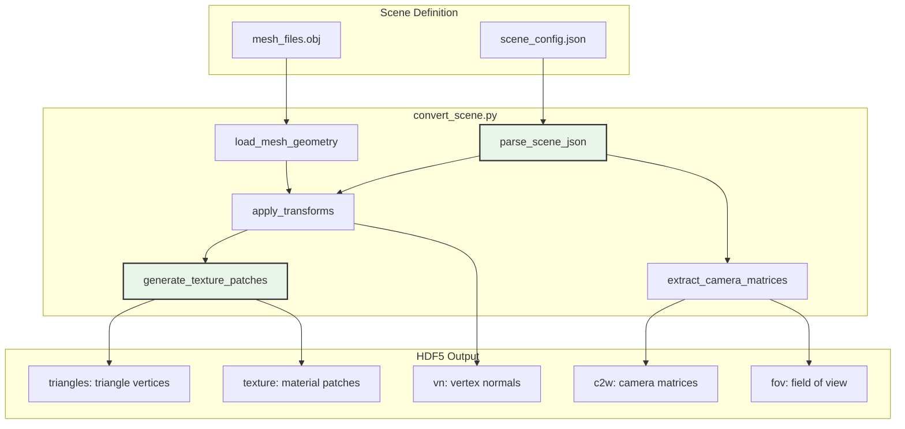

**Scene Processing Pipeline**
- JSON scene definitions specify geometry, materials, and camera configurations
- Processing pipeline triangulates meshes and generates texture representations
- Output HDF5 files contain structured data ready for neural rendering

Sources: [README.md:109-116](), [scene_processor/convert_scene.py](), [scene_processor/to_h5.py:1-289]()

## Data Flow and Tensor Shapes

The system processes data through specific tensor formats optimized for transformer architectures:

| Data Type | Tensor Shape | Description |
|-----------|--------------|-------------|
| Triangle Vertices | `[B, N, 3, 3]` | Batch × Triangles × Vertices × Coordinates |
| Texture Patches | `[B, N, 13, 32, 32]` | Batch × Triangles × Channels × Height × Width |
| Vertex Normals | `[B, N, 3, 3]` | Batch × Triangles × Vertices × Normal Vector |
| Camera Matrices | `[B, V, 4, 4]` | Batch × Views × Transform Matrix |
| Output Images | `[B, V, 512, 512, 3]` | Batch × Views × Height × Width × RGB |

## Inference Modes

RenderFormer supports two primary inference modes for different use cases:

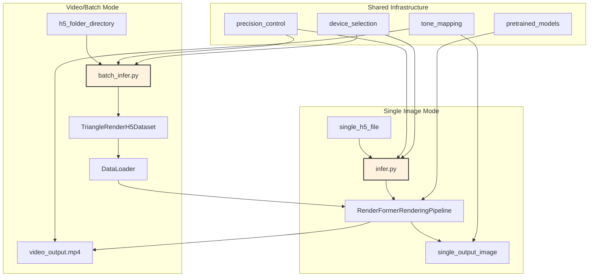

**Inference Mode Comparison**
- Single image mode processes individual scenes through `infer.py`
- Batch mode enables video generation through `batch_infer.py` with dataset loading
- Both modes share core pipeline and infrastructure components

Sources: [README.md:117-133](), [README.md:192-203](), [infer.py](), [batch_infer.py]()

## Key Capabilities

### Global Illumination Effects
RenderFormer renders complex lighting phenomena including specular reflections, soft shadows, diffuse indirect lighting, and glossy reflections without physics-based simulation.

### Hardware Acceleration
The system supports multiple compute backends:
- NVIDIA CUDA GPUs with Flash Attention optimization
- Apple Metal Performance Shaders (MPS)
- CPU fallback for cross-platform compatibility

### Precision Control
Inference supports multiple precision modes (`fp16`, `bf16`, `fp32`) for memory and performance optimization.

### Output Formats
- HDR output in `.exr` format for professional workflows
- LDR output with tone mapping (`agx`, `filmic`, `pbr_neutral`)
- Video generation in `.mp4` format for animation sequences

Sources: [README.md:40-41](), [README.md:75-78](), [README.md:125-131](), [README.md:139-147]()

---

# Page: Core Architecture

# Core Architecture

<details>
<summary>Relevant source files</summary>

The following files were used as context for generating this wiki page:

- [README.md](README.md)

</details>


This document covers the neural rendering pipeline architecture of RenderFormer, focusing on the transformer-based two-stage design and core data flow. For information about scene processing and data format preparation, see [Scene Processing](#2.2). For details about the specific data structures and tensor formats, see [Data Formats](#2.3).

RenderFormer implements a sequence-to-sequence neural rendering approach where triangle mesh representations are transformed into rendered images through a two-stage transformer pipeline. The architecture treats rendering as a token transformation problem, converting triangle tokens with material properties into pixel patch outputs.

## Pipeline Overview

The `RenderFormerRenderingPipeline` class serves as the central orchestrator for the neural rendering process, coordinating data flow between the view-independent and view-dependent transformer stages.

**RenderFormer Pipeline Architecture**
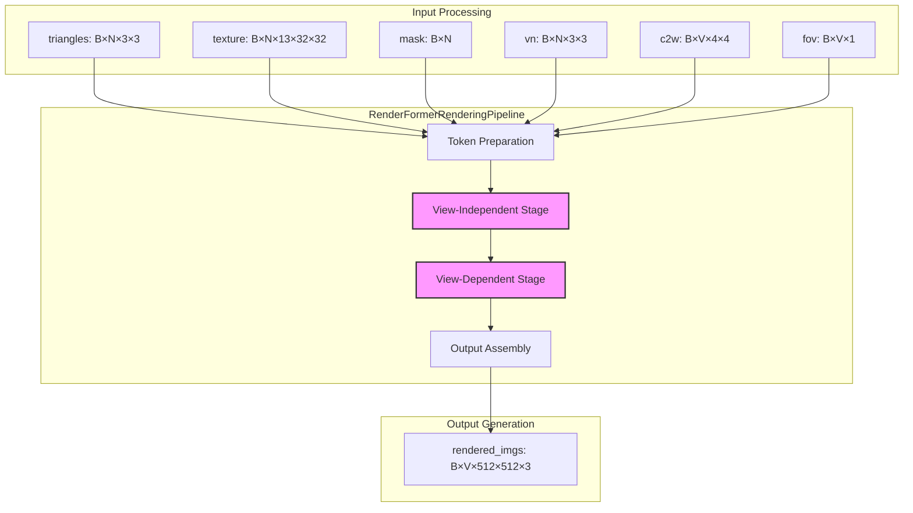

Sources: [README.md:155-187](), [README.md:40-41]()

## Two-Stage Transformer Architecture

The core innovation of RenderFormer lies in its two-stage transformer design that separates view-independent light transport modeling from view-dependent ray-to-pixel transformation.

**Two-Stage Processing Flow**
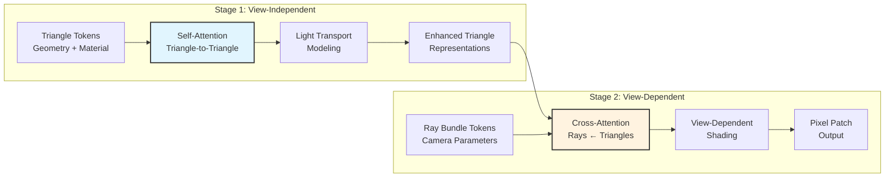

The view-independent stage processes triangle tokens through self-attention mechanisms to model inter-triangle light transport without considering camera viewpoints. This stage captures global illumination effects like indirect lighting and inter-reflections that are consistent regardless of viewing angle.

The view-dependent stage takes the enhanced triangle representations from stage one and combines them with ray bundle tokens derived from camera parameters. Cross-attention mechanisms allow ray tokens to query relevant triangle information for view-dependent effects like specular reflections and occlusion.

Sources: [README.md:40-41]()

## Data Flow and Tensor Transformations

The pipeline processes batched data through well-defined tensor transformations, maintaining consistent shapes throughout the neural rendering process.

**Tensor Flow Diagram**
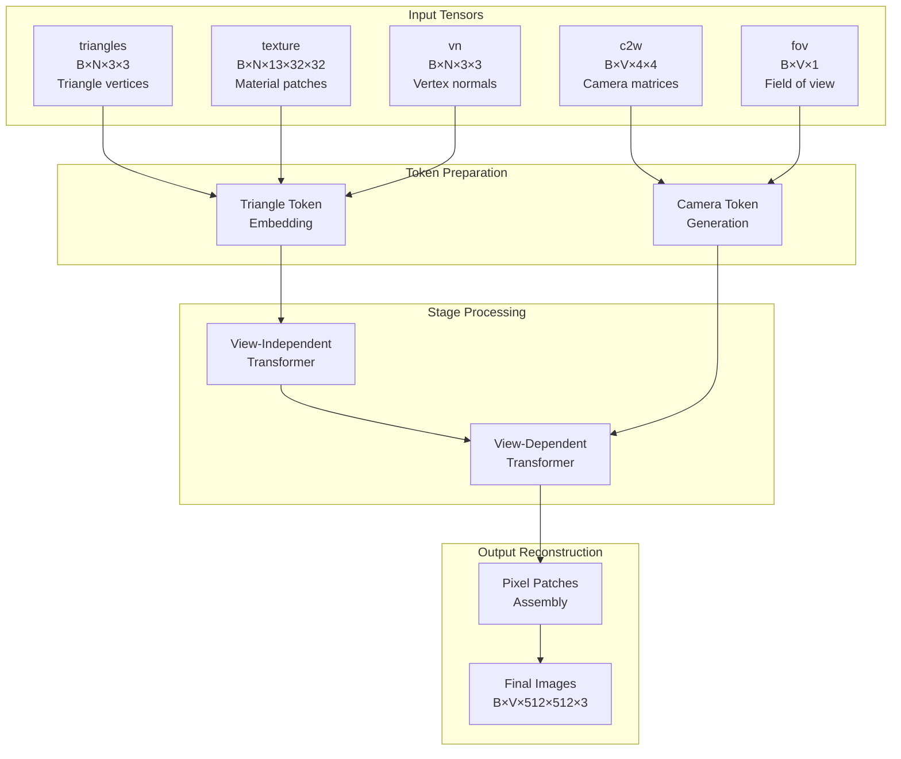

Key tensor dimensions:
- `B`: Batch size
- `N`: Number of triangles (up to 4096 in training, 8192 in inference)
- `V`: Number of camera views
- Triangle vertices are stored as 3×3 matrices (three 3D points)
- Texture patches are 13-channel 32×32 patches encoding material properties
- Camera-to-world matrices follow Blender coordinate system (-Z forward, +Y up, +X right)

Sources: [README.md:168-174](), [README.md:280-285]()

## Core Component Integration

The `RenderFormerRenderingPipeline` integrates multiple subsystems to achieve end-to-end neural rendering functionality.

**Component Integration Architecture**
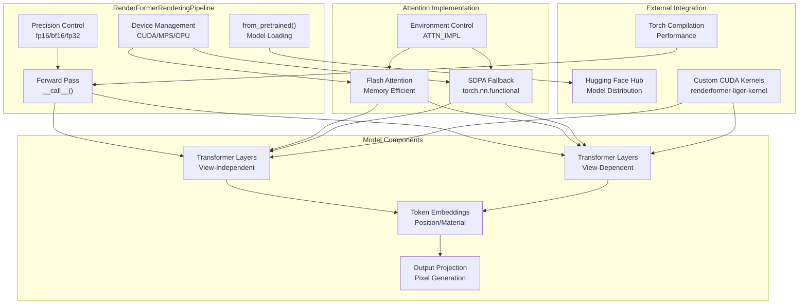

The pipeline provides several key integration points:

| Component | Purpose | Configuration |
|-----------|---------|---------------|
| Model Loading | Loads pre-trained weights from Hugging Face | `model_id` parameter |
| Device Management | Handles CUDA/MPS/CPU placement | Automatic detection |
| Precision Control | Manages fp16/bf16/fp32 inference | `torch_dtype` parameter |
| Attention Backend | Selects Flash Attention or SDPA | `ATTN_IMPL` environment variable |

The pipeline automatically handles model compilation, attention implementation selection, and device placement while exposing a simple interface for batch inference.

Sources: [README.md:149-189](), [README.md:125-131](), [renderformer/pipelines/rendering_pipeline.py]()

---

# Page: Rendering Pipeline

# Rendering Pipeline

<details>
<summary>Relevant source files</summary>

The following files were used as context for generating this wiki page:

- [README.md](README.md)
- [batch_infer.py](batch_infer.py)
- [infer.py](infer.py)

</details>


This document explains the core `RenderFormerRenderingPipeline` class and its two-stage transformer architecture that performs neural rendering of triangle meshes. For information about scene data preparation and HDF5 format specifications, see [Data Formats](#2.3). For details about the scene conversion process, see [Scene Processing](#2.2).

## Pipeline Overview

The RenderFormer rendering pipeline implements a neural approach to physically-based rendering using transformer architectures. Instead of traditional ray-tracing methods, it treats rendering as a sequence-to-sequence transformation problem where triangle tokens are converted to pixel patch tokens.

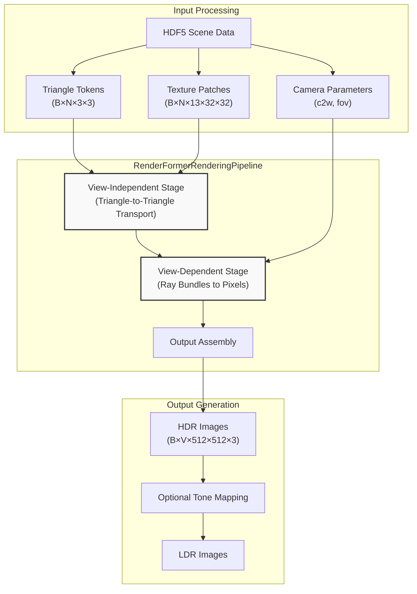

**Pipeline Architecture Overview**

The pipeline consists of two main transformer stages that work together to simulate global illumination effects without requiring per-scene training.

Sources: [README.md:40-41](), [README.md:149-189](), [infer.py:75-84]()

## Two-Stage Transformer Architecture

The RenderFormer pipeline implements a novel two-stage approach to neural rendering, where each stage handles different aspects of the light transport simulation.

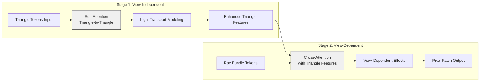

**Two-Stage Transformer Process**

### View-Independent Stage

The first stage processes triangle tokens using self-attention mechanisms to model triangle-to-triangle light transport relationships. This stage captures global illumination effects such as:

- Inter-reflections between surfaces
- Diffuse indirect lighting
- Shadow casting relationships
- Light transport paths

### View-Dependent Stage

The second stage takes the enhanced triangle features from stage one and combines them with view-specific ray bundle tokens. This stage handles:

- Camera perspective transformations  
- Specular reflections
- View-dependent lighting effects
- Final pixel value computation

Sources: [README.md:40-41]()

## Input Data Format

The `RenderFormerRenderingPipeline` expects specific tensor formats for all input data. The following table describes the required input parameters:

| Parameter | Shape | Data Type | Description |
|-----------|-------|-----------|-------------|
| `triangles` | `(B, N, 3, 3)` | `torch.float32` | Triangle vertex coordinates |
| `texture` | `(B, N, 13, 32, 32)` | `torch.float32` | Material texture patches per triangle |
| `mask` | `(B, N)` | `torch.bool` | Valid triangle mask for padding |
| `vn` | `(B, N, 3, 3)` | `torch.float32` | Vertex normals per triangle |
| `c2w` | `(B, V, 4, 4)` | `torch.float32` | Camera-to-world transformation matrices |
| `fov` | `(B, V, 1)` | `torch.float32` | Field of view angles in degrees |

Where:
- `B` = Batch size
- `N` = Number of triangles per scene
- `V` = Number of camera views
- `13` = Material property channels (diffuse RGB, specular RGB, roughness, etc.)
- `32` = Texture patch resolution

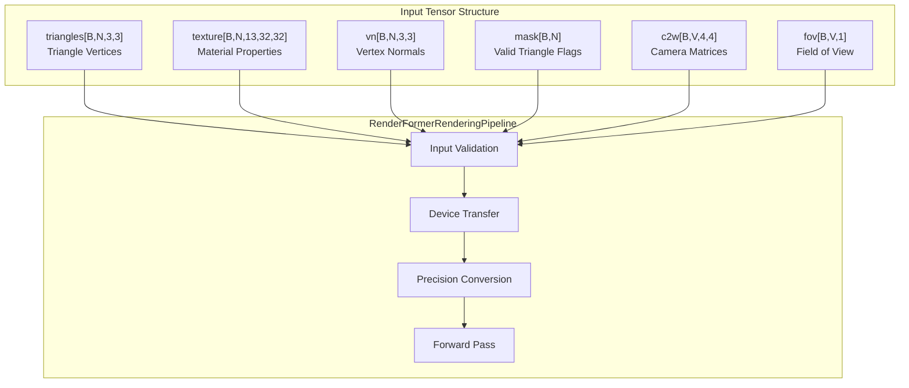

**Input Data Processing Flow**

Sources: [README.md:168-174](), [infer.py:67-74](), [batch_infer.py:125-130]()

## Rendering Process

The rendering process in `RenderFormerRenderingPipeline` follows a structured workflow that handles model loading, device management, and inference execution.

### Model Initialization

The pipeline supports loading pre-trained models from Hugging Face Hub or local paths:

```python
pipeline = RenderFormerRenderingPipeline.from_pretrained("microsoft/renderformer-v1.1-swin-large")
```

### Device and Precision Management

The system automatically detects and configures optimal compute settings:

| Device Type | Precision Support | Optimizations |
|-------------|------------------|---------------|
| CUDA GPU | `fp16`, `bf16`, `fp32` | Flash Attention, TF32, Liger Kernels |  
| Apple MPS | `fp32` only | Automatic fallback from fp16/bf16 |
| CPU | `fp16`, `bf16`, `fp32` | Scaled Dot Product Attention |

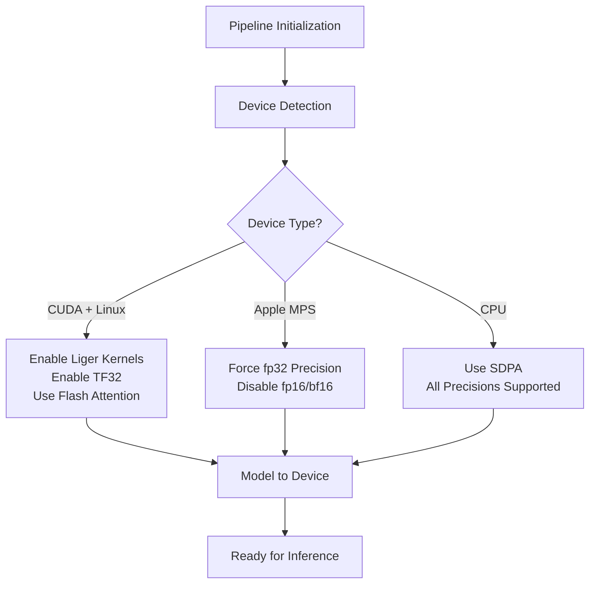

**Device Configuration Flow**

### Inference Execution

The core rendering call processes all input tensors through both transformer stages:

```python
rendered_imgs = pipeline(
    triangles=triangles,
    texture=texture, 
    mask=mask,
    vn=vn,
    c2w=c2w,
    fov=fov,
    resolution=512,
    torch_dtype=torch.float16
)
```

The output tensor has shape `(B, V, H, W, 3)` representing HDR RGB images for each batch item and camera view.

Sources: [infer.py:45-55](), [batch_infer.py:81-92](), [README.md:125-130]()

## Output Generation

The pipeline generates HDR (High Dynamic Range) images as primary output, with optional tone mapping for LDR (Low Dynamic Range) display.

### HDR Output Format

All rendered images are initially produced in linear HDR format with:
- **File Format**: OpenEXR (`.exr`)
- **Color Space**: Linear RGB
- **Data Type**: `float32`
- **Value Range**: Unbounded (can exceed 1.0 for bright regions)

### Tone Mapping Options

For display purposes, HDR images can be converted to LDR using various tone mappers:

| Tone Mapper | Configuration | Use Case |
|-------------|---------------|----------|
| `none` | Direct clipping at [0,1] | Basic visualization |
| `agx` | AGX tone mapping | Cinematic look |
| `filmic` | Filmic tone mapping | Photography-style |
| `pbr_neutral` | Khronos PBR Neutral | PBR-compliant rendering |

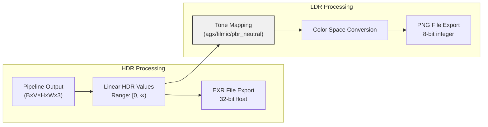

**Output Processing Pipeline**

### File Output Structure

For each rendered view, the system generates both HDR and LDR outputs:

```
output_directory/
├── scene_name_view_0.exr    # HDR linear RGB
├── scene_name_view_0.png    # LDR tone-mapped
├── scene_name_view_1.exr
├── scene_name_view_1.png
└── ...
```

Sources: [infer.py:93-106](), [batch_infer.py:152-163](), [README.md:123-124]()

## Performance Considerations

The RenderFormer pipeline includes several optimization strategies for efficient inference across different hardware configurations.

### Memory Optimization

- **Padding Strategy**: Variable triangle counts are handled using boolean masks and optional padding to fixed lengths
- **Batch Processing**: Supports configurable batch sizes for memory-constrained environments
- **Precision Control**: Lower precision (fp16/bf16) reduces memory usage by ~50%

### Compute Acceleration

The system leverages hardware-specific optimizations:

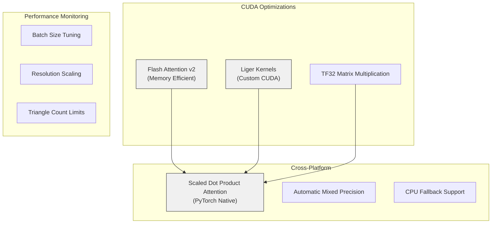

**Hardware Optimization Stack**

### Attention Implementation Selection

The pipeline automatically selects the best available attention implementation:

1. **Flash Attention** (CUDA): Most memory efficient for long sequences
2. **SDPA** (All platforms): PyTorch native implementation with good performance
3. **Environment Override**: `ATTN_IMPL=sdpa` forces SDPA usage

### Scaling Recommendations

| Scene Complexity | Recommended Settings |
|------------------|---------------------|
| Simple (< 1K triangles) | Batch size: 8-16, Resolution: 512-1024 |
| Medium (1K-4K triangles) | Batch size: 4-8, Resolution: 512 |
| Complex (4K+ triangles) | Batch size: 1-4, Resolution: 512, fp16 precision |

Sources: [batch_infer.py:83-91](), [README.md:125-130](), [infer.py:47-55]()

---

# Page: Scene Processing

# Scene Processing

<details>
<summary>Relevant source files</summary>

The following files were used as context for generating this wiki page:

- [README.md](README.md)
- [examples/cbox.json](examples/cbox.json)

</details>


## Purpose and Scope

This document covers the scene processing pipeline in RenderFormer, which converts user-defined scenes from JSON format into the HDF5 format required by the neural rendering pipeline. The scene processing system handles mesh loading, triangulation, texture preparation, material property encoding, and data organization for efficient neural rendering.

For information about the JSON scene definition format, see [Scene Definition](#5). For details about the HDF5 data structures used by the rendering pipeline, see [Data Formats](#2.3).

## Scene Processing Pipeline Overview

The scene processing pipeline transforms human-readable scene descriptions into optimized data structures for neural rendering. The pipeline consists of several stages that handle geometry processing, material encoding, and data serialization.

### Pipeline Architecture

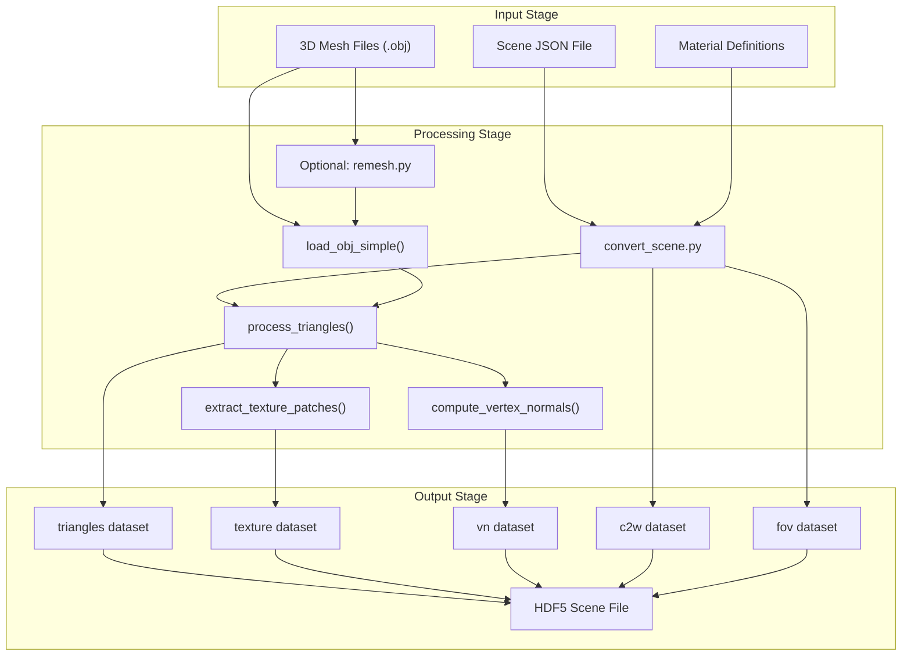

Sources: [README.md:109-115](), [README.md:276-288]()

## JSON to HDF5 Conversion Process

The core conversion process is handled by the `convert_scene.py` script, which orchestrates the transformation from scene definition to neural rendering format.

### Conversion Workflow

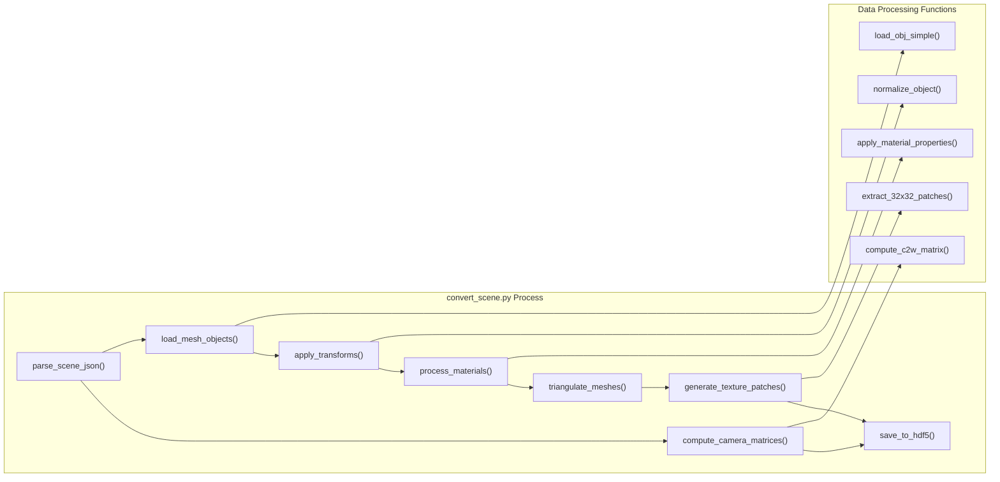

Sources: [README.md:113-115](), [scene_processor/convert_scene.py]()

### Scene Object Processing

The conversion process handles multiple object types and applies various transformations:

| Processing Step | Function | Purpose |
|-----------------|----------|---------|
| Mesh Loading | `load_obj_simple()` | Parse OBJ files and extract vertices/faces |
| Transformation | `apply_transforms()` | Apply translation, rotation, scale, normalization |
| Material Encoding | `process_materials()` | Convert material properties to texture format |
| Triangulation | `triangulate_meshes()` | Ensure all geometry is triangle-based |
| Patch Extraction | `generate_texture_patches()` | Create 32×32 texture patches per triangle |

Sources: [README.md:241-262](), [examples/cbox.json:1-320]()

## Mesh Processing and Triangulation

The scene processor handles various mesh formats and ensures compatibility with the neural rendering pipeline through standardized triangulation and texture extraction.

### Triangle and Texture Processing

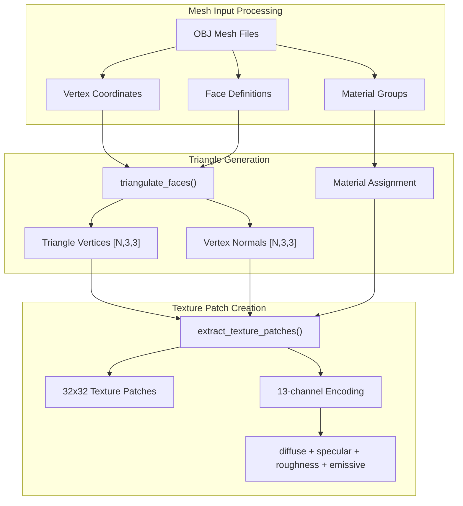

Sources: [README.md:280-285](), [README.md:246-254]()

### Material Property Encoding

The system encodes material properties into a standardized 13-channel format for each triangle:

| Channel Range | Content | Source |
|---------------|---------|---------|
| 0-2 | Diffuse RGB | `material.diffuse` |
| 3-5 | Specular RGB | `material.specular` |
| 6 | Roughness | `material.roughness` |
| 7-9 | Emissive RGB | `material.emissive` |
| 10-12 | Additional Properties | Computed values |

Sources: [README.md:246-254](), [examples/cbox.json:25-45]()

## Remeshing Capabilities

The scene processor includes optional remeshing functionality to optimize mesh density and triangle distribution for neural rendering.

### Remeshing Pipeline

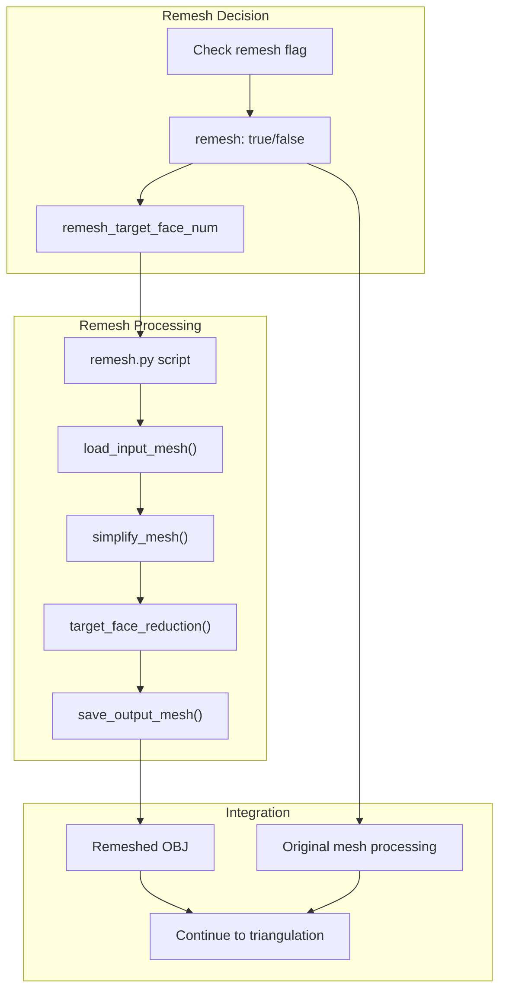

Sources: [README.md:290-298](), [README.md:260-261]()

### Remeshing Configuration

The remeshing process can be controlled through scene JSON configuration:

```json
{
  "remesh": true,
  "remesh_target_face_num": 1024
}
```

Or invoked directly via command line:
```bash
python3 scene_processor/remesh.py --input mesh.obj --output remeshed.obj --target_face_num 1024
```

Sources: [README.md:296-298](), [README.md:260-261]()

## HDF5 Data Format Specification

The scene processor outputs data in HDF5 format with specific datasets required by the neural rendering pipeline.

### HDF5 Dataset Structure

| Dataset Name | Shape | Data Type | Description |
|--------------|-------|-----------|-------------|
| `triangles` | `[N, 3, 3]` | float32 | Triangle vertex coordinates |
| `texture` | `[N, 13, 32, 32]` | float32 | Material property patches |
| `vn` | `[N, 3, 3]` | float32 | Vertex normals per triangle |
| `c2w` | `[V, 4, 4]` | float32 | Camera-to-world matrices |
| `fov` | `[V]` | float32 | Field of view per camera |

Where `N` is the number of triangles and `V` is the number of camera views.

Sources: [README.md:280-285]()

### Coordinate System Convention

The scene processor uses Blender's coordinate system convention:
- **-Z**: View direction (forward)
- **+Y**: Up direction  
- **+X**: Right direction

This coordinate system is maintained throughout the conversion process for camera matrices and geometry positioning.

Sources: [README.md:286-287]()

## Integration with Rendering Pipeline

The processed HDF5 files serve as input to the RenderFormer neural rendering pipeline, providing the structured data required for transformer-based rendering.

### Pipeline Integration Flow

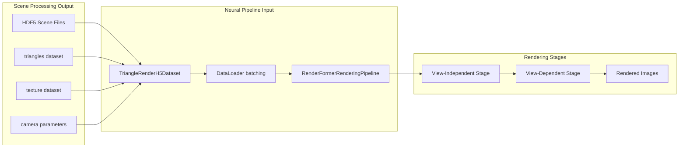

Sources: [README.md:114-115](), [README.md:149-189]()

The scene processing pipeline ensures that all geometric and material data is properly formatted and optimized for efficient neural rendering, maintaining the quality and accuracy required for high-fidelity image synthesis.

---

# Page: Data Formats

# Data Formats

<details>
<summary>Relevant source files</summary>

The following files were used as context for generating this wiki page:

- [README.md](README.md)
- [batch_infer.py](batch_infer.py)

</details>


This document describes the data formats and structures used throughout the RenderFormer neural rendering pipeline. It covers the HDF5 scene format, tensor shapes during neural processing, and data loading mechanisms. For information about scene definition and JSON input formats, see [Scene Definition](/5). For details about the neural rendering pipeline architecture, see [Rendering Pipeline](/2.1).

## HDF5 Scene Format

The core data format used by RenderFormer is HDF5, which stores preprocessed scene geometry, materials, and camera information. This format is created by the scene conversion process and consumed by both inference scripts.

### Primary Data Fields

The HDF5 files contain the following required fields:

| Field | Shape | Type | Description |
|-------|-------|------|-------------|
| `triangles` | `[N, 3, 3]` | `float32` | Triangle vertex positions in world coordinates |
| `texture` | `[N, 13, 32, 32]` | `float32` | Per-triangle texture patches with material properties |
| `vn` | `[N, 3, 3]` | `float32` | Vertex normals for each triangle |
| `c2w` | `[V, 4, 4]` | `float32` | Camera-to-world transformation matrices |
| `fov` | `[V]` | `float32` | Field of view values for each camera view |

Where `N` is the number of triangles and `V` is the number of camera views.

**HDF5 Data Structure**
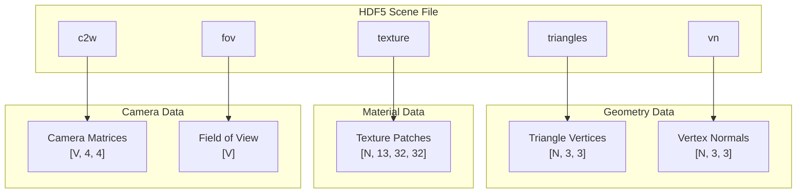

Sources: [README.md:276-284](), [batch_infer.py:29-35]()

### Texture Patch Encoding

The `texture` field uses a 13-channel encoding per triangle, stored as 32×32 patches:

- **Channels 0-2**: Diffuse RGB values
- **Channels 3-5**: Specular RGB values  
- **Channel 6**: Roughness parameter
- **Channels 7-9**: Emissive RGB values
- **Channels 10-12**: Additional material properties

Each triangle gets its own 32×32 texture patch, allowing the neural network to process material information spatially.

Sources: [README.md:281](), [batch_infer.py:32]()

## Tensor Data Flow

Data flows through the RenderFormer pipeline with specific tensor shapes at each stage. The system supports batching for efficient processing.

### Pipeline Input Tensors

When data enters the `RenderFormerRenderingPipeline`, it follows this structure:

| Tensor | Shape | Description |
|--------|-------|-------------|
| `triangles` | `[B, N, 3, 3]` | Batched triangle vertices |
| `texture` | `[B, N, 13, 32, 32]` | Batched texture patches |
| `mask` | `[B, N]` | Boolean mask for valid triangles |
| `vn` | `[B, N, 3, 3]` | Batched vertex normals |
| `c2w` | `[B, V, 4, 4]` | Batched camera matrices |
| `fov` | `[B, V, 1]` | Batched field of view values |

Where `B` is batch size, `N` is number of triangles, and `V` is number of views.

**Data Flow Through Pipeline**
```mermaid
flowchart LR
    subgraph "Input_Stage"["Input Stage"]
        A["HDF5 Files"]
        B["TriangleRenderH5Dataset"]
    end
    
    subgraph "Tensor_Processing"["Tensor Processing"]
        C["triangles<br/>[B,N,3,3]"]
        D["texture<br/>[B,N,13,32,32]"]
        E["mask<br/>[B,N]"]
        F["vn<br/>[B,N,3,3]"]
        G["c2w<br/>[B,V,4,4]"]
        H["fov<br/>[B,V,1]"]
    end
    
    subgraph "Neural_Pipeline"["Neural Pipeline"]
        I["RenderFormerRenderingPipeline"]
    end
    
    subgraph "Output_Stage"["Output Stage"]
        J["rendered_imgs<br/>[B,V,512,512,3]"]
    end
    
    A --> B
    B --> C
    B --> D
    B --> E
    B --> F
    B --> G
    B --> H
    
    C --> I
    D --> I
    E --> I
    F --> I
    G --> I
    H --> I
    
    I --> J
```

Sources: [README.md:168-173](), [batch_infer.py:125-143]()

### Output Tensor Format

The pipeline outputs rendered images with shape `[B, V, H, W, 3]` where:
- `B`: Batch size
- `V`: Number of views per scene
- `H`, `W`: Image height and width (typically 512×512)
- `3`: RGB color channels

The output represents linear HDR images that require tone mapping for display.

Sources: [README.md:185-186](), [batch_infer.py:152]()

## Data Loading and Batching

The `TriangleRenderH5Dataset` class handles loading and batching of HDF5 scene data for efficient processing.

### Dataset Implementation

The dataset provides automatic padding for batch processing when triangles counts vary:

```python
# Simplified data loading process from TriangleRenderH5Dataset
triangles = torch.from_numpy(np.array(f['triangles'])).float()
texture = torch.from_numpy(np.array(f['texture'])).float()
vn = torch.from_numpy(np.array(f['vn'])).float()
c2w = np.array(f['c2w']).astype(np.float32)
fov = np.array(f['fov']).astype(np.float32)
```

**Data Loading Architecture**
```mermaid
graph TB
    subgraph "File_System"["File System"]
        A["HDF5 Files Directory"]
        B["Scene_001.h5"]
        C["Scene_002.h5"]
        D["Scene_N.h5"]
    end
    
    subgraph "Dataset_Layer"["Dataset Layer"]
        E["TriangleRenderH5Dataset"]
        F["__getitem__"]
        G["Padding Logic"]
    end
    
    subgraph "DataLoader_Layer"["DataLoader Layer"]
        H["PyTorch DataLoader"]
        I["Batch Collation"]
        J["Device Transfer"]
    end
    
    subgraph "Pipeline_Input"["Pipeline Input"]
        K["Batched Tensors"]
    end
    
    A --> E
    B --> F
    C --> F
    D --> F
    
    E --> F
    F --> G
    G --> H
    H --> I
    I --> J
    J --> K
```

Sources: [batch_infer.py:17-58](), [batch_infer.py:102-110]()

### Padding Strategy

When `padding_length` is specified, the dataset pads shorter sequences to a fixed length:

- **Triangle data**: Padded with zeros to `[padding_length, 3, 3]`
- **Texture data**: Padded with zeros to `[padding_length, 13, 32, 32]`  
- **Normal data**: Padded with zeros to `[padding_length, 3, 3]`
- **Mask**: Boolean mask indicating valid triangles (True for real data, False for padding)

This enables efficient batch processing of scenes with varying triangle counts.

Sources: [batch_infer.py:37-47]()

## Input and Output Formats

### JSON Scene Definition

Input scenes are defined in JSON format and converted to HDF5 via `scene_processor/convert_scene.py`. The JSON format supports:

- Object geometry and material definitions
- Camera positioning and parameters
- Lighting configurations
- Transform hierarchies

The conversion process triangulates meshes, generates texture patches, and computes camera matrices.

Sources: [README.md:230-295]()

### Image Output Formats

RenderFormer produces two types of image outputs:

| Format | Extension | Description | Usage |
|--------|-----------|-------------|-------|
| HDR | `.exr` | Linear color space, float32 | Post-processing, compositing |
| LDR | `.png` | Tone-mapped, 8-bit RGB | Display, web usage |

The tone mapping process converts linear HDR to display-ready LDR using configurable tone mappers (`agx`, `filmic`, `pbr_neutral`).

Sources: [README.md:123](), [batch_infer.py:153-157]()

### Video Output

For video sequences, individual frames are collected and encoded into MP4 format:

- **Frame rate**: 24 fps
- **Quality**: Configurable (default: 9)
- **Format**: H.264 encoded MP4

The video assembly process handles frame ordering and timing automatically.

Sources: [batch_infer.py:170-174]()

---

# Page: Getting Started

# Getting Started

<details>
<summary>Relevant source files</summary>

The following files were used as context for generating this wiki page:

- [README.md](README.md)

</details>


This page provides an overview of how to install and use RenderFormer for neural rendering of 3D scenes. It covers the essential concepts, workflow, and initial setup required to render your first images using the transformer-based neural rendering pipeline.

For detailed installation instructions, see [Installation & Setup](#3.1). For step-by-step usage examples, see [Basic Usage](#3.2). For batch processing and video generation, see [Video Rendering](#3.3).

## Prerequisites and System Requirements

RenderFormer supports cross-platform deployment with the following requirements:

| Component | Requirement |
|-----------|-------------|
| **Operating System** | Linux, macOS, Windows |
| **Hardware** | NVIDIA CUDA GPUs, Apple Metal GPUs, or CPU fallback |
| **GPU Memory** | Minimum 8GB VRAM |
| **Python** | PyTorch 2.0+ |
| **Optional** | Flash Attention for memory efficiency |

The system automatically detects available hardware and selects the appropriate compute backend (CUDA, MPS, or CPU).

Sources: [README.md:76-77]()

## Core Workflow Overview

RenderFormer follows a two-stage process from scene definition to rendered output:

**RenderFormer Workflow Diagram**
```mermaid
graph TD
    A["Scene JSON Definition"] --> B["convert_scene.py"]
    B --> C["HDF5 Scene File"]
    C --> D["infer.py / batch_infer.py"]
    D --> E["RenderFormerRenderingPipeline"]
    E --> F["View-Independent Stage"]
    E --> G["View-Dependent Stage"]
    F --> H["Triangle Token Processing"]
    G --> I["Ray-to-Pixel Transformation"]
    H --> J["Rendered HDR Images"]
    I --> J
    J --> K["Tone Mapping (Optional)"]
    K --> L["LDR Output Images/Videos"]
    
    style E fill:#ffcccc
    style F fill:#ccffcc
    style G fill:#ccffcc
```

Sources: [README.md:109-123](), [README.md:40-41]()

## Key Components and Code Structure

The system architecture maps to specific code entities that handle different stages of the rendering pipeline:

**Core Code Components Diagram**
```mermaid
graph TB
    subgraph "Scene Processing Layer"
        A["convert_scene.py"] --> B["to_h5.py"]
        C["remesh.py"] --> A
    end
    
    subgraph "Inference Layer"
        D["infer.py"] --> E["RenderFormerRenderingPipeline"]
        F["batch_infer.py"] --> E
        G["TriangleRenderH5Dataset"] --> F
    end
    
    subgraph "Neural Rendering Core"
        E --> H["View-Independent Transformer"]
        E --> I["View-Dependent Transformer"]
        H --> J["Triangle Token Processing"]
        I --> K["Ray Bundle Processing"]
    end
    
    subgraph "Output Processing"
        L["ToneMapper"] --> M["HDR to LDR Conversion"]
        N["ImageIO"] --> O["EXR/PNG Files"]
        P["Video Assembly"] --> Q["MP4 Files"]
    end
    
    E --> L
    J --> L
    K --> L
    L --> N
    F --> P
    
    style E fill:#ffdddd
    style H fill:#ddffdd
    style I fill:#ddffdd
```

Sources: [README.md:189](), [renderformer/pipelines/rendering_pipeline.py](), [scene_processor/to_h5.py:288]()

## Essential Data Formats

RenderFormer uses specific tensor formats for neural processing:

| Data Type | Shape | Description |
|-----------|-------|-------------|
| `triangles` | `[B×N×3×3]` | Triangle vertex coordinates |
| `texture` | `[B×N×13×32×32]` | Texture patch data per triangle |
| `vn` | `[B×N×3×3]` | Vertex normals |
| `c2w` | `[B×V×4×4]` | Camera-to-world transformation matrices |
| `fov` | `[B×V×1]` | Field of view parameters |

The system processes scenes through the `RenderFormerRenderingPipeline` class, which accepts these tensor inputs and returns rendered images with shape `[B×V×512×512×3]`.

Sources: [README.md:278-284](), [README.md:175-186]()

## Quick Start Steps

### 1. Scene Conversion
Convert a scene definition to the internal HDF5 format:
```bash
python3 scene_processor/convert_scene.py examples/cbox.json --output_h5_path tmp/cbox/cbox.h5
```

### 2. Single Image Rendering
Render a single image using the inference script:
```bash
python3 infer.py --h5_file tmp/cbox/cbox.h5 --output_dir output/cbox/
```

### 3. Programmatic Usage
Use the `RenderFormerRenderingPipeline` class directly for batch processing:
```python
from renderformer import RenderFormerRenderingPipeline
pipeline = RenderFormerRenderingPipeline.from_pretrained("microsoft/renderformer-v1.1-swin-large")
```

Sources: [README.md:113-121](), [README.md:149-189]()

## Model Selection

RenderFormer provides pre-trained models with different complexity levels:

| Model | Parameters | Hugging Face ID |
|-------|------------|-----------------|
| RenderFormer-V1-Base | 205M | `microsoft/renderformer-v1-base` |  
| RenderFormer-V1.1-Large | 483M | `microsoft/renderformer-v1.1-swin-large` |

Models are automatically downloaded from Hugging Face Hub when first used. The system supports multiple precision modes (`fp16`, `bf16`, `fp32`) and attention implementations (Flash Attention, SDPA).

Sources: [README.md:94-97](), [README.md:125-130]()

## Output Formats and Tone Mapping

The pipeline generates HDR linear output in `.exr` format and optionally applies tone mapping for LDR `.png` output. Available tone mappers include:

- `none`: No tone mapping (HDR output only)
- `agx`: AGX tone mapping
- `filmic`: Filmic tone mapping  
- `pbr_neutral`: PBR neutral tone mapping

Sources: [README.md:123-124](), [README.md:145-146]()

## Next Steps

After completing the basic setup, you can:

- Follow detailed installation procedures in [Installation & Setup](#3.1)
- Learn step-by-step rendering workflows in [Basic Usage](#3.2) 
- Explore video generation capabilities in [Video Rendering](#3.3)
- Create custom scenes using the JSON format documented in [Scene Definition](#5)
- Optimize performance using guidelines in [Performance Optimization](#4.3)

Sources: [README.md:42-70]()

---

# Page: Installation & Setup

# Installation & Setup

<details>
<summary>Relevant source files</summary>

The following files were used as context for generating this wiki page:

- [README.md](README.md)
- [infer.py](infer.py)

</details>


This document covers the installation and initial setup of RenderFormer, including system requirements, dependency management, environment configuration, and model downloads. For information about basic usage after installation, see [Basic Usage](#3.2). For development setup and contribution guidelines, see [Development Setup](#9.3).

## System Requirements

RenderFormer supports multiple platforms and hardware configurations with specific minimum requirements:

| Component | Requirement | Notes |
|-----------|-------------|-------|
| **Operating System** | Linux, macOS, Windows | Tested across all platforms |
| **GPU Memory** | 8GB minimum | Required for model inference |
| **GPU Support** | NVIDIA CUDA, Apple Metal | CPU fallback available |
| **Python** | 3.8+ | With PyTorch 2.0+ support |

**Hardware Acceleration Priority:**
1. NVIDIA CUDA GPUs (recommended)
2. Apple Metal GPUs (MPS)
3. CPU (fallback, slower performance)

Sources: [README.md:76-77](), [infer.py:43]()

## Installation Flow

```mermaid
flowchart TD
    A["User Environment"] --> B["Check Prerequisites"]
    B --> C["Clone Repository"]
    C --> D["Install Dependencies"]
    D --> E["Configure Flash Attention"]
    E --> F["Download FreeImage Plugin"]
    F --> G["Load Pretrained Models"]
    G --> H["Device Detection"]
    H --> I["Kernel Optimization"]
    I --> J["Ready for Inference"]
    
    B --> B1["Python 3.8+"]
    B --> B2["PyTorch 2.0+"]
    B --> B3["CUDA/MPS/CPU"]
    
    D --> D1["requirements.txt"]
    D --> D2["renderformer package"]
    D --> D3["simple_ocio ToneMapper"]
    
    E --> E1["flash-attention (CUDA only)"]
    E --> E2["ATTN_IMPL environment"]
    
    G --> G1["microsoft/renderformer-v1-base"]
    G --> G2["microsoft/renderformer-v1.1-swin-large"]
    
    H --> H1["torch.cuda.is_available()"]
    H --> H2["torch.backends.mps.is_available()"]
    
    I --> I1["renderformer_liger_kernel"]
    I --> I2["tf32 optimization"]
```

**Installation Dependencies and Code References**

Sources: [README.md:72-103](), [infer.py:43-55]()

## Step-by-Step Installation

### 1. Repository Setup

```bash
git clone https://github.com/microsoft/renderformer
cd renderformer
```

### 2. Dependency Installation

Install core dependencies through the requirements file:

```bash
pip install -r requirements.txt
```

The `requirements.txt` includes essential packages for:
- `torch` - Core PyTorch framework
- `transformers` - Hugging Face model loading
- `h5py` - HDF5 scene file processing
- `imageio` - Image I/O operations
- `numpy` - Numerical computations

### 3. HDR Image Support

Download the FreeImage plugin for HDR image processing:

```bash
python3 -c "import imageio; imageio.plugins.freeimage.download()"
```

This enables `.exr` format support used in [infer.py:103]() for HDR output.

### 4. Flash Attention (CUDA Optional)

For CUDA users, install Flash Attention for memory-efficient attention:

```bash
# From https://github.com/Dao-AILab/flash-attention
pip install flash-attn --no-build-isolation
```

The system automatically falls back to PyTorch SDPA if Flash Attention is unavailable, as implemented in the pipeline.

Sources: [README.md:81-89](), [infer.py:125-130]()

## Device Configuration

### Device Detection Flow

```mermaid
flowchart LR
    A["Device Selection"] --> B{"CUDA Available?"}
    B -->|Yes| C["torch.device('cuda')"]
    B -->|No| D{"MPS Available?"}
    D -->|Yes| E["torch.device('mps')"]
    D -->|No| F["torch.device('cpu')"]
    
    C --> G["Apply Liger Kernels"]
    C --> H["Enable TF32"]
    E --> I["Force FP32 Precision"]
    F --> J["CPU Inference"]
    
    G --> G1["renderformer_liger_kernel.apply_kernels"]
    H --> H1["torch.backends.cuda.matmul.allow_tf32"]
    I --> I1["args.precision = 'fp32'"]
```

**Device-Specific Optimizations**

The system applies different optimizations based on detected hardware:

| Device | Optimizations | Code Reference |
|--------|---------------|----------------|
| CUDA | Liger kernels, TF32 acceleration | [infer.py:47-51]() |
| MPS | Force FP32 (fp16/bf16 cause errors) | [infer.py:52-54]() |
| CPU | Standard PyTorch operations | [infer.py:43]() |

### Attention Implementation Selection

Control attention implementation via environment variable:

```bash
# Force SDPA usage
ATTN_IMPL=sdpa python3 infer.py --h5_file scene.h5 --output_dir output/

# Default: automatic selection (Flash Attention if available)
python3 infer.py --h5_file scene.h5 --output_dir output/
```

Sources: [infer.py:43-55](), [README.md:125-130]()

## Model Configuration

### Available Pretrained Models

| Model | Parameters | Hugging Face ID | Use Case |
|-------|------------|-----------------|----------|
| RenderFormer-V1-Base | 205M | `microsoft/renderformer-v1-base` | Lightweight inference |
| RenderFormer-V1.1-Large | 483M | `microsoft/renderformer-v1.1-swin-large` | Best quality (default) |

### Model Loading Process

```mermaid
flowchart TD
    A["Model Request"] --> B["RenderFormerRenderingPipeline.from_pretrained()"]
    B --> C{"Local Path?"}
    C -->|Yes| D["Load from Filesystem"]
    C -->|No| E["Download from Hugging Face"]
    
    E --> F["Cache in ~/.cache/huggingface/"]
    D --> G["Initialize Pipeline"]
    F --> G
    
    G --> H["Move to Device"]
    H --> I{"CUDA + Linux?"}
    I -->|Yes| J["Apply Liger Kernels"]
    I -->|No| K["Standard Pipeline"]
    
    J --> L["Ready for Inference"]
    K --> L
```

**Model Loading Implementation**

The `RenderFormerRenderingPipeline` class handles model initialization and device placement as shown in [infer.py:45]().

Sources: [README.md:94-97](), [infer.py:36-55]()

## Verification Steps

### 1. Basic Import Test

```python
import torch
from renderformer import RenderFormerRenderingPipeline
print("RenderFormer imported successfully")
```

### 2. Device Detection Test

```python
device = torch.device('cuda' if torch.cuda.is_available() else 
                     'mps' if torch.backends.mps.is_available() else 'cpu')
print(f"Using device: {device}")
```

### 3. Model Loading Test

```python
pipeline = RenderFormerRenderingPipeline.from_pretrained("microsoft/renderformer-v1.1-swin-large")
print("Model loaded successfully")
```

### 4. Scene Processing Test

Convert an example scene to verify the complete pipeline:

```bash
python3 scene_processor/convert_scene.py examples/cbox.json --output_h5_path tmp/test.h5
python3 infer.py --h5_file tmp/test.h5 --output_dir tmp/
```

Sources: [README.md:113-123](), [infer.py:33-110]()

## Common Issues and Solutions

### Flash Attention Installation

**Issue**: Flash Attention compilation errors on some systems.

**Solution**: Use environment variable to force SDPA:
```bash
ATTN_IMPL=sdpa python3 infer.py [args...]
```

### Memory Issues

**Issue**: Out of memory errors during inference.

**Symptoms**: CUDA/MPS memory allocation failures.

**Solutions**:
- Reduce batch size in batch inference
- Use lower precision (`--precision fp16`)
- Enable gradient checkpointing for large scenes

### Model Download Issues

**Issue**: Slow or failed model downloads from Hugging Face.

**Solution**: Pre-download models or use local cache:
```bash
# Pre-download
huggingface-cli download microsoft/renderformer-v1.1-swin-large

# Use local path
python3 infer.py --model_id /path/to/local/model [args...]
```

### Precision Compatibility

**Issue**: Precision errors on Apple Silicon.

**Auto-fix**: System automatically forces FP32 on MPS devices as implemented in [infer.py:52-54]().

Sources: [infer.py:47-55](), [README.md:125-130]()

---

# Page: Basic Usage

# Basic Usage

<details>
<summary>Relevant source files</summary>

The following files were used as context for generating this wiki page:

- [README.md](README.md)
- [examples/cbox.json](examples/cbox.json)
- [infer.py](infer.py)

</details>


This page covers the essential workflow for rendering your first image with RenderFormer, from scene definition to final output. It provides step-by-step instructions for the most common use case: converting a JSON scene definition to a rendered image using the single image inference pipeline.

For installation and environment setup, see [Installation & Setup](#3.1). For batch processing and video generation, see [Video Rendering](#3.3). For detailed scene definition syntax, see [JSON Scene Format](#5.1).

## Basic Workflow Overview

The RenderFormer rendering process follows a two-step pipeline that transforms JSON scene definitions into neural-rendered images:

**Basic Workflow: JSON Scene to Rendered Image**
```mermaid
flowchart LR
    subgraph "Input"
        A[scene.json]
        B["examples/cbox.json"]
    end
    
    subgraph "Scene Processing"
        C["convert_scene.py"]
        D["scene.h5"]
    end
    
    subgraph "Neural Rendering"
        E["infer.py"]
        F["RenderFormerRenderingPipeline"]
        G["load_single_h5_data()"]
    end
    
    subgraph "Output"
        H["image.exr (HDR)"]
        I["image.png (LDR)"]
    end
    
    A --> C
    B --> C
    C --> D
    D --> G
    G --> F
    F --> E
    E --> H
    E --> I
    
    style C fill:#e1f5fe
    style F fill:#fff3e0
    style D fill:#f3e5f5
```

Sources: [README.md:109-123](), [infer.py:1-110]()

## Step-by-Step Instructions

### Step 1: Scene Conversion

Convert your JSON scene definition to RenderFormer's HDF5 format using the `convert_scene.py` script:

```bash
python3 scene_processor/convert_scene.py examples/cbox.json --output_h5_path tmp/cbox/cbox.h5
```

This process loads the scene definition, processes mesh files, applies materials and transforms, and packages everything into an HDF5 file with the required data fields: `triangles`, `texture`, `vn`, `c2w`, and `fov`.

**Scene Conversion Data Flow**
```mermaid
flowchart TB
    subgraph "JSON Scene Components"
        A["objects: mesh_path, material, transform"]
        B["cameras: position, look_at, up, fov"]
    end
    
    subgraph "Processing Pipeline"
        C["convert_scene.py"]
        D["Mesh Loading (.obj files)"]
        E["Material Application"]
        F["Camera Matrix Generation"]
    end
    
    subgraph "HDF5 Output"
        G["triangles: [N, 3, 3]"]
        H["texture: [N, 13, 32, 32]"]
        I["vn: [N, 3, 3]"]
        J["c2w: [N, 4, 4]"]
        K["fov: [N]"]
    end
    
    A --> C
    B --> C
    C --> D
    C --> E
    C --> F
    D --> G
    E --> H
    D --> I
    F --> J
    F --> K
```

Sources: [README.md:109-115](), [README.md:276-285]()

### Step 2: Image Rendering

Render the scene using the `infer.py` script with your converted HDF5 file:

```bash
python3 infer.py --h5_file tmp/cbox/cbox.h5 --output_dir output/cbox/
```

**Core Rendering Pipeline Components**
```mermaid
flowchart TB
    subgraph "Data Loading"
        A["load_single_h5_data()"]
        B["h5py.File()"]
        C["torch.from_numpy()"]
    end
    
    subgraph "Pipeline Setup"
        D["RenderFormerRenderingPipeline.from_pretrained()"]
        E["Device Selection: CUDA/MPS/CPU"]
        F["Precision: fp16/bf16/fp32"]
    end
    
    subgraph "Neural Rendering"
        G["pipeline(triangles, texture, mask, vn, c2w, fov)"]
        H["View-Independent Stage"]
        I["View-Dependent Stage"]
    end
    
    subgraph "Output Processing"
        J["HDR Images (.exr)"]
        K["ToneMapper (optional)"]
        L["LDR Images (.png)"]
    end
    
    A --> B
    B --> C
    C --> D
    D --> E
    E --> F
    F --> G
    G --> H
    H --> I
    I --> J
    J --> K
    K --> L
```

Sources: [infer.py:12-30](), [infer.py:43-84](), [infer.py:87-106]()

### Step 3: Understanding Outputs

The rendering process generates two output formats for each camera view:

| Output Type | Format | Description | Usage |
|-------------|--------|-------------|-------|
| HDR | `.exr` | Linear HDR values from neural network | Post-processing, compositing |
| LDR | `.png` | Tone-mapped 8-bit RGB | Direct viewing, web display |

For a scene with multiple cameras, outputs are named with view indices: `scene_view_0.exr`, `scene_view_1.exr`, etc.

Sources: [infer.py:91-106](), [README.md:123]()

## Common Configuration Options

### Model Selection

Specify different pre-trained models using the `--model_id` parameter:

```bash
# Use the larger, more accurate model (default)
python3 infer.py --h5_file scene.h5 --model_id microsoft/renderformer-v1.1-swin-large

# Use the smaller, faster model
python3 infer.py --h5_file scene.h5 --model_id microsoft/renderformer-v1-base
```

### Precision Control

Control computational precision for performance vs. quality trade-offs:

```bash
# High precision (slower, more accurate)
python3 infer.py --h5_file scene.h5 --precision fp32

# Standard precision (default)
python3 infer.py --h5_file scene.h5 --precision fp16

# Brain float precision (CUDA only)
python3 infer.py --h5_file scene.h5 --precision bf16
```

### Tone Mapping

Apply tone mapping for better visual results in LDR outputs:

```bash
# AGX tone mapper (Blender-style)
python3 infer.py --h5_file scene.h5 --tone_mapper agx

# Filmic tone mapper
python3 infer.py --h5_file scene.h5 --tone_mapper filmic

# PBR Neutral tone mapper
python3 infer.py --h5_file scene.h5 --tone_mapper pbr_neutral
```

Sources: [infer.py:36-40](), [README.md:134-147]()

## Device and Attention Configuration

RenderFormer automatically selects the best available device and attention implementation:

**Device and Attention Selection Logic**
```mermaid
flowchart TD
    A["Device Detection"] --> B["CUDA Available?"]
    A --> C["MPS Available?"]
    A --> D["CPU Fallback"]
    
    B --> E["torch.device('cuda')"]
    C --> F["torch.device('mps')"]
    D --> G["torch.device('cpu')"]
    
    E --> H["Flash Attention + Liger Kernels"]
    E --> I["TF32 Optimization"]
    F --> J["Force fp32 precision"]
    G --> K["SDPA Attention"]
    
    subgraph "Environment Override"
        L["ATTN_IMPL=sdpa"]
        M["Force SDPA instead of Flash"]
    end
    
    L --> M
    M --> K
```

Override attention implementation manually:
```bash
ATTN_IMPL=sdpa python3 infer.py --h5_file scene.h5 --output_dir output/
```

Sources: [infer.py:43-55](), [README.md:125-131]()

## Troubleshooting Common Issues

### Memory Issues
- Reduce `--resolution` from default 512 to 256 or 128
- Use `--precision fp16` instead of `fp32`
- Ensure minimum 8GB GPU memory

### Platform-Specific Considerations
- **macOS/MPS**: Automatically forces `fp32` precision due to numerical precision issues
- **Windows**: Liger kernel optimizations may not be available
- **Linux/CUDA**: Full optimization features available

### Output Verification
Check that both HDR and LDR outputs are generated:
- HDR files should have realistic brightness ranges
- LDR files should display properly without tone mapping artifacts

Sources: [infer.py:52-54](), [README.md:77]()

---

# Page: Video Rendering

# Video Rendering

<details>
<summary>Relevant source files</summary>

The following files were used as context for generating this wiki page:

- [README.md](README.md)
- [batch_infer.py](batch_infer.py)

</details>


This document covers batch processing and video generation using RenderFormer's batch inference pipeline. Video rendering allows you to process multiple scene files sequentially and compile the rendered frames into video files.

For single image rendering, see [Basic Usage](#3.2). For advanced performance tuning, see [Performance Optimization](#4.3).

## Video Rendering Workflow

Video rendering in RenderFormer follows a batch processing pipeline that loads multiple HDF5 scene files, renders them sequentially, and optionally compiles the output frames into a video file.

### High-Level Process Flow

```mermaid
flowchart TD
    A["H5 Files Directory"] --> B["TriangleRenderH5Dataset"]
    B --> C["DataLoader Batching"]
    C --> D["RenderFormerRenderingPipeline"]
    D --> E["Frame Rendering"]
    E --> F["HDR Output (.exr)"]
    E --> G["LDR Output (.png)"]
    G --> H["Video Compilation (.mp4)"]
    
    I["batch_infer.py"] --> B
    I --> C
    I --> D
    
    J["Tone Mapping"] --> G
    K["Device Selection"] --> D
    L["Precision Control"] --> D
```

Sources: [batch_infer.py:1-179](), [README.md:191-227]()

### Data Flow Architecture

```mermaid
graph TB
    subgraph "Input Stage"
        A["H5 Files Directory<br/>Naturally sorted"]
        B["Scene Files<br/>triangles, texture, vn, c2w, fov"]
    end
    
    subgraph "Data Loading"
        C["TriangleRenderH5Dataset"]
        D["PyTorch DataLoader"]
        E["Batch Collation<br/>Optional padding"]
    end
    
    subgraph "Processing"
        F["RenderFormerRenderingPipeline"]
        G["Batch Inference"]
        H["Multi-view Rendering"]
    end
    
    subgraph "Output Generation"
        I["HDR Images<br/>.exr format"]
        J["ToneMapper"]
        K["LDR Images<br/>.png format"]
        L["Video Writer<br/>imageio.v3"]
        M["Final Video<br/>.mp4 format"]
    end
    
    A --> C
    B --> C
    C --> D
    D --> E
    E --> F
    F --> G
    G --> H
    H --> I
    H --> J
    I --> J
    J --> K
    K --> L
    L --> M
```

Sources: [batch_infer.py:17-58](), [batch_infer.py:101-175]()

## Dataset and Data Loading

### TriangleRenderH5Dataset Class

The `TriangleRenderH5Dataset` class handles loading and preprocessing of multiple HDF5 scene files for batch processing.

| Component | Purpose | Implementation |
|-----------|---------|----------------|
| File Discovery | Locate all H5 files in directory | `glob.glob()` with natural sorting |
| Data Loading | Load scene data from H5 files | `h5py.File()` for each scene |
| Padding | Uniform sequence lengths | Optional zero-padding to `padding_length` |
| Masking | Valid triangle indicators | Boolean masks for padded sequences |

```mermaid
classDiagram
    class TriangleRenderH5Dataset {
        +file_list: List[str]
        +padding_length: Optional[int]
        +__init__(h5_folder_path, padding_length)
        +__len__() int
        +__getitem__(index) Dict
        -load_h5_data(file_path) Dict
    }
    
    class DataLoader {
        +batch_size: int
        +num_workers: int
        +shuffle: bool
        +pin_memory: bool
        +drop_last: bool
    }
    
    TriangleRenderH5Dataset --> DataLoader : "feeds into"
```

The dataset loads the following tensors from each H5 file:

| Tensor | Shape | Description |
|--------|-------|-------------|
| `triangles` | `[N, 3, 3]` | Triangle vertices |
| `texture` | `[N, 13, 32, 32]` | Texture patches |
| `vn` | `[N, 3, 3]` | Vertex normals |
| `c2w` | `[V, 4, 4]` | Camera-to-world matrices |
| `fov` | `[V]` | Field of view values |
| `mask` | `[N]` | Valid triangle indicators |

Sources: [batch_infer.py:17-58]()

### File Organization and Loading

Video rendering expects a directory structure with numbered HDF5 files:

```
video_sequence/
├── frame_0000.h5
├── frame_0001.h5
├── frame_0002.h5
└── ...
```

The dataset uses natural sorting to ensure proper frame ordering:

Sources: [batch_infer.py:19-22]()

## Batch Processing Pipeline

### Core Inference Loop

The batch processing pipeline processes multiple scenes simultaneously using PyTorch's DataLoader for efficient GPU utilization.

```mermaid
sequenceDiagram
    participant DL as "DataLoader"
    participant P as "RenderFormerRenderingPipeline"
    participant TM as "ToneMapper"
    participant IO as "ImageIO"
    
    loop "For each batch"
        DL->>P: "Batch of scenes<br/>(triangles, texture, mask, vn, c2w, fov)"
        P->>P: "Neural rendering<br/>B×V×512×512×3"
        P->>TM: "HDR images"
        TM->>IO: "LDR images"
        IO->>IO: "Save .exr and .png"
        IO->>IO: "Collect video frames"
    end
    IO->>IO: "Compile video.mp4"
```

### Pipeline Integration

The batch inference script integrates with `RenderFormerRenderingPipeline` for neural rendering:

| Parameter | Purpose | Default |
|-----------|---------|---------|
| `batch_size` | Number of scenes per batch | 8 |
| `resolution` | Output image resolution | 512 |
| `precision` | Floating point precision | fp16 |
| `padding_length` | Fixed sequence length | None |
| `num_workers` | Data loading workers | 0 |

Sources: [batch_infer.py:62-75](), [batch_infer.py:134-143]()

### Device and Optimization

The script automatically selects the best available device and applies optimizations:

```mermaid
flowchart TD
    A["Device Detection"] --> B{"CUDA Available?"}
    B -->|Yes| C["CUDA Device"]
    B -->|No| D{"MPS Available?"}
    D -->|Yes| E["Apple Silicon MPS"]
    D -->|No| F["CPU Fallback"]
    
    C --> G["Apply Liger Kernels"]
    C --> H["Enable TF32"]
    E --> I["Force FP32 Precision"]
    
    G --> J["Start Inference"]
    H --> J
    I --> J
    F --> J
```

Sources: [batch_infer.py:77-92]()

## Output Generation

### Multi-Format Output

Each rendered frame is saved in both HDR and LDR formats:

| Format | Extension | Purpose | Precision |
|--------|-----------|---------|-----------|
| HDR | `.exr` | High dynamic range | 32-bit float |
| LDR | `.png` | Display/video use | 8-bit integer |

### Video Compilation

When `--save_video` is enabled, the script collects all LDR frames and compiles them into an MP4 video:

```mermaid
graph LR
    A["LDR Frames<br/>List[np.ndarray]"] --> B["Stack Arrays<br/>np.array()"]
    B --> C["imageio.v3.imwrite()"]
    C --> D["video.mp4<br/>fps=24, quality=9"]
```

### Tone Mapping Integration

The script supports multiple tone mapping operators for HDR to LDR conversion:

| Tone Mapper | Purpose | Implementation |
|-------------|---------|----------------|
| `none` | Linear clipping | `np.clip(hdr, 0, 1)` |
| `agx` | Filmic response | `ToneMapper('agx')` |
| `filmic` | Cinematic look | `ToneMapper('filmic')` |
| `pbr_neutral` | Neutral rendering | `ToneMapper('Khronos PBR Neutral')` |

Sources: [batch_infer.py:94-100](), [batch_infer.py:153-167](), [batch_infer.py:170-174]()

## Performance and Configuration

### Batch Size Optimization

Optimal batch size depends on available GPU memory and scene complexity:

| GPU Memory | Recommended Batch Size | Notes |
|------------|----------------------|-------|
| 8GB | 2-4 | Minimal viable setup |
| 16GB | 4-8 | Balanced performance |
| 24GB+ | 8-16 | Maximum throughput |

### Padding Strategy

For sequences with varying triangle counts, padding ensures uniform batch processing:

- Without padding: Variable batch sizes, dynamic shapes
- With padding: Fixed batch sizes, masked computation
- Recommended: Use padding for consistent performance

### Memory Optimization

The pipeline includes several memory optimization features:

| Feature | Purpose | Configuration |
|---------|---------|---------------|
| Pin Memory | Faster GPU transfer | `pin_memory=True` |
| Mixed Precision | Reduced memory usage | `--precision fp16` |
| Gradient Checkpointing | Lower memory footprint | Automatic |
| Flash Attention | Efficient attention | Auto-detected |

Sources: [batch_infer.py:101-110](), [batch_infer.py:83-91]()

---

# Page: Inference Scripts

# Inference Scripts

<details>
<summary>Relevant source files</summary>

The following files were used as context for generating this wiki page:

- [batch_infer.py](batch_infer.py)
- [infer.py](infer.py)

</details>


This document covers the inference tools provided by RenderFormer for rendering individual images and generating videos from preprocessed scene data. The inference scripts serve as the primary interface for users to generate rendered outputs from HDF5 scene files using pre-trained RenderFormer models.

For information about the core rendering pipeline architecture, see [Core Architecture](#2). For scene preprocessing and data format details, see [Scene Processing](#2.2) and [Data Formats](#2.3).

## Overview

RenderFormer provides two main inference scripts that handle different rendering workflows:

| Script | Purpose | Input | Output |
|--------|---------|-------|--------|
| `infer.py` | Single image rendering | Single HDF5 file | HDR/LDR image pair per view |
| `batch_infer.py` | Batch processing and video generation | Directory of HDF5 files | Images and optional MP4 video |

Both scripts share common infrastructure for model loading, device management, precision control, and tone mapping, but differ in their data handling and output workflows.

```mermaid
graph TB
    subgraph "Inference Entry Points"
        A[infer.py] 
        B[batch_infer.py]
    end
    
    subgraph "Shared Infrastructure"
        C["RenderFormerRenderingPipeline.from_pretrained()"]
        D["Device Selection<br/>(CUDA/MPS/CPU)"]
        E["Precision Control<br/>(fp16/bf16/fp32)"]
        F["ToneMapper<br/>(agx/filmic/pbr_neutral)"]
    end
    
    subgraph "Data Loading"
        G["load_single_h5_data()"]
        H["TriangleRenderH5Dataset"]
        I["torch.utils.data.DataLoader"]
    end
    
    subgraph "Output Generation"
        J["HDR Images (.exr)"]
        K["LDR Images (.png)"]
        L["Video Files (.mp4)"]
    end
    
    A --> C
    B --> C
    A --> G
    B --> H
    H --> I
    
    C --> D
    C --> E
    C --> F
    
    A --> J
    A --> K
    B --> J
    B --> K
    B --> L
```

**Sources:** [infer.py:1-111](), [batch_infer.py:1-179]()

## Shared Components

Both inference scripts utilize common components that handle model initialization, device management, and output processing.

### Model Loading and Device Management

The scripts use identical patterns for loading pre-trained models and configuring device-specific optimizations:

```mermaid
flowchart TD
    A["RenderFormerRenderingPipeline.from_pretrained(model_id)"] --> B{"Device Detection"}
    
    B -->|"CUDA Available"| C["CUDA Device"]
    B -->|"MPS Available"| D["Apple Silicon MPS"]
    B -->|"Fallback"| E["CPU Device"]
    
    C --> F["apply_kernels(pipeline.model)"]
    C --> G["Enable TF32"]
    D --> H["Force fp32 precision"]
    
    F --> I["Pipeline Ready"]
    G --> I
    H --> I
    E --> I
```

The CUDA optimization path includes loading custom kernels from `renderformer_liger_kernel` and enabling TF32 operations for improved performance [infer.py:47-51](), [batch_infer.py:83-87](). On Apple Silicon devices, the scripts automatically force `fp32` precision to avoid numerical errors with lower precision types [infer.py:52-54](), [batch_infer.py:88-90]().

### Tone Mapping Pipeline

Both scripts support identical tone mapping workflows using the `ToneMapper` class:

| Tone Mapper | Description | Usage |
|-------------|-------------|-------|
| `none` | No tone mapping, simple clipping | Default behavior |
| `agx` | AgX tone mapping | Professional color grading |
| `filmic` | Filmic tone mapping | Cinematic look |
| `pbr_neutral` | Khronos PBR Neutral | Physically-based rendering standard |

The tone mapping process converts HDR images to LDR format while preserving visual quality [infer.py:94-98](), [batch_infer.py:153-157]().

**Sources:** [infer.py:45-62](), [batch_infer.py:81-99]()

## Single Image Inference

The `infer.py` script provides a straightforward interface for rendering individual scenes from HDF5 files.

### Data Loading Workflow

The `load_single_h5_data()` function extracts all necessary components from an HDF5 file:

```mermaid
graph LR
    A["HDF5 File"] --> B["load_single_h5_data()"]
    
    B --> C["triangles<br/>torch.Tensor"]
    B --> D["texture<br/>torch.Tensor"] 
    B --> E["vn<br/>torch.Tensor"]
    B --> F["c2w<br/>torch.Tensor"]
    B --> G["fov<br/>torch.Tensor"]
    B --> H["mask<br/>torch.bool"]
    
    subgraph "Data Dictionary"
        C
        D
        E
        F
        G
        H
    end
```

The function creates a boolean mask covering all triangles and converts numpy arrays to PyTorch tensors with appropriate data types [infer.py:12-30]().

### Inference Process

The single image inference follows this pipeline:

1. **Data Preparation**: Load HDF5 data and add batch dimensions [infer.py:65-73]()
2. **Pipeline Execution**: Call the RenderFormer pipeline with all required inputs [infer.py:75-84]()
3. **Output Processing**: Generate both HDR and LDR versions of each view [infer.py:91-106]()

The script automatically handles multiple camera views if present in the scene data, generating separate output files for each view with the naming pattern `{base_name}_view_{i}.{ext}`.

**Sources:** [infer.py:33-110]()

## Batch Inference

The `batch_infer.py` script enables efficient processing of multiple scenes and video generation through the `TriangleRenderH5Dataset` class and PyTorch DataLoader integration.

### Dataset Implementation

The `TriangleRenderH5Dataset` class extends PyTorch's `Dataset` interface to handle collections of HDF5 files:

```mermaid
classDiagram
    class TriangleRenderH5Dataset {
        +file_list: List[str]
        +padding_length: Optional[int]
        +__init__(h5_folder_path, padding_length)
        +__len__() int
        +__getitem__(index) dict
    }
    
    class Dataset {
        <<abstract>>
        +__len__()
        +__getitem__()
    }
    
    TriangleRenderH5Dataset --|> Dataset
```

The dataset supports optional padding to handle scenes with varying triangle counts, ensuring consistent batch processing [batch_infer.py:37-47](). Files are sorted using `natsorted` to maintain proper sequence ordering for video generation [batch_infer.py:19-20]().

### Batch Processing Pipeline

The batch inference workflow leverages PyTorch's DataLoader for efficient parallel processing:

```mermaid
flowchart TD
    A["H5 Files Directory"] --> B["TriangleRenderH5Dataset"]
    B --> C["DataLoader<br/>(batch_size, num_workers)"]
    
    C --> D["Batch Processing Loop"]
    D --> E["Move Data to Device"]
    E --> F["RenderFormer Pipeline"]
    F --> G["Process Outputs"]
    
    G --> H["Save HDR Images"]
    G --> I["Save LDR Images"]
    G --> J["Collect Video Frames"]
    
    J --> K["Generate MP4 Video"]
```

The DataLoader configuration includes memory pinning for efficient GPU transfer and configurable worker processes for parallel data loading [batch_infer.py:103-110]().

### Video Generation

When `--save_video` is enabled, the script collects all rendered frames and assembles them into an MP4 video file using `imageio.v3.imwrite()` with 24 FPS and high quality settings [batch_infer.py:170-174]().

**Sources:** [batch_infer.py:17-58](), [batch_infer.py:101-174]()

## Performance Optimization

Both inference scripts include several performance optimization features:

### Precision Control

| Precision | Description | Performance | Accuracy |
|-----------|-------------|-------------|----------|
| `fp32` | Full precision | Baseline | Highest |
| `fp16` | Half precision | ~2x faster | Good |
| `bf16` | Brain float 16 | ~2x faster | Better than fp16 |

The precision setting affects both memory usage and computational speed, with lower precision types providing significant performance benefits on modern hardware [infer.py:37](), [batch_infer.py:65]().

### Hardware-Specific Optimizations

The scripts automatically apply hardware-specific optimizations:

- **CUDA**: Custom kernels via `renderformer_liger_kernel` and TF32 acceleration
- **Apple Silicon**: Forced `fp32` precision to avoid MPS numerical issues  
- **CPU**: Standard PyTorch execution without additional optimizations

### Memory Management

The batch inference script supports configurable batch sizes and worker processes to balance memory usage with processing speed. The `padding_length` parameter enables consistent memory allocation across batches when scenes have varying complexity [batch_infer.py:69]().

**Sources:** [infer.py:47-54](), [batch_infer.py:83-90](), [batch_infer.py:103-110]()

---

# Page: Single Image Inference

# Single Image Inference

<details>
<summary>Relevant source files</summary>

The following files were used as context for generating this wiki page:

- [README.md](README.md)
- [infer.py](infer.py)

</details>


The single image inference system provides a command-line interface for rendering individual images from HDF5 scene files using the RenderFormer neural rendering pipeline. This page covers the `infer.py` script, its parameters, data flow, and output handling.

For batch processing and video rendering workflows, see [Batch Inference](#4.2). For details about the underlying neural rendering architecture, see [Rendering Pipeline](#2.1). For scene data preparation, see [Scene Processing](#2.2).

## Overview

The single image inference workflow transforms preprocessed scene data into rendered images through the RenderFormer neural rendering pipeline. The system supports multiple output formats, precision settings, and tone mapping options for different use cases.

### Single Image Inference Architecture

```mermaid
graph TB
    subgraph "Input Layer"
        A[h5_file]
        B["Command Line Arguments"]
    end
    
    subgraph "Data Loading"
        C[load_single_h5_data]
        D["HDF5 Scene Data"]
        E["triangles, texture, mask, vn, c2w, fov"]
    end
    
    subgraph "Pipeline Initialization"
        F[RenderFormerRenderingPipeline.from_pretrained]
        G["Device Selection"]
        H["Precision Configuration"]
        I["CUDA Optimizations"]
    end
    
    subgraph "Neural Rendering"
        J[pipeline.__call__]
        K["Tensor Processing"]
        L["HDR Image Output"]
    end
    
    subgraph "Post-Processing"
        M[ToneMapper]
        N["HDR to LDR Conversion"]
        O["File Output"]
    end
    
    A --> C
    B --> G
    C --> D
    D --> E
    E --> K
    F --> J
    G --> H
    H --> I
    I --> J
    K --> J
    J --> L
    L --> M
    M --> N
    N --> O
    
    style J fill:#ff9999
    style C fill:#99ccff
    style F fill:#ffcc99
```

**Sources:** [infer.py:1-111](), [README.md:117-148]()

### Code Entity Mapping

```mermaid
flowchart LR
    subgraph "infer.py Functions"
        A[main]
        B[load_single_h5_data]
    end
    
    subgraph "Core Classes"
        C[RenderFormerRenderingPipeline]
        D[ToneMapper]
    end
    
    subgraph "Data Structures"
        E["torch.Tensor"]
        F["h5py.File"]
        G["argparse.ArgumentParser"]
    end
    
    subgraph "External Dependencies"
        H[torch.device]
        I[imageio.v3.imwrite]
        J[apply_kernels]
    end
    
    A --> B
    A --> C
    A --> D
    A --> G
    B --> F
    B --> E
    C --> E
    C --> H
    D --> I
    A --> J
    
    style C fill:#ff9999
    style B fill:#99ccff
    style A fill:#ffcc99
```

**Sources:** [infer.py:12-30](), [infer.py:33-110]()

## Command Line Interface

The `infer.py` script provides a comprehensive command-line interface for single image rendering with the following argument structure:

| Argument | Type | Default | Description |
|----------|------|---------|-------------|
| `--h5_file` | str | Required | Path to input HDF5 scene file |
| `--model_id` | str | `microsoft/renderformer-v1.1-swin-large` | Hugging Face model ID or local path |
| `--precision` | str | `fp16` | Inference precision: `bf16`, `fp16`, `fp32` |
| `--resolution` | int | `512` | Output image resolution |
| `--output_dir` | str | Same as input | Output directory for rendered images |
| `--tone_mapper` | str | `none` | Tone mapping: `none`, `agx`, `filmic`, `pbr_neutral` |

### Usage Examples

```bash
# Basic single image rendering
python3 infer.py --h5_file tmp/cbox/cbox.h5 --output_dir output/cbox/

# High resolution rendering with tone mapping
python3 infer.py --h5_file scene.h5 --resolution 1024 --tone_mapper agx

# Local model with specific precision
python3 infer.py --h5_file scene.h5 --model_id ./local_model --precision fp32
```

**Sources:** [infer.py:34-41](), [README.md:136-147]()

## Data Loading and Processing

### HDF5 Data Loading

The `load_single_h5_data` function extracts scene data from HDF5 files and converts it to PyTorch tensors:

```mermaid
graph TB
    subgraph "HDF5 File Structure"
        A["triangles: [N, 3, 3]"]
        B["texture: [N, 13, 32, 32]"]
        C["vn: [N, 3, 3]"]
        D["c2w: [N, 4, 4]"]
        E["fov: [N]"]
    end
    
    subgraph "load_single_h5_data Processing"
        F["h5py.File.open"]
        G["np.array conversion"]
        H["torch.from_numpy"]
        I["mask generation"]
    end
    
    subgraph "Output Data Dictionary"
        J["triangles: torch.Tensor"]
        K["texture: torch.Tensor"]
        L["mask: torch.Tensor"]
        M["vn: torch.Tensor"]
        N["c2w: torch.Tensor"]
        O["fov: torch.Tensor"]
    end
    
    A --> F
    B --> F
    C --> F
    D --> F
    E --> F
    F --> G
    G --> H
    H --> I
    I --> J
    I --> K
    I --> L
    I --> M
    I --> N
    I --> O
    
    style F fill:#99ccff
    style I fill:#ffcc99
```

**Sources:** [infer.py:12-30]()

### Tensor Batch Processing

The system adds batch dimensions and moves tensors to the appropriate device:

```mermaid
graph LR
    subgraph "Tensor Preparation"
        A["data['triangles']"]
        B["unsqueeze(0)"]
        C["to(device)"]
        D["Batched Tensor"]
    end
    
    subgraph "Device Selection Logic"
        E["torch.cuda.is_available()"]
        F["torch.backends.mps.is_available()"]
        G["CPU fallback"]
        H["Selected Device"]
    end
    
    A --> B
    B --> C
    C --> D
    E --> H
    F --> H
    G --> H
    H --> C
    
    style B fill:#ffcc99
    style H fill:#ff9999
```

**Sources:** [infer.py:43-73]()

## Pipeline Execution

### Model Loading and Optimization

The inference script initializes the rendering pipeline with device-specific optimizations:

```mermaid
graph TB
    subgraph "Pipeline Initialization"
        A[RenderFormerRenderingPipeline.from_pretrained]
        B["Model Loading"]
        C["Device Assignment"]
    end
    
    subgraph "CUDA Optimizations"
        D["apply_kernels"]
        E["torch.backends.cuda.matmul.allow_tf32"]
        F["torch.backends.cudnn.allow_tf32"]
    end
    
    subgraph "MPS Handling"
        G["Precision Override"]
        H["fp32 enforcement"]
    end
    
    subgraph "Pipeline Execution"
        I["pipeline.__call__"]
        J["Neural Rendering"]
        K["HDR Output"]
    end
    
    A --> B
    B --> C
    C --> D
    D --> E
    E --> F
    C --> G
    G --> H
    F --> I
    H --> I
    I --> J
    J --> K
    
    style A fill:#ff9999
    style D fill:#ffcc99
    style I fill:#ff6666
```

**Sources:** [infer.py:45-55](), [infer.py:75-84]()

### Rendering Parameters

The pipeline receives the following tensor inputs:

| Parameter | Shape | Description |
|-----------|-------|-------------|
| `triangles` | `[B, N, 3, 3]` | Triangle vertex coordinates |
| `texture` | `[B, N, 13, 32, 32]` | Texture patches per triangle |
| `mask` | `[B, N]` | Valid triangle mask |
| `vn` | `[B, N, 3, 3]` | Vertex normals |
| `c2w` | `[B, V, 4, 4]` | Camera-to-world matrices |
| `fov` | `[B, V, 1]` | Field of view values |

**Sources:** [infer.py:75-84]()

## Output Processing

### HDR and LDR Generation

The system generates both HDR (.exr) and LDR (.png) outputs with optional tone mapping:

```mermaid
graph TB
    subgraph "Rendered Output"
        A["rendered_imgs: [B, V, H, W, 3]"]
        B["HDR Linear Values"]
    end
    
    subgraph "Tone Mapping Branch"
        C["tone_mapper != 'none'"]
        D[ToneMapper]
        E["hdr_to_ldr conversion"]
        F["Tone Mapped LDR"]
    end
    
    subgraph "Direct Clipping Branch"
        G["np.clip(hdr_img, 0, 1)"]
        H["Clipped LDR"]
    end
    
    subgraph "File Output"
        I["imageio.v3.imwrite(.exr)"]
        J["imageio.v3.imwrite(.png)"]
        K["HDR and LDR Files"]
    end
    
    A --> B
    B --> C
    C --> D
    D --> E
    E --> F
    B --> G
    G --> H
    F --> I
    H --> I
    F --> J
    H --> J
    I --> K
    J --> K
    
    style D fill:#ffcc99
    style I fill:#99ccff
    style J fill:#99ccff
```

**Sources:** [infer.py:91-106]()

### Tone Mapping Options

The system supports multiple tone mapping algorithms:

| Tone Mapper | Configuration | Use Case |
|-------------|---------------|----------|
| `none` | Direct clipping | Linear HDR preservation |
| `agx` | AgX tone mapping | Cinematic look |
| `filmic` | Filmic tone mapping | Film-like rendering |
| `pbr_neutral` | Khronos PBR Neutral | PBR-compliant output |

**Sources:** [infer.py:58-62](), [README.md:145]()

## Performance Configuration

### Precision and Memory Management

The system provides precision control for memory efficiency and performance:

```mermaid
graph LR
    subgraph "Precision Selection"
        A["args.precision"]
        B["fp16: torch.float16"]
        C["bf16: torch.bfloat16"] 
        D["fp32: torch.float32"]
    end
    
    subgraph "Device-Specific Handling"
        E["CUDA: All precisions"]
        F["MPS: Force fp32"]
        G["CPU: All precisions"]
    end
    
    subgraph "Memory Optimization"
        H["Flash Attention"]
        I["SDPA fallback"]
        J["Liger Kernel integration"]
    end
    
    A --> B
    A --> C
    A --> D
    B --> E
    C --> E
    D --> E
    D --> F
    D --> G
    E --> H
    F --> I
    G --> I
    H --> J
    
    style F fill:#ffcc99
    style H fill:#ff9999
```

**Sources:** [infer.py:52-54](), [infer.py:47-51]()

### Environment Variables

The system supports attention implementation control via environment variables:

```bash
# Force SDPA usage
ATTN_IMPL=sdpa python3 infer.py --h5_file scene.h5

# Default behavior (Flash Attention if available)
python3 infer.py --h5_file scene.h5
```

**Sources:** [README.md:125-130]()

---

# Page: Batch Inference

# Batch Inference

<details>
<summary>Relevant source files</summary>

The following files were used as context for generating this wiki page:

- [README.md](README.md)
- [batch_infer.py](batch_infer.py)

</details>


This document covers the batch inference system in RenderFormer, which enables efficient video rendering and multi-scene processing workflows. The batch inference system processes multiple HDF5 scene files sequentially or in batches to generate video sequences with consistent neural rendering quality.

For single image rendering, see [Single Image Inference](#4.1). For performance optimization techniques, see [Performance Optimization](#4.3).

## Overview

The batch inference system is implemented in [`batch_infer.py`](batch_infer.py:1-179)() and provides functionality for:

- Loading and processing multiple HDF5 scene files from a directory
- Batched neural rendering using `RenderFormerRenderingPipeline`
- Automatic video assembly from rendered frame sequences
- Memory-efficient processing with configurable batch sizes and padding
- Tone mapping and HDR/LDR output generation

Sources: [batch_infer.py:1-179](), [README.md:191-227]()

## Core Components

### TriangleRenderH5Dataset

The `TriangleRenderH5Dataset` class handles loading multiple HDF5 files for batch processing:

```mermaid
classDiagram
    class TriangleRenderH5Dataset {
        +file_list: List[str]
        +padding_length: Optional[int]
        +__init__(h5_folder_path, padding_length)
        +__len__() int
        +__getitem__(index) Dict
    }
    
    class DataLoader {
        +batch_size: int
        +num_workers: int
        +shuffle: bool
        +pin_memory: bool
    }
    
    TriangleRenderH5Dataset --> DataLoader : "provides data to"
```

The dataset implementation includes:

- **File Discovery**: Automatically finds all `.h5` files in the specified directory using natural sorting via `natsorted`
- **Padding Support**: Optional triangle count padding to enable efficient batching of scenes with different triangle counts
- **Memory Management**: Loads data on-demand to minimize memory usage

Key data loading logic at [batch_infer.py:27-58]():

| Field | Shape | Description |
|-------|-------|-------------|
| `triangles` | `[N, 3, 3]` | Triangle vertex coordinates |
| `texture` | `[N, 13, 32, 32]` | Texture patch data |
| `vn` | `[N, 3, 3]` | Vertex normals |
| `c2w` | `[V, 4, 4]` | Camera-to-world matrices |
| `fov` | `[V]` | Field of view values |
| `mask` | `[N]` | Triangle validity mask |

Sources: [batch_infer.py:17-58]()

### Batch Processing Pipeline

The batch inference workflow integrates with the core rendering pipeline:

```mermaid
flowchart TD
    H5Folder["H5 Files Directory"] --> Dataset["TriangleRenderH5Dataset"]
    Dataset --> DataLoader["PyTorch DataLoader"]
    DataLoader --> Pipeline["RenderFormerRenderingPipeline"]
    
    Pipeline --> HDROutput["HDR Images (.exr)"]
    Pipeline --> ToneMapper["ToneMapper (optional)"]
    ToneMapper --> LDROutput["LDR Images (.png)"]
    
    LDROutput --> VideoFrames["Video Frame Collection"]
    VideoFrames --> VideoAssembly["Video Assembly (MP4)"]
    
    subgraph "Device Optimization"
        CUDAKernels["Liger CUDA Kernels"]
        Precision["fp16/bf16/fp32"]
        DeviceSelect["CUDA/MPS/CPU"]
    end
    
    Pipeline --> DeviceSelect
    Pipeline --> Precision
    Pipeline --> CUDAKernels
```

The pipeline processes batches through the main inference loop at [batch_infer.py:119-167](), handling:

- **Device Transfer**: Moving tensor data to GPU/MPS/CPU as appropriate
- **Batch Rendering**: Processing multiple scenes simultaneously when memory permits
- **Output Generation**: Saving both HDR and tone-mapped LDR versions

Sources: [batch_infer.py:119-167](), [batch_infer.py:81-92]()

## Command Line Interface

The batch inference script provides comprehensive configuration options:

### Core Arguments

| Argument | Type | Default | Description |
|----------|------|---------|-------------|
| `--h5_folder` | str | Required | Input directory containing HDF5 files |
| `--model_id` | str | `microsoft/renderformer-v1.1-swin-large` | HuggingFace model identifier |
| `--output_dir` | str | Same as input | Output directory for rendered images |

### Performance Configuration

| Argument | Type | Default | Description |
|----------|------|---------|-------------|  
| `--batch_size` | int | 8 | Number of scenes processed simultaneously |
| `--padding_length` | int | None | Triangle count for padding (enables batching) |
| `--num_workers` | int | 0 | Data loader worker processes |
| `--precision` | str | fp16 | Inference precision (bf16/fp16/fp32) |
| `--resolution` | int | 512 | Output image resolution |

### Output Options

| Argument | Type | Default | Description |
|----------|------|---------|-------------|
| `--save_video` | flag | True | Generate MP4 video from frames |
| `--tone_mapper` | str | none | Tone mapping method (agx/filmic/pbr_neutral) |

Sources: [batch_infer.py:62-75]()

## Batch Processing Workflow

The complete batch inference process follows this sequence:

```mermaid
sequenceDiagram
    participant CLI as "batch_infer.py"
    participant Dataset as "TriangleRenderH5Dataset"
    participant DataLoader as "PyTorch DataLoader"
    participant Pipeline as "RenderFormerRenderingPipeline"
    participant Storage as "File System"
    
    CLI->>Dataset: Initialize with h5_folder
    Dataset->>Dataset: Discover and sort H5 files
    CLI->>DataLoader: Create with batch_size config
    CLI->>Pipeline: Load pretrained model
    CLI->>Pipeline: Apply device optimizations
    
    loop For each batch
        DataLoader->>Dataset: Request batch data
        Dataset->>Dataset: Load H5 files with padding
        DataLoader->>CLI: Return batched tensors
        CLI->>Pipeline: Perform neural rendering
        Pipeline->>CLI: Return rendered images
        CLI->>Storage: Save HDR (.exr) files
        CLI->>Storage: Save LDR (.png) files
        CLI->>CLI: Collect video frames
    end
    
    CLI->>Storage: Assemble MP4 video
```

Key processing stages:

1. **Initialization**: Model loading and device optimization at [batch_infer.py:81-92]()
2. **Data Loading**: Batch preparation with optional padding at [batch_infer.py:101-110]()
3. **Inference Loop**: Neural rendering for each batch at [batch_infer.py:121-143]()
4. **Output Generation**: File saving and video assembly at [batch_infer.py:145-174]()

Sources: [batch_infer.py:61-178]()

## Memory and Performance Optimization

### Device-Specific Optimizations

The batch inference system includes several performance optimizations:

```mermaid
graph TD
    DeviceDetection["Device Detection"] --> CUDA["CUDA Available?"]
    CUDA -->|Yes| LigerKernels["Apply Liger CUDA Kernels"]
    CUDA -->|Yes| TF32["Enable TF32 Operations"]
    CUDA -->|No| MPS["MPS Available?"]
    MPS -->|Yes| ForceFP32["Force FP32 Precision"]
    MPS -->|No| CPUFallback["CPU Fallback"]
    
    LigerKernels --> PrecisionConfig["Configure Precision"]
    TF32 --> PrecisionConfig
    ForceFP32 --> PrecisionConfig
    CPUFallback --> PrecisionConfig
    
    PrecisionConfig --> BatchProcessing["Batch Processing"]
```

Device-specific configurations at [batch_infer.py:83-91]():

- **CUDA**: Enables Liger kernel optimizations and TF32 acceleration
- **MPS**: Forces FP32 precision to avoid numerical instability
- **CPU**: Uses standard PyTorch operations with configurable precision

### Memory Management

The system provides several memory optimization strategies:

- **Padding Length**: Uniform triangle counts enable efficient batching but increase memory usage
- **Batch Size**: Configurable batch size balances throughput and memory consumption  
- **Data Loading**: On-demand loading minimizes peak memory usage
- **Pin Memory**: Accelerates GPU transfers when enabled

Sources: [batch_infer.py:83-91](), [batch_infer.py:37-47]()

## Video Generation

The batch inference system automatically assembles rendered frames into video sequences:

### Frame Collection

Individual rendered images are collected during the inference loop at [batch_infer.py:165-166]():

- LDR frames are stored in memory as NumPy arrays
- Frames maintain temporal ordering based on input file sorting
- Multiple camera views generate separate frame sequences

### Video Assembly

Final video generation occurs at [batch_infer.py:170-174]() with the following specifications:

| Parameter | Value | Description |
|-----------|-------|-------------|
| Format | MP4 | Container format |
| FPS | 24 | Frames per second |
| Quality | 9 | Compression quality setting |
| Codec | Default | Determined by imageio |

The video assembly process:

1. **Frame Stacking**: Convert list of frames to NumPy array
2. **Video Encoding**: Use `imageio.v3.imwrite` with MP4 format
3. **Output**: Save to `video.mp4` in the output directory

Sources: [batch_infer.py:165-174]()

## Integration with Core Pipeline

The batch inference system leverages the same `RenderFormerRenderingPipeline` used for single image rendering, ensuring consistent quality and feature support:

- **Model Loading**: Uses `from_pretrained()` for HuggingFace integration
- **Tensor Processing**: Same input/output tensor formats as single inference
- **Device Support**: Identical CUDA, MPS, and CPU compatibility
- **Precision Control**: Same floating-point precision options

This architectural consistency ensures that batch processing produces identical results to single image inference while enabling efficient multi-scene workflows.

Sources: [batch_infer.py:81](), [batch_infer.py:134-143]()

---

# Page: Performance Optimization

# Performance Optimization

<details>
<summary>Relevant source files</summary>

The following files were used as context for generating this wiki page:

- [README.md](README.md)
- [batch_infer.py](batch_infer.py)
- [infer.py](infer.py)

</details>


This page covers performance tuning techniques, hardware acceleration options, and optimization strategies for RenderFormer inference. It focuses on maximizing rendering throughput and managing computational resources effectively during both single image and batch inference workflows.

For basic usage instructions, see [Basic Usage](#3.2). For video rendering workflows, see [Video Rendering](#3.3).

## Device Selection and Hardware Acceleration

RenderFormer automatically detects and selects the optimal computational device based on available hardware. The device selection follows a priority hierarchy to maximize performance.

```mermaid
flowchart TD
    A["Device Detection"] --> B{"CUDA Available?"}
    B -->|Yes| C["torch.device('cuda')"]
    B -->|No| D{"MPS Available?"}
    D -->|Yes| E["torch.device('mps')"]
    D -->|No| F["torch.device('cpu')"]
    
    C --> G["CUDA Optimizations"]
    E --> H["MPS Adaptations"]
    F --> I["CPU Fallback"]
    
    G --> J["apply_kernels()"]
    G --> K["TF32 Acceleration"]
    G --> L["Flash Attention"]
    
    H --> M["Force fp32 Precision"]
    H --> N["SDPA Attention"]
    
    I --> O["Standard PyTorch"]
```

**Device Selection Priority and Optimizations**

| Device | Detection Method | Optimizations Applied |
|--------|------------------|----------------------|
| CUDA | `torch.cuda.is_available()` | Liger kernels, TF32, Flash Attention |
| MPS | `torch.backends.mps.is_available()` | Forced fp32 precision, SDPA |
| CPU | Fallback | Standard PyTorch operations |

The device selection logic is implemented in both inference scripts:

Sources: [infer.py:43-54](), [batch_infer.py:77-91]()

## Precision Control

RenderFormer supports multiple precision modes to balance computational speed and numerical accuracy. Different devices have varying precision support and performance characteristics.

```mermaid
graph TD
    A["Precision Selection"] --> B["fp16"]
    A --> C["bf16"]
    A --> D["fp32"]
    
    B --> E["torch.float16"]
    C --> F["torch.bfloat16"]
    D --> G["torch.float32"]
    
    E --> H{"CUDA Device?"}
    F --> H
    G --> H
    
    H -->|Yes| I["Full Precision Support"]
    H -->|No| J{"MPS Device?"}
    
    J -->|Yes| K["Force fp32<br/>(Error Prevention)"]
    J -->|No| L["CPU Standard Precision"]
    
    I --> M["Fast Inference"]
    K --> N["Accurate Inference"]
    L --> O["Compatible Inference"]
```

**Precision Performance Characteristics**

| Precision | Memory Usage | Speed | Accuracy | CUDA | MPS | CPU |
|-----------|--------------|-------|----------|------|-----|-----|
| `fp16` | Lowest | Fastest | Good | ✓ | ✗ | ✓ |
| `bf16` | Low | Fast | Better | ✓ | ✗ | ✓ |
| `fp32` | Highest | Slower | Best | ✓ | ✓ | ✓ |

The precision is controlled via the `--precision` argument and automatically converted to the appropriate PyTorch dtype during pipeline execution.

Sources: [infer.py:37,83](), [batch_infer.py:65,89-90,142]()

## Attention Implementation Selection

RenderFormer supports two attention mechanisms: Flash Attention for memory efficiency and Scaled Dot Product Attention (SDPA) for compatibility. The selection can be controlled via environment variables or automatic fallback.

```mermaid
flowchart LR
    A["Attention Selection"] --> B{"Flash Attention<br/>Available?"}
    B -->|Yes| C["Flash Attention"]
    B -->|No| D["SDPA Fallback"]
    
    E["ATTN_IMPL Environment"] --> F{"Manual Override?"}
    F -->|sdpa| D
    F -->|flash| G{"Flash Available?"}
    G -->|Yes| C
    G -->|No| H["Error/Fallback"]
    
    C --> I["Memory Efficient<br/>Fast Training"]
    D --> J["Universal Compatibility<br/>Standard Performance"]
    
    subgraph "Implementation Details"
        K["Flash Attention:<br/>- Lower memory usage<br/>- Faster on large sequences<br/>- CUDA optimized"]
        L["SDPA:<br/>- PyTorch native<br/>- Cross-platform<br/>- Stable performance"]
    end
```

**Attention Implementation Control**

The attention mechanism can be explicitly controlled using the `ATTN_IMPL` environment variable:

```bash
# Force SDPA usage
ATTN_IMPL=sdpa python3 infer.py --h5_file scene.h5

# Use Flash Attention (if available)
ATTN_IMPL=flash python3 infer.py --h5_file scene.h5
```

Sources: [README.md:125-130]()

## CUDA Optimization Features

When running on CUDA devices, RenderFormer applies several GPU-specific optimizations to maximize performance and reduce memory usage.

```mermaid
graph TB
    A["CUDA Device Detected"] --> B["Platform Check"]
    B --> C{"Linux/Unix?"}
    C -->|Yes| D["Apply CUDA Optimizations"]
    C -->|No| E["Skip Advanced Optimizations<br/>(Windows Compatibility)"]
    
    D --> F["renderformer_liger_kernel"]
    D --> G["TF32 Matrix Multiplication"]
    D --> H["Flash Attention Priority"]
    
    F --> I["apply_kernels(pipeline.model)"]
    G --> J["torch.backends.cuda.matmul.allow_tf32 = True"]
    G --> K["torch.backends.cudnn.allow_tf32 = True"]
    
    subgraph "Liger Kernel Benefits"
        L["Memory Efficient Attention"]
        M["Optimized CUDA Kernels"]
        N["Reduced Memory Fragmentation"]
    end
    
    subgraph "TF32 Benefits"
        O["Faster Matrix Operations"]
        P["Maintained Numerical Precision"]
        Q["Automatic Hardware Acceleration"]
    end
```

**CUDA Optimization Implementation**

The CUDA optimizations are conditionally applied based on device and platform detection:

```python
if device == torch.device('cuda') and os.name == 'posix':  # avoid windows
    from renderformer_liger_kernel import apply_kernels
    apply_kernels(pipeline.model)
    torch.backends.cuda.matmul.allow_tf32 = True
    torch.backends.cudnn.allow_tf32 = True
```

Sources: [infer.py:47-51](), [batch_infer.py:83-87]()

## Batch Processing Optimization

For video rendering and high-throughput scenarios, RenderFormer provides batch processing capabilities with configurable parameters to optimize memory usage and processing speed.

```mermaid
graph TD
    A["TriangleRenderH5Dataset"] --> B["Batch Configuration"]
    B --> C["batch_size"]
    B --> D["padding_length"]
    B --> E["num_workers"]
    B --> F["pin_memory"]
    
    C --> G["GPU Memory Balance"]
    D --> H["Efficient Tensor Operations"]
    E --> I["Parallel Data Loading"]
    F --> J["Faster GPU Transfer"]
    
    G --> K["DataLoader Setup"]
    H --> K
    I --> K
    J --> K
    
    K --> L["Batch Processing Loop"]
    L --> M["Device Transfer"]
    M --> N["Pipeline Inference"]
    N --> O["Output Generation"]
    
    subgraph "Memory Management"
        P["Padding Strategy:<br/>- Zero-pad shorter sequences<br/>- Mask for valid triangles<br/>- Uniform batch processing"]
        Q["Pin Memory:<br/>- Faster CPU→GPU transfer<br/>- Reduced copy overhead<br/>- Better pipeline utilization"]
    end
```

**Batch Processing Parameters**

| Parameter | Purpose | Impact | Recommended Values |
|-----------|---------|--------|-------------------|
| `batch_size` | Number of scenes per batch | GPU memory usage | 4-16 depending on VRAM |
| `padding_length` | Max triangles per scene | Memory efficiency | Scene-dependent |
| `num_workers` | Data loading threads | I/O parallelism | 0-4 for most systems |
| `pin_memory` | Memory allocation strategy | Transfer speed | `True` for GPU inference |

Sources: [batch_infer.py:17-58,103-110]()

## Memory Requirements and Scaling

RenderFormer's memory usage scales with scene complexity, batch size, and precision settings. Understanding these relationships helps optimize performance for available hardware.

```mermaid
graph LR
    A["Memory Factors"] --> B["Scene Complexity"]
    A --> C["Batch Size"]
    A --> D["Precision Setting"]
    A --> E["Resolution"]
    
    B --> F["Triangle Count<br/>Texture Size"]
    C --> G["Parallel Processing"]
    D --> H["Data Type Size"]
    E --> I["Output Dimensions"]
    
    F --> J["Base Memory Usage"]
    G --> J
    H --> J
    I --> J
    
    J --> K{"Memory Available?"}
    K -->|Sufficient| L["Optimal Performance"]
    K -->|Limited| M["Optimization Strategies"]
    
    M --> N["Reduce Batch Size"]
    M --> O["Lower Precision"]
    M --> P["Scene Simplification"]
    M --> Q["Resolution Reduction"]
```

**Memory Usage Guidelines**

| GPU Memory | Recommended Batch Size | Max Triangles | Precision |
|------------|----------------------|---------------|-----------|
| 8GB | 1-2 | 4096 | fp16 |
| 16GB | 4-8 | 8192 | fp16/bf16 |
| 24GB+ | 8-16 | 8192+ | Any |

Sources: [README.md:77-78]()

## Performance Monitoring and Troubleshooting

RenderFormer provides various indicators and fallback mechanisms to help diagnose and resolve performance issues during inference.

```mermaid
flowchart TD
    A["Performance Issues"] --> B["Memory Errors"]
    A --> C["Slow Inference"]
    A --> D["Accuracy Problems"]
    
    B --> E["Reduce Batch Size"]
    B --> F["Lower Precision"]
    B --> G["Simplify Scenes"]
    
    C --> H["Check Device Usage"]
    C --> I["Verify Attention Impl"]
    C --> J["Enable CUDA Optimizations"]
    
    D --> K["Increase Precision"]
    D --> L["Check MPS Compatibility"]
    D --> M["Validate Input Data"]
    
    subgraph "Diagnostic Information"
        N["Device Detection Logs"]
        O["Attention Implementation"]
        P["Optimization Status"]
        Q["Memory Usage Patterns"]
    end
```

**Common Performance Issues and Solutions**

| Issue | Symptoms | Solutions |
|-------|----------|-----------|
| Out of Memory | CUDA OOM errors | Reduce `batch_size`, use fp16 precision |
| Slow Inference | Long processing times | Enable Flash Attention, use CUDA optimizations |
| Accuracy Loss | Visual artifacts | Use fp32 precision, especially on MPS |
| Import Errors | Missing dependencies | Install Flash Attention, check CUDA setup |

Sources: [infer.py:47-54](), [batch_infer.py:83-91]()

---

# Page: Scene Definition

# Scene Definition

<details>
<summary>Relevant source files</summary>

The following files were used as context for generating this wiki page:

- [README.md](README.md)
- [examples/cbox.json](examples/cbox.json)

</details>


This document covers RenderFormer's scene definition system, which uses a JSON-based format to describe 3D scenes including geometry, materials, lighting, and camera configurations. The scene definition serves as the primary input to the RenderFormer neural rendering pipeline and is converted to HDF5 format for processing.

For information about the scene processing pipeline that converts these definitions, see [Scene Processing](#2.2). For details on the underlying data formats used during rendering, see [Data Formats](#2.3).

## Scene Definition Overview

RenderFormer uses a hierarchical JSON-based scene description format that defines all aspects of a 3D scene. The system follows a structured approach where scenes are composed of objects, materials, cameras, and transformations that are processed into a format suitable for neural rendering.

```mermaid
graph TD
    subgraph "Scene Definition Components"
        A["JSON Scene File"]
        B["Scene Metadata"]
        C["Objects Dictionary"]
        D["Material Properties"]
        E["Transform Data"]
        F["Camera Array"]
    end
    
    subgraph "Processing Pipeline"
        G["convert_scene.py"]
        H["HDF5 Scene File"]
        I["Triangle Data"]
        J["Texture Patches"]
        K["Camera Matrices"]
    end
    
    A --> B
    A --> C
    A --> F
    C --> D
    C --> E
    
    A --> G
    G --> H
    H --> I
    H --> J
    H --> K
    
    style A fill:#e1f5fe
    style H fill:#f3e5f5
```

**Scene Definition to Processing Flow**

Sources: [README.md:230-288](), [examples/cbox.json:1-320]()

## JSON Scene Structure

The scene definition follows a standardized JSON schema with four primary components organized in a hierarchical structure.

| Component | Purpose | Required |
|-----------|---------|----------|
| `scene_name` | Descriptive identifier for the scene | Yes |
| `version` | Scene format version (currently "1.0") | Yes |
| `objects` | Dictionary of scene objects and lighting | Yes |
| `cameras` | Array of camera configurations | Yes |

```mermaid
graph LR
    subgraph "JSON Scene Schema"
        A["scene_name"]
        B["version"]
        C["objects"]
        D["cameras"]
    end
    
    subgraph "Objects Structure"
        E["Object ID"]
        F["mesh_path"]
        G["material"]
        H["transform"]
        I["remesh"]
    end
    
    subgraph "Camera Structure"
        J["position"]
        K["look_at"]
        L["up"]
        M["fov"]
    end
    
    C --> E
    E --> F
    E --> G
    E --> H
    E --> I
    
    D --> J
    D --> K
    D --> L
    D --> M
```

**JSON Scene Schema Structure**

Sources: [README.md:234-240](), [examples/cbox.json:1-10]()

## Object and Material System

Each object in the scene requires specific configuration for geometry, materials, and spatial positioning. The material system supports physically-based rendering properties with constraints on energy conservation.

### Object Configuration

```mermaid
graph TD
    subgraph "Object Definition"
        A["Object ID Key"]
        B["mesh_path"]
        C["material"]
        D["transform"]
        E["remesh"]
    end
    
    subgraph "Material Properties"
        F["diffuse RGB"]
        G["specular RGB"]
        H["roughness"]
        I["emissive RGB"]
        J["smooth_shading"]
        K["rand_tri_diffuse_seed"]
        L["random_diffuse_max"]
        M["random_diffuse_type"]
    end
    
    subgraph "Transform Properties"
        N["translation XYZ"]
        O["rotation XYZ"]
        P["scale XYZ"]
        Q["normalize"]
    end
    
    A --> B
    A --> C
    A --> D
    A --> E
    
    C --> F
    C --> G
    C --> H
    C --> I
    C --> J
    C --> K
    C --> L
    C --> M
    
    D --> N
    D --> O
    D --> P
    D --> Q
```

**Object and Material Configuration Structure**

### Material Property Constraints

The material system enforces specific constraints for physical plausibility:

| Property | Range | Constraint |
|----------|-------|------------|
| `diffuse` | [0.0, 1.0] per channel | diffuse + specular ≤ 1.0 |
| `specular` | [0.0, 1.0] per channel | Currently white only |
| `roughness` | [0.01, 1.0] | Surface microsurface roughness |
| `emissive` | [0.0, ∞] per channel | Light source only, white only |
| `smooth_shading` | boolean | Vertex normal interpolation |

Sources: [README.md:241-262](), [examples/cbox.json:25-46]()

## Camera Configuration System

Camera configuration defines the viewpoint and projection parameters for rendering. The system uses a standard camera model with position, orientation, and field of view parameters.

```mermaid
graph LR
    subgraph "Camera Parameters"
        A["position"]
        B["look_at"]
        C["up"]
        D["fov"]
    end
    
    subgraph "Coordinate System"
        E["-Z = view direction"]
        F["+Y = up"]
        G["+X = right"]
        H["Blender Compatible"]
    end
    
    subgraph "Matrix Generation"
        I["c2w Matrix"]
        J["4x4 Transform"]
        K["Camera-to-World"]
    end
    
    A --> I
    B --> I
    C --> I
    D --> J
    
    E --> H
    F --> H
    G --> H
    H --> I
    
    I --> J
    J --> K
```

**Camera Configuration and Coordinate System**

### Camera Parameter Specification

| Parameter | Type | Description |
|-----------|------|-------------|
| `position` | [x, y, z] | Camera world position |
| `look_at` | [x, y, z] | Target point for camera orientation |
| `up` | [x, y, z] | Up vector for camera orientation |
| `fov` | float | Field of view in degrees |

The system uses Blender's coordinate convention where -Z is the view direction, +Y is up, and +X is right.

Sources: [README.md:264-271](), [README.md:286-287](), [examples/cbox.json:300-319]()

## Transform and Coordinate System

The transform system handles object positioning, orientation, and scaling within the scene coordinate space. Objects can be transformed through translation, rotation, scaling, and normalization operations.

```mermaid
graph TD
    subgraph "Transform Operations"
        A["translation"]
        B["rotation"]
        C["scale"]
        D["normalize"]
    end
    
    subgraph "Coordinate Constraints"
        E["Scene Bounding Box"]
        F["[-0.5, 0.5] XYZ"]
        G["Unit Sphere Normalization"]
    end
    
    subgraph "Object Processing"
        H["OBJ Mesh Loading"]
        I["Vertex Transformation"]
        J["Triangle Generation"]
        K["Normal Computation"]
    end
    
    A --> I
    B --> I
    C --> I
    D --> G
    
    E --> F
    G --> E
    
    H --> I
    I --> J
    J --> K
```

**Transform System and Coordinate Processing**

### Transform Parameters

| Parameter | Type | Description |
|-----------|------|-------------|
| `translation` | [x, y, z] | Object position offset |
| `rotation` | [x, y, z] | Rotation in degrees per axis |
| `scale` | [x, y, z] | Scale factors per axis |
| `normalize` | boolean | Normalize to unit sphere |

Sources: [README.md:255-261](), [examples/cbox.json:175-192]()

## Scene Processing Pipeline

The scene definition undergoes conversion from JSON format to HDF5 format through the `convert_scene.py` processor. This conversion handles mesh loading, material processing, and data preparation for neural rendering.

```mermaid
graph LR
    subgraph "Input Processing"
        A["JSON Scene File"]
        B["OBJ Mesh Files"]
        C["Material Properties"]
    end
    
    subgraph "convert_scene.py"
        D["Scene Parser"]
        E["Mesh Loader"]
        F["Triangle Processor"]
        G["Texture Generator"]
        H["Camera Matrix Builder"]
    end
    
    subgraph "HDF5 Output"
        I["triangles N×3×3"]
        J["texture N×13×32×32"]
        K["vn N×3×3"]
        L["c2w N×4×4"]
        M["fov N"]
    end
    
    A --> D
    B --> E
    C --> G
    
    D --> E
    E --> F
    F --> I
    G --> J
    E --> K
    D --> H
    H --> L
    H --> M
```

**Scene Processing Pipeline Flow**

### HDF5 Data Structure

The conversion process generates HDF5 files with specific data arrays:

| Field | Shape | Description |
|-------|-------|-------------|
| `triangles` | [N, 3, 3] | Triangle vertex coordinates |
| `texture` | [N, 13, 32, 32] | Material texture patches |
| `vn` | [N, 3, 3] | Vertex normal vectors |
| `c2w` | [N, 4, 4] | Camera-to-world matrices |
| `fov` | [N] | Field of view values |

Sources: [README.md:276-285](), [README.md:109-115]()

## Scene Configuration Constraints

RenderFormer has specific constraints based on its training data distribution. These constraints ensure optimal performance within the model's learned domain.

### Training Data Constraints

| Component | Constraint | Range |
|-----------|------------|-------|
| Camera Distance | Scene center distance | [1.5, 2.0] units |
| Field of View | Camera FOV | [30, 60] degrees |
| Scene Bounds | Bounding box | [-0.5, 0.5] XYZ |
| Light Sources | Triangle count | Up to 8 triangles |
| Light Scale | Light source scale | [2.0, 2.5] units |
| Light Distance | Distance to center | [2.1, 2.7] units |
| Light Emission | Summed emission | [2500, 5000] units |
| Total Triangles | Scene triangle count | Up to 4096 (8192 during inference) |

### Mesh Quality Requirements

- Water-tight meshes preferred
- Uniform triangle sizes recommended
- QSlim simplification suggested
- Remeshing tools available via [scene_processor/remesh.py]()

Sources: [README.md:304-313](), [README.md:290-298]()

## Integration with Rendering Pipeline

The scene definition system integrates with the broader RenderFormer architecture through the HDF5 conversion process and dataset loading mechanisms.

```mermaid
graph TB
    subgraph "Scene Definition Layer"
        A["JSON Scene Files"]
        B["convert_scene.py"]
        C["HDF5 Scene Files"]
    end
    
    subgraph "Data Loading Layer"
        D["TriangleRenderH5Dataset"]
        E["DataLoader"]
        F["Batch Processing"]
    end
    
    subgraph "Neural Rendering Layer"
        G["RenderFormerRenderingPipeline"]
        H["View-Independent Stage"]
        I["View-Dependent Stage"]
    end
    
    A --> B
    B --> C
    C --> D
    D --> E
    E --> F
    F --> G
    G --> H
    H --> I
```

**Scene Definition Integration Architecture**

The scene definition system serves as the foundational input layer that feeds into the neural rendering pipeline through standardized data formats and processing workflows.

Sources: [README.md:149-189](), [README.md:192-227]()

---

# Page: JSON Scene Format

# JSON Scene Format

<details>
<summary>Relevant source files</summary>

The following files were used as context for generating this wiki page:

- [examples/cbox-bunny.json](examples/cbox-bunny.json)
- [examples/cbox.json](examples/cbox.json)
- [examples/init-template.json](examples/init-template.json)

</details>


This document specifies the JSON scene definition format used by RenderFormer to describe 3D scenes. The JSON format serves as the primary input for scene definition, containing geometry references, material properties, transformations, and camera configurations that are processed into the neural rendering pipeline.

For information about specific object and material properties, see [Objects and Materials](#5.2). For advanced scene composition features, see [Advanced Scene Features](#5.3).

## Schema Overview

The JSON scene format follows a structured schema that defines all components necessary for neural rendering. The format is processed by the scene conversion pipeline to generate HDF5 files for the RenderFormer neural renderer.

```mermaid
graph TB
    subgraph "JSON Scene Structure"
        A["scene_name"]
        B["version"]
        C["objects"]
        D["cameras"]
    end
    
    subgraph "Object Definition"
        E["mesh_path"]
        F["transform"]
        G["material"]
    end
    
    subgraph "Transform Properties"
        H["translation"]
        I["rotation"] 
        J["scale"]
        K["normalize"]
    end
    
    subgraph "Material Properties"
        L["diffuse"]
        M["specular"]
        N["roughness"]
        O["emissive"]
        P["smooth_shading"]
    end
    
    subgraph "Camera Properties"
        Q["position"]
        R["look_at"]
        S["up"]
        T["fov"]
    end
    
    C --> E
    C --> F
    C --> G
    F --> H
    F --> I
    F --> J
    F --> K
    G --> L
    G --> M
    G --> N
    G --> O
    G --> P
    D --> Q
    D --> R
    D --> S
    D --> T
```

*Sources: [examples/cbox.json:1-320](), [examples/cbox-bunny.json:1-278](), [examples/init-template.json:1-236]()*

## Top-Level Properties

The JSON scene format contains four required top-level properties:

| Property | Type | Description | Example |
|----------|------|-------------|---------|
| `scene_name` | string | Human-readable scene identifier | `"cornell box"` |
| `version` | string | Scene format version | `"1.0"` |
| `objects` | object | Dictionary of scene objects | See Objects section |
| `cameras` | array | Array of camera definitions | See Cameras section |

```json
{
    "scene_name": "cornell box",
    "version": "1.0",
    "objects": { ... },
    "cameras": [ ... ]
}
```

*Sources: [examples/cbox.json:1-4](), [examples/cbox-bunny.json:1-4]()*

## Objects Section

The `objects` section contains a dictionary where each key is a unique object identifier and each value defines the object's properties. Objects are the fundamental building blocks of scenes, combining geometry, transformations, and materials.

### Object Structure

Each object contains three required sections:

| Property | Type | Description |
|----------|------|-------------|
| `mesh_path` | string | Relative path to OBJ mesh file |
| `transform` | object | Spatial transformation parameters |
| `material` | object | Material and shading properties |

### Transform Properties

| Property | Type | Description | Default |
|----------|------|-------------|---------|
| `translation` | [x, y, z] | 3D translation vector | `[0.0, 0.0, 0.0]` |
| `rotation` | [x, y, z] | Euler rotation angles in degrees | `[0.0, 0.0, 0.0]` |
| `scale` | [x, y, z] | 3D scaling factors | `[1.0, 1.0, 1.0]` |
| `normalize` | boolean | Whether to normalize mesh to unit scale | `false` |

### Material Properties

| Property | Type | Description | Range |
|----------|------|-------------|-------|
| `diffuse` | [r, g, b] | Base color reflectance | [0.0, 1.0] |
| `specular` | [r, g, b] | Specular reflectance | [0.0, 1.0] |
| `roughness` | number | Surface roughness | [0.0, 1.0] |
| `emissive` | [r, g, b] | Emissive light contribution | [0.0, ∞] |
| `smooth_shading` | boolean | Enable smooth normal interpolation | `true`/`false` |
| `random_diffuse_max` | number | Maximum random diffuse variation | [0.0, 1.0] |
| `rand_tri_diffuse_seed` | number\|null | Random seed for diffuse variation | Optional |

*Sources: [examples/cbox.json:4-256](), [examples/cbox-bunny.json:4-214]()*

## Cameras Section

The `cameras` section defines viewpoint configurations as an array of camera objects. Each camera specifies the viewing parameters for rendering.

### Camera Properties

| Property | Type | Description |
|----------|------|-------------|
| `position` | [x, y, z] | Camera world position |
| `look_at` | [x, y, z] | Target point to look at |
| `up` | [x, y, z] | Up vector for camera orientation |
| `fov` | number | Field of view angle in degrees |

```json
"cameras": [
    {
        "position": [0.0, -2.0, 0.0],
        "look_at": [0.0, 0.0, 0.0],
        "up": [0.0, 0.0, 1.0],
        "fov": 37.5
    }
]
```

*Sources: [examples/cbox.json:300-319](), [examples/cbox-bunny.json:258-277]()*

## Processing Pipeline Integration

The JSON scene format serves as input to the scene processing pipeline, which converts scenes into the HDF5 format required by the neural renderer.

```mermaid
flowchart LR
    subgraph "Input"
        A["Scene JSON"]
        B["OBJ Mesh Files"]
    end
    
    subgraph "scene_processor/convert_scene.py"
        C["JSON Parser"]
        D["Mesh Loader"]
        E["Transform Application"]
        F["Material Assignment"]
        G["Triangulation"]
    end
    
    subgraph "Output"
        H["HDF5 Scene File"]
        I["triangles dataset"]
        J["texture dataset"]
        K["camera matrices"]
    end
    
    A --> C
    B --> D
    C --> E
    D --> E
    E --> F
    F --> G
    G --> H
    H --> I
    H --> J
    H --> K
    
    C -.-> F
    E -.-> G
```

*Sources: Based on scene processing pipeline architecture*

## Example Scene Structure

Here is a complete example showing the structure of a Cornell box scene with multiple objects:

```json
{
    "scene_name": "cornell box",
    "version": "1.0",
    "objects": {
        "background_0": {
            "mesh_path": "templates/backgrounds/plane.obj",
            "transform": {
                "translation": [0.0, 0.0, 0.0],
                "rotation": [0.0, 0.0, 0.0],
                "scale": [0.5, 0.5, 0.5],
                "normalize": false
            },
            "material": {
                "diffuse": [0.4, 0.4, 0.4],
                "specular": [0.01, 0.01, 0.01],
                "roughness": 0.99,
                "emissive": [0.0, 0.0, 0.0],
                "smooth_shading": true
            }
        },
        "light_0": {
            "mesh_path": "templates/lighting/tri.obj",
            "transform": {
                "translation": [0.0, 0.0, 2.1],
                "scale": [2.5, 2.5, 2.5]
            },
            "material": {
                "emissive": [5000.0, 5000.0, 5000.0],
                "smooth_shading": false
            }
        }
    },
    "cameras": [
        {
            "position": [0.0, -2.0, 0.0],
            "look_at": [0.0, 0.0, 0.0],
            "up": [0.0, 0.0, 1.0],
            "fov": 37.5
        }
    ]
}
```

*Sources: [examples/cbox.json:1-320](), [examples/init-template.json:1-236]()*

## Object Categories

The example scenes demonstrate common object categories used in RenderFormer scenes:

| Category | Purpose | Example Objects |
|----------|---------|-----------------|
| Background | Scene environment | `background_0`, `background_1`, `wall0.obj`, `plane.obj` |
| Geometry | Primary scene objects | `bunny`, `tall_box`, `short_box` |
| Lighting | Emissive light sources | `light_0`, `tri.obj` |

Each category uses the same JSON structure but differs in mesh paths, material properties, and typical usage patterns.

*Sources: [examples/cbox.json:4-298](), [examples/cbox-bunny.json:4-256]()*

---

# Page: Objects and Materials

# Objects and Materials

<details>
<summary>Relevant source files</summary>

The following files were used as context for generating this wiki page:

- [examples/cbox-lucy.json](examples/cbox-lucy.json)
- [examples/cbox-teapot.json](examples/cbox-teapot.json)
- [examples/crystals.json](examples/crystals.json)

</details>


This page documents the structure and properties of objects and materials within RenderFormer's JSON scene definition format. Objects define the 3D geometry and spatial positioning, while materials control the visual appearance and rendering properties of surfaces.

For information about the overall JSON scene structure and cameras, see [JSON Scene Format](#5.1). For advanced material features and complex scene composition, see [Advanced Scene Features](#5.3).

## Object Structure Overview

Objects in RenderFormer scenes are defined within the `objects` dictionary, where each object consists of three main components: mesh geometry reference, spatial transform, and material properties.

```mermaid
graph TD
    A["Scene JSON"] --> B["objects"]
    B --> C["Object ID"]
    C --> D["mesh_path"]
    C --> E["transform"]
    C --> F["material"]
    
    D --> D1["Path to .obj file"]
    
    E --> E1["translation"]
    E --> E2["rotation"] 
    E --> E3["scale"]
    E --> E4["normalize"]
    
    F --> F1["diffuse"]
    F --> F2["specular"]
    F --> F3["roughness"]
    F --> F4["emissive"]
    F --> F5["smooth_shading"]
    F --> F6["random_diffuse_max"]
    F --> F7["rand_tri_diffuse_seed"]
```

**Object Definition Flow**
Sources: [examples/cbox-lucy.json:4-256](), [examples/cbox-teapot.json:4-256](), [examples/crystals.json:4-298]()

## Object Properties

### Mesh Reference

The `mesh_path` property specifies the path to the 3D geometry file relative to the scene definition:

| Property | Type | Description |
|----------|------|-------------|
| `mesh_path` | string | Relative path to .obj geometry file |

Common mesh categories include:
- `templates/backgrounds/` - Scene backgrounds and walls
- `templates/lighting/` - Light source geometry
- `objects/` - Primary scene objects

### Transform Properties

The `transform` object controls the spatial positioning and scaling of objects:

| Property | Type | Range | Description |
|----------|------|-------|-------------|
| `translation` | [x, y, z] | Any float | Object position offset |
| `rotation` | [x, y, z] | 0-360° | Rotation angles in degrees |
| `scale` | [x, y, z] | > 0 | Scaling factors per axis |
| `normalize` | boolean | true/false | Auto-fit object to unit scale |

```mermaid
graph LR
    A["Original Mesh"] --> B["Apply Translation"]
    B --> C["Apply Rotation"]
    C --> D["Apply Scale"]
    D --> E["Normalize (if enabled)"]
    E --> F["Final Position"]
    
    subgraph "Transform Pipeline"
        B
        C
        D
        E
    end
```

**Transform Processing Pipeline**
Sources: [examples/cbox-lucy.json:175-191](), [examples/cbox-teapot.json:175-191]()

## Material Properties

Materials in RenderFormer use a simplified physically-based rendering model with the following properties:

### Core Material Properties

| Property | Type | Range | Description |
|----------|------|-------|-------------|
| `diffuse` | [r, g, b] | 0.0-1.0 | Base surface color |
| `specular` | [r, g, b] | 0.0-1.0 | Reflective surface color |
| `roughness` | float | 0.0-1.0 | Surface roughness (0=mirror, 1=matte) |
| `emissive` | [r, g, b] | 0.0+ | Light emission values |

### Shading Control

| Property | Type | Description |
|----------|------|-------------|
| `smooth_shading` | boolean | Enable smooth vs flat shading |
| `random_diffuse_max` | float | Maximum randomization for diffuse color |
| `rand_tri_diffuse_seed` | int/null | Seed for triangle color randomization |

```mermaid
graph TD
    A["Material Definition"] --> B["Base Properties"]
    A --> C["Surface Behavior"]
    A --> D["Randomization"]
    
    B --> B1["diffuse: Base Color"]
    B --> B2["specular: Reflection"]
    B --> B3["emissive: Light Output"]
    
    C --> C1["roughness: Surface Quality"]
    C --> C2["smooth_shading: Interpolation"]
    
    D --> D1["random_diffuse_max"]
    D --> D2["rand_tri_diffuse_seed"]
```

**Material Property Categories**
Sources: [examples/cbox-lucy.json:25-45](), [examples/cbox-teapot.json:193-213](), [examples/crystals.json:67-87]()

## Material Types and Examples

### Diffuse Materials
Matte surfaces with minimal reflection:
- High `diffuse` values (0.5-0.8)
- Low `specular` values (0.01-0.1)  
- High `roughness` (0.8-1.0)

### Specular Materials
Reflective surfaces like metals or glass:
- Low `diffuse` values (0.0-0.2)
- High `specular` values (0.5-0.9)
- Low `roughness` (0.0-0.3)

### Emissive Materials
Light-emitting surfaces:
- High `emissive` values (1000.0+)
- Used for area lights and illumination

```mermaid
graph TD
    A["Material Types"] --> B["Diffuse Materials"]
    A --> C["Specular Materials"] 
    A --> D["Emissive Materials"]
    
    B --> B1["Lucy Model<br/>diffuse: [0.8, 0.8, 0.8]<br/>roughness: 1.0"]
    B --> B2["Cornell Box Walls<br/>diffuse: [0.8, 0.8, 0.8]<br/>roughness: 0.99"]
    
    C --> C1["Teapot<br/>specular: [0.9, 0.9, 0.9]<br/>roughness: 0.3"]
    C --> C2["Crystal Objects<br/>specular: [0.25-0.4]<br/>roughness: 0.5"]
    
    D --> D1["Area Lights<br/>emissive: [5000, 5000, 5000]<br/>roughness: 1.0"]
```

**Material Type Examples**
Sources: [examples/cbox-lucy.json:193-213](), [examples/cbox-teapot.json:193-213](), [examples/crystals.json:277-297]()

## Object Categorization

RenderFormer scenes typically organize objects into functional categories:

### Background Objects
Scene environment and walls:
- Prefix: `background_N`
- Mesh paths: `templates/backgrounds/`
- Materials: Neutral diffuse colors

### Primary Objects  
Main scene elements:
- Custom names: `lucy`, `teapot`, `green`, `pink`
- Mesh paths: `objects/`
- Materials: Varied based on desired appearance

### Light Objects
Illumination sources:
- Prefix: `light_N`
- Mesh paths: `templates/lighting/`
- Materials: High emissive values

```mermaid
graph TB
    A["Scene Objects"] --> B["background_0<br/>background_1<br/>background_2"]
    A --> C["lucy<br/>teapot<br/>green<br/>pink"]
    A --> D["light_0<br/>light_1"]
    
    B --> B1["templates/backgrounds/<br/>plane.obj<br/>wall0.obj<br/>wall1.obj"]
    C --> C1["objects/<br/>lucy/11k.obj<br/>classical/teapot.obj<br/>crystals/green.obj"]
    D --> D1["templates/lighting/<br/>tri.obj"]
    
    subgraph "Object Categories"
        B2["Environment"]
        C2["Scene Content"]
        D2["Illumination"]
    end
    
    B --> B2
    C --> C2
    D --> D2
```

**Scene Object Organization**
Sources: [examples/cbox-lucy.json:4-256](), [examples/cbox-teapot.json:4-256](), [examples/crystals.json:4-298]()

## Processing Pipeline Integration

Objects and materials defined in JSON are processed through the scene conversion pipeline before neural rendering:

```mermaid
graph LR
    A["JSON Scene<br/>objects + materials"] --> B["convert_scene.py<br/>Scene Processing"]
    B --> C["HDF5 Format<br/>triangles + texture"]
    C --> D["RenderFormerRenderingPipeline<br/>Neural Rendering"]
    
    subgraph "Data Transformation"
        B1["Mesh Loading"]
        B2["Transform Application"]
        B3["Material Encoding"]
    end
    
    B --> B1
    B --> B2  
    B --> B3
```

**Scene Processing Integration**
Sources: [examples/cbox-lucy.json:1-278](), [examples/cbox-teapot.json:1-278](), [examples/crystals.json:1-320]()

---

# Page: Advanced Scene Features

# Advanced Scene Features

<details>
<summary>Relevant source files</summary>

The following files were used as context for generating this wiki page:

- [examples/compose-scene.json](examples/compose-scene.json)
- [examples/constant-width.json](examples/constant-width.json)
- [examples/fox-in-the-wild.json](examples/fox-in-the-wild.json)

</details>


This document covers advanced scene composition techniques and complex material properties for RenderFormer scenes. It focuses on multi-object scenes, sophisticated lighting setups, advanced material properties, and complex geometric transformations. For basic scene format structure, see [JSON Scene Format](#5.1). For fundamental object and material definitions, see [Objects and Materials](#5.2).

## Complex Scene Composition

Advanced RenderFormer scenes typically involve multiple objects with coordinated materials, lighting, and positioning to create compelling visual compositions. The scene architecture supports sophisticated arrangements through structured object hierarchies and systematic naming conventions.

```mermaid
graph TB
    subgraph "Scene Architecture"
        A[scene_name] --> B["Scene Root"]
        B --> C["objects"]
        B --> D["cameras"]
        
        C --> E["background_*"]
        C --> F["object_*"] 
        C --> G["light_*"]
        C --> H["random_object_*"]
        
        E --> I["Backgrounds & Walls"]
        F --> J["Primary Objects"]
        G --> K["Emissive Light Sources"]
        H --> L["Parametric Variations"]
    end
    
    subgraph "Object Components"
        M["mesh_path"] --> N["3D Geometry File"]
        O["material"] --> P["Surface Properties"]
        Q["transform"] --> R["Spatial Positioning"]
        
        P --> S["diffuse"]
        P --> T["specular"] 
        P --> U["emissive"]
        P --> V["random_diffuse_*"]
        
        R --> W["translation"]
        R --> X["rotation"]
        R --> Y["scale"]
        R --> Z["normalize"]
    end
```

**Multi-Object Scene Structure**

Complex scenes use systematic object naming patterns to organize different functional groups:

| Object Type | Naming Pattern | Purpose |
|-------------|----------------|---------|
| Background Elements | `background_0`, `background_1` | Scene environments, walls, floors |
| Primary Objects | `object_0`, `object_1`, `object_2` | Main scene content |
| Light Sources | `light_0`, `light_1`, `light_2` | Emissive lighting geometry |
| Variations | `random_object_0`, `random_object_1` | Parametric object instances |

Sources: [examples/compose-scene.json:4-306](), [examples/constant-width.json:4-435](), [examples/fox-in-the-wild.json:4-257]()

## Advanced Lighting Systems

RenderFormer implements lighting through emissive materials on geometric objects rather than traditional light primitives. This approach enables complex lighting scenarios with area lights, multiple light sources, and realistic light falloff patterns.

```mermaid
graph LR
    subgraph "Lighting Implementation"
        A["Light Objects"] --> B["templates/lighting/tri.obj"]
        B --> C["Triangle Mesh Geometry"] 
        C --> D["Emissive Material"]
        D --> E["High Emissive Values"]
        E --> F["Area Light Effect"]
    end
    
    subgraph "Material Properties"
        G["diffuse: [1.0, 1.0, 1.0]"] --> H["White Base Color"]
        I["specular: [0.0, 0.0, 0.0]"] --> J["No Reflection"]
        K["roughness: 1.0"] --> L["Fully Diffuse"]
        M["emissive: [high_value, ...]"] --> N["Light Emission"]
        O["smooth_shading: false"] --> P["Flat Triangle"]
    end
    
    subgraph "Positioning System"
        Q["Complex Rotations"] --> R["Light Direction"]
        S["Scale Variations"] --> T["Light Size"]
        U["Translation Offsets"] --> V["3D Positioning"]
    end
```

**Emissive Light Configuration**

Light objects use standardized material configurations with high emissive values:

```json
"material": {
    "diffuse": [1.0, 1.0, 1.0],
    "specular": [0.0, 0.0, 0.0], 
    "roughness": 1.0,
    "emissive": [633.1068437359679, 633.1068437359679, 633.1068437359679],
    "smooth_shading": false,
    "random_diffuse_max": 0.0
}
```

The `emissive` values typically range from 600-1300 units, creating realistic lighting intensities. The `smooth_shading: false` setting ensures sharp light boundaries, while zero `specular` values prevent unwanted reflections from light sources themselves.

Sources: [examples/compose-scene.json:220-305](), [examples/constant-width.json:220-434](), [examples/fox-in-the-wild.json:215-256]()

## Advanced Material Properties

RenderFormer supports sophisticated material systems including stochastic surface variations, per-triangle randomization, and advanced shading models that create realistic surface appearance variations.

**Stochastic Material Variations**

```mermaid
graph TB
    subgraph "Random Diffuse System"
        A["random_diffuse_type"] --> B["per-triangle"]
        A --> C["per-shading-group"]
        
        D["random_diffuse_max"] --> E["Variation Amplitude"]
        F["rand_tri_diffuse_seed"] --> G["Reproducible Randomness"]
        F --> H["null for Non-Deterministic"]
    end
    
    subgraph "Shading Models"
        I["smooth_shading: true"] --> J["Interpolated Normals"]
        I --> K["smooth_shading: false"] --> L["Flat Faceting"]
    end
    
    subgraph "Surface Properties"
        M["diffuse"] --> N["Base Color"]
        O["specular"] --> P["Reflection Intensity"]
        Q["roughness"] --> R["Surface Microsurface"]
        S["emissive"] --> T["Self-Illumination"]
    end
```

**Material Randomization Patterns**

| Property | Type | Effect |
|----------|------|--------|
| `random_diffuse_type: "per-triangle"` | Triangle-level | Each triangle gets unique color variation |
| `random_diffuse_type: "per-shading-group"` | Group-level | Coherent variation across mesh regions |
| `rand_tri_diffuse_seed: 42` | Deterministic | Reproducible random patterns |
| `rand_tri_diffuse_seed: null` | Non-deterministic | Different results each conversion |

**Surface Finish Configurations**

Common material archetypes used in complex scenes:

```json
// Metallic Surface
{
    "diffuse": [0.1, 0.1, 0.1],
    "specular": [0.8, 0.8, 0.8], 
    "roughness": 0.01,
    "smooth_shading": true
}

// Matte Diffuse
{
    "diffuse": [0.7, 0.3, 0.3],
    "specular": [0.05, 0.05, 0.05],
    "roughness": 0.99,
    "smooth_shading": true
}

// Glossy Plastic
{
    "diffuse": [0.3, 0.3, 0.6],
    "specular": [0.25, 0.25, 0.25],
    "roughness": 0.5,
    "smooth_shading": true
}
```

Sources: [examples/compose-scene.json:7-28, 50-70, 93-113](), [examples/constant-width.json:93-113, 136-156]()

## Complex Geometric Transforms

Advanced scenes require sophisticated object positioning through multi-axis rotations, non-uniform scaling, and coordinate system transformations. The transform system supports both absolute positioning and normalization-based scaling.

```mermaid
graph TB
    subgraph "Transform Components"
        A["translation"] --> B["3D Position Offset"]
        C["rotation"] --> D["Euler Angles (degrees)"]
        E["scale"] --> F["Axis-Specific Scaling"]
        G["normalize"] --> H["Bounding Box Normalization"]
    end
    
    subgraph "Coordinate System"
        I["X-Axis"] --> J["Right Direction"]
        K["Y-Axis"] --> L["Forward Direction"]  
        M["Z-Axis"] --> N["Up Direction"]
    end
    
    subgraph "Rotation Order"
        O["rotation: [X, Y, Z]"] --> P["Roll, Pitch, Yaw"]
        P --> Q["Applied in XYZ Sequence"]
    end
    
    subgraph "Scaling Modes"
        R["normalize: false"] --> S["Direct Scale Factors"]
        T["normalize: true"] --> U["Fit to Unit Bounding Box"]
    end
```

**Complex Transform Examples**

Light positioning often requires sophisticated transforms to achieve desired illumination angles:

```json
"transform": {
    "translation": [-1.8, -0.34037638631336636, 1.0],
    "rotation": [123.92335502433075, -5.352786763315667, 89.60311887692926],
    "scale": [2.1086832414263728, 2.4971117998814916, 2.4351061547225124],
    "normalize": false
}
```

Object instancing with parametric variations:

```json
"transform": {
    "translation": [-0.2, -0.2, 0.2],
    "rotation": [90, 90, 180],
    "scale": [0.4, 0.4, 0.4], 
    "normalize": true
}
```

**Transform Processing Pipeline**

1. **Normalization** (if `normalize: true`): Object scaled to unit bounding box
2. **Scaling**: Applied per-axis multiplication 
3. **Rotation**: Euler angle rotation in X→Y→Z order
4. **Translation**: Final position offset in world space

Sources: [examples/compose-scene.json:244-261, 287-304](), [examples/constant-width.json:158-175, 201-218]()

## Multi-Camera Scene Setup

While most example scenes use single cameras, the scene format supports multiple camera configurations for different viewing angles and field-of-view settings.

```mermaid
graph LR
    subgraph "Camera Configuration"
        A["cameras"] --> B["Array of Camera Objects"]
        B --> C["position"]
        B --> D["look_at"] 
        B --> E["up"]
        B --> F["fov"]
    end
    
    subgraph "Camera Coordinate System"
        G["position: [x, y, z]"] --> H["Camera World Position"]
        I["look_at: [x, y, z]"] --> J["Target Point"]
        K["up: [x, y, z]"] --> L["Up Vector (typically Z)"]
        M["fov: degrees"] --> N["Field of View Angle"]
    end
```

**Camera Positioning Strategies**

| Scene Type | Position Strategy | FOV Range |
|------------|------------------|-----------|
| Object Focus | Close positioning, centered look_at | 30-40° |
| Environmental | Wider positioning, scene overview | 40-60° |
| Detail Views | Tight positioning, specific features | 20-30° |

Standard camera configuration:

```json
"cameras": [{
    "position": [0.0, -1.35, 0.8],
    "look_at": [0.0, 0.0, 0.0],
    "up": [0.0, 0.0, 1.0],
    "fov": 40
}]
```

Sources: [examples/compose-scene.json:307-326](), [examples/constant-width.json:436-455](), [examples/fox-in-the-wild.json:258-277]()

## Scene Optimization Strategies

Advanced scenes require careful balance between visual complexity and computational efficiency. Scene organization and material choices significantly impact rendering performance and memory usage.

**Object Count Management**

- **Background elements**: 1-2 objects for environmental context
- **Primary objects**: 3-5 objects for main scene content  
- **Light sources**: 2-5 lights for adequate illumination
- **Total triangles**: Monitor through scene conversion process

**Material Complexity Balance**

- Use `smooth_shading: false` for geometric objects requiring crisp edges
- Apply `random_diffuse_*` selectively to avoid excessive stochastic computation
- Balance `roughness` values between 0.01 (mirror) and 1.0 (matte) for realistic surfaces
- Keep `emissive` values proportional to scene scale (typically 500-1500 range)

Sources: [examples/compose-scene.json:1-327](), [examples/constant-width.json:1-456](), [examples/fox-in-the-wild.json:1-278]()

---

# Page: Examples & Assets

# Examples & Assets

<details>
<summary>Relevant source files</summary>

The following files were used as context for generating this wiki page:

- [examples/cbox.json](examples/cbox.json)
- [examples/objects/classical/bunny.obj](examples/objects/classical/bunny.obj)

</details>


This page documents the example scenes and 3D model assets included with RenderFormer. These resources demonstrate the system's capabilities and provide ready-to-use content for testing and experimentation. The examples range from classic rendering test scenes to more complex compositions, showcasing different material properties, lighting setups, and geometric configurations.

For information about creating custom scenes, see [Scene Definition](#5). For details about the scene processing pipeline, see [Scene Processing](#2.2).

## Asset Organization Structure

RenderFormer includes a structured collection of 3D models and example scenes organized into logical categories. The asset hierarchy supports modular scene composition through reusable components.

### Asset Directory Structure

```mermaid
graph TD
    A["examples/"] --> B["cbox.json"]
    
    C["templates/"] --> D["backgrounds/"]
    C --> E["lighting/"]
    
    D --> F["plane.obj"]
    D --> G["wall0.obj"]
    D --> H["wall1.obj"]
    D --> I["wall2.obj"]
    
    E --> J["tri.obj"]
    
    K["objects/"] --> L["cbox/"]
    
    L --> M["tall-box.obj"]
    L --> N["short-box.obj"]
    
    B -.-> F
    B -.-> G
    B -.-> H
    B -.-> I
    B -.-> J
    B -.-> M
    B -.-> N
    
    style B fill:#ffcc99
    style F fill:#e6f3ff
    style G fill:#e6f3ff
    style H fill:#e6f3ff
    style I fill:#e6f3ff
    style J fill:#fff2e6
    style M fill:#f0fff0
    style N fill:#f0fff0
```

This diagram shows how scene JSON files reference distributed 3D model assets through relative paths, enabling modular scene composition.

**Sources:** [examples/cbox.json:1-320]()

### Scene Component Mapping

The relationship between JSON scene definitions and their corresponding 3D assets follows a structured referencing system that enables flexible scene composition.

```mermaid
graph LR
    subgraph "Scene Definition"
        A["cbox.json"]
        B["objects"]
        C["cameras"]
    end
    
    subgraph "Background Assets"
        D["background_0"]
        E["background_1"] 
        F["background_2"]
        G["background_3"]
        H["plane.obj"]
        I["wall0.obj"]
        J["wall1.obj"]
        K["wall2.obj"]
    end
    
    subgraph "Object Assets"
        L["tall_box"]
        M["short_box"]
        N["tall-box.obj"]
        O["short-box.obj"]
    end
    
    subgraph "Lighting Assets"
        P["light_0"]
        Q["tri.obj"]
    end
    
    A --> B
    A --> C
    B --> D
    B --> E
    B --> F
    B --> G
    B --> L
    B --> M
    B --> P
    
    D --> H
    E --> I
    F --> J
    G --> K
    L --> N
    M --> O
    P --> Q
```

This mapping demonstrates how scene objects reference their corresponding mesh files through the `mesh_path` property in the JSON structure.

**Sources:** [examples/cbox.json:4-298]()

## Cornell Box Scene Analysis

The Cornell Box is a classic computer graphics test scene that provides a controlled environment for evaluating rendering algorithms. RenderFormer's implementation demonstrates material variety, lighting setup, and geometric complexity.

### Scene Composition

| Component | Mesh File | Material Properties | Purpose |
|-----------|-----------|-------------------|---------|
| Floor | `templates/backgrounds/plane.obj` | Neutral gray diffuse | Base surface |
| Back Wall | `templates/backgrounds/wall0.obj` | White diffuse | Background |
| Left Wall | `templates/backgrounds/wall1.obj` | Green diffuse | Color reference |
| Right Wall | `templates/backgrounds/wall2.obj` | Red diffuse | Color reference |
| Tall Box | `objects/cbox/tall-box.obj` | Specular, low roughness | Reflective object |
| Short Box | `objects/cbox/short-box.obj` | Specular, very low roughness | Highly reflective |
| Light Source | `templates/lighting/tri.obj` | High emissive values | Area light |

**Sources:** [examples/cbox.json:4-298]()

### Material Configuration Details

The Cornell Box scene showcases different material types and their rendering characteristics:

```mermaid
graph TD
    subgraph "Diffuse Materials"
        A["Floor: diffuse [0.4, 0.4, 0.4]"]
        B["Back Wall: diffuse [0.8, 0.8, 0.8]"]
        C["Left Wall: diffuse [0.0, 0.5, 0.0]"]
        D["Right Wall: diffuse [0.5, 0.0, 0.0]"]
    end
    
    subgraph "Specular Materials"
        E["Tall Box: specular [0.5, 0.5, 0.5], roughness 0.3"]
        F["Short Box: specular [0.5, 0.5, 0.5], roughness 0.2"]
    end
    
    subgraph "Emissive Materials"
        G["Light Source: emissive [5000.0, 5000.0, 5000.0]"]
    end
    
    subgraph "Material Properties"
        H["random_diffuse_max"]
        I["smooth_shading"]
        J["rand_tri_diffuse_seed"]
    end
    
    A --> H
    B --> H
    C --> H
    D --> H
    E --> H
    F --> H
    
    A --> I
    B --> I
    C --> I
    E --> I
    F --> I
    
    G --> I
```

The material system supports both physically-based properties and procedural variations through randomization parameters.

**Sources:** [examples/cbox.json:25-297]()

### Camera Configuration

The Cornell Box uses a single camera positioned to capture the classic view of the scene:

| Parameter | Value | Description |
|-----------|-------|-------------|
| Position | `[0.0, -2.0, 0.0]` | Camera location in world space |
| Look At | `[0.0, 0.0, 0.0]` | Target point for camera direction |
| Up Vector | `[0.0, 0.0, 1.0]` | Camera orientation reference |
| Field of View | `37.5` | Viewing angle in degrees |

**Sources:** [examples/cbox.json:300-319]()

## Asset Integration Workflow

The process of using example assets in RenderFormer follows a clear pipeline from asset files to rendered output.

```mermaid
flowchart TD
    subgraph "Asset Files"
        A["OBJ Mesh Files"]
        B["JSON Scene Definition"]
    end
    
    subgraph "Scene Processing"
        C["convert_scene.py"]
        D["Mesh Loading"]
        E["Material Application"]
        F["Transform Application"]
    end
    
    subgraph "Data Format"
        G["HDF5 Scene File"]
        H["Triangle Data"]
        I["Texture Patches"]
        J["Camera Matrices"]
    end
    
    subgraph "Rendering Pipeline"
        K["RenderFormerRenderingPipeline"]
        L["Neural Rendering"]
        M["Output Images"]
    end
    
    A --> C
    B --> C
    C --> D
    C --> E
    C --> F
    D --> G
    E --> G
    F --> G
    G --> H
    G --> I
    G --> J
    H --> K
    I --> K
    J --> K
    K --> L
    L --> M
```

This workflow demonstrates how static assets are processed through the scene conversion pipeline to become inputs for neural rendering.

**Sources:** [examples/cbox.json:1-320]()

## Usage Examples

### Loading Example Scenes

Example scenes can be processed using the scene conversion tools:

```bash
python scene_processor/convert_scene.py examples/cbox.json --output cbox.h5
```

The converted HDF5 file can then be used with the inference scripts:

```bash
python infer.py --scene cbox.h5 --output rendered_cbox.png
```

### Asset Path Resolution

Scene JSON files use relative paths to reference 3D models. The path resolution follows these patterns:

- `templates/backgrounds/` - Environmental geometry
- `templates/lighting/` - Light source geometry  
- `objects/[category]/` - Scene objects organized by type

Transform parameters in the JSON allow positioning, rotating, and scaling assets without modifying the original mesh files.

**Sources:** [examples/cbox.json:6-298]()

---

# Page: Cornell Box Scenes

# Cornell Box Scenes

<details>
<summary>Relevant source files</summary>

The following files were used as context for generating this wiki page:

- [examples/cbox-bunny.json](examples/cbox-bunny.json)
- [examples/cbox-lucy.json](examples/cbox-lucy.json)
- [examples/cbox-teapot.json](examples/cbox-teapot.json)
- [examples/cbox.json](examples/cbox.json)

</details>


This document covers the Cornell Box example scenes included with RenderFormer, which serve as classic computer graphics test cases for validating rendering algorithms and demonstrating different material properties. These scenes provide standardized configurations for testing the neural rendering pipeline with known reference outputs.

For information about creating custom scenes, see [JSON Scene Format](#5.1). For details about the rendering pipeline that processes these scenes, see [Rendering Pipeline](#2.1).

## Overview

The Cornell Box scenes are located in the `examples/` directory and represent the classic Cornell Box setup - a simple room with colored walls and various objects inside. RenderFormer includes four variants that demonstrate different geometric complexity and material properties:

| Scene File | Central Object | Mesh Path | Material Properties |
|------------|----------------|-----------|-------------------|
| `cbox.json` | Two boxes | `objects/cbox/tall-box.obj`, `objects/cbox/short-box.obj` | Specular surfaces with different roughness |
| `cbox-bunny.json` | Stanford Bunny | `objects/classical/bunny.obj` | Highly reflective surface (specular: 0.9) |
| `cbox-lucy.json` | Lucy statue | `objects/lucy/11k.obj` | Diffuse surface (11k triangle mesh) |
| `cbox-teapot.json` | Utah Teapot | `objects/classical/teapot.obj` | Semi-reflective surface (roughness: 0.3) |

## Scene Architecture

All Cornell Box scenes share a common structural foundation consisting of background geometry, lighting, and camera configuration, with only the central object varying between scenes.

### Common Scene Structure

```mermaid
graph TB
    subgraph "Cornell Box Structure"
        A[background_0] --> B["plane.obj<br/>Floor (gray)"]
        C[background_1] --> D["wall0.obj<br/>Back Wall (white)"]
        E[background_2] --> F["wall1.obj<br/>Left Wall (green)"]
        G[background_3] --> H["wall2.obj<br/>Right Wall (red)"]
        I[light_0] --> J["tri.obj<br/>Ceiling Light"]
        K[central_object] --> L["Variable Object<br/>(bunny/lucy/teapot/boxes)"]
        M[camera] --> N["Fixed Position<br/>(-2.0, 0.0, 0.0)"]
    end
    
    subgraph "Material Properties"
        B --> B1["diffuse: [0.4, 0.4, 0.4]<br/>roughness: 0.99"]
        D --> D1["diffuse: [0.8, 0.8, 0.8]<br/>roughness: 0.99"]
        F --> F1["diffuse: [0.0, 0.5, 0.0]<br/>roughness: 0.99"]
        H --> H1["diffuse: [0.5, 0.0, 0.0]<br/>roughness: 0.99"]
        J --> J1["emissive: [5000, 5000, 5000]<br/>Area Light Source"]
    end
```

Sources: [examples/cbox.json:1-320](), [examples/cbox-bunny.json:1-278](), [examples/cbox-lucy.json:1-278](), [examples/cbox-teapot.json:1-278]()

### Transform and Scale Configuration

```mermaid
graph LR
    subgraph "Transform Pipeline"
        A["JSON Scene Definition"] --> B["convert_scene.py"]
        B --> C["HDF5 Format"]
        C --> D["RenderFormerRenderingPipeline"]
    end
    
    subgraph "Scale Settings"
        E["Background Elements<br/>scale: [0.5, 0.5, 0.5]"] 
        F["Central Objects<br/>normalize: true"]
        G["Light Source<br/>scale: [2.5, 2.5, 2.5]"]
    end
    
    subgraph "Coordinate System"
        H["Camera Position: [0, -2, 0]"]
        I["Look At: [0, 0, 0]"]
        J["Up Vector: [0, 0, 1]"]
        K["FOV: 37.5 degrees"]
    end
```

Sources: [examples/cbox.json:7-23](), [examples/cbox-bunny.json:175-192](), [examples/cbox-lucy.json:175-192](), [examples/cbox-teapot.json:175-192]()

## Scene Variants

### Classic Cornell Box (`cbox.json`)

The original Cornell Box configuration featuring two boxes with different heights and material properties. This scene tests basic geometric occlusion and specular reflection.

**Central Objects:**
- `tall_box`: Uses `objects/cbox/tall-box.obj` with moderate specularity (0.5) and roughness (0.3)
- `short_box`: Uses `objects/cbox/short-box.obj` with higher specularity (0.5) and lower roughness (0.2)

Both boxes use `random_diffuse_max: 0.5` to introduce material variation across triangle faces.

Sources: [examples/cbox.json:173-256]()

### Bunny Variant (`cbox-bunny.json`)

Features the Stanford Bunny model to test complex organic geometry and high-frequency specular highlights.

**Material Configuration:**
```json
"material": {
    "diffuse": [0.0, 0.0, 0.0],
    "specular": [0.9, 0.9, 0.9],
    "roughness": 0.1
}
```

The bunny uses `normalize: true` to fit within the scene bounds and demonstrates highly reflective surfaces with minimal diffuse contribution.

Sources: [examples/cbox-bunny.json:173-214]()

### Lucy Variant (`cbox-lucy.json`)

Contains a high-resolution Lucy statue (11k triangles) to test complex diffuse surfaces and fine geometric detail.

**Key Properties:**
- Mesh: `objects/lucy/11k.obj` (high-resolution scan data)
- Material: Primarily diffuse with `random_diffuse_max: 0.5` for surface variation
- Demonstrates the system's handling of dense triangle meshes

Sources: [examples/cbox-lucy.json:173-214]()

### Teapot Variant (`cbox-teapot.json`)

Uses the Utah Teapot to test curved surfaces and moderate specularity.

**Material Balance:**
- Zero diffuse component: `[0.0, 0.0, 0.0]`
- High specularity: `[0.9, 0.9, 0.9]` 
- Medium roughness: `0.3` (between bunny and boxes)

Sources: [examples/cbox-teapot.json:173-214]()

## Usage with RenderFormer

### Processing Pipeline

```mermaid
flowchart LR
    A["examples/cbox-*.json"] --> B["scene_processor/convert_scene.py"]
    B --> C["HDF5 Scene Files"]
    C --> D["infer.py<br/>Single Image"]
    C --> E["batch_infer.py<br/>Video Sequence"]
    
    subgraph "Output Formats"
        D --> F["HDR (.exr)"]
        D --> G["LDR (.png)"]
        E --> H["Video (.mp4)"]
    end
    
    subgraph "Tone Mapping Options"
        I["agx"]
        J["filmic"] 
        K["pbr_neutral"]
    end
    
    F --> I
    G --> I
    F --> J
    G --> J  
    F --> K
    G --> K
```

Sources: [examples/cbox.json:1-320](), [examples/cbox-bunny.json:1-278](), [examples/cbox-lucy.json:1-278](), [examples/cbox-teapot.json:1-278]()

### Command Line Usage

To render a Cornell Box scene:

```bash
# Convert scene to HDF5 format
python scene_processor/convert_scene.py examples/cbox-bunny.json

# Render single image
python infer.py cbox-bunny.h5 --tone_mapper agx

# Generate video sequence
python batch_infer.py /path/to/scene/directory --output_video cornell_box.mp4
```

## Technical Specifications

### Common Camera Configuration

All Cornell Box scenes use identical camera settings:

| Parameter | Value | Purpose |
|-----------|--------|---------|
| `position` | `[0.0, -2.0, 0.0]` | View from negative Y axis |
| `look_at` | `[0.0, 0.0, 0.0]` | Center scene at origin |
| `up` | `[0.0, 0.0, 1.0]` | Z-axis up orientation |
| `fov` | `37.5` degrees | Moderate field of view |

Sources: [examples/cbox.json:300-319](), [examples/cbox-bunny.json:258-277]()

### Lighting Setup

The ceiling light uses an emissive triangle with high intensity:

- **Mesh**: `templates/lighting/tri.obj`
- **Position**: `[0.0, 0.0, 2.1]` (above scene)
- **Scale**: `[2.5, 2.5, 2.5]` (area light source)
- **Emissive**: `[5000.0, 5000.0, 5000.0]` (white light, high intensity)

This configuration provides uniform illumination suitable for testing both diffuse and specular material responses.

Sources: [examples/cbox.json:257-298](), [examples/cbox-bunny.json:215-256]()

---

# Page: Complex Scene Examples

# Complex Scene Examples

<details>
<summary>Relevant source files</summary>

The following files were used as context for generating this wiki page:

- [examples/crystals.json](examples/crystals.json)
- [examples/fox-in-the-wild.json](examples/fox-in-the-wild.json)
- [examples/horse-and-heart.json](examples/horse-and-heart.json)

</details>


This page demonstrates advanced scene composition techniques using RenderFormer's JSON scene format. The examples showcase multi-object scenes with sophisticated lighting, material properties, and geometric arrangements that go beyond basic rendering tests.

For basic scene setup and Cornell box examples, see [Cornell Box Scenes](#6.1). For the fundamental JSON scene format specification, see [JSON Scene Format](#5.1).

## Multi-Object Crystal Collection

The crystals scene demonstrates complex material interactions with multiple objects sharing similar geometric properties but different material characteristics. This scene features five crystal objects with varying diffuse colors, specular properties, and roughness values.

```mermaid
graph TD
    subgraph "Crystal Scene Structure"
        A["crystals.json"]
        B["background_0"]
        C["green crystal"]
        D["pink crystal"] 
        E["purple crystal"]
        F["blue crystal"]
        G["red crystal"]
        H["light_0"]
    end
    
    subgraph "Material Properties"
        I["diffuse colors"]
        J["specular reflection"]
        K["roughness variation"]
        L["random_diffuse_max"]
    end
    
    subgraph "Mesh Resources"
        M["objects/crystals/green.obj"]
        N["objects/crystals/pink.obj"]
        O["objects/crystals/purple.obj"]
        P["objects/crystals/blue.obj"]
        Q["objects/crystals/red.obj"]
        R["templates/lighting/tri.obj"]
    end
    
    A --> B
    A --> C
    A --> D
    A --> E
    A --> F
    A --> G
    A --> H
    
    C --> I
    D --> I
    E --> I
    F --> I
    G --> I
    
    C --> J
    D --> J
    E --> J
    F --> J
    
    C --> M
    D --> N
    E --> O
    F --> P
    G --> Q
    H --> R
```

### Material Diversity Patterns

The crystal scene demonstrates systematic material variation across similar objects:

| Object | Diffuse Color | Specular | Roughness | Material Type |
|--------|---------------|----------|-----------|---------------|
| Green Crystal | `[0.312, 0.749, 0.175]` | `[0.25, 0.25, 0.25]` | `0.5` | Semi-glossy |
| Pink Crystal | `[0.618, 0.272, 0.675]` | `[0.3, 0.3, 0.3]` | `0.5` | Semi-glossy |
| Purple Crystal | `[0.338, 0.119, 0.568]` | `[0.4, 0.4, 0.4]` | `0.5` | Glossy |
| Blue Crystal | `[0.115, 0.466, 0.699]` | `[0.3, 0.3, 0.3]` | `0.5` | Semi-glossy |
| Red Crystal | `[1.0, 0.071, 0.071]` | `[0.0, 0.0, 0.0]` | `1.0` | Matte |

The scene uses a single light source positioned at `[1.47, 0.0, 1.47]` with high emissive values `[5000.0, 5000.0, 5000.0]` to illuminate the crystal arrangement.

**Sources:** [examples/crystals.json:1-320]()

## Natural Environment Scene

The fox-in-the-wild scene demonstrates organic object composition with environmental elements including terrain, vegetation, and wildlife models.

```mermaid
graph TB
    subgraph "Fox Scene Composition"
        A["fox-in-the-wild.json"]
        B["background_0 (terrain)"]
        C["rock object"]
        D["fox object"]
        E["trunk object"]
        F["leaves object"]
        G["light_0 (overhead)"]
    end
    
    subgraph "Environmental Elements"
        H["Ground plane scale [0.8, 0.8, 0.5]"]
        I["Natural materials"]
        J["Organic positioning"]
        K["Overhead lighting"]
    end
    
    subgraph "Material Realism"
        L["Green terrain diffuse [0.1, 0.4, 0.1]"]
        M["Brown rock diffuse [0.227, 0.192, 0.106]"]
        N["Orange fox diffuse [1.0, 0.265, 0.0]"]
        O["Dark trunk diffuse [0.369, 0.063, 0.047]"]
        P["Pink leaves diffuse [1.0, 0.194, 0.539]"]
    end
    
    A --> B
    A --> C
    A --> D
    A --> E
    A --> F
    A --> G
    
    B --> H
    B --> L
    C --> M
    D --> N
    E --> O
    F --> P
    
    G --> K
```

### Scene Positioning Strategy

This scene demonstrates careful spatial arrangement with environmental context:

- **Camera Position**: `[0.0, -2.0, 0.26]` provides a low-angle view simulating ground-level perspective
- **Camera Target**: `[0.0, -0.6, 0.0]` focuses on the central scene area
- **Field of View**: `30.0` degrees creates a telephoto effect for wildlife photography aesthetic
- **Light Placement**: `[0.0, 0.0, 2.1]` simulates overhead sunlight

The leaves object includes a slight vertical translation `[0.0, 0.0, 0.1]` to create natural layering above the trunk.

**Sources:** [examples/fox-in-the-wild.json:1-278]()

## Figurine Collection Scene

The horse-and-heart scene showcases object material contrast and reflective surface techniques using a dark, reflective background with bright figurines.

```mermaid
flowchart LR
    subgraph "Object Hierarchy"
        A["horse-and-heart.json"]
        B["background_0"]
        C["horse object"]
        D["heart-gray object"]
        E["heart-red object"]
        F["light_0"]
    end
    
    subgraph "Surface Properties"
        G["Reflective background<br/>specular [0.8, 0.8, 0.8]<br/>roughness 0.15"]
        H["Matte horse<br/>diffuse [1.0, 1.0, 0.0]<br/>roughness 1.0"]
        I["Glossy hearts<br/>specular [0.2, 0.2, 0.2]<br/>roughness 0.1"]
    end
    
    subgraph "Lighting Effects"
        J["High contrast lighting"]
        K["Reflection interactions"]
        L["Specular highlights"]
    end
    
    A --> B
    A --> C
    A --> D
    A --> E
    A --> F
    
    B --> G
    C --> H
    D --> I
    E --> I
    
    G --> K
    H --> J
    I --> L
```

### Advanced Material Techniques

This scene demonstrates sophisticated material property usage:

#### Reflective Background Surface
The background uses near-black diffuse `[0.0, 0.0, 0.0]` with high specular `[0.8, 0.8, 0.8]` and low roughness `0.15` to create a mirror-like surface that reflects the figurines.

#### Material Contrast Strategy
- **Horse**: Bright yellow `[1.0, 1.0, 0.0]` with zero specular for pure diffuse appearance
- **Gray Heart**: Mid-tone `[0.5, 0.5, 0.5]` with moderate specular for subtle reflections  
- **Red Heart**: Deep red `[0.6, 0.0, 0.0]` with matching specular properties

#### Random Diffuse Variation
All objects except the light source use `random_diffuse_max: 0.4` to add surface variation and prevent uniform appearance.

**Sources:** [examples/horse-and-heart.json:1-236]()

## Common Scene Construction Patterns

### Lighting Configuration Standards

All complex scenes follow consistent lighting patterns:

```mermaid
graph LR
    A["Light Object"] --> B["templates/lighting/tri.obj"]
    A --> C["Emissive Material [5000, 5000, 5000]"]
    A --> D["Scale Transform [2.5, 2.5, 2.5]"]
    A --> E["Strategic Positioning"]
    
    E --> F["Overhead: [0, 0, 2.1]"]
    E --> G["Diagonal: [1.47, 0, 1.47]"]
    E --> H["Custom placement per scene"]
```

### Background Plane Usage

Every complex scene includes a background plane object with specific characteristics:

- **Mesh Source**: `templates/backgrounds/plane.obj` 
- **Transform Scale**: Varies per scene (`[0.5, 0.5, 0.5]` to `[0.8, 0.8, 0.5]`)
- **Material Role**: Provides environmental context and surface interactions
- **Lighting Interaction**: Configured for ambient reflection or high contrast

### Camera Positioning Strategies

Complex scenes employ advanced camera techniques:

| Scene Type | Position Strategy | FOV Range | Look-at Target |
|------------|------------------|-----------|----------------|
| Crystal Display | Mid-distance angled | `37.5°` | Object center |
| Natural Environment | Ground-level telephoto | `30.0°` | Scene focus |
| Figurine Collection | Elevated perspective | `37.5°` | Below object center |

**Sources:** [examples/crystals.json:300-319](), [examples/fox-in-the-wild.json:258-277](), [examples/horse-and-heart.json:216-235]()

## Technical Implementation Notes

### Object Organization

Complex scenes require careful object naming and organization within the JSON structure. Each object entry in the `objects` dictionary contains:

- **Unique identifier keys**: Descriptive names like `"green"`, `"fox"`, `"heart-red"`
- **Mesh path references**: Organized in scene-specific subdirectories under `objects/`
- **Transform hierarchies**: Consistent coordinate system usage across all objects
- **Material property sets**: Complete material definitions with all required fields

### Performance Considerations

Multi-object scenes impact rendering performance through:

- **Triangle count scaling**: Each additional object contributes to the total triangle budget
- **Material diversity**: Varying material properties increase shader complexity
- **Lighting interactions**: Multiple objects create more complex light transport
- **Memory usage**: Scene complexity affects HDF5 file size and loading time

Complex scenes benefit from the remeshing capabilities described in the scene processing pipeline to optimize triangle counts while preserving visual quality.

**Sources:** [examples/crystals.json:4-298](), [examples/fox-in-the-wild.json:4-256](), [examples/horse-and-heart.json:4-214]()

---

# Page: 3D Model Assets

# 3D Model Assets

<details>
<summary>Relevant source files</summary>

The following files were used as context for generating this wiki page:

- [examples/objects/cbox/short-box.obj](examples/objects/cbox/short-box.obj)
- [examples/objects/cbox/tall-box.obj](examples/objects/cbox/tall-box.obj)
- [examples/objects/classical/bunny.obj](examples/objects/classical/bunny.obj)
- [examples/objects/classical/teapot.obj](examples/objects/classical/teapot.obj)

</details>


This page documents the 3D model assets included with RenderFormer and their usage in neural rendering scenes. These assets provide ready-to-use geometry for testing and demonstrating the system's capabilities.

For information about how these models are used in complete scene definitions, see [Cornell Box Scenes](#6.1) and [Complex Scene Examples](#6.2). For details on how mesh data is processed and converted, see [Scene Processing](#2.2).

## Asset Organization

The 3D model assets are organized in the `examples/objects/` directory with categorical subdirectories:

```mermaid
graph TD
    A["examples/objects/"] --> B["cbox/"]
    A --> C["classical/"]
    
    B --> D["short-box.obj"]
    B --> E["tall-box.obj"]
    
    C --> F["bunny.obj"]
    
    style A fill:#f9f9f9
    style B fill:#e8f4f8
    style C fill:#e8f4f8
```

**Model Categories**:
- **`cbox/`**: Cornell box scene components for classic rendering tests
- **`classical/`**: Well-known computer graphics reference models

Sources: [examples/objects/cbox/short-box.obj:1-10](), [examples/objects/cbox/tall-box.obj:1-10](), [examples/objects/classical/bunny.obj:1-10]()

## Available Models

### Cornell Box Components

| Model | File | Purpose | Vertices | Complexity |
|-------|------|---------|----------|------------|
| Short Box | `short-box.obj` | Cornell box geometry | 1,285 | Low |
| Tall Box | `tall-box.obj` | Cornell box geometry | ~1,200 | Low |

The Cornell box models provide simple geometric primitives for testing lighting and material properties:

- **Short Box**: Compact rectangular geometry for foreground placement
- **Tall Box**: Taller rectangular geometry for depth composition

### Classical Reference Models

| Model | File | Purpose | Vertices | Complexity |
|-------|------|---------|----------|------------|
| Stanford Bunny | `bunny.obj` | Reference geometry | ~35,000+ | High |

The Stanford bunny is a standard test model in computer graphics research, providing complex organic geometry with detailed surface features.

Sources: [examples/objects/cbox/short-box.obj:1-1680](), [examples/objects/cbox/tall-box.obj:1-1200](), [examples/objects/classical/bunny.obj:1-800]()

## File Format Specifications

All models use the Wavefront OBJ format with standard structure:

```mermaid
graph LR
    A["OBJ File"] --> B["Header Comments"]
    A --> C["Object Declaration"] 
    A --> D["Vertex Data (v)"]
    A --> E["Face Data (f)"]
    
    B --> B1["# Blender 4.3.2"]
    B --> B2["# www.blender.org"]
    
    C --> C1["o objectName"]
    
    D --> D1["v x y z coordinates"]
    
    E --> E1["f v1 v2 v3 triangles"]
```

**Format Details**:
- **Header**: Generated by Blender 4.3.2
- **Vertices**: 3D coordinates in object space
- **Faces**: Triangulated geometry (all faces are triangles)
- **Normals**: Automatically computed during scene processing

Sources: [examples/objects/cbox/short-box.obj:1-3](), [examples/objects/cbox/tall-box.obj:1-3](), [examples/objects/classical/bunny.obj:1-3]()

## Integration with Scene Pipeline

The 3D model assets integrate into the RenderFormer pipeline through the scene processing system:

```mermaid
graph TD
    A["OBJ Files"] --> B["convert_scene.py"]
    B --> C["Triangulation"]
    C --> D["Texture Mapping"]
    D --> E["HDF5 Storage"]
    E --> F["Neural Pipeline"]
    
    A1["short-box.obj"] --> B
    A2["tall-box.obj"] --> B  
    A3["bunny.obj"] --> B
    
    B --> B1["Mesh Loading"]
    B --> B2["Material Assignment"]
    
    E --> E1["triangles dataset"]
    E --> E2["texture patches"]
    E --> E3["vertex normals"]
    
    F --> F1["RenderFormerRenderingPipeline"]
```

**Processing Steps**:
1. **Mesh Loading**: OBJ files parsed for vertex and face data
2. **Triangulation**: Ensures all faces are triangular
3. **Material Assignment**: Links geometry to material properties
4. **HDF5 Conversion**: Transforms to neural pipeline format

Sources: [scene_processor/convert_scene.py](), [renderformer/pipeline.py]()

## Model Characteristics

### Geometric Properties

```mermaid
graph TD
    A["Model Properties"] --> B["Vertex Count"]
    A --> C["Face Topology"] 
    A --> D["Bounding Box"]
    A --> E["Surface Complexity"]
    
    B --> B1["short-box: ~1,285"]
    B --> B2["tall-box: ~1,200"]
    B --> B3["bunny: ~35,000+"]
    
    C --> C1["All Triangulated"]
    C --> C2["Closed Meshes"]
    
    D --> D1["Normalized Coordinates"]
    
    E --> E1["boxes: Low Detail"]
    E --> E2["bunny: High Detail"]
```

**Coordinate Systems**:
- All models use right-handed coordinate system
- Y-axis typically represents vertical direction
- Models are pre-scaled for appropriate scene composition

### Usage Patterns

The models serve different purposes in the rendering pipeline:

| Usage | Models | Scene Types |
|-------|--------|-------------|
| Lighting Tests | Cornell boxes | Simple illumination studies |
| Material Studies | All models | Surface property evaluation |
| Geometry Complexity | Stanford bunny | Neural network stress testing |
| Composition | Mixed | Complex scene construction |

Sources: [examples/objects/cbox/short-box.obj:4-20](), [examples/objects/classical/bunny.obj:4-20]()

## Asset Extension

To add new 3D models to the system:

1. **Format Requirements**: Use Wavefront OBJ format with triangulated faces
2. **Directory Structure**: Place in appropriate `examples/objects/` subdirectory
3. **Scene Integration**: Reference in JSON scene definitions
4. **Processing**: Models automatically processed by `convert_scene.py`

The system supports arbitrary OBJ files as long as they conform to the standard format and contain valid triangulated geometry.

Sources: [scene_processor/convert_scene.py](), [examples/]()

---

# Page: Data & Resources

# Data & Resources

<details>
<summary>Relevant source files</summary>

The following files were used as context for generating this wiki page:

- [README.md](README.md)
- [download_video_data.sh](download_video_data.sh)

</details>


This document covers the external datasets, pre-trained models, example assets, and other resources available for use with RenderFormer. It includes information about downloading and organizing video datasets, accessing pre-trained models from Hugging Face, and utilizing example scenes and 3D assets.

For information about scene definition formats and creating your own scenes, see [Scene Definition](#5). For details about the internal HDF5 data format, see [Data Formats](#2.3).

## Dataset Overview

RenderFormer provides access to multiple types of data resources through different channels. The system relies on external datasets for video rendering examples, pre-trained transformer models for inference, and a collection of example scenes with 3D assets.

```mermaid
graph TB
    subgraph "External Data Sources"
        A["Hugging Face Hub"]
        B["GitHub Repository"]
        C["Third-party Assets"]
    end
    
    subgraph "Data Categories"
        D["Pre-trained Models<br/>microsoft/renderformer-*"]
        E["Video Dataset<br/>renderformer/renderformer-video-data"]
        F["Example Scenes<br/>examples/*.json"]
        G["3D Model Assets<br/>examples/templates/objects/*"]
    end
    
    subgraph "Local Organization"
        H["video-data/<br/>animations/<br/>teaser-scenes/<br/>simulations/"]
        I["examples/<br/>Scene JSON files"]
        J["Model Cache<br/>~/.cache/huggingface/"]
    end
    
    subgraph "Usage Entry Points"
        K["batch_infer.py<br/>--h5_folder"]
        L["infer.py<br/>--model_id"]
        M["convert_scene.py<br/>examples/*.json"]
    end
    
    A --> D
    A --> E
    B --> F
    B --> G
    
    D --> J
    E --> H
    F --> I
    G --> I
    
    J --> L
    H --> K
    I --> M
    
    style A fill:#f9f,stroke:#333,stroke-width:2px
    style E fill:#bbf,stroke:#333,stroke-width:2px
    style D fill:#bbf,stroke:#333,stroke-width:2px
```

Sources: [README.md:93-98](), [README.md:194-196](), [README.md:322-342]()

## Video Dataset

The RenderFormer video dataset is hosted on Hugging Face and contains pre-rendered scene sequences for video generation examples. The dataset includes various scene types organized into categories.

### Dataset Structure

```mermaid
graph TD
    A["renderformer/renderformer-video-data<br/>Hugging Face Dataset"]
    
    subgraph "Dataset Categories"
        B["animations/<br/>Dynamic object animations"]
        C["teaser-scenes/<br/>Promotional examples"] 
        D["simulations/<br/>Physics simulations"]
    end
    
    subgraph "File Organization"
        E["*.zip files<br/>Compressed scene data"]
        F["Extracted directories<br/>Individual scenes"]
        G["*.h5 files<br/>HDF5 scene format"]
    end
    
    subgraph "Processing Pipeline"
        H["download_video_data.sh<br/>Download script"]
        I["huggingface-cli download<br/>CLI tool"]
        J["Automatic unzipping<br/>Directory creation"]
    end
    
    A --> B
    A --> C  
    A --> D
    
    B --> E
    C --> E
    D --> E
    
    E --> F
    F --> G
    
    I --> H
    H --> J
    J --> F
    
    style A fill:#bbf,stroke:#333,stroke-width:2px
    style H fill:#bfb,stroke:#333,stroke-width:2px
```

Sources: [README.md:194-196](), [download_video_data.sh:1-44]()

### Download Process

The video dataset can be downloaded using the provided shell script, which handles both downloading and extraction:

| Component | Purpose | Location |
|-----------|---------|----------|
| `huggingface-cli` | Command-line tool for downloading | System dependency |
| `download_video_data.sh` | Automated download script | [download_video_data.sh:1-44]() |
| Local storage | Extracted video data | `video-data/` directory |

The download script performs these operations:
1. Downloads dataset using `huggingface-cli download --repo-type dataset renderformer/renderformer-video-data`
2. Creates organized directory structure
3. Extracts ZIP files into named subdirectories
4. Processes animations, teaser-scenes, and simulations categories

```mermaid
sequenceDiagram
    participant User
    participant Script as "download_video_data.sh"
    participant HF as "Hugging Face CLI"
    participant FS as "File System"
    
    User->>Script: Execute download script
    Script->>HF: huggingface-cli download
    HF->>FS: Download to video-data/
    Script->>FS: Check directory exists
    
    loop For each category
        Script->>FS: Process *.zip files
        FS->>Script: Return zip file list
        
        loop For each zip file
            Script->>FS: mkdir dirname
            Script->>FS: unzip file to dirname
        end
    end
    
    Script->>User: Completion message
```

Sources: [download_video_data.sh:2-3](), [download_video_data.sh:10-36]()

### Usage with Batch Inference

The downloaded video data is designed for use with the batch inference pipeline:

```bash
python3 batch_infer.py --h5_folder renderformer-video-data/submission-videos/cbox-roughness/ --output_dir output/videos/cbox-roughness
```

The `TriangleRenderH5Dataset` class in the batch inference system reads the HDF5 files from these directories and processes them for video rendering.

Sources: [README.md:199-201]()

## Pre-trained Models

RenderFormer provides pre-trained transformer models through Hugging Face Hub, offering different parameter sizes for various computational requirements.

### Available Models

| Model Name | Parameters | Hugging Face ID | Purpose |
|------------|------------|-----------------|---------|
| RenderFormer-V1-Base | 205M | `microsoft/renderformer-v1-base` | Lightweight inference |
| RenderFormer-V1.1-Large | 483M | `microsoft/renderformer-v1.1-swin-large` | High-quality rendering |

### Model Architecture Mapping

```mermaid
graph LR
    subgraph "Hugging Face Models"
        A["microsoft/renderformer-v1-base<br/>205M parameters"]
        B["microsoft/renderformer-v1.1-swin-large<br/>483M parameters"]
    end
    
    subgraph "Pipeline Integration"
        C["RenderFormerRenderingPipeline.from_pretrained()"]
    end
    
    subgraph "Model Components"
        D["View-Independent Stage<br/>Triangle-to-triangle transport"]
        E["View-Dependent Stage<br/>Ray-to-pixel transformation"]
    end
    
    subgraph "Inference Usage"
        F["infer.py<br/>--model_id"]
        G["batch_infer.py<br/>--model_id"]
    end
    
    A --> C
    B --> C
    C --> D
    C --> E
    C --> F
    C --> G
    
    style C fill:#bbf,stroke:#333,stroke-width:2px
    style A fill:#f9f,stroke:#333,stroke-width:2px
    style B fill:#f9f,stroke:#333,stroke-width:2px
```

Sources: [README.md:94-98](), [README.md:138](), [README.md:210]()

### Model Loading Process

The models are automatically downloaded and cached when first accessed through the `RenderFormerRenderingPipeline.from_pretrained()` method. The system handles model loading, device placement, and precision configuration.

Sources: [README.md:159]()

## Example Scenes and Assets

The repository includes a comprehensive collection of example scenes and 3D model assets for testing and demonstration purposes.

### Scene Organization

```mermaid
graph TB
    subgraph "Scene Categories"
        A["examples/<br/>Scene JSON files"]
    end
    
    subgraph "Asset Types"
        B["Cornell Box Scenes<br/>cbox*.json"]
        C["Complex Scenes<br/>Multi-object compositions"]
        D["Template Assets<br/>Reusable components"]
    end
    
    subgraph "3D Models"
        E["Object Meshes<br/>*.obj files"]
        F["Lighting Templates<br/>Light source geometry"]
        G["Standard Test Objects<br/>Bunny, teapot, etc."]
    end
    
    subgraph "Processing Pipeline"
        H["convert_scene.py<br/>JSON to HDF5"]
        I["remesh.py<br/>Face optimization"]
        J["Texture Processing<br/>Material extraction"]
    end
    
    A --> B
    A --> C
    A --> D
    
    B --> E
    C --> E
    D --> F
    
    E --> H
    F --> H
    G --> H
    
    H --> I
    H --> J
    
    style A fill:#bfb,stroke:#333,stroke-width:2px
    style H fill:#bbf,stroke:#333,stroke-width:2px
```

Sources: [README.md:111-115](), [README.md:274](), [README.md:292-298]()

### Asset Attribution

The repository includes 3D models from various sources with proper attribution:

| Source | Assets | Usage |
|--------|--------|-------|
| Stanford Repository | Bunny, Lucy | Standard test geometry |
| Cornell University | Cornell Box | Classic rendering test |
| Mitsuba Gallery | Shader Ball | Material testing |
| Objaverse | Various objects | Scene composition |
| Microsoft | Custom models | Demonstration scenes |

The complete attribution list includes licensing information and source URLs for all included 3D assets.

Sources: [README.md:322-342]()

## External Dependencies and Resources

RenderFormer integrates with several external resources and tools that provide additional functionality.

### Resource Integration Map

```mermaid
graph TD
    subgraph "External Tools"
        A["Blender Extension<br/>Scene creation aid"]
        B["huggingface-cli<br/>Dataset download"]
        C["imageio.freeimage<br/>HDR image support"]
    end
    
    subgraph "Data Repositories"
        D["Hugging Face Hub<br/>Models + datasets"]
        E["GitHub Repositories<br/>Code dependencies"]
        F["Academic Sources<br/>3D model collections"]
    end
    
    subgraph "Integration Points"
        G["renderformer-blender-extension<br/>UI integration"]
        H["requirements.txt<br/>Python dependencies"]
        I["Attribution system<br/>License compliance"]
    end
    
    A --> G
    B --> D
    C --> H
    
    D --> H
    E --> H
    F --> I
    
    G --> A
    H --> B
    H --> C
    I --> F
    
    style D fill:#f9f,stroke:#333,stroke-width:2px
    style H fill:#bbf,stroke:#333,stroke-width:2px
```

Sources: [README.md:300-302](), [README.md:87-90](), [README.md:314-342]()

### Setup Requirements

The external resources require specific setup steps:

1. **HDR Image Support**: `python3 -c "import imageio; imageio.plugins.freeimage.download()"`
2. **Hugging Face CLI**: Required for dataset downloads
3. **Blender Extension**: Optional UI tool for scene creation

These dependencies are managed through the installation process and provide extended functionality for data handling and user interaction.

Sources: [README.md:89](), [download_video_data.sh:2]()

---

# Page: Video Dataset

# Video Dataset

<details>
<summary>Relevant source files</summary>

The following files were used as context for generating this wiki page:

- [batch_infer.py](batch_infer.py)
- [download_video_data.sh](download_video_data.sh)

</details>


This document describes the RenderFormer video dataset, which provides pre-processed HDF5 scene files for generating video sequences using the batch inference pipeline. The dataset contains multiple categories of animated scenes that demonstrate RenderFormer's neural rendering capabilities across different types of content.

For information about scene creation and HDF5 format specification, see [Data Formats](#2.3). For batch processing and video generation workflows, see [Batch Inference](#4.2).

## Dataset Overview

The RenderFormer video dataset is hosted on Hugging Face as `renderformer/renderformer-video-data` and contains pre-processed scene sequences organized into three main categories:

| Category | Description | Content Type |
|----------|-------------|--------------|
| `animations` | Object animations and transformations | Animated geometry and materials |
| `teaser-scenes` | Demonstration scenes for showcasing | Complex rendered scenes |
| `simulations` | Physics-based scene sequences | Dynamic simulations |

Each category contains ZIP archives that expand into directories of HDF5 files, where each file represents a single frame in a video sequence.

## Dataset Download and Setup

### Download Script

The repository provides [`download_video_data.sh`]() for automated dataset retrieval and extraction:

```bash
#!/bin/bash
huggingface-cli download --repo-type dataset renderformer/renderformer-video-data --local-dir video-data
```

The script performs the following operations:
1. Downloads the complete dataset to a `video-data/` directory
2. Processes ZIP files in each subdirectory
3. Extracts HDF5 sequences for immediate use

### Dataset Structure Workflow

```mermaid
flowchart TD
    A["huggingface-cli download"] --> B["video-data/"]
    B --> C["animations/"]
    B --> D["teaser-scenes/"]
    B --> E["simulations/"]
    
    C --> F["*.zip files"]
    D --> G["*.zip files"]
    E --> H["*.zip files"]
    
    F --> I["download_video_data.sh"]
    G --> I
    H --> I
    
    I --> J["animations/sequence1/*.h5"]
    I --> K["teaser-scenes/sequence1/*.h5"]
    I --> L["simulations/sequence1/*.h5"]
    
    J --> M["batch_infer.py"]
    K --> M
    L --> M
    
    M --> N["video.mp4"]
```

**Dataset Download and Processing Workflow**

Sources: [download_video_data.sh:1-44]()

### Extraction Process

The download script includes a `process_directory()` function that handles ZIP file extraction:

```bash
process_directory() {
    local dir=$1
    for zipfile in "$dir"/*.zip; do
        dirname=$(basename "$zipfile" .zip)
        mkdir -p "$dir/$dirname"
        unzip -q "$zipfile" -d "$dir/$dirname"
    done
}
```

This creates a hierarchical structure where each ZIP file becomes a directory containing an HDF5 sequence.

Sources: [download_video_data.sh:11-36]()

## Dataset Loading and Processing

### TriangleRenderH5Dataset Class

The [`TriangleRenderH5Dataset`]() class in [`batch_infer.py`]() provides the data loading interface for video sequences:

```python
class TriangleRenderH5Dataset(Dataset):
    def __init__(self, h5_folder_path: str, padding_length: Optional[int] = None)
```

**Key Functionality:**
- Automatically discovers HDF5 files using `glob.glob()` pattern matching
- Sorts files using `natsorted()` for correct sequence ordering  
- Supports optional padding for batch processing consistency
- Returns structured data dictionaries for each frame

### HDF5 Data Structure

Each HDF5 file contains the following datasets:

| Dataset | Shape | Type | Description |
|---------|-------|------|-------------|
| `triangles` | `(N, 3, 3)` | float32 | Triangle vertex coordinates |
| `texture` | `(N, 13, 32, 32)` | float32 | Texture patch data |
| `vn` | `(N, 3)` | float32 | Vertex normals |
| `c2w` | `(V, 4, 4)` | float32 | Camera-to-world matrices |
| `fov` | `(V,)` | float32 | Field of view per camera |

Where `N` is the number of triangles and `V` is the number of camera views per frame.

Sources: [batch_infer.py:28-58]()

### Data Loading Pipeline

```mermaid
flowchart LR
    A["h5_folder_path"] --> B["glob.glob(*.h5)"]
    B --> C["natsorted(file_list)"]
    C --> D["TriangleRenderH5Dataset"]
    
    D --> E["__getitem__(index)"]
    E --> F["h5py.File(file_path)"]
    F --> G["Load triangles, texture, vn"]
    F --> H["Load c2w, fov"]
    
    G --> I["torch.from_numpy()"]
    H --> I
    I --> J["Optional padding"]
    J --> K["Return data dict"]
    
    K --> L["DataLoader batching"]
    L --> M["RenderFormerRenderingPipeline"]
    M --> N["Video frames"]
```

**HDF5 Data Loading and Processing Pipeline**

Sources: [batch_infer.py:17-58]()

## Batch Inference Integration

### Video Generation Workflow

The dataset integrates with the batch inference system through the following process:

1. **Dataset Initialization**: [`TriangleRenderH5Dataset`]() scans the target directory
2. **DataLoader Creation**: PyTorch `DataLoader` handles batching and parallel loading
3. **Batch Processing**: [`RenderFormerRenderingPipeline`]() processes multiple frames simultaneously
4. **Frame Collection**: Individual rendered images are collected for video assembly
5. **Video Output**: Final MP4 video is generated using `imageio`

### Configuration Parameters

The batch inference script supports several dataset-related parameters:

| Parameter | Type | Default | Description |
|-----------|------|---------|-------------|
| `--h5_folder` | str | Required | Path to HDF5 sequence directory |
| `--batch_size` | int | 8 | Number of frames processed simultaneously |
| `--padding_length` | int | None | Triangle count for consistent batching |
| `--num_workers` | int | 0 | DataLoader worker processes |

Sources: [batch_infer.py:62-75]()

## Performance Considerations

### Memory Management

The dataset implementation includes several optimizations for video processing:

- **Lazy Loading**: HDF5 files are opened only when accessed via `__getitem__()`
- **Tensor Conversion**: NumPy arrays are converted to PyTorch tensors efficiently
- **Optional Padding**: Triangle count normalization for consistent batch processing
- **Pin Memory**: DataLoader uses `pin_memory=True` for GPU transfer optimization

### Sequence Ordering

File discovery uses `natsorted()` to ensure correct temporal ordering:

```python
self.file_list = glob.glob(os.path.join(h5_folder_path, '*.h5'))
self.file_list = natsorted(self.file_list)
```

This handles numeric sequences correctly (e.g., `frame_1.h5`, `frame_2.h5`, `frame_10.h5`).

Sources: [batch_infer.py:19-21]()

## Usage Examples

### Basic Video Rendering

```bash
python batch_infer.py \
    --h5_folder video-data/animations/sequence1 \
    --batch_size 4 \
    --save_video
```

### Advanced Configuration

```bash
python batch_infer.py \
    --h5_folder video-data/simulations/physics_demo \
    --batch_size 8 \
    --padding_length 10000 \
    --num_workers 4 \
    --tone_mapper agx
```

The dataset provides the foundation for efficient video generation workflows, enabling researchers and developers to create high-quality neural rendered videos from pre-processed scene sequences.

Sources: [batch_infer.py:61-178](), [download_video_data.sh:1-44]()

---

# Page: Development & Contribution

# Development & Contribution

<details>
<summary>Relevant source files</summary>

The following files were used as context for generating this wiki page:

- [CODE_OF_CONDUCT.md](CODE_OF_CONDUCT.md)
- [SUPPORT.md](SUPPORT.md)

</details>


This document provides guidelines for contributing to the RenderFormer project and outlines development practices for extending the neural rendering system. It covers the contribution workflow, code organization for developers, and references to community guidelines.

For specific support procedures, see [Getting Support](#8.1). For security vulnerability reporting, see [Security Policy](#8.2). For community guidelines, see [Code of Conduct](#8.3).

## Contribution Overview

RenderFormer welcomes contributions across multiple system components, from scene processing improvements to neural architecture enhancements. The project follows standard GitHub workflows with Microsoft Open Source guidelines.

### Key Contribution Areas

| Component | Files | Description |
|-----------|-------|-------------|
| Scene Processing | `scene_processor/convert_scene.py`, `scene_processor/remesh.py` | JSON to HDF5 conversion, mesh optimization |
| Neural Pipeline | `renderformer/` module | Transformer architecture, rendering pipeline |
| Inference Tools | `infer.py`, `batch_infer.py` | Single image and batch rendering scripts |
| Data Handling | `TriangleRenderH5Dataset` class | HDF5 data loading and processing |
| Examples | `examples/` directory | Scene definitions and 3D assets |

## Development Workflow

The development process involves understanding the data flow from scene definition through neural rendering to output generation.

### Contribution Process Flow

```mermaid
graph TD
    A["Fork Repository"] --> B["Clone Fork"]
    B --> C["Create Feature Branch"]
    C --> D["Identify Target Component"]
    
    subgraph "Development Areas"
        E["Scene Processing<br/>convert_scene.py"]
        F["Neural Pipeline<br/>RenderFormerRenderingPipeline"]
        G["Inference Scripts<br/>infer.py, batch_infer.py"]
        H["Data Handling<br/>TriangleRenderH5Dataset"]
    end
    
    D --> E
    D --> F
    D --> G
    D --> H
    
    E --> I["Implement Changes"]
    F --> I
    G --> I
    H --> I
    
    I --> J["Test Changes"]
    J --> K["Create Pull Request"]
    K --> L["Code Review"]
    L --> M["Merge to Main"]
    
    subgraph "Testing Areas"
        N["Scene Conversion<br/>HDF5 validation"]
        O["Rendering Pipeline<br/>Output verification"]
        P["Inference Scripts<br/>End-to-end testing"]
    end
    
    J --> N
    J --> O
    J --> P
```

Sources: [SUPPORT.md:1-14](), [CODE_OF_CONDUCT.md:1-10]()

## Code Architecture for Contributors

Understanding the system architecture is essential for effective contributions. The codebase is organized into distinct layers with clear interfaces.

### Core System Components

```mermaid
graph TB
    subgraph "Entry Points"
        A["infer.py<br/>Single image rendering"]
        B["batch_infer.py<br/>Video generation"]
        C["convert_scene.py<br/>Scene processing"]
    end
    
    subgraph "Core Classes"
        D["RenderFormerRenderingPipeline<br/>Main neural renderer"]
        E["TriangleRenderH5Dataset<br/>Data loader"]
        F["ToneMapper<br/>HDR to LDR conversion"]
    end
    
    subgraph "Processing Modules"
        G["scene_processor.convert_scene<br/>JSON to HDF5"]
        H["scene_processor.remesh<br/>Mesh optimization"]
        I["renderformer module<br/>Transformer architecture"]
    end
    
    subgraph "Data Structures"
        J["HDF5 Scene Files<br/>triangles, texture, vn, c2w, fov"]
        K["JSON Scene Definitions<br/>objects, materials, cameras"]
        L["Output Tensors<br/>B×V×512×512×3"]
    end
    
    A --> D
    B --> D
    B --> E
    C --> G
    
    D --> I
    E --> J
    D --> F
    
    G --> H
    G --> J
    K --> G
    
    D --> L
    F --> L
```

Sources: Based on system architecture analysis

## Development Environment Setup

### Prerequisites

Contributors need a Python environment with PyTorch and the following key dependencies:

- **PyTorch**: Core deep learning framework
- **Hugging Face Transformers**: Model loading and management
- **Flash Attention**: Memory-efficient attention computation
- **HDF5**: Scene data storage format
- **OpenEXR**: HDR image output support

### Key Development Files

| File Pattern | Purpose | Key Classes/Functions |
|-------------|---------|----------------------|
| `renderformer/*.py` | Neural architecture | `RenderFormerRenderingPipeline` |
| `scene_processor/*.py` | Data preparation | `convert_scene()`, `remesh()` |
| `infer.py` | Single inference | `main()`, argument parsing |
| `batch_infer.py` | Batch processing | `TriangleRenderH5Dataset`, `DataLoader` |
| `examples/*.json` | Scene definitions | JSON schema validation |

## Testing and Validation

### Testing Strategy

Contributors should validate changes across the complete pipeline from scene definition to rendered output.

```mermaid
graph LR
    subgraph "Input Validation"
        A["JSON Schema<br/>Scene definition"]
        B["HDF5 Format<br/>convert_scene.py output"]
        C["Mesh Integrity<br/>Triangle validation"]
    end
    
    subgraph "Pipeline Testing"
        D["Neural Pipeline<br/>RenderFormerRenderingPipeline"]
        E["Data Loading<br/>TriangleRenderH5Dataset"]
        F["Inference Scripts<br/>infer.py, batch_infer.py"]
    end
    
    subgraph "Output Verification"
        G["Image Quality<br/>HDR/LDR validation"]
        H["Performance Metrics<br/>Memory, timing"]
        I["Format Compliance<br/>EXR, PNG, MP4"]
    end
    
    A --> D
    B --> E
    C --> D
    
    D --> G
    E --> F
    F --> G
    
    G --> H
    G --> I
```

Sources: Based on inference pipeline analysis

### Validation Checklist

1. **Scene Processing**: Verify [scene_processor/convert_scene.py]() correctly handles new scene features
2. **Neural Pipeline**: Test [RenderFormerRenderingPipeline]() with different precision settings
3. **Data Loading**: Validate [TriangleRenderH5Dataset]() handles edge cases
4. **Inference**: Run [infer.py]() and [batch_infer.py]() with test scenes
5. **Output**: Verify HDR/LDR conversion and tone mapping

## Community Guidelines

### Issue Reporting

The project uses GitHub Issues for bug reports and feature requests. Before filing new issues, search existing issues to avoid duplicates. When reporting issues:

- Provide clear reproduction steps
- Include system information (GPU, PyTorch version)
- Attach relevant scene files or error logs
- Specify which component is affected (scene processing, neural pipeline, inference)

### Pull Request Process

1. **Fork and Branch**: Create feature branches for specific changes
2. **Clear Scope**: Focus pull requests on single features or bug fixes
3. **Documentation**: Update relevant wiki pages for new features
4. **Testing**: Include validation for changed components
5. **Code Style**: Follow existing patterns in the codebase

## Related Resources

- [Getting Support](#8.1): Detailed support procedures and issue reporting
- [Security Policy](#8.2): Security vulnerability reporting guidelines
- [Code of Conduct](#8.3): Community standards and behavior expectations
- [Development Setup](#9.3): Detailed development environment configuration

Sources: [SUPPORT.md:1-14](), [CODE_OF_CONDUCT.md:1-10]()

---

# Page: Getting Support

# Getting Support

<details>
<summary>Relevant source files</summary>

The following files were used as context for generating this wiki page:

- [SUPPORT.md](SUPPORT.md)

</details>


This document explains how to get help, report bugs, and request features for the RenderFormer neural rendering system. It covers the GitHub Issues workflow, Microsoft's support policy, and best practices for effective issue reporting.

For information about contributing code or development practices, see [Development & Contribution](#8).

## GitHub Issues Process

RenderFormer uses GitHub Issues as the primary support mechanism for tracking bugs, feature requests, and user questions. The project follows a structured approach to issue management outlined in [SUPPORT.md:5-7]().

### Filing New Issues

Before creating a new issue, search the existing issues to avoid duplicates. The supported issue types include:

| Issue Type | Purpose | Examples |
|------------|---------|----------|
| Bug Report | System malfunctions or errors | Rendering failures, installation problems |
| Feature Request | New functionality proposals | Additional tone mappers, export formats |
| Question/Help | Usage guidance and support | Scene setup, performance optimization |

All issues should be filed as new GitHub Issues in the repository, as specified in [SUPPORT.md:6-7]().

### Support Workflow

```mermaid
flowchart TD
    A["User Encounters Issue"] --> B["Search Existing Issues"]
    B --> C{"Issue Found?"}
    C -->|Yes| D["Comment on Existing Issue"]
    C -->|No| E["Create New Issue"]
    
    E --> F["Select Issue Template"]
    F --> G["Provide System Information"]
    G --> H["Include Reproduction Steps"]
    H --> I["Submit Issue"]
    
    I --> J["Community/Maintainer Review"]
    J --> K{"Issue Type?"}
    
    K -->|Bug| L["Investigate & Fix"]
    K -->|Feature| M["Evaluate & Plan"]
    K -->|Question| N["Provide Guidance"]
    
    L --> O["Test & Validate"]
    M --> P["Implementation Decision"]
    N --> Q["Mark Resolved"]
    
    O --> Q
    P --> Q
    
    D --> J
    Q --> R["Close Issue"]
```

**Issue Lifecycle Management**

Sources: [SUPPORT.md:5-9]()

## Microsoft Support Policy

Microsoft provides limited support for RenderFormer as an open-source research project. The support scope is explicitly defined in [SUPPORT.md:11-13]():

- Support is limited to the resources available through GitHub Issues
- No dedicated customer support channels
- Community-driven support model with maintainer oversight

This policy reflects the project's nature as a research tool rather than a commercial product.

Sources: [SUPPORT.md:11-13]()

## Effective Issue Reporting

### System Information Requirements

When reporting issues, include comprehensive system details to enable effective troubleshooting:

```mermaid
graph LR
    subgraph "Hardware Information"
        A["GPU Model & Memory"]
        B["CPU Architecture"]
        C["System RAM"]
    end
    
    subgraph "Software Environment"
        D["Python Version"]
        E["PyTorch Version"]
        F["CUDA/MPS/CPU Backend"]
        G["Operating System"]
    end
    
    subgraph "RenderFormer Context"
        H["Scene Complexity"]
        I["Inference Script Used"]
        J["Model Configuration"]
        K["Error Messages"]
    end
    
    A --> L["Issue Report"]
    B --> L
    C --> L
    D --> L
    E --> L
    F --> L
    G --> L
    H --> L
    I --> L
    J --> L
    K --> L
```

**System Context for Issue Reports**

### Component-Specific Reporting Guidelines

Different RenderFormer components require specific diagnostic information:

| Component | Key Information | Relevant Files |
|-----------|----------------|----------------|  
| `infer.py` | Command-line arguments, scene file path, output errors | Single image rendering issues |
| `batch_infer.py` | Dataset structure, batch size, memory usage | Video rendering problems |
| `convert_scene.py` | Scene JSON format, mesh file paths, conversion errors | Scene processing failures |
| `RenderFormerRenderingPipeline` | Model loading, transformer stages, tensor shapes | Core pipeline issues |

### Reproduction Steps Format

Structure reproduction steps to enable maintainers to replicate issues:

1. **Environment Setup**: Python version, dependency installation method
2. **Data Preparation**: Scene files, model downloads, preprocessing steps  
3. **Command Execution**: Exact command-line invocation with parameters
4. **Expected vs Actual Results**: Clear description of the problem
5. **Error Output**: Complete error messages and stack traces

Sources: [SUPPORT.md:5-9]()

## Support Channel Mapping

```mermaid
graph TB
    subgraph "User Issues"
        A["Installation Problems"]
        B["Rendering Errors"] 
        C["Performance Issues"]
        D["Scene Setup Questions"]
        E["Model Loading Failures"]
    end
    
    subgraph "Support Mechanisms"
        F["GitHub Issues"]
        G["Code Documentation"]
        H["Example Scenes"]
        I["Wiki Pages"]
    end
    
    subgraph "Code Components"
        J["requirements.txt<br/>setup dependencies"]
        K["infer.py<br/>batch_infer.py<br/>rendering scripts"]
        L["RenderFormerRenderingPipeline<br/>device optimization"]
        M["examples/<br/>scene definitions"]
        N["Hugging Face Hub<br/>model distribution"]
    end
    
    A --> F
    B --> F  
    C --> F
    D --> F
    E --> F
    
    F --> J
    F --> K
    F --> L
    G --> M
    H --> M
    I --> M
    F --> N
    
    A -.-> G
    D -.-> H
    D -.-> I
```

**Support Channel to Code Component Mapping**

This diagram shows how different types of user issues map to specific support mechanisms and the underlying code components that may need investigation.

Sources: [SUPPORT.md:1-13]()

## Community Guidelines

When participating in GitHub Issues discussions:

- **Be Specific**: Reference exact file paths, function names, and line numbers when possible
- **Provide Context**: Include relevant portions of scene JSON files, command outputs, and error messages  
- **Follow Up**: Update issues with additional information or confirm when problems are resolved
- **Search First**: Check closed issues for similar problems and solutions

The support system is designed to efficiently connect user problems with the appropriate code components and maintainer expertise, ensuring effective resolution of issues across the RenderFormer neural rendering pipeline.

Sources: [SUPPORT.md:5-9]()

---

# Page: Security Policy

# Security Policy

<details>
<summary>Relevant source files</summary>

The following files were used as context for generating this wiki page:

- [SECURITY.md](SECURITY.md)

</details>


This document outlines the security vulnerability reporting procedures and responsible disclosure guidelines for the RenderFormer project. It defines how to report security issues, the expected response process, and Microsoft's approach to handling security vulnerabilities in this repository.

For information about getting general support and reporting non-security issues, see [Getting Support](#8.1).

## Overview

Microsoft takes the security of RenderFormer and all software products seriously. The RenderFormer project follows Microsoft's standard security policy for coordinated vulnerability disclosure, which ensures that security issues are handled responsibly and efficiently.

Sources: [SECURITY.md:1-42]()

## Security Vulnerability Reporting Process

### Reporting Channels

Security vulnerabilities should **not** be reported through public GitHub issues. Instead, use one of the following secure channels:

| Channel | Method | Details |
|---------|--------|---------|
| **Primary** | Web Portal | [Microsoft Security Response Center (MSRC)](https://msrc.microsoft.com/create-report) |
| **Alternative** | Email | secure@microsoft.com |
| **Encrypted** | PGP Email | Use [Microsoft Security Response Center PGP Key](https://aka.ms/security.md/msrc/pgp) |

**Security Reporting Workflow**

```mermaid
flowchart TD
    A["Security Issue Discovery"] --> B{"Is it a security vulnerability?"}
    B -->|Yes| C["Do NOT create public GitHub issue"]
    B -->|No| D["Create regular GitHub issue"]
    
    C --> E["Choose reporting channel"]
    E --> F["MSRC Web Portal<br/>(Recommended)"]
    E --> G["Email to secure@microsoft.com"]
    E --> H["PGP Encrypted Email"]
    
    F --> I["Submit detailed report"]
    G --> I
    H --> I
    
    I --> J["MSRC receives report"]
    J --> K["Response within 24 hours"]
    K --> L["Investigation begins"]
    L --> M["Coordinated disclosure process"]
    
    D --> N["Standard issue workflow"]
```

Sources: [SECURITY.md:10-17]()

### Required Information for Security Reports

When reporting a security vulnerability, include as much of the following information as possible to help with triage and resolution:

**Essential Details**
- **Type of issue**: Buffer overflow, injection vulnerability, authentication bypass, etc.
- **Affected files**: Full paths of source files related to the issue
- **Location**: Specific tag, branch, commit, or direct URL to affected code
- **Configuration**: Any special setup required to reproduce the issue

**Reproduction Information**
- **Step-by-step instructions**: Detailed reproduction steps
- **Proof-of-concept**: Working exploit code if available
- **Impact assessment**: How an attacker might exploit the vulnerability

**RenderFormer Security Context Diagram**

```mermaid
graph TB
    subgraph "RenderFormer Components"
        A["inference scripts<br/>(infer.py, batch_infer.py)"]
        B["scene processing<br/>(convert_scene.py)"]
        C["neural pipeline<br/>(RenderFormerRenderingPipeline)"]
        D["external models<br/>(Hugging Face integration)"]
    end
    
    subgraph "Potential Security Surfaces"
        E["Scene file processing<br/>(HDF5, JSON parsing)"]
        F["Model loading<br/>(PyTorch, external weights)"]
        G["CUDA kernel execution<br/>(renderformer_liger_kernel)"]
        H["File I/O operations<br/>(mesh files, textures)"]
    end
    
    subgraph "Reporting Process"
        I["Vulnerability identified<br/>in any component"]
        J["Report to MSRC<br/>(not GitHub issues)"]
        K["Include component details<br/>and reproduction steps"]
    end
    
    A --> E
    B --> E
    C --> F
    C --> G
    A --> H
    B --> H
    
    E --> I
    F --> I
    G --> I
    H --> I
    
    I --> J
    J --> K
```

Sources: [SECURITY.md:19-29]()

## Response Process

### Timeline and Communication

Microsoft follows these response guidelines for security reports:

1. **Initial Response**: Within 24 hours of report submission
2. **Follow-up**: If no response received, follow up via email
3. **Investigation**: MSRC team begins security assessment
4. **Resolution**: Coordinated vulnerability disclosure process

### Bug Bounty Program

Security reports may be eligible for Microsoft's Bug Bounty Program. More complete and detailed reports can contribute to higher bounty awards. Visit the [Microsoft Bug Bounty Program](https://aka.ms/security.md/msrc/bounty) for active program details.

Sources: [SECURITY.md:17-31]()

## Policy Framework

### Coordinated Vulnerability Disclosure

Microsoft follows the principle of **Coordinated Vulnerability Disclosure (CVD)**, which ensures:

- Responsible handling of security vulnerabilities
- Coordination between researchers and Microsoft
- Appropriate timing for public disclosure
- Protection of users during the resolution process

### Communication Preferences

- **Language**: All communications should be in English
- **Confidentiality**: Security reports are handled confidentially
- **Updates**: Regular communication during investigation process

**Security Policy Implementation**

```mermaid
flowchart LR
    subgraph "Microsoft Policy Framework"
        A["Coordinated Vulnerability Disclosure"]
        B["MSRC Response Team"]
        C["Bug Bounty Program"]
    end
    
    subgraph "RenderFormer Implementation"
        D["SECURITY.md file"]
        E["Repository-specific guidance"]
        F["Component security considerations"]
    end
    
    subgraph "Developer Responsibilities"
        G["Follow reporting procedures"]
        H["Provide detailed information"]
        I["Respect disclosure timeline"]
    end
    
    A --> D
    B --> D
    C --> D
    
    D --> E
    E --> F
    
    D --> G
    E --> H
    A --> I
```

Sources: [SECURITY.md:33-40]()

## Implementation Details

The security policy for RenderFormer is implemented through the standard Microsoft security framework:

- **Policy File**: [SECURITY.md:1-42]() contains the complete security policy
- **Template Version**: Microsoft SECURITY.MD V0.0.9 BLOCK
- **Scope**: Applies to all Microsoft-owned repositories including RenderFormer
- **Contact Points**: MSRC web portal and secure@microsoft.com

### Repository Context

As a neural rendering system, RenderFormer processes various input formats and executes machine learning models. Security considerations include:

- **Input Validation**: Scene files (JSON, HDF5) and mesh data (OBJ files)
- **Model Security**: Pre-trained models loaded from Hugging Face
- **Execution Environment**: CUDA kernels and PyTorch operations
- **File Operations**: Image output and video generation

Sources: [SECURITY.md:1-42]()

---

# Page: Code of Conduct

# Code of Conduct

<details>
<summary>Relevant source files</summary>

The following files were used as context for generating this wiki page:

- [CODE_OF_CONDUCT.md](CODE_OF_CONDUCT.md)

</details>


This document establishes the community guidelines and expected behavior standards for all contributors, users, and participants in the RenderFormer project. The code of conduct applies to all project spaces including GitHub repositories, discussions, issues, and any RenderFormer-related communications.

For information about reporting security vulnerabilities, see [Security Policy](#8.2). For general support and questions, see [Getting Support](#8.1).

## Microsoft Open Source Code of Conduct

The RenderFormer project has adopted the [Microsoft Open Source Code of Conduct](https://opensource.microsoft.com/codeofconduct/), which provides comprehensive guidelines for fostering an open and welcoming environment for all participants.

### Core Principles

The Microsoft Open Source Code of Conduct is built on these fundamental principles:

| Principle | Description |
|-----------|-------------|
| **Respectful** | Treat all community members with respect and courtesy |
| **Inclusive** | Welcome people of all backgrounds and skill levels |
| **Professional** | Maintain professional conduct in all interactions |
| **Constructive** | Provide helpful feedback and collaborate effectively |
| **Responsible** | Take accountability for actions and their impact |

### Scope of Application

The code of conduct applies to all RenderFormer project spaces and activities:

- GitHub repository interactions (issues, pull requests, discussions)
- Code contributions and reviews
- Documentation contributions
- Community forums and discussions
- Email communications with project maintainers
- Any public representation of the project

Sources: [CODE_OF_CONDUCT.md:1-10]()

## Community Structure

```mermaid
graph TB
    subgraph "RenderFormer Community"
        A[Project Maintainers]
        B[Core Contributors]
        C[Regular Contributors]
        D[Community Users]
        E[Researchers]
        F[Industry Users]
    end
    
    subgraph "Communication Channels"
        G[GitHub Issues]
        H[GitHub Discussions]
        I[Pull Requests]
        J[Email Contact]
    end
    
    subgraph "Project Resources"
        K[Repository]
        L[Documentation Wiki]
        M[Example Scenes]
        N[Hugging Face Models]
    end
    
    A --> G
    A --> H
    A --> I
    A --> J
    
    B --> G
    B --> H
    B --> I
    
    C --> G
    C --> H
    C --> I
    
    D --> G
    D --> H
    
    E --> G
    E --> H
    E --> K
    
    F --> G
    F --> H
    F --> K
    
    A --> K
    A --> L
    B --> K
    B --> L
    C --> K
    C --> M
    
    K --> N
```

This diagram illustrates the RenderFormer community structure, showing how different participant types interact through various communication channels and contribute to project resources.

Sources: [CODE_OF_CONDUCT.md:1-10]()

## Expected Behavior Standards

### Positive Behaviors

Contributors and community members are expected to demonstrate these behaviors:

- **Technical Excellence**: Provide well-tested code, clear documentation, and thoughtful technical discussions
- **Collaborative Spirit**: Work constructively with others, accept feedback gracefully, and offer help to newcomers
- **Inclusive Communication**: Use welcoming language and be patient with users of different experience levels
- **Professional Conduct**: Maintain appropriate boundaries and focus discussions on technical merits
- **Constructive Criticism**: Provide specific, actionable feedback that helps improve the project

### Unacceptable Behaviors

The following behaviors are not tolerated in the RenderFormer community:

- Harassment, discrimination, or intimidation of any kind
- Offensive comments related to personal characteristics or technical choices
- Deliberate disruption of discussions or project activities
- Sharing private information without explicit permission
- Any conduct that creates an unsafe or unwelcoming environment

## Issue Reporting and Resolution Process

```mermaid
flowchart TD
    A[Community Member Observes Issue] --> B{Issue Type}
    
    B -->|Technical Problem| C[GitHub Issues]
    B -->|Code of Conduct Violation| D[Report to opencode@microsoft.com]
    B -->|Security Vulnerability| E[Security Policy Process]
    
    C --> F[Maintainer Review]
    F --> G[Technical Resolution]
    
    D --> H[Microsoft Code of Conduct Team]
    H --> I[Investigation Process]
    I --> J[Resolution Actions]
    
    E --> K[Security Team Review]
    K --> L[Coordinated Disclosure]
    
    G --> M[Issue Closed]
    J --> N[Community Notification]
    L --> O[Security Advisory]
    
    subgraph "Resolution Actions"
        P[Warning]
        Q[Temporary Restriction]
        R[Permanent Ban]
        S[Project Modifications]
    end
    
    J --> P
    J --> Q
    J --> R
    J --> S
```

This workflow diagram shows how different types of issues are reported and resolved within the RenderFormer community, with appropriate escalation paths for each category.

Sources: [CODE_OF_CONDUCT.md:3-9]()

## Reporting Mechanisms

### Code of Conduct Violations

For code of conduct violations, use the official Microsoft reporting channels:

| Contact Method | Purpose | Response Time |
|---------------|---------|---------------|
| `opencode@microsoft.com` | Primary contact for code of conduct issues | Within 48 hours |
| [Microsoft Code of Conduct FAQ](https://opensource.microsoft.com/codeofconduct/faq/) | Common questions and guidance | Self-service |
| GitHub Repository Issues | Technical problems and feature requests | Varies by maintainer availability |

### Technical Issues

For technical problems, questions, or feature requests:

1. **Search Existing Issues**: Check GitHub issues for similar problems
2. **Create New Issue**: Use appropriate issue templates when available
3. **Provide Context**: Include RenderFormer version, system information, and reproduction steps
4. **Follow Up**: Respond to maintainer questions promptly

## Enforcement Guidelines

```mermaid
graph LR
    subgraph "Violation Severity"
        A[Minor Infraction]
        B[Moderate Violation]  
        C[Severe Violation]
        D[Repeated Violations]
    end
    
    subgraph "Response Actions"
        E[Private Warning]
        F[Public Warning]
        G[Temporary Suspension]
        H[Permanent Ban]
    end
    
    subgraph "Project Impact"
        I[No Access Restriction]
        J[Limited Participation]
        K[Full Project Ban]
    end
    
    A --> E
    B --> F
    C --> G
    D --> H
    
    E --> I
    F --> I
    G --> J
    H --> K
    
    style A fill:#90EE90
    style B fill:#FFD700
    style C fill:#FFA500
    style D fill:#FF6347
```

This enforcement matrix shows how violation severity maps to appropriate response actions and their impact on project participation.

Sources: [CODE_OF_CONDUCT.md:1-10]()

## Community Guidelines for RenderFormer

### Technical Contributions

When contributing to RenderFormer, follow these community-specific guidelines:

- **Scene Examples**: When sharing example scenes in [examples/](examples/) or discussions, ensure they use appropriate content and respect intellectual property rights
- **Model Usage**: Follow responsible AI practices when using or discussing the neural rendering models
- **Performance Claims**: Support performance assertions with reproducible benchmarks and system specifications
- **Documentation**: Maintain clear, accurate documentation that serves users across different experience levels

### Research and Academic Use

RenderFormer serves both industry and research communities:

- **Citation Requirements**: Properly cite RenderFormer and related work (see [Citation](#9.2))
- **Research Collaboration**: Share findings and improvements that benefit the broader community
- **Open Science**: Encourage reproducible research practices when using RenderFormer

### Commercial and Industry Use

For commercial applications:

- **License Compliance**: Ensure all usage complies with the MIT license terms (see [License](#9.1))
- **Contribution Back**: Consider contributing improvements back to the open source project
- **Community Support**: Help answer questions from other users when possible

## Resources and Contact Information

### Microsoft Resources

- [Microsoft Open Source Code of Conduct](https://opensource.microsoft.com/codeofconduct/)
- [Microsoft Code of Conduct FAQ](https://opensource.microsoft.com/codeofconduct/faq/)
- Email: `opencode@microsoft.com`

### Project-Specific Resources

- GitHub Issues: Technical problems and feature requests
- GitHub Discussions: General questions and community interaction
- Documentation Wiki: Comprehensive usage guides and reference materials

Sources: [CODE_OF_CONDUCT.md:5-9]()

---

# Page: Reference

# Reference

<details>
<summary>Relevant source files</summary>

The following files were used as context for generating this wiki page:

- [CITATION.cff](CITATION.cff)
- [LICENSE](LICENSE)

</details>


This page provides reference materials for the RenderFormer project, including licensing information, citation guidelines, and technical specifications. This documentation covers the legal and academic aspects of using RenderFormer in research and commercial applications.

For installation and setup instructions, see [Installation & Setup](#3.1). For development environment configuration, see [Development Setup](#9.3).

## Project Information

RenderFormer is a transformer-based neural rendering system developed by Microsoft Corporation. The project implements neural rendering of triangle meshes with global illumination capabilities, representing a significant advancement in the field of computer graphics and neural rendering.

### Repository Structure

The following diagram illustrates how reference materials integrate with the codebase structure:

**Reference Materials Integration**

```mermaid
graph TB
    subgraph "Legal Framework"
        A["LICENSE"]
        B["MIT License Terms"]
        C["Copyright Notice"]
    end
    
    subgraph "Academic Framework"
        D["CITATION.cff"]
        E["Conference Paper Reference"]
        F["DOI: 10.1145/3721238.3730595"]
    end
    
    subgraph "Core Codebase"
        G["renderformer/"]
        H["infer.py"]
        I["batch_infer.py"]
        J["scene_processor/"]
    end
    
    subgraph "Documentation"
        K["README.md"]
        L["Wiki Pages"]
        M["Code Comments"]
    end
    
    A --> G
    B --> G
    C --> G
    D --> K
    E --> L
    F --> L
    G --> H
    G --> I
    G --> J
    K --> L
    L --> M
    
    style A fill:#f9f9f9,stroke:#333,stroke-width:2px
    style D fill:#f9f9f9,stroke:#333,stroke-width:2px
    style G fill:#e1f5fe,stroke:#333,stroke-width:2px
```

Sources: [LICENSE:1-22](), [CITATION.cff:1-21]()

## Licensing

RenderFormer is released under the MIT License, providing broad permissions for use, modification, and distribution.

### License Terms

The MIT License grants the following permissions:
- **Use**: Use the software for any purpose
- **Modify**: Modify the source code
- **Distribute**: Distribute copies of the software
- **Sublicense**: Include in proprietary software
- **Sell**: Use in commercial applications

### Copyright Information

- **Copyright Holder**: Microsoft Corporation
- **License Type**: MIT License
- **Year**: Not specified in license file

The complete license text is available in [LICENSE:1-22]().

### License Requirements

When using RenderFormer, you must:
1. Include the copyright notice in all copies
2. Include the license text in all substantial portions
3. Acknowledge that the software is provided "as is" without warranty

Sources: [LICENSE:1-22]()

## Citation

### Academic Citation Format

When citing RenderFormer in academic work, use the following citation format:

```
Chong Zeng, Yue Dong, Pieter Peers, Hongzhi Wu, and Xin Tong. 2025. 
RenderFormer: Transformer-based Neural Rendering of Triangle Meshes with Global Illumination. 
In ACM SIGGRAPH 2025 Conference Papers. DOI: 10.1145/3721238.3730595
```

### Citation Metadata

The following diagram shows the structured citation information:

**Citation Structure**

```mermaid
graph LR
    subgraph "Publication Details"
        A["Conference Paper"]
        B["ACM SIGGRAPH 2025"]
        C["DOI: 10.1145/3721238.3730595"]
    end
    
    subgraph "Authors"
        D["Chong Zeng"]
        E["Yue Dong"] 
        F["Pieter Peers"]
        G["Hongzhi Wu"]
        H["Xin Tong"]
    end
    
    subgraph "Technical Content"
        I["Transformer Architecture"]
        J["Neural Rendering"]
        K["Triangle Meshes"]
        L["Global Illumination"]
    end
    
    A --> B
    B --> C
    D --> A
    E --> A
    F --> A
    G --> A
    H --> A
    I --> A
    J --> A
    K --> A
    L --> A
    
    style A fill:#f0f8ff,stroke:#333,stroke-width:2px
    style C fill:#fff0f5,stroke:#333,stroke-width:2px
```

Sources: [CITATION.cff:4-21]()

### Citation File Format

The project includes a Citation File Format (CFF) file that provides machine-readable citation information:

- **CFF Version**: 1.2.0
- **Repository URL**: https://github.com/microsoft/renderformer
- **Publication Type**: Conference paper
- **Publication Year**: 2025

The CFF format enables automated citation generation in various academic formats and reference management systems.

## Technical Specifications

### System Requirements

Based on the codebase structure, RenderFormer requires:

| Component | Requirement |
|-----------|-------------|
| Python | 3.8+ (inferred from modern syntax usage) |
| PyTorch | Recent version with transformer support |
| CUDA | Optional for GPU acceleration |
| Memory | Sufficient for transformer model inference |
| Storage | Space for HDF5 scene files and model weights |

### Key Technical Components

The following table summarizes the main technical components and their purposes:

| Component | File Path | Purpose |
|-----------|-----------|---------|
| Inference Scripts | `infer.py`, `batch_infer.py` | Single image and batch rendering |
| Scene Processing | `scene_processor/` | Convert scenes to neural format |
| Core Pipeline | `renderformer/` | Neural rendering architecture |
| Model Weights | Hugging Face Hub | Pre-trained transformer models |

### Data Format Specifications

RenderFormer uses specific data formats for different components:

- **Scene Format**: HDF5 files containing triangle meshes, textures, and camera parameters
- **Image Output**: HDR (EXR) and LDR (PNG) formats
- **Video Output**: MP4 format for animation sequences
- **Model Format**: PyTorch state dictionaries via Hugging Face Hub

Sources: [CITATION.cff:1-21](), [LICENSE:1-22]()

## Research Context

### Academic Contribution

RenderFormer represents a significant contribution to the field of neural rendering, specifically in the area of transformer-based approaches for triangle mesh rendering with global illumination. The work builds upon recent advances in:

- Transformer architectures for computer graphics
- Neural rendering techniques
- Global illumination simulation
- Real-time rendering systems

### Publication Venue

The research was accepted at ACM SIGGRAPH 2025, one of the premier conferences in computer graphics. This indicates the high quality and significance of the technical contribution.

### Research Impact

The availability of both the research paper and the open-source implementation enables:
- Reproducible research in neural rendering
- Extension and improvement of the base techniques
- Integration into other graphics and rendering systems
- Educational use in computer graphics courses

Sources: [CITATION.cff:17-20]()

## Usage Guidelines

### Commercial Use

The MIT License permits commercial use of RenderFormer without licensing fees. Commercial users should:
1. Include the license and copyright notice
2. Consider citing the academic paper in technical documentation
3. Ensure compliance with any dependencies' licenses

### Academic Use

Researchers using RenderFormer should:
1. Cite the original paper in publications
2. Include the repository URL for reproducibility
3. Consider contributing improvements back to the project

### Attribution Requirements

While not legally required beyond the license terms, proper attribution includes:
- Acknowledging Microsoft Corporation as the copyright holder
- Citing the academic paper when using the techniques
- Referencing the GitHub repository for the implementation

Sources: [LICENSE:5-21](), [CITATION.cff:2-3]()

---

# Page: License

# License

<details>
<summary>Relevant source files</summary>

The following files were used as context for generating this wiki page:

- [LICENSE](LICENSE)

</details>


This page documents the licensing terms and conditions for the RenderFormer neural rendering system. It covers the MIT License under which the software is distributed and explains the practical implications for users, researchers, and contributors.

For information about citing RenderFormer in academic work, see [Citation](#9.2). For contribution guidelines, see [Development & Contribution](#8).

## License Overview

RenderFormer is released under the MIT License with Microsoft Corporation as the copyright holder. This is a permissive open-source license that allows broad usage rights with minimal restrictions.

**License Type**: MIT License  
**Copyright Holder**: Microsoft Corporation  
**License File**: [LICENSE:1-22]()

## MIT License Terms

The complete license text is maintained in the repository root as specified in [LICENSE:1-22](). The key components of this MIT License include:

### Copyright Notice
```
Copyright (c) Microsoft Corporation.
```

### Permissions Granted
The license grants the following rights to any person obtaining a copy of the software:
- Use the software without restriction
- Modify the software and create derivative works
- Publish and distribute the software
- Sublicense the software
- Sell copies of the software

### Required Conditions
Users must include:
- The copyright notice [LICENSE:3]()
- The permission notice [LICENSE:10-13]()

### Warranty Disclaimer
The software is provided "AS IS" without warranties of any kind, as specified in [LICENSE:15-21]().

Sources: [LICENSE:1-22]()

## License Application Scope

The following diagram illustrates how the MIT License applies to different components and usage scenarios in the RenderFormer ecosystem:

License Coverage and Application
```mermaid
graph TB
    subgraph "MIT Licensed Components"
        A["RenderFormerRenderingPipeline<br/>(Core Neural Renderer)"]
        B["infer.py<br/>(Single Image Inference)"]
        C["batch_infer.py<br/>(Video Rendering)"]
        D["convert_scene.py<br/>(Scene Processing)"]
        E["Example Scenes<br/>(JSON Definitions)"]
        F["3D Assets<br/>(.obj files)"]
    end
    
    subgraph "Usage Scenarios"
        G["Research Use<br/>(Academic/Commercial)"]
        H["Commercial Products<br/>(Derivative Works)"]
        I["Open Source Projects<br/>(Redistribution)"]
        J["Educational Use<br/>(Teaching/Learning)"]
    end
    
    subgraph "Requirements"
        K["Include Copyright Notice"]
        L["Include License Text"]
        M["No Trademark Rights"]
        N["No Warranty Claims"]
    end
    
    A --> G
    B --> G
    C --> G
    D --> G
    E --> G
    F --> G
    
    G --> K
    H --> K
    I --> K
    J --> K
    
    K --> L
    L --> M
    M --> N
```

Sources: [LICENSE:1-22]()

## Practical Usage Guidelines

### For Researchers and Academics
- Use RenderFormer freely in research projects
- Include proper attribution and license notices
- No restrictions on publishing research results
- Can be used in both academic and commercial research

### For Commercial Applications
- Incorporate RenderFormer into commercial products
- Modify the codebase for proprietary applications
- Redistribute as part of larger software packages
- Must retain copyright and license notices

### For Open Source Contributors
- Fork and modify the repository
- Submit pull requests and contributions
- Create derivative works and extensions
- Follow the same MIT License terms for distributions

### For Educational Institutions
- Use in coursework and educational materials
- Teach neural rendering concepts using the codebase
- Allow students to modify and experiment with the code
- No licensing fees or usage restrictions

Sources: [LICENSE:1-22]()

## License Compliance Requirements

The following table summarizes the compliance requirements for different usage scenarios:

| Usage Type | Copyright Notice Required | License Text Required | Attribution Required | Commercial Use Allowed |
|------------|---------------------------|----------------------|---------------------|----------------------|
| Research Use | ✓ | ✓ | Recommended | ✓ |
| Commercial Product | ✓ | ✓ | Required | ✓ |
| Open Source Distribution | ✓ | ✓ | Required | ✓ |
| Educational Use | ✓ | ✓ | Recommended | ✓ |
| Internal Company Use | ✓ | ✓ | Not Required | ✓ |
| Modified Versions | ✓ | ✓ | Required | ✓ |

Sources: [LICENSE:3](), [LICENSE:10-13]()

## Dependencies and Third-Party Licenses

While RenderFormer itself is MIT licensed, users should be aware that the system depends on various third-party libraries that may have different licensing terms:

### Core Dependencies
- **PyTorch**: BSD-3-Clause License
- **Hugging Face Transformers**: Apache 2.0 License
- **NumPy**: BSD License
- **OpenEXR/ImageIO**: Various licenses

### Optional Dependencies
- **Flash Attention**: BSD License
- **CUDA Toolkit**: NVIDIA Software License Agreement (for GPU acceleration)

Users should review the licenses of all dependencies when distributing applications that include RenderFormer.

## License Verification

To verify the current license status and ensure compliance:

1. **Check License File**: Always reference the canonical [LICENSE:1-22]() file in the repository
2. **Include in Distributions**: Copy the complete license text when redistributing
3. **Maintain Attribution**: Preserve the Microsoft Corporation copyright notice
4. **Update Documentation**: Include license information in derivative works

Sources: [LICENSE:1-22]()

## Disclaimer and Legal Notes

The MIT License provides the software "AS IS" without warranty of any kind. Microsoft Corporation and contributors are not liable for any damages arising from the use of RenderFormer, as explicitly stated in [LICENSE:15-21]().

This documentation provides factual information about the license terms but does not constitute legal advice. Users should consult with legal counsel for specific compliance questions or complex licensing scenarios.

Sources: [LICENSE:15-21]()

---

# Page: Citation

# Citation

<details>
<summary>Relevant source files</summary>

The following files were used as context for generating this wiki page:

- [CITATION.cff](CITATION.cff)

</details>


This page provides information on how to properly cite RenderFormer in academic papers, research publications, and other scholarly work. It explains the citation format requirements and provides examples in common academic citation styles.

## Citation Requirements

RenderFormer should be cited when used in academic research, publications, or any scholarly work. The project provides a standardized citation through the Citation File Format (CFF) specification.

### Primary Citation

The primary citation for RenderFormer references the original research paper published at ACM SIGGRAPH 2025:

**Title:** RenderFormer: Transformer-based Neural Rendering of Triangle Meshes with Global Illumination  
**Authors:** Chong Zeng, Yue Dong, Pieter Peers, Hongzhi Wu, Xin Tong  
**Conference:** ACM SIGGRAPH 2025 Conference Papers  
**Year:** 2025  
**DOI:** 10.1145/3721238.3730595

## Citation File Format Structure

RenderFormer includes a formal citation specification in the repository root using the Citation File Format (CFF) standard.

### CFF File Structure

```mermaid
graph TD
    A["CITATION.cff"] --> B["cff-version: 1.2.0"]
    A --> C["message"]
    A --> D["url"]
    A --> E["preferred-citation"]
    
    E --> F["type: conference-paper"]
    E --> G["authors[]"]
    E --> H["doi"]
    E --> I["title"]
    E --> J["booktitle"]
    E --> K["year"]
    
    G --> L["family-names: Zeng<br/>given-names: Chong"]
    G --> M["family-names: Dong<br/>given-names: Yue"]
    G --> N["family-names: Peers<br/>given-names: Pieter"]
    G --> O["family-names: Wu<br/>given-names: Hongzhi"]
    G --> P["family-names: Tong<br/>given-names: Xin"]
```

Sources: [CITATION.cff:1-21]()

### Citation Workflow

```mermaid
flowchart LR
    A["CITATION.cff"] --> B["CFF Parser"]
    B --> C["BibTeX Format"]
    B --> D["APA Format"]
    B --> E["IEEE Format"]
    B --> F["ACM Format"]
    
    G["Research Paper"] --> H["Bibliography"]
    C --> H
    D --> H
    E --> H
    F --> H
```

Sources: [CITATION.cff:1-21]()

## Citation Formats

### BibTeX Format

```bibtex
@inproceedings{zeng2025renderformer,
  author = {Zeng, Chong and Dong, Yue and Peers, Pieter and Wu, Hongzhi and Tong, Xin},
  title = {RenderFormer: Transformer-based Neural Rendering of Triangle Meshes with Global Illumination},
  booktitle = {ACM SIGGRAPH 2025 Conference Papers},
  year = {2025},
  doi = {10.1145/3721238.3730595}
}
```

### APA Format

Zeng, C., Dong, Y., Peers, P., Wu, H., & Tong, X. (2025). RenderFormer: Transformer-based Neural Rendering of Triangle Meshes with Global Illumination. *ACM SIGGRAPH 2025 Conference Papers*. https://doi.org/10.1145/3721238.3730595

### IEEE Format

C. Zeng, Y. Dong, P. Peers, H. Wu, and X. Tong, "RenderFormer: Transformer-based Neural Rendering of Triangle Meshes with Global Illumination," in *ACM SIGGRAPH 2025 Conference Papers*, 2025, doi: 10.1145/3721238.3730595.

## Citation File Details

The citation information is maintained in the repository's `CITATION.cff` file, which follows the Citation File Format specification version 1.2.0.

| Field | Value | Description |
|-------|-------|-------------|
| `cff-version` | 1.2.0 | CFF specification version |
| `message` | "Cite as below if you find this repository is helpful to your project" | Citation request message |
| `url` | https://github.com/microsoft/renderformer | Repository URL |
| `type` | conference-paper | Publication type |
| `doi` | 10.1145/3721238.3730595 | Digital Object Identifier |
| `year` | 2025 | Publication year |
| `booktitle` | ACM SIGGRAPH 2025 Conference Papers | Conference proceedings |

Sources: [CITATION.cff:1-21]()

## Author Information

The RenderFormer paper has five authors listed in the citation file:

| Position | Family Name | Given Name |
|----------|-------------|------------|
| 1 | Zeng | Chong |
| 2 | Dong | Yue |
| 3 | Peers | Pieter |
| 4 | Wu | Hongzhi |
| 5 | Tong | Xin |

Sources: [CITATION.cff:6-16]()

## Usage Guidelines

When citing RenderFormer:

1. **Always include the DOI** when available in digital publications
2. **Use the complete title** as specified in the citation file
3. **List all authors** in the order provided
4. **Reference the conference proceedings** correctly as "ACM SIGGRAPH 2025 Conference Papers"
5. **Include the publication year** (2025)

## Repository Citation

For citing the software repository specifically (as opposed to the research paper), include the GitHub URL:

```
RenderFormer. (2025). Microsoft. Retrieved from https://github.com/microsoft/renderformer
```

Sources: [CITATION.cff:3]()

---

# Page: Development Setup

# Development Setup

<details>
<summary>Relevant source files</summary>

The following files were used as context for generating this wiki page:

- [.gitattributes](.gitattributes)
- [.gitignore](.gitignore)

</details>


This document provides comprehensive guidance for setting up a development environment for contributing to the RenderFormer codebase. It covers Git configuration, development environment setup, and file organization best practices.

For general installation and usage instructions, see [Installation & Setup](#3.1). For contribution guidelines and support, see [Getting Support](#8.1), [Security Policy](#8.2), and [Code of Conduct](#8.3).

## Git Configuration

The RenderFormer repository includes specific Git configurations to ensure consistent development practices across contributors.

### Line Ending Normalization

The repository uses automatic line ending detection and normalization through the `.gitattributes` configuration:

```
* text=auto
```

This setting ensures that:
- Text files are automatically detected
- Line endings are normalized to LF on commit
- Line endings are converted to the platform-appropriate format on checkout
- Binary files are left unchanged

**Sources:** [.gitattributes:1-3]()

### Repository Structure and Ignored Files

The development environment excludes several categories of files from version control to maintain a clean repository state.

## Development Environment Workflow

```mermaid
flowchart TD
    A["git clone repository"] --> B["setup virtual environment"]
    B --> C["install dependencies"]
    C --> D["configure IDE settings"]
    D --> E["run development scripts"]
    E --> F["git add/commit changes"]
    F --> G["push to feature branch"]
    G --> H["create pull request"]
    
    I["checkpoints/ directory"] -.-> J["model training outputs"]
    K["output/ directory"] -.-> L["inference results"]
    M["tmp/ directory"] -.-> N["temporary processing files"]
    O["video-data/ directory"] -.-> P["dataset downloads"]
    
    style A fill:#f9f9f9
    style H fill:#f9f9f9
```

**Sources:** [.gitignore:165-170]()

## File Categories and Ignore Patterns

The repository maintains a comprehensive `.gitignore` configuration that excludes development artifacts while preserving essential source code and configuration files.

### Python Development Artifacts

| Category | Patterns | Purpose |
|----------|----------|---------|
| Bytecode | `__pycache__/`, `*.py[cod]` | Compiled Python files |
| Distribution | `build/`, `dist/`, `*.egg-info/` | Package build artifacts |
| Testing | `.pytest_cache/`, `coverage.xml` | Test execution artifacts |
| Virtual Environments | `.venv`, `venv/`, `ENV/` | Python environment isolation |

### Project-Specific Exclusions

```mermaid
graph LR
    subgraph "Tracked Files"
        A["source code (.py)"]
        B["scene definitions (.json)"]
        C["model configs"]
        D["documentation"]
    end
    
    subgraph "Ignored Directories"
        E["checkpoints/"]
        F["output/"]
        G["video-data/"]
        H["tmp/"]
    end
    
    subgraph "Ignored File Types"
        I["*.ipynb"]
        J[".DS_Store"]
        K["*.log"]
        L["__pycache__/"]
    end
    
    A --> M["Git Repository"]
    B --> M
    C --> M
    D --> M
    
    E -.-> N["Development Artifacts"]
    F -.-> N
    G -.-> N
    H -.-> N
    I -.-> N
    J -.-> N
    K -.-> N
    L -.-> N
```

### Key Ignored Components

- **`checkpoints/`**: Model training checkpoints and saved states
- **`output/`**: Generated images, videos, and inference results  
- **`video-data/`**: Downloaded dataset files
- **`tmp/`**: Temporary processing files
- **`*.ipynb`**: Jupyter notebook files used for experimentation

**Sources:** [.gitignore:165-170]()

## IDE and Tool Configuration

The `.gitignore` includes patterns for common development tools and IDEs:

### Supported Development Environments

| Tool Category | Ignored Patterns | Description |
|---------------|------------------|-------------|
| JetBrains IDEs | `#.idea/` | PyCharm, IntelliJ configurations |
| Jupyter | `.ipynb_checkpoints`, `*.ipynb` | Notebook artifacts |
| VS Code | Not explicitly listed | Would typically ignore `.vscode/` |
| mypy | `.mypy_cache/` | Type checking cache |

### Python Environment Management

The configuration supports multiple Python environment managers:

```mermaid
graph TD
    A["Python Environment Managers"] --> B["virtualenv (.venv, venv/)"]
    A --> C["conda (ENV/, env.bak/)"]
    A --> D["pipenv (Pipfile.lock)"]
    A --> E["poetry (poetry.lock)"]
    A --> F["pdm (.pdm.toml)"]
    
    G["Environment Variables"] --> H[".env files"]
    G --> I["local_settings.py"]
    
    J["Package Management"] --> K["pip (pip-log.txt)"]
    J --> L["setuptools (*.egg-info/)"]
    J --> M["wheel (wheels/)"]
```

**Sources:** [.gitignore:90-130]()

## Development Best Practices

### File Organization

When developing for RenderFormer, follow these file organization principles:

1. **Source Code**: Keep all Python modules in appropriate package directories
2. **Experiments**: Store Jupyter notebooks in a separate experiments directory (not tracked)
3. **Outputs**: Use the `output/` directory for inference results (automatically ignored)
4. **Models**: Store model checkpoints in `checkpoints/` (automatically ignored)
5. **Data**: Place datasets in `video-data/` directory (automatically ignored)

### Platform Considerations

The configuration includes platform-specific exclusions:

- **macOS**: `.DS_Store` files are ignored
- **Windows**: No specific patterns, but standard Python patterns apply
- **Linux**: Standard Python and development tool patterns

### Security Considerations

Environment files containing sensitive information are automatically excluded:

- `.env` files containing API keys or credentials
- Local configuration files (`local_settings.py`)
- Database files (`db.sqlite3`)

**Sources:** [.gitignore:58-63](), [.gitignore:122-129](), [.gitignore:162-164]()

## Troubleshooting Development Setup

### Common Issues

1. **Line Ending Problems**: The `text=auto` setting in `.gitattributes` should handle cross-platform line ending issues automatically
2. **Ignored Files**: If important files aren't being tracked, check against the `.gitignore` patterns
3. **Environment Conflicts**: Ensure your Python environment directory matches one of the ignored patterns

### Verification Steps

To verify your development setup:

1. Check that temporary files are properly ignored: `git status` should not show `__pycache__/` or `.pyc` files
2. Confirm environment isolation: Your virtual environment directory should not appear in `git status`
3. Test line endings: Files should maintain consistent line endings across platforms

**Sources:** [.gitignore:1-170](), [.gitattributes:1-3]()