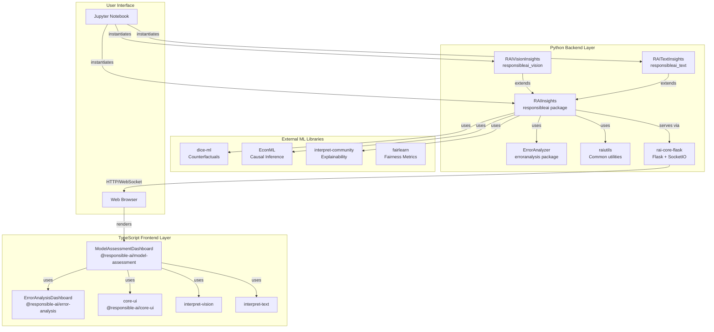
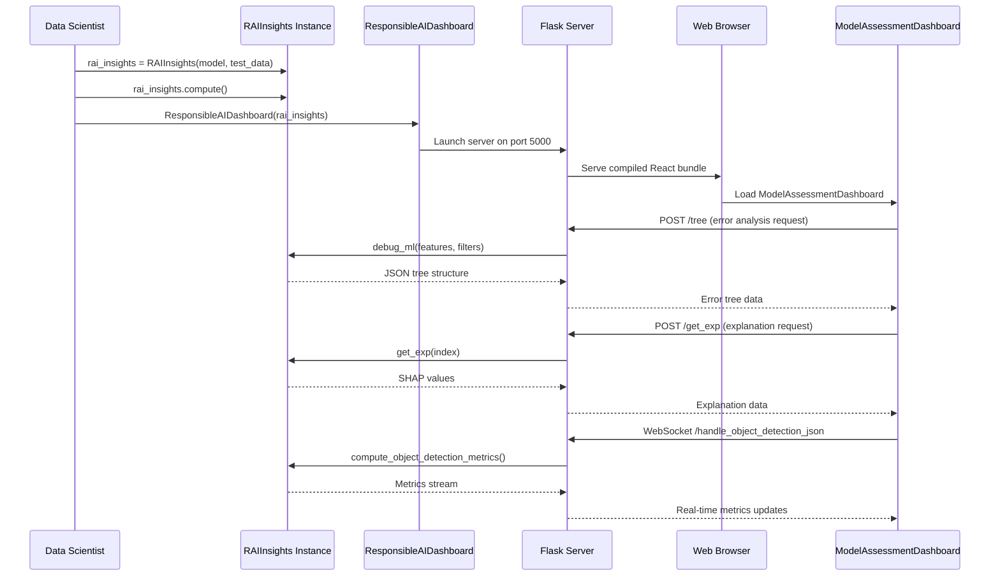
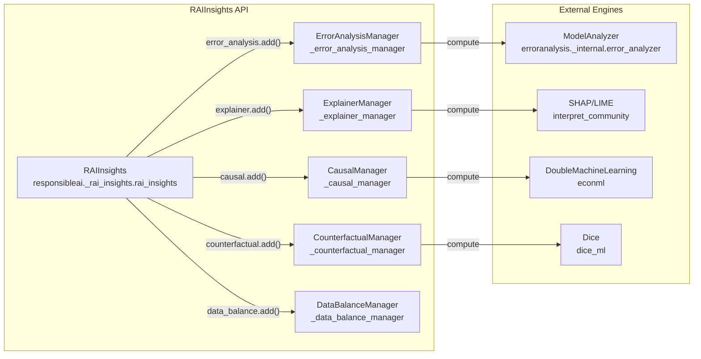
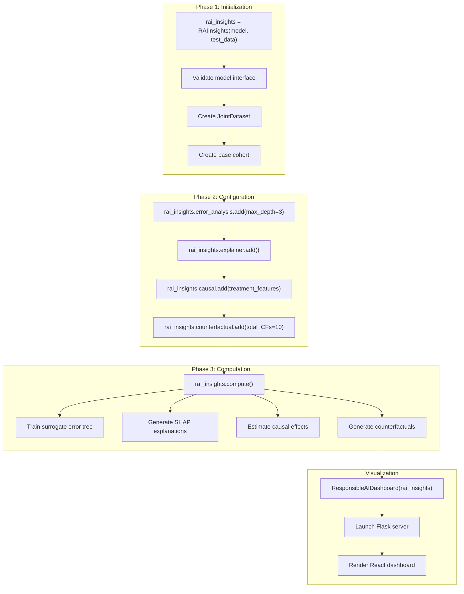
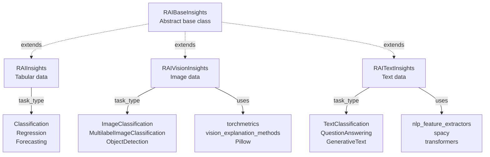
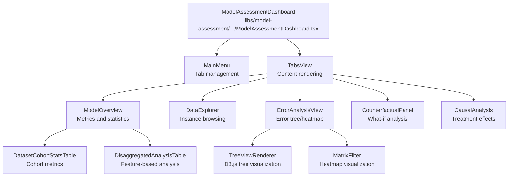
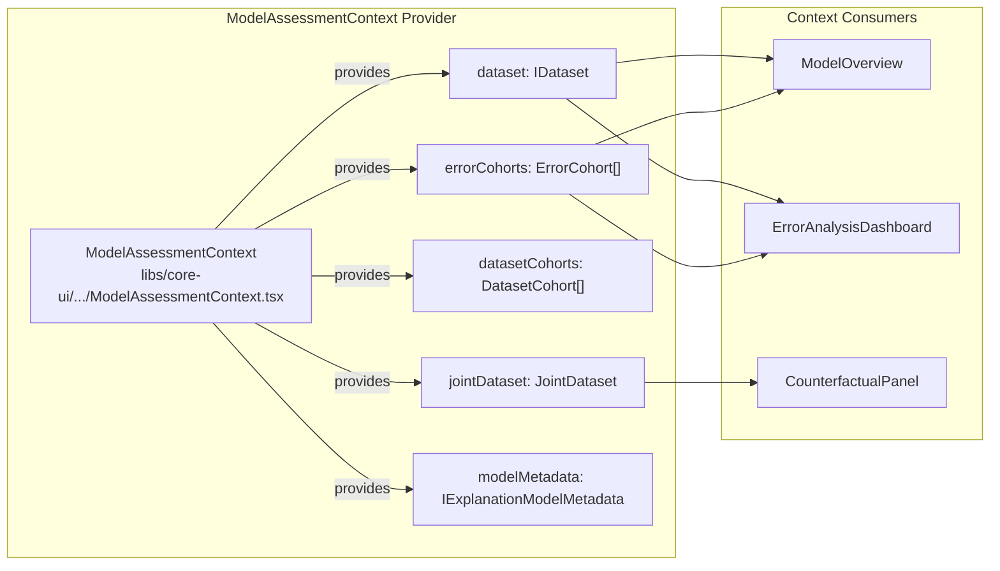
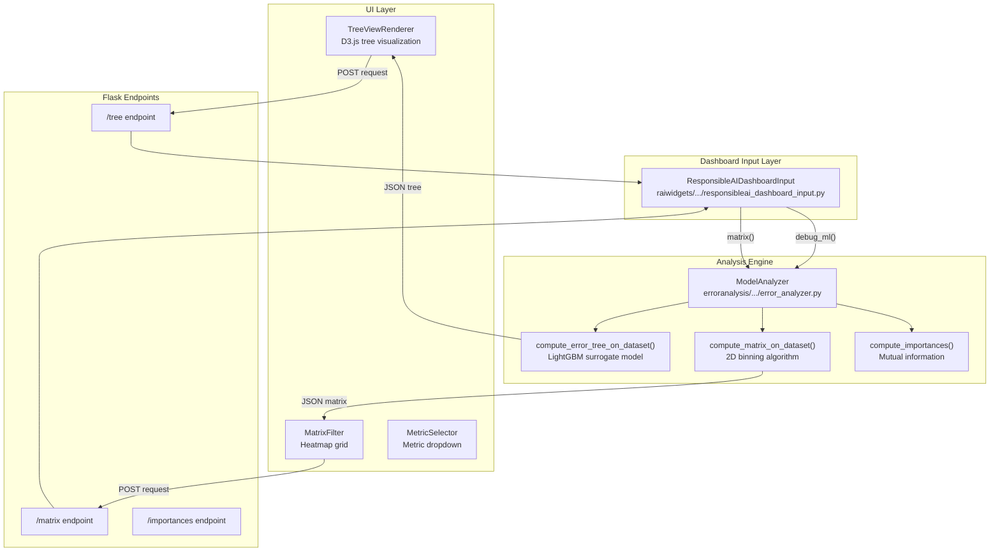
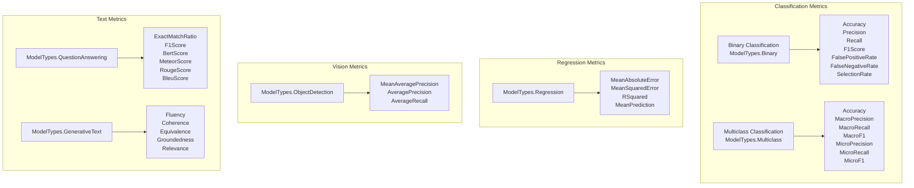
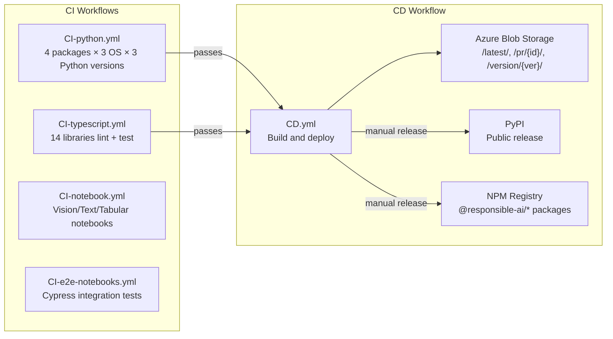

<!-- source: DeepWiki mcp.deepwiki.com · repo microsoft/responsible-ai-toolbox · page 1 Overview · fetched 2026-10-26 -->

# Overview

Relevant source files

The following files were used as context for generating this wiki page:

- [CHANGES.md](CHANGES.md)
- [README.md](README.md)
- [apps/widget/src/app/ModelAssessment.tsx](apps/widget/src/app/ModelAssessment.tsx)
- [erroranalysis/requirements-dev.txt](erroranalysis/requirements-dev.txt)
- [erroranalysis/requirements.txt](erroranalysis/requirements.txt)
- [libs/core-ui/src/index.ts](libs/core-ui/src/index.ts)
- [libs/core-ui/src/lib/Context/ModelAssessmentContext.tsx](libs/core-ui/src/lib/Context/ModelAssessmentContext.tsx)
- [libs/core-ui/src/lib/Interfaces/IExplanationContext.ts](libs/core-ui/src/lib/Interfaces/IExplanationContext.ts)
- [libs/core-ui/src/lib/util/StatisticsUtils.ts](libs/core-ui/src/lib/util/StatisticsUtils.ts)
- [libs/error-analysis/src/index.ts](libs/error-analysis/src/index.ts)
- [libs/error-analysis/src/lib/ErrorAnalysisDashboard/Controls/MetricSelector/MetricSelector.tsx](libs/error-analysis/src/lib/ErrorAnalysisDashboard/Controls/MetricSelector/MetricSelector.tsx)
- [libs/error-analysis/src/lib/ErrorAnalysisDashboard/Interfaces/IErrorAnalysisDashboardState.ts](libs/error-analysis/src/lib/ErrorAnalysisDashboard/Interfaces/IErrorAnalysisDashboardState.ts)
- [libs/interpret-vision/src/lib/VisionExplanationDashboard/Interfaces/IVisionExplanationDashboardProps.ts](libs/interpret-vision/src/lib/VisionExplanationDashboard/Interfaces/IVisionExplanationDashboardProps.ts)
- [libs/localization/src/lib/en.json](libs/localization/src/lib/en.json)
- [libs/model-assessment/src/lib/ModelAssessmentDashboard/Context/buildModelAssessmentContext.ts](libs/model-assessment/src/lib/ModelAssessmentDashboard/Context/buildModelAssessmentContext.ts)
- [libs/model-assessment/src/lib/ModelAssessmentDashboard/Controls/ModelOverview/ModelOverview.tsx](libs/model-assessment/src/lib/ModelAssessmentDashboard/Controls/ModelOverview/ModelOverview.tsx)
- [libs/model-assessment/src/lib/ModelAssessmentDashboard/Controls/ModelOverview/StatsTableUtils.ts](libs/model-assessment/src/lib/ModelAssessmentDashboard/Controls/ModelOverview/StatsTableUtils.ts)
- [libs/model-assessment/src/lib/ModelAssessmentDashboard/Controls/TabsView/TabsViewProps.ts](libs/model-assessment/src/lib/ModelAssessmentDashboard/Controls/TabsView/TabsViewProps.ts)
- [libs/model-assessment/src/lib/ModelAssessmentDashboard/ModelAssessmentDashboard.tsx](libs/model-assessment/src/lib/ModelAssessmentDashboard/ModelAssessmentDashboard.tsx)
- [libs/model-assessment/src/lib/ModelAssessmentDashboard/ModelAssessmentDashboardProps.ts](libs/model-assessment/src/lib/ModelAssessmentDashboard/ModelAssessmentDashboardProps.ts)
- [libs/model-assessment/src/lib/ModelAssessmentDashboard/ModelAssessmentDashboardState.ts](libs/model-assessment/src/lib/ModelAssessmentDashboard/ModelAssessmentDashboardState.ts)
- [nlp_feature_extractors/requirements.txt](nlp_feature_extractors/requirements.txt)
- [notebooks/responsibleaidashboard/text/responsibleaidashboard-openai-model-debugging.ipynb](notebooks/responsibleaidashboard/text/responsibleaidashboard-openai-model-debugging.ipynb)
- [notebooks/test_notebooks.py](notebooks/test_notebooks.py)
- [rai_core_flask/requirements.txt](rai_core_flask/requirements.txt)
- [raiwidgets/raiwidgets/responsibleai_dashboard.py](raiwidgets/raiwidgets/responsibleai_dashboard.py)
- [raiwidgets/raiwidgets/responsibleai_dashboard_input.py](raiwidgets/raiwidgets/responsibleai_dashboard_input.py)
- [raiwidgets/requirements.txt](raiwidgets/requirements.txt)
- [responsibleai/requirements-dev.txt](responsibleai/requirements-dev.txt)
- [responsibleai/requirements.txt](responsibleai/requirements.txt)
- [responsibleai_text/responsibleai_text/version.py](responsibleai_text/responsibleai_text/version.py)
- [responsibleai_vision/responsibleai_vision/version.py](responsibleai_vision/responsibleai_vision/version.py)
- [scripts/e2e-widget.js](scripts/e2e-widget.js)
- [version.cfg](version.cfg)

## Purpose and Scope

The Responsible AI Toolbox is a comprehensive framework for assessing, debugging, and understanding machine learning models across tabular, vision, and text modalities. This document provides a high-level overview of the system architecture, core packages, and integration patterns.

For detailed information on specific subsystems:
- Python backend architecture: see [Python Backend Architecture](#3)
- TypeScript dashboard: see [TypeScript Dashboard Architecture](#4)
- Vision and text packages: see [Specialized Packages](#5)
- Development and testing: see [Development Guide](#6) and [Testing and CI/CD](#7)

**Sources**: [README.md:1-153](), [libs/localization/src/lib/en.json:1-100](), [responsibleai/requirements.txt:1-22]()

---

## System Architecture

The Responsible AI Toolbox consists of three major architectural layers that work together to provide end-to-end model assessment capabilities:

### High-Level Component Architecture

**Sources**: [README.md:24-62](), [responsibleai/requirements.txt:1-22](), [raiwidgets/requirements.txt:1-10](), [libs/core-ui/src/index.ts:1-129]()

---

## Package Ecosystem

The toolbox is distributed as multiple independently versioned Python packages and TypeScript libraries:

### Python Packages

| Package | Version | Purpose | Key Dependencies |
|---------|---------|---------|------------------|
| `responsibleai` | 0.36.0 | Core RAI library, main API entry point | erroranalysis, dice-ml, econml, interpret-community |
| `raiwidgets` | 0.36.0 | Dashboard widgets for Jupyter | rai-core-flask, erroranalysis, fairlearn |
| `erroranalysis` | 0.5.4 | Error analysis engine (trees, heatmaps) | lightgbm, scikit-learn, raiutils |
| `rai-core-flask` | 0.7.6 | Flask backend API server | Flask, Flask-Cors, flask-socketio |
| `raiutils` | 0.4.2 | Common utilities and helpers | - |
| `responsibleai_vision` | 0.3.8 | Vision-specific tasks | responsibleai, torchmetrics, Pillow |
| `responsibleai_text` | 0.2.7 | Text/NLP-specific tasks | responsibleai, spacy, transformers |

**Sources**: [version.cfg:1-2](), [responsibleai/requirements.txt:1-22](), [raiwidgets/requirements.txt:1-10](), [erroranalysis/requirements.txt:1-6](), [rai_core_flask/requirements.txt:1-8](), [responsibleai_vision/responsibleai_vision/version.py:1-9](), [responsibleai_text/responsibleai_text/version.py:1-9]()

### TypeScript Libraries (Nx Monorepo)

The frontend is organized as an Nx monorepo containing 14+ TypeScript libraries:

- `@responsible-ai/model-assessment`: Main dashboard orchestrator
- `@responsible-ai/error-analysis`: Error analysis UI components
- `@responsible-ai/core-ui`: Shared UI components and utilities
- `@responsible-ai/interpret`: Model interpretation widgets
- `@responsible-ai/interpret-vision`: Vision-specific UI
- `@responsible-ai/interpret-text`: Text-specific UI
- `@responsible-ai/mlchartlib`: Chart visualization library
- `@responsible-ai/localization`: i18n strings

**Sources**: [libs/core-ui/src/index.ts:1-129](), [libs/model-assessment/src/lib/ModelAssessmentDashboard/ModelAssessmentDashboard.tsx:1-50](), [libs/localization/src/lib/en.json:1-100]()

---

## Frontend-Backend Integration

### Request-Response Flow

**Sources**: [raiwidgets/raiwidgets/responsibleai_dashboard.py:1-150](), [raiwidgets/raiwidgets/responsibleai_dashboard_input.py:1-100](), [apps/widget/src/app/ModelAssessment.tsx:1-100](), [libs/model-assessment/src/lib/ModelAssessmentDashboard/ModelAssessmentDashboard.tsx:56-175]()

### Key API Endpoints

The Flask server (`rai-core-flask`) exposes the following HTTP and WebSocket endpoints:

| Endpoint | Method | Purpose | Handler |
|----------|--------|---------|---------|
| `/tree` | POST | Generate error analysis tree | `ResponsibleAIDashboardInput.debug_ml()` |
| `/matrix` | POST | Generate error heatmap | `ResponsibleAIDashboardInput.matrix()` |
| `/predict` | POST | Get model predictions | `ResponsibleAIDashboardInput.on_predict()` |
| `/get_exp` | POST | Get SHAP explanations | `ResponsibleAIDashboardInput.get_exp()` |
| `/global_causal_effects` | POST | Compute causal effects | `ResponsibleAIDashboardInput.get_global_causal_effects()` |
| `/causal_whatif` | POST | Causal what-if analysis | `ResponsibleAIDashboardInput.causal_whatif()` |
| `/handle_object_detection_json` | WebSocket | Stream object detection metrics | Socket handler |
| `/handle_question_answering_json` | WebSocket | Stream QA metrics | Socket handler |

**Sources**: [raiwidgets/raiwidgets/responsibleai_dashboard.py:53-150](), [raiwidgets/raiwidgets/responsibleai_dashboard_input.py:129-398](), [apps/widget/src/app/ModelAssessment.tsx:23-200]()

---

## Core Analysis Workflow

### Manager Orchestration Pattern

The `RAIInsights` class uses a manager pattern to orchestrate different types of analyses:

**Sources**: [libs/model-assessment/src/lib/ModelAssessmentDashboard/Context/buildModelAssessmentContext.ts:1-100](), [raiwidgets/raiwidgets/responsibleai_dashboard_input.py:24-50]()

### Three-Phase Analysis Pipeline

Users interact with the toolbox through a three-phase workflow:

1. **Initialization Phase**: Create `RAIInsights` instance with model and test data
2. **Configuration Phase**: Add desired analyses using manager APIs
3. **Computation Phase**: Execute all configured analyses with `compute()`

**Sources**: [libs/model-assessment/src/lib/ModelAssessmentDashboard/Context/buildModelAssessmentContext.ts:39-174](), [raiwidgets/raiwidgets/responsibleai_dashboard_input.py:25-48]()

---

## Data Modality Support

The toolbox supports three primary data modalities through specialized classes that extend the base `RAIInsights` functionality:

### Modality-Specific Classes

| Modality | Class | Package | Supported Tasks |
|----------|-------|---------|-----------------|
| Tabular | `RAIInsights` | `responsibleai` | Classification, Regression, Forecasting |
| Vision | `RAIVisionInsights` | `responsibleai_vision` | Image Classification, Multilabel Classification, Object Detection |
| Text | `RAITextInsights` | `responsibleai_text` | Text Classification, Question Answering, Generative Text |

**Sources**: [responsibleai_vision/responsibleai_vision/version.py:1-9](), [responsibleai_text/responsibleai_text/version.py:1-9](), [libs/model-assessment/src/lib/ModelAssessmentDashboard/Controls/ModelOverview/ModelOverview.tsx:130-192](), [libs/core-ui/src/lib/Interfaces/IExplanationContext.ts:8-22]()

---

## Dashboard Component Hierarchy

The `ModelAssessmentDashboard` React component serves as the main UI orchestrator:

**Sources**: [libs/model-assessment/src/lib/ModelAssessmentDashboard/ModelAssessmentDashboard.tsx:1-378](), [libs/model-assessment/src/lib/ModelAssessmentDashboard/Controls/ModelOverview/ModelOverview.tsx:1-100](), [libs/model-assessment/src/lib/ModelAssessmentDashboard/Controls/TabsView/TabsViewProps.ts:1-87]()

---

## State Management and Context

The dashboard uses React Context to share state across components:

**Sources**: [libs/core-ui/src/lib/Context/ModelAssessmentContext.tsx:1-221](), [libs/model-assessment/src/lib/ModelAssessmentDashboard/ModelAssessmentDashboard.tsx:59-121](), [libs/model-assessment/src/lib/ModelAssessmentDashboard/Context/buildModelAssessmentContext.ts:39-174]()

---

## Error Analysis Deep Dive

The error analysis subsystem is a core feature that helps identify model failure patterns:

### Error Analysis Architecture

**Sources**: [raiwidgets/raiwidgets/responsibleai_dashboard_input.py:172-240](), [libs/error-analysis/src/lib/ErrorAnalysisDashboard/Controls/MetricSelector/MetricSelector.tsx:1-60](), [libs/error-analysis/src/index.ts:1-23]()

---

## Model Metrics and Statistics

The toolbox computes metrics based on task type and model characteristics:

### Supported Metrics by Task Type

**Sources**: [libs/core-ui/src/lib/util/StatisticsUtils.ts:1-150](), [libs/model-assessment/src/lib/ModelAssessmentDashboard/Controls/ModelOverview/StatsTableUtils.ts:256-400](), [libs/core-ui/src/lib/Interfaces/IExplanationContext.ts:8-22]()

---

## CI/CD and Testing Strategy

The repository uses GitHub Actions for continuous integration and deployment:

### Testing Pipeline

**Sources**: [CHANGES.md:1-100](), [notebooks/test_notebooks.py:1-100](), [scripts/e2e-widget.js:1-100]()

### Test Coverage

| Test Type | Framework | Location | Purpose |
|-----------|-----------|----------|---------|
| Python Unit Tests | pytest | `*/tests/` | Test individual functions/classes |
| TypeScript Unit Tests | Jest | `libs/*/src/**/*.test.ts` | Test React components |
| Notebook Tests | papermill + scrapbook | `notebooks/test_notebooks.py` | Validate example notebooks |
| E2E Widget Tests | Cypress | `apps/widget-e2e/` | Test full dashboard flows |

**Sources**: [notebooks/test_notebooks.py:1-361](), [erroranalysis/requirements-dev.txt:1-9](), [responsibleai/requirements-dev.txt:1-13]()

---

## Key Data Structures

### JointDataset

The `JointDataset` class merges features, predictions, and labels into a unified structure for analysis:

**Sources**: [libs/core-ui/src/lib/Context/ModelAssessmentContext.tsx:48-49](), [libs/model-assessment/src/lib/ModelAssessmentDashboard/Context/buildModelAssessmentContext.ts:59-69]()

### ErrorCohort and DatasetCohort

Cohorts represent filtered subsets of data for comparative analysis:

- `ErrorCohort`: Wraps a `Cohort` with error-specific metadata (error rate, coverage)
- `DatasetCohort`: Dataset-level cohort for data exploration without predictions

**Sources**: [libs/core-ui/src/lib/Context/ModelAssessmentContext.tsx:39-44](), [libs/model-assessment/src/lib/ModelAssessmentDashboard/Context/buildModelAssessmentContext.ts:85-135]()

### IModelAssessmentContext

The central context interface providing shared state and callback functions to all dashboard components:

**Sources**: [libs/core-ui/src/lib/Context/ModelAssessmentContext.tsx:28-191](), [libs/model-assessment/src/lib/ModelAssessmentDashboard/ModelAssessmentDashboardProps.ts:22-177]()

---

## Summary

The Responsible AI Toolbox is a multi-layered system that bridges Python-based ML analysis with interactive TypeScript visualizations. Key architectural patterns include:

1. **Manager Pattern**: `RAIInsights` delegates to specialized managers for different analysis types
2. **Three-Phase Workflow**: Initialize → Configure → Compute
3. **Flask Bridge**: `rai-core-flask` serves both the compiled React bundle and API endpoints
4. **Modality Specialization**: Inheritance-based extension for vision and text tasks
5. **Context-Based State**: React Context provides unified state management
6. **Independent Versioning**: Packages evolve independently while maintaining compatibility

The system supports tabular, vision, and text modalities across classification, regression, object detection, question answering, and generative text tasks, providing comprehensive model debugging and decision-making capabilities.

**Sources**: [README.md:1-153](), [libs/model-assessment/src/lib/ModelAssessmentDashboard/ModelAssessmentDashboard.tsx:1-378](), [raiwidgets/raiwidgets/responsibleai_dashboard.py:1-150]()

---

