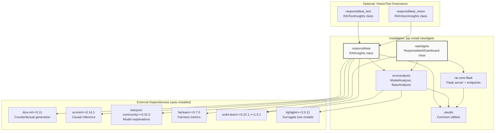
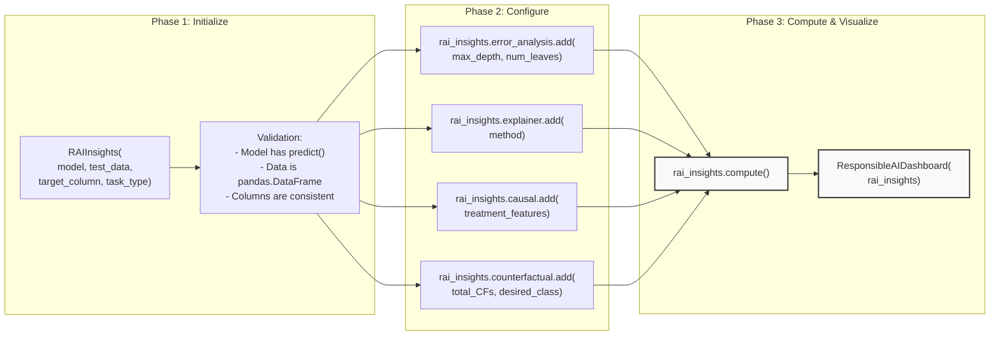
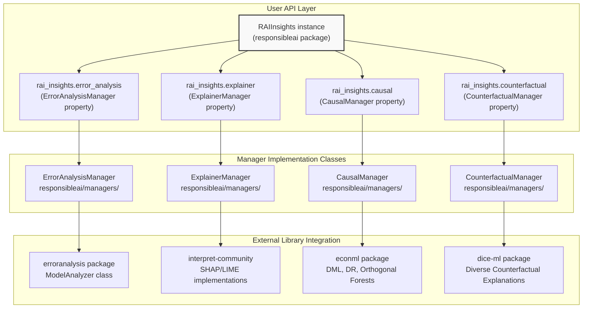
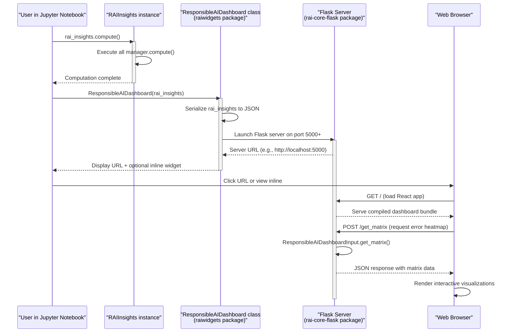

<!-- source: DeepWiki mcp.deepwiki.com · repo microsoft/responsible-ai-toolbox · page 2 Getting Started · fetched 2026-10-26 -->

# Getting Started

<details>
<summary>Relevant source files</summary>

The following files were used as context for generating this wiki page:

- [CHANGES.md](CHANGES.md)
- [README.md](README.md)
- [erroranalysis/requirements-dev.txt](erroranalysis/requirements-dev.txt)
- [erroranalysis/requirements.txt](erroranalysis/requirements.txt)
- [nlp_feature_extractors/requirements.txt](nlp_feature_extractors/requirements.txt)
- [notebooks/responsibleaidashboard/text/responsibleaidashboard-openai-model-debugging.ipynb](notebooks/responsibleaidashboard/text/responsibleaidashboard-openai-model-debugging.ipynb)
- [notebooks/test_notebooks.py](notebooks/test_notebooks.py)
- [rai_core_flask/requirements.txt](rai_core_flask/requirements.txt)
- [raiwidgets/requirements.txt](raiwidgets/requirements.txt)
- [responsibleai/requirements-dev.txt](responsibleai/requirements-dev.txt)
- [responsibleai/requirements.txt](responsibleai/requirements.txt)
- [responsibleai_text/responsibleai_text/version.py](responsibleai_text/responsibleai_text/version.py)
- [responsibleai_vision/responsibleai_vision/version.py](responsibleai_vision/responsibleai_vision/version.py)
- [scripts/e2e-widget.js](scripts/e2e-widget.js)
- [version.cfg](version.cfg)

</details>


This page provides installation instructions, basic usage patterns, and example notebooks for getting started with the Responsible AI Toolbox. It covers the essential steps to install packages, create insights objects, configure analyses, and launch interactive dashboards.

For detailed information about the overall architecture and package structure, see [Overview](#1). For development setup and contribution guidelines, see [Development Guide](#6).

---

## Installation

### Python Package Installation

The Responsible AI Toolbox can be installed via pip. The primary package `raiwidgets` includes all necessary dependencies for tabular data analysis:

```bash
pip install raiwidgets
```

**Important:** If running in Jupyter notebooks, restart the Jupyter kernel after installation to ensure the package is properly loaded.

This installs the following core packages and their dependencies:

| Package | Purpose | Version |
|---------|---------|---------|
| `raiwidgets` | Dashboard widgets and visualization components | 0.36.0 |
| `responsibleai` | Core RAI analysis library for tabular data | 0.36.0 |
| `rai-core-flask` | Flask backend API server | ≥0.7.6 |
| `erroranalysis` | Error analysis engine | ≥0.5.4 |
| `raiutils` | Common utilities | ≥0.4.2 |

### Domain-Specific Package Installation

For vision or text modalities, install the specialized packages:

```bash
# For vision tasks (image classification, object detection)
pip install responsibleai-vision

# For text tasks (text classification, question answering)
pip install responsibleai-text
```

These packages extend `responsibleai` with modality-specific features:

| Package | Version | Supported Tasks |
|---------|---------|----------------|
| `responsibleai_vision` | 0.3.8 | Image classification, multilabel classification, object detection |
| `responsibleai_text` | 0.2.7 | Text classification, question answering, generative AI |

**Sources:** [README.md:72-80](), [responsibleai/requirements.txt:1-22](), [raiwidgets/requirements.txt:1-10](), [responsibleai_vision/responsibleai_vision/version.py:1-9](), [responsibleai_text/responsibleai_text/version.py:1-9]()

---

## Package Dependency Overview

The following diagram shows how the installed packages relate to each other and to external machine learning libraries:



**Sources:** [README.md:24-33](), [responsibleai/requirements.txt:1-22](), [raiwidgets/requirements.txt:1-10](), [erroranalysis/requirements.txt:1-6]()

---

## Basic Usage Pattern

### The Three-Phase Workflow

All analysis workflows follow a consistent three-phase pattern regardless of data modality:



**Sources:** High-level Diagram 3 (Analysis Pipeline and Manager Orchestration), [README.md:37-70]()

### Code Template: Tabular Data

```python
from responsibleai import RAIInsights, ModelTask
from raiwidgets import ResponsibleAIDashboard
import pandas as pd

# Phase 1: Initialize
rai_insights = RAIInsights(
    model=trained_model,           # Must have predict() or predict_proba()
    test=test_data,                # pandas.DataFrame
    target_column="target",        # Name of label column
    task_type=ModelTask.CLASSIFICATION  # or REGRESSION
)

# Phase 2: Configure desired analyses
rai_insights.error_analysis.add(max_depth=3, num_leaves=20)
rai_insights.explainer.add()
rai_insights.causal.add(treatment_features=["feature1", "feature2"])
rai_insights.counterfactual.add(total_CFs=10)

# Phase 3: Compute insights
rai_insights.compute()

# Launch dashboard
ResponsibleAIDashboard(rai_insights)
```

### Code Template: Vision Data

```python
from responsibleai_vision import RAIVisionInsights, ModelTask
from raiwidgets import ResponsibleAIDashboard

# Phase 1: Initialize
rai_vision_insights = RAIVisionInsights(
    model=vision_model,
    test=test_data,               # DataFrame with image paths
    target_column="label",
    task_type=ModelTask.IMAGE_CLASSIFICATION  # or OBJECT_DETECTION
)

# Phase 2: Configure
rai_vision_insights.error_analysis.add()
rai_vision_insights.explainer.add()

# Phase 3: Compute and visualize
rai_vision_insights.compute()
ResponsibleAIDashboard(rai_vision_insights)
```

### Code Template: Text Data

```python
from responsibleai_text import RAITextInsights, ModelTask
from raiwidgets import ResponsibleAIDashboard

# Phase 1: Initialize
rai_text_insights = RAITextInsights(
    model=text_model,
    test=test_data,               # DataFrame with text columns
    target_column="label",
    task_type=ModelTask.TEXT_CLASSIFICATION  # or QUESTION_ANSWERING
)

# Phase 2: Configure
rai_text_insights.error_analysis.add()
rai_text_insights.explainer.add()

# Phase 3: Compute and visualize
rai_text_insights.compute()
ResponsibleAIDashboard(rai_text_insights)
```

**Sources:** [notebooks/responsibleaidashboard/text/responsibleaidashboard-openai-model-debugging.ipynb:276-300](), [README.md:37-70]()

---

## Available Analysis Components

The following table summarizes the analysis managers available through the `.add()` configuration pattern:

| Manager | Access Pattern | Key Parameters | Purpose |
|---------|---------------|----------------|---------|
| Error Analysis | `rai_insights.error_analysis.add()` | `max_depth`, `num_leaves`, `metric` | Identify error cohorts using surrogate decision trees |
| Explainer | `rai_insights.explainer.add()` | `method` (optional) | Generate SHAP/LIME explanations for model predictions |
| Causal | `rai_insights.causal.add()` | `treatment_features` (required) | Estimate causal effects using EconML |
| Counterfactual | `rai_insights.counterfactual.add()` | `total_CFs`, `desired_class` | Generate minimal changes for different predictions using DiCE |
| Data Balance | `rai_insights.data_balance.add()` | None | Analyze feature distributions and class balance |

Each manager validates configuration at `.add()` time and executes computation during the `.compute()` phase.

**Sources:** High-level Diagram 3 (Analysis Pipeline and Manager Orchestration), [README.md:48-62]()

---

## Manager Class Architecture

This diagram maps the user-facing manager pattern to the actual implementation classes:



**Sources:** High-level Diagram 2 (Frontend-Backend Integration Architecture), High-level Diagram 3 (Analysis Pipeline and Manager Orchestration)

---

## Example Notebooks

The repository includes comprehensive example notebooks demonstrating end-to-end workflows for different scenarios.

### Tabular Data Examples

| Notebook | Dataset | Task Type | Analyses Demonstrated |
|----------|---------|-----------|----------------------|
| `getting-started.ipynb` | Synthetic | Classification | Basic workflow introduction |
| `responsibleaidashboard-census-classification-model-debugging.ipynb` | Census income | Classification | Error analysis, explanations, fairness |
| `responsibleaidashboard-diabetes-regression-model-debugging.ipynb` | Diabetes progression | Regression | Error analysis, feature importance |
| `responsibleaidashboard-housing-decision-making.ipynb` | Housing prices | Classification | Causal analysis, counterfactuals |
| `responsibleaidashboard-diabetes-decision-making.ipynb` | Diabetes | Classification | Causal inference for treatment decisions |
| `responsibleaidashboard-multiclass-dnn-model-debugging.ipynb` | Multiclass | Classification | Deep neural network debugging |
| `responsibleaidashboard-orange-juice-forecasting.ipynb` | Time series | Forecasting | Forecasting-specific features |

### Vision Data Examples

| Notebook | Task Type | Analyses Demonstrated |
|----------|-----------|----------------------|
| `responsibleaidashboard-fridge-image-classification-model-debugging.ipynb` | Image classification | Error analysis, vision explanations |
| `responsibleaidashboard-fridge-multilabel-image-classification-model-debugging.ipynb` | Multilabel classification | Multilabel metrics, cohort analysis |
| `responsibleaidashboard-fridge-object-detection-model-debugging.ipynb` | Object detection | Bounding box visualization, detection metrics |

### Text Data Examples

| Notebook | Task Type | Analyses Demonstrated |
|----------|-----------|----------------------|
| `responsibleaidashboard-DBPedia-text-classification-model-debugging.ipynb` | Text classification | Token-level explanations, error patterns |
| `responsibleaidashboard-blbooksgenre-binary-text-classification-model-debugging.ipynb` | Binary classification | Text feature importance |
| `responsibleaidashboard-covid-event-multilabel-text-classification-model-debugging.ipynb` | Multilabel classification | Multilabel text analysis |
| `responsibleaidashboard-question-answering-model-debugging.ipynb` | Question answering | QA metrics (F1, Exact Match), text explanations |
| `responsibleaidashboard-openai-model-debugging.ipynb` | Question answering | OpenAI endpoint integration |

**Location:** All notebooks are in the `notebooks/responsibleaidashboard/` directory, organized by modality (`tabular/`, `vision/`, `text/`).

**Sources:** [README.md:102-124](), [notebooks/test_notebooks.py:16-361](), [scripts/e2e-widget.js:14-42]()

---

## Running Your First Example

### Step 1: Locate the Getting Started Notebook

```bash
# Clone the repository (or download the notebook directly)
git clone https://github.com/microsoft/responsible-ai-toolbox.git
cd responsible-ai-toolbox/notebooks/responsibleaidashboard/tabular
```

### Step 2: Launch Jupyter

```bash
jupyter notebook getting-started.ipynb
```

### Step 3: Execute Cells

The `getting-started.ipynb` notebook demonstrates:
1. Creating a simple classification dataset
2. Training a basic model
3. Initializing `RAIInsights`
4. Adding error analysis and explainer components
5. Computing insights
6. Launching the `ResponsibleAIDashboard`

### Step 4: Interact with the Dashboard

When you execute the final cell containing `ResponsibleAIDashboard(rai_insights)`, the system will:
1. Launch a Flask server on `http://localhost:5000` (or next available port)
2. Display the dashboard URL in the notebook output
3. Optionally embed the dashboard inline in Jupyter (depending on environment)

The dashboard provides:
- **Model Overview:** Aggregate metrics and performance statistics
- **Error Analysis:** Interactive error tree and heatmap visualizations
- **Data Explorer:** Browse individual instances and create custom cohorts
- **Feature Importances:** Global and local explanation visualizations
- **Counterfactual What-If:** Generate and explore counterfactual examples

**Sources:** [README.md:102-105](), [notebooks/test_notebooks.py:306-311]()

---

## Dashboard Launch Flow

This diagram shows the process from notebook code to interactive dashboard:



**Sources:** High-level Diagram 2 (Frontend-Backend Integration Architecture), [rai_core_flask/requirements.txt:1-8]()

---

## Verification

After installation, verify the packages are correctly installed:

```python
# Verify core packages
import raiwidgets
import responsibleai
import erroranalysis
print(f"raiwidgets version: {raiwidgets.__version__}")
print(f"responsibleai version: {responsibleai.__version__}")

# Verify optional packages (if installed)
try:
    import responsibleai_vision
    print(f"responsibleai_vision version: {responsibleai_vision.__version__}")
except ImportError:
    print("responsibleai_vision not installed")

try:
    import responsibleai_text
    print(f"responsibleai_text version: {responsibleai_text.__version__}")
except ImportError:
    print("responsibleai_text not installed")
```

Expected output (versions may vary):
```
raiwidgets version: 0.36.0
responsibleai version: 0.36.0
responsibleai_vision version: 0.3.8
responsibleai_text version: 0.2.7
```

**Sources:** [version.cfg:1-2](), [responsibleai_vision/responsibleai_vision/version.py:4-8](), [responsibleai_text/responsibleai_text/version.py:4-8]()

---

## Supported Model Types

The toolbox accepts models that implement the following interfaces:

| Interface | Required Methods | Compatible Libraries |
|-----------|-----------------|---------------------|
| Classification | `predict_proba()` or `predict()` | scikit-learn, XGBoost, LightGBM, PyTorch, TensorFlow, Keras |
| Regression | `predict()` | scikit-learn, XGBoost, LightGBM, PyTorch, TensorFlow, Keras |
| Vision | `predict()` returning class labels or bounding boxes | PyTorch, TensorFlow, torchvision, AutoML models |
| Text | `predict()` returning labels or text | Hugging Face transformers, PyTorch, TensorFlow, OpenAI API |

**Model Wrapping:** If your model doesn't conform to these interfaces, wrap it in a class with the appropriate `predict()` method. The toolbox also provides `ml-wrappers` for common scenarios.

**Sources:** [README.md:125-132](), [responsibleai/requirements.txt:15]()

---

## Data Format Requirements

### Tabular Data

- **Format:** `pandas.DataFrame`
- **Features:** Numeric or categorical columns
- **Target:** Single column with class labels (classification) or numeric values (regression)
- **Index:** Any index type, but must be consistent between train and test sets

### Vision Data

- **Format:** `pandas.DataFrame` with image references
- **Image Column:** File paths or PIL Image objects
- **Labels:** Class labels (classification), list of labels (multilabel), or bounding box dictionaries (object detection)
- **Metadata:** Optional columns for EXIF data or other image attributes

### Text Data

- **Format:** `pandas.DataFrame` with text columns
- **Text Columns:** One or more columns containing text (context, questions, etc.)
- **Labels:** Class labels (classification) or answer text (question answering)

**Sources:** [README.md:127-128]()

---

## Notebook Testing Infrastructure

All example notebooks are automatically tested in CI/CD using the following tools:

| Tool | Purpose |
|------|---------|
| `papermill` | Execute notebooks programmatically |
| `scrapbook` | Extract and validate outputs from notebooks |
| `pytest` | Run notebook tests with markers (e.g., `@pytest.mark.notebooks`) |

The test file [notebooks/test_notebooks.py:1-361]() defines test functions for each notebook, ensuring they execute without errors and produce expected outputs.

**Sources:** [notebooks/test_notebooks.py:1-102]()

---

## Next Steps

After completing a basic example:

1. **Explore Components:** See [Analysis Managers](#3.3) for detailed documentation of each analysis type
2. **Customize Dashboards:** Learn about available tabs and visualizations in [Model Assessment Dashboard](#4.2)
3. **Advanced Topics:** Review [Persistence and Serialization](#3.2.3) for saving/loading workflows
4. **Vision Tasks:** See [Vision Package](#5.1) for image-specific features
5. **Text Tasks:** See [Text Package](#5.2) for NLP-specific features
6. **Development:** Contribute to the project using the [Development Guide](#6)

**Sources:** [README.md:101-105]()

---

