<!-- source: DeepWiki mcp.deepwiki.com · repo microsoft/responsible-ai-toolbox · page 3 Python Backend Architecture · fetched 2026-10-26 -->

# Python Backend Architecture

<details>
<summary>Relevant source files</summary>

The following files were used as context for generating this wiki page:

- [CHANGES.md](CHANGES.md)
- [erroranalysis/requirements-dev.txt](erroranalysis/requirements-dev.txt)
- [erroranalysis/requirements.txt](erroranalysis/requirements.txt)
- [nlp_feature_extractors/requirements.txt](nlp_feature_extractors/requirements.txt)
- [rai_core_flask/requirements.txt](rai_core_flask/requirements.txt)
- [raiwidgets/requirements.txt](raiwidgets/requirements.txt)
- [responsibleai/requirements-dev.txt](responsibleai/requirements-dev.txt)
- [responsibleai/requirements.txt](responsibleai/requirements.txt)
- [responsibleai/responsibleai/_internal/constants.py](responsibleai/responsibleai/_internal/constants.py)
- [responsibleai/responsibleai/rai_insights/rai_base_insights.py](responsibleai/responsibleai/rai_insights/rai_base_insights.py)
- [responsibleai/responsibleai/rai_insights/rai_insights.py](responsibleai/responsibleai/rai_insights/rai_insights.py)
- [responsibleai/tests/common_utils.py](responsibleai/tests/common_utils.py)
- [responsibleai/tests/model_analysis/test_model_analysis.py](responsibleai/tests/model_analysis/test_model_analysis.py)
- [responsibleai/tests/model_analysis/test_model_analysis_validations.py](responsibleai/tests/model_analysis/test_model_analysis_validations.py)
- [responsibleai/tests/rai_insights/test_rai_insights.py](responsibleai/tests/rai_insights/test_rai_insights.py)
- [responsibleai/tests/rai_insights/test_rai_insights_cohort_filter.py](responsibleai/tests/rai_insights/test_rai_insights_cohort_filter.py)
- [responsibleai/tests/rai_insights/test_rai_insights_data_size_scenarios.py](responsibleai/tests/rai_insights/test_rai_insights_data_size_scenarios.py)
- [responsibleai/tests/rai_insights/test_rai_insights_get_feature_ranges.py](responsibleai/tests/rai_insights/test_rai_insights_get_feature_ranges.py)
- [responsibleai/tests/rai_insights/test_rai_insights_save_and_load_scenarios.py](responsibleai/tests/rai_insights/test_rai_insights_save_and_load_scenarios.py)
- [responsibleai/tests/rai_insights/test_rai_insights_validations.py](responsibleai/tests/rai_insights/test_rai_insights_validations.py)
- [responsibleai/tests/test_model_serializer.py](responsibleai/tests/test_model_serializer.py)
- [responsibleai_text/responsibleai_text/version.py](responsibleai_text/responsibleai_text/version.py)
- [responsibleai_vision/responsibleai_vision/version.py](responsibleai_vision/responsibleai_vision/version.py)
- [version.cfg](version.cfg)

</details>


## Purpose and Scope

This document describes the Python backend architecture of the Responsible AI Toolbox, covering the core analysis packages and their interactions. It focuses on the structure of the `responsibleai` package, the `RAIInsights` API, the manager orchestration pattern, and supporting infrastructure packages.

For information about the TypeScript dashboard that consumes this backend, see [TypeScript Dashboard Architecture](#4). For domain-specific extensions to vision and text models, see [Vision Package](#5.1) and [Text Package](#5.2).

## Package Structure and Dependencies

The Python backend is organized into multiple independently versioned packages that work together to provide responsible AI capabilities.

### Core Package Hierarchy

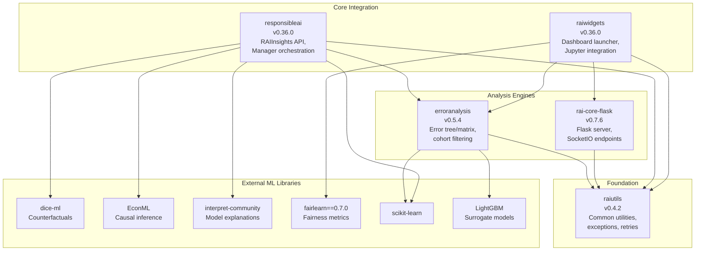

**Sources:** [responsibleai/requirements.txt:1-22](), [raiwidgets/requirements.txt:1-10](), [erroranalysis/requirements.txt:1-6](), [rai_core_flask/requirements.txt:1-8]()

### Dependency Version Constraints

| Package | Key Dependencies | Version Constraints |
|---------|-----------------|---------------------|
| `responsibleai` | dice-ml | >=0.11,<0.12 |
| | econml | >=0.14.1 |
| | erroranalysis | >=0.5.4 |
| | interpret-community | >=0.31.0 |
| | scikit-learn | >=0.22.1,!=1.1,<=1.5.1 |
| | raiutils | >=0.4.2 |
| `raiwidgets` | rai-core-flask | >=0.7.6 |
| | erroranalysis | >=0.5.4 |
| | fairlearn | ==0.7.0 (exact) |
| `erroranalysis` | lightgbm | >=2.0.11 |
| | raiutils | >=0.4.2 |

**Sources:** [responsibleai/requirements.txt:1-22](), [raiwidgets/requirements.txt:1-10]()

## RAIInsights Entry Point Architecture

The `RAIInsights` class serves as the primary user-facing API for tabular data analysis. It inherits from `RAIBaseInsights` and orchestrates all analysis components.

### Class Hierarchy and Initialization

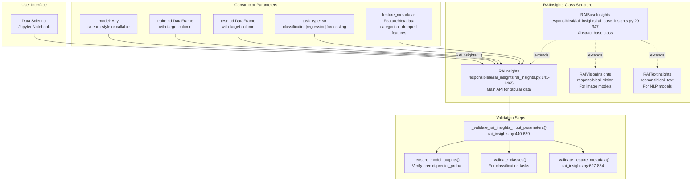

**Sources:** [responsibleai/rai_insights/rai_insights.py:141-263](), [responsibleai/rai_insights/rai_base_insights.py:29-77]()

### Model Output Caching Strategy

The `RAIInsights` class caches model predictions to avoid recomputation across different managers. This is handled through a sophisticated output caching system that supports both small and large datasets.

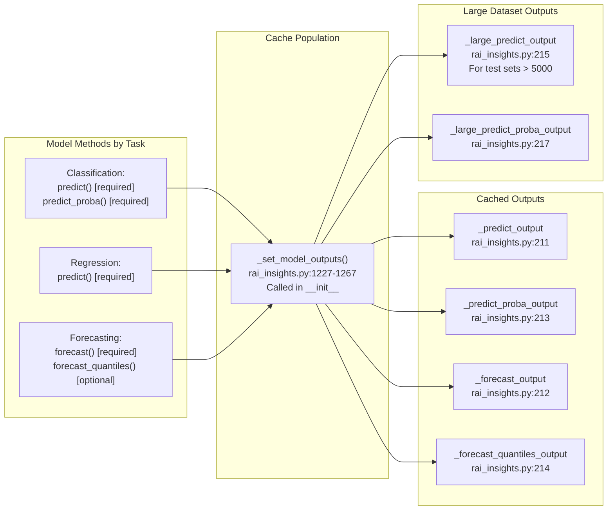

**Sources:** [responsibleai/rai_insights/rai_insights.py:211-218](), [responsibleai/rai_insights/rai_insights.py:1227-1267](), [responsibleai/rai_insights/rai_insights.py:72-139]()

### Task-Specific Model Method Validation

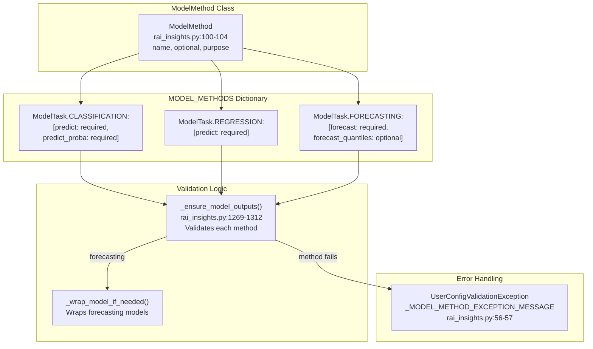

**Sources:** [responsibleai/rai_insights/rai_insights.py:100-138](), [responsibleai/rai_insights/rai_insights.py:1269-1312]()

## Manager Pattern and Orchestration

The `RAIInsights` class uses a manager pattern where each type of analysis (causal, counterfactual, error analysis, explainer, data balance) is handled by a dedicated manager. This enables modular, independent development of each capability.

### Manager Initialization Flow

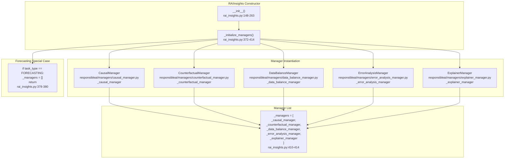

**Sources:** [responsibleai/rai_insights/rai_insights.py:372-414](), [responsibleai/rai_insights/rai_insights.py:29-34]()

### Manager Configuration and Computation Phase

Each manager follows a two-phase pattern: configuration (via `add()` methods) and computation (via `compute()` method).

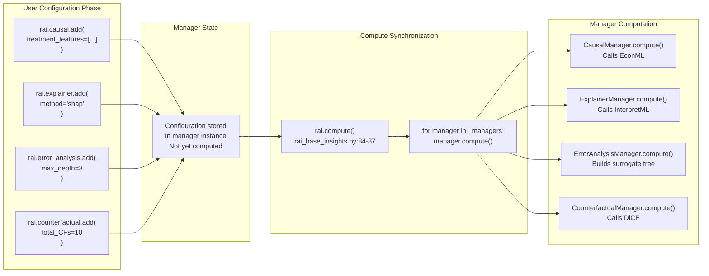

**Sources:** [responsibleai/rai_insights/rai_base_insights.py:84-87]()

### Manager Names and Constants

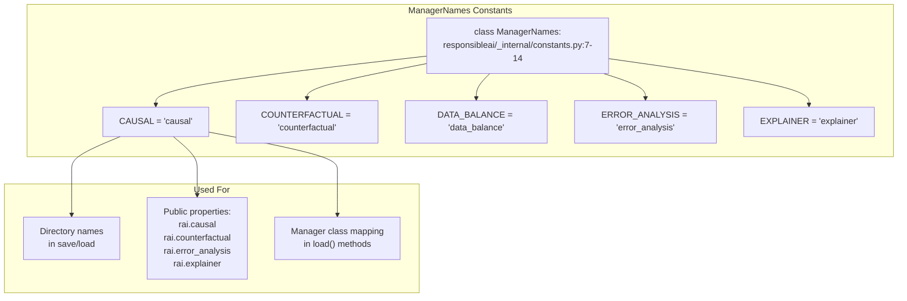

**Sources:** [responsibleai/_internal/constants.py:7-14]()

## Data Handling and Feature Processing

### Feature Metadata and Dropped Features

The `FeatureMetadata` class allows users to specify which features should be dropped, which are categorical, and other metadata. The `RAIInsights` class provides accessor methods that handle dropped features transparently.

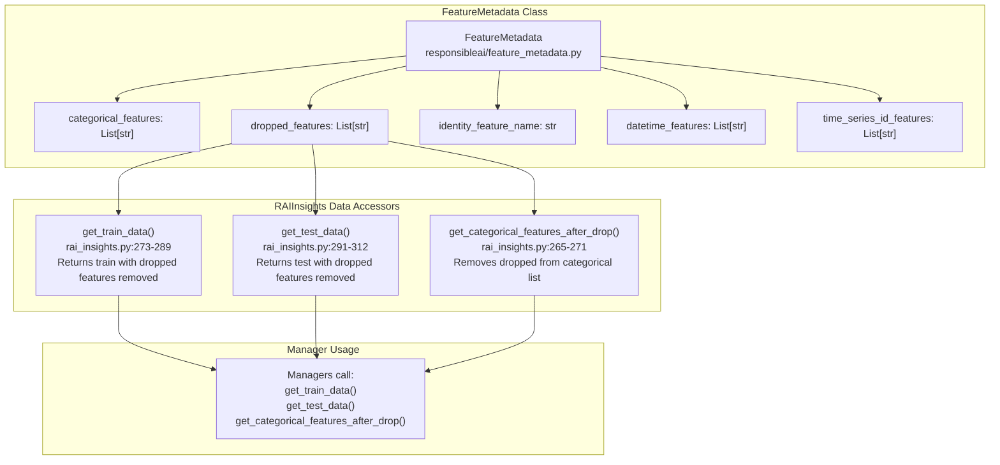

**Sources:** [responsibleai/rai_insights/rai_insights.py:265-312](), [responsibleai/rai_insights/rai_insights.py:382-408]()

### Categorical Feature Processing

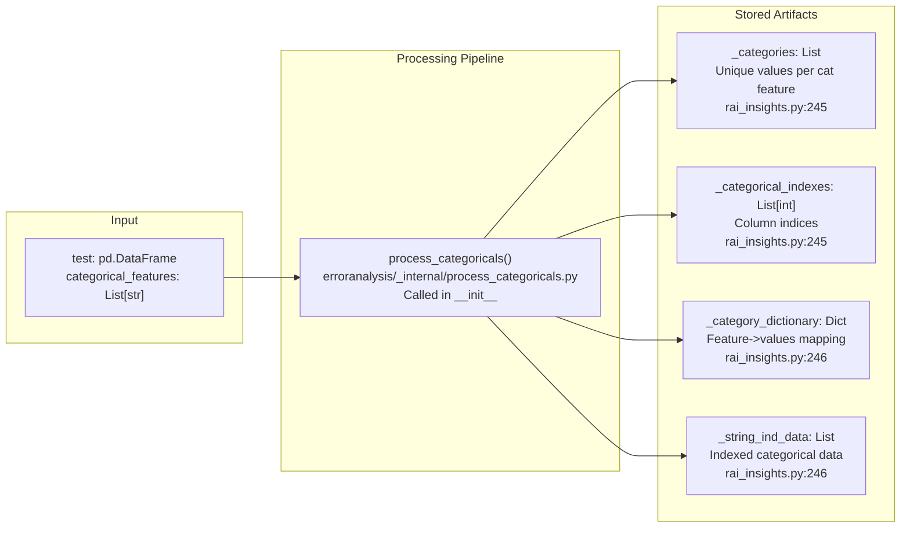

**Sources:** [responsibleai/rai_insights/rai_insights.py:245-250]()

### Feature Ranges Calculation

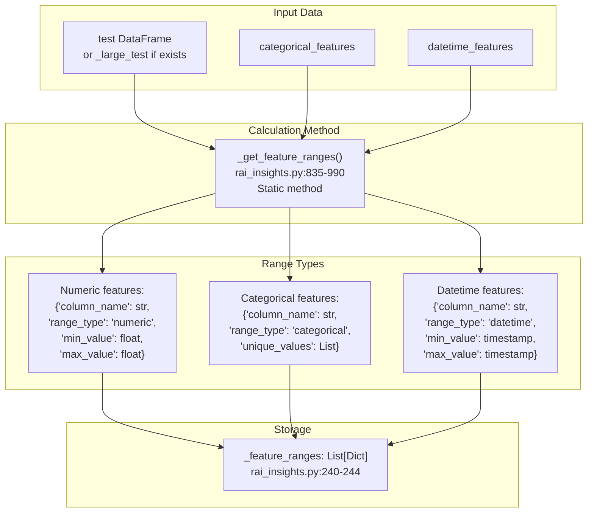

**Sources:** [responsibleai/rai_insights/rai_insights.py:240-244](), [responsibleai/rai_insights/rai_insights.py:835-990]()

## Serialization and Persistence

The `RAIInsights` class supports saving and loading its complete state, including the model, data, managers, and computed results. This uses a directory-based structure with JSON and pickle files.

### Save Architecture

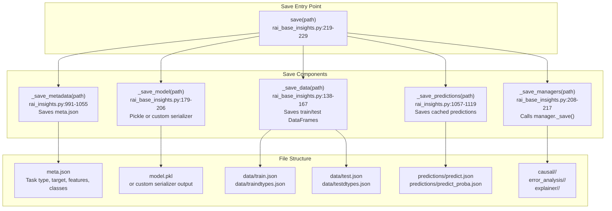

**Sources:** [responsibleai/rai_insights/rai_base_insights.py:219-229](), [responsibleai/rai_insights/rai_insights.py:991-1119]()

### Directory Structure on Disk

```
<save_path>/
├── meta.json                          # Metadata
├── rai_version.json                   # Package version
├── model.pkl                          # Serialized model
├── data/
│   ├── train.json                     # Training data
│   ├── traindtypes.json              # Column dtypes
│   ├── test.json                      # Test data
│   └── testdtypes.json               # Column dtypes
├── predictions/
│   ├── predict.json                   # Cached predictions
│   ├── predict_proba.json            # Cached probabilities
│   ├── large_predict.json            # Large dataset predictions
│   └── large_predict_proba.json      # Large dataset probabilities
├── causal/
│   └── <uuid>/                        # Per-config directories
│       ├── data/                      # Computed results
│       └── generators/                # (not used)
├── counterfactual/
│   └── <uuid>/
│       ├── config/                    # Configuration
│       ├── data/                      # Computed results
│       └── generators/                # DiCE generators
├── error_analysis/
│   └── <uuid>/
│       ├── config/                    # Configuration
│       └── data/                      # Error reports
├── explainer/
│   └── <uuid>/
│       └── data/                      # Explanation results
└── data_balance/
    └── <uuid>/
        └── data/                      # Data balance measures
```

**Sources:** [responsibleai/_internal/constants.py:87-143](), [responsibleai/rai_insights/test_rai_insights.py:300-362]()

### Load Architecture

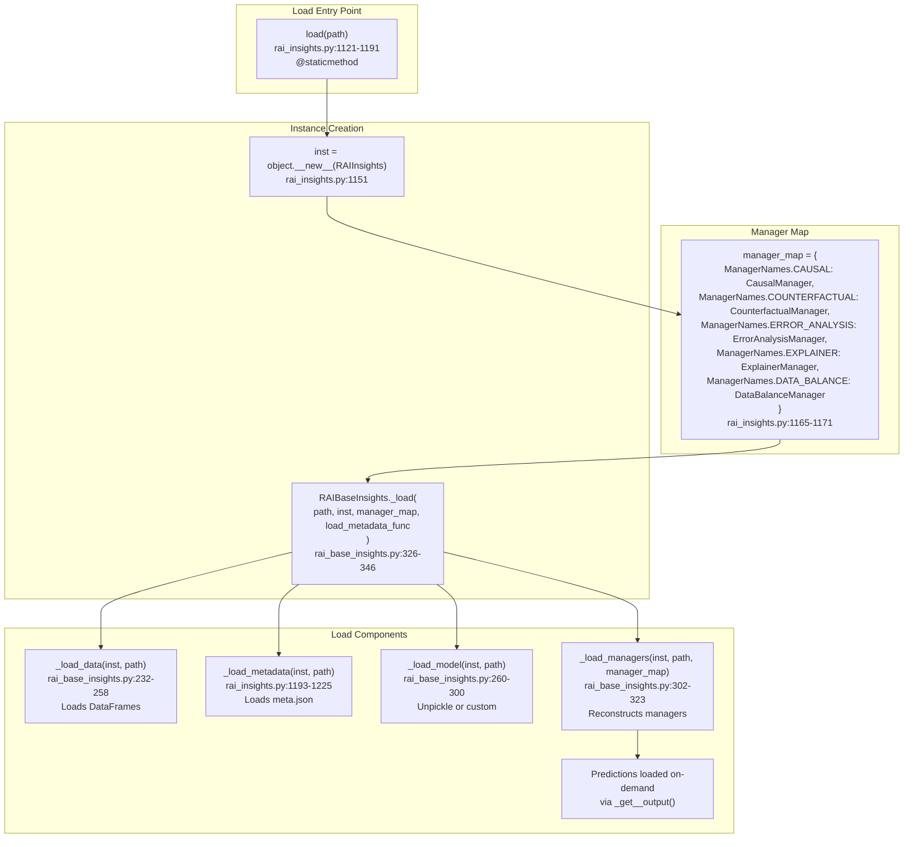

**Sources:** [responsibleai/rai_insights/rai_insights.py:1121-1191](), [responsibleai/rai_insights/rai_base_insights.py:326-346]()

### Metadata JSON Schema

The `meta.json` file contains essential information for reconstruction:

```json
{
  "task_type": "classification|regression|forecasting",
  "target_column": "string",
  "classes": ["class1", "class2", ...],  // for classification
  "feature_columns": ["feature1", "feature2", ...],
  "feature_ranges": [
    {
      "column_name": "feature1",
      "range_type": "numeric|categorical|datetime",
      "min_value": 0.0,
      "max_value": 100.0
    }
  ],
  "categorical_features": ["cat1", "cat2", ...],
  "categories": [["val1", "val2"], ...],
  "category_dictionary": {"cat1": ["val1", "val2"]},
  "categorical_indexes": [0, 1, ...],
  "string_ind_data": [...],
  "number_large_test_samples": 10000,  // if large dataset
  "feature_metadata": {
    "categorical_features": [...],
    "dropped_features": [...],
    "identity_feature_name": "string",
    "datetime_features": [...],
    "time_series_id_features": [...]
  }
}
```

**Sources:** [responsibleai/rai_insights/rai_insights.py:991-1055](), [responsibleai/_internal/constants.py:17-35]()

## Model Wrapping and Validation

### Model Interface Validation

The `RAIInsights` class validates that the provided model implements the required methods for the specified task type.

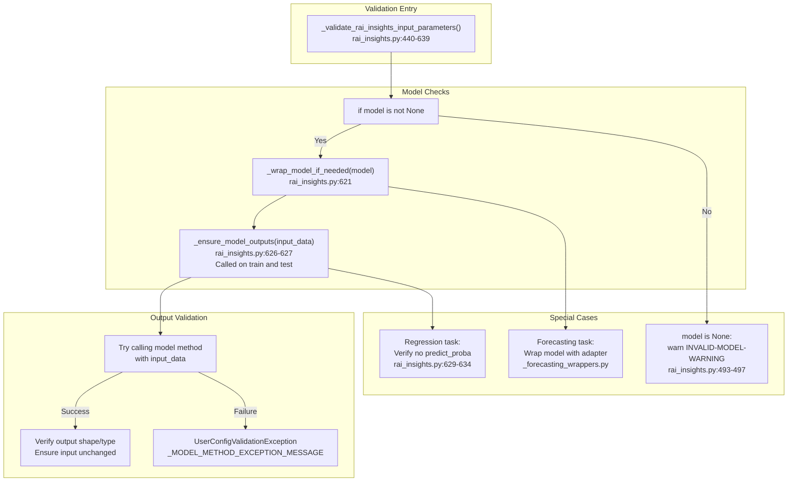

**Sources:** [responsibleai/rai_insights/rai_insights.py:440-639](), [responsibleai/rai_insights/rai_insights.py:1269-1312]()

### Forecasting Model Wrapper

For forecasting tasks, models are wrapped to provide a consistent interface:

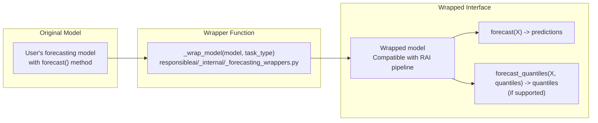

**Sources:** [responsibleai/rai_insights/rai_insights.py:621](), [responsibleai/_internal/_forecasting_wrappers.py:24]()

## Supporting Infrastructure

### Exception Hierarchy

The backend uses structured exceptions from `raiutils` to provide clear error messages:

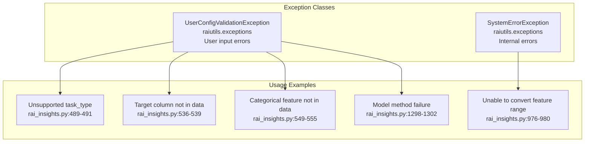

**Sources:** [responsibleai/rai_insights/rai_insights.py:19-20](), [responsibleai/rai_insights/rai_insights.py:489-639]()

### Constants and File Formats

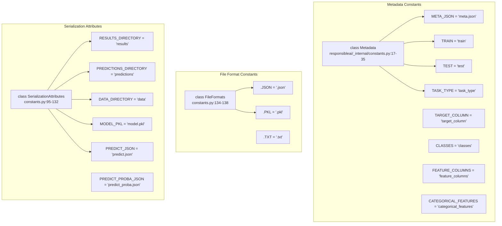

**Sources:** [responsibleai/_internal/constants.py:17-143]()

### Model Serving Integration

The `RAIBaseInsights` class supports loading models from a locally served endpoint instead of a pickled file, enabling deployment scenarios:

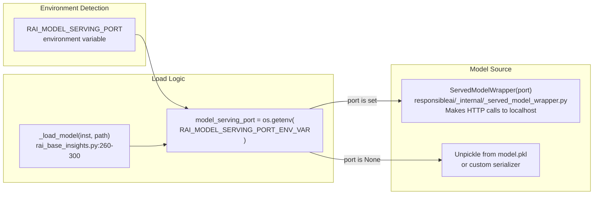

**Sources:** [responsibleai/rai_insights/rai_base_insights.py:260-300](), [responsibleai/_internal/constants.py:141-143]()

### Large Dataset Handling

When test datasets exceed the `maximum_rows_for_test` threshold (default 5000), RAIInsights stores the full dataset separately and uses a subset for interactive operations:

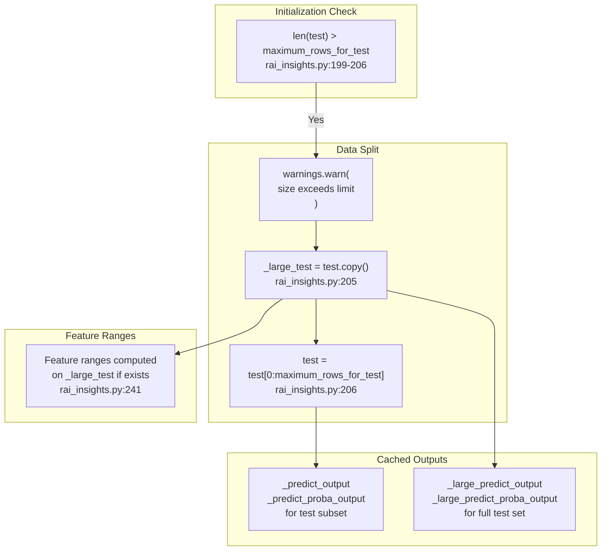

**Sources:** [responsibleai/rai_insights/rai_insights.py:199-206](), [responsibleai/rai_insights/rai_insights.py:215-218](), [responsibleai/rai_insights/rai_insights.py:240-244]()

---

