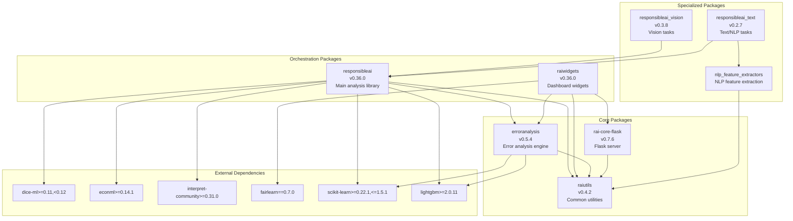
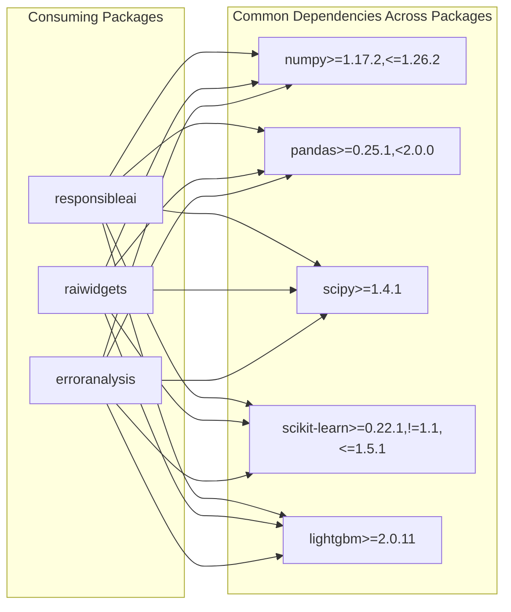
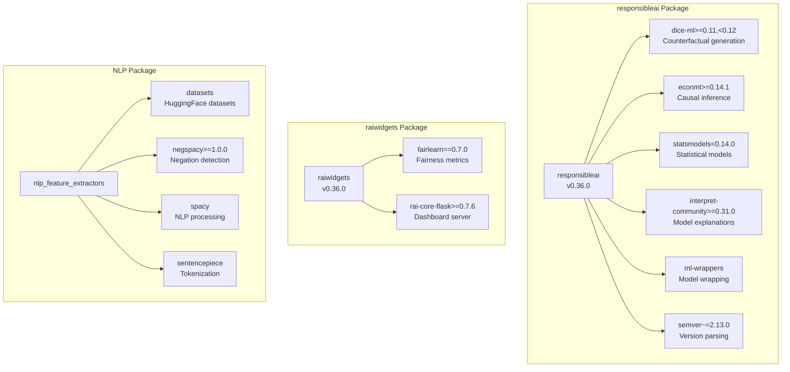
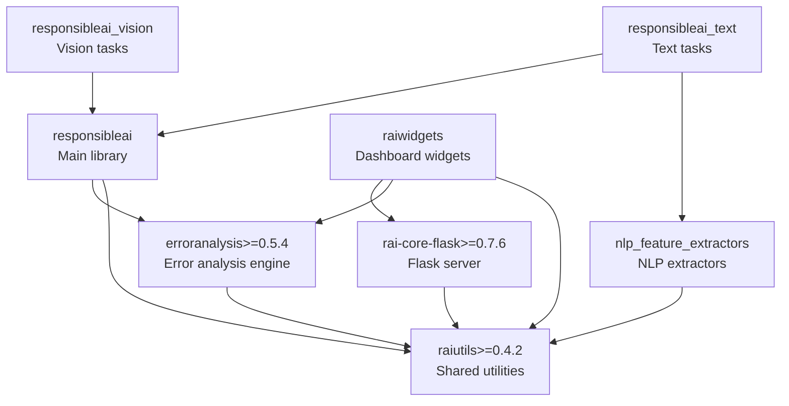
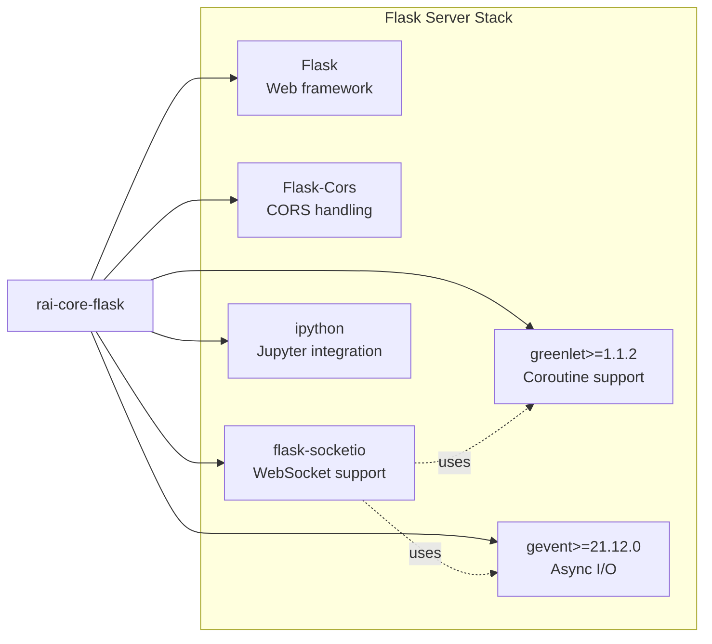
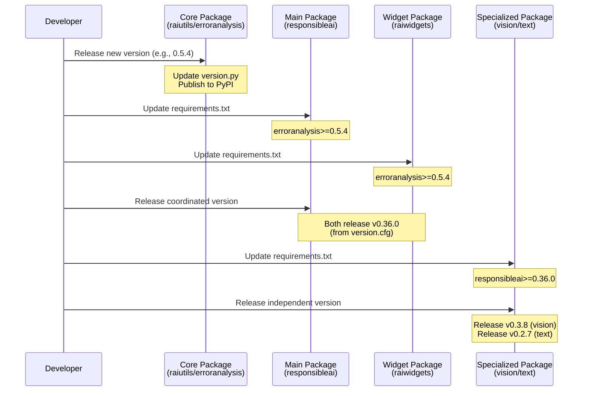

<!-- source: DeepWiki mcp.deepwiki.com · repo microsoft/responsible-ai-toolbox · page 3.1 Package Dependencies and Versioning · fetched 2026-10-26 -->

# Package Dependencies and Versioning

<details>
<summary>Relevant source files</summary>

The following files were used as context for generating this wiki page:

- [CHANGES.md](CHANGES.md)
- [erroranalysis/requirements-dev.txt](erroranalysis/requirements-dev.txt)
- [erroranalysis/requirements.txt](erroranalysis/requirements.txt)
- [nlp_feature_extractors/requirements.txt](nlp_feature_extractors/requirements.txt)
- [rai_core_flask/requirements.txt](rai_core_flask/requirements.txt)
- [raiwidgets/requirements.txt](raiwidgets/requirements.txt)
- [responsibleai/requirements-dev.txt](responsibleai/requirements-dev.txt)
- [responsibleai/requirements.txt](responsibleai/requirements.txt)
- [responsibleai_text/responsibleai_text/version.py](responsibleai_text/responsibleai_text/version.py)
- [responsibleai_vision/responsibleai_vision/version.py](responsibleai_vision/responsibleai_vision/version.py)
- [version.cfg](version.cfg)

</details>


## Purpose and Scope

This document explains the package dependency structure, versioning strategy, and dependency management across the Responsible AI Toolbox Python packages. It covers how the multiple packages in the repository are versioned independently or in coordination, how dependencies are specified, and the mechanisms for ensuring version compatibility.

For details on the development workflow and release process, see [Package Versioning and Releases](#6.3). For information on the overall repository structure, see [Repository Structure](#6.1).

## Package Structure Overview

The Responsible AI Toolbox repository contains multiple Python packages that can be installed independently but work together as a cohesive system. These packages fall into three categories:

1. **Core packages**: Foundation components shared across all implementations
2. **Orchestration packages**: Main entry points for model analysis
3. **Specialized packages**: Domain-specific implementations for vision and text



**Sources:** [responsibleai/requirements.txt](), [raiwidgets/requirements.txt](), [erroranalysis/requirements.txt](), [rai_core_flask/requirements.txt](), [nlp_feature_extractors/requirements.txt]()

## Package Versions and Release Coordination

### Coordinated Versioning

The main orchestration packages (`responsibleai` and `raiwidgets`) follow a **coordinated versioning scheme** where they share the same version number, managed through a central configuration file:

| Package | Version Source | Current Version |
|---------|----------------|-----------------|
| `responsibleai` | `version.cfg` | 0.36.0 |
| `raiwidgets` | `version.cfg` | 0.36.0 |

The version is read from [version.cfg:1]() which contains a single line with the version number.

### Independent Versioning

Core and specialized packages maintain **independent version numbers** defined in their respective `version.py` files:

| Package | Version File | Current Version |
|---------|--------------|-----------------|
| `raiutils` | Not shown in files | 0.4.2 |
| `erroranalysis` | Not shown in files | 0.5.4 |
| `rai-core-flask` | Not shown in files | 0.7.6 |
| `responsibleai_vision` | [responsibleai_vision/responsibleai_vision/version.py:1-8]() | 0.3.8 |
| `responsibleai_text` | [responsibleai_text/responsibleai_text/version.py:1-8]() | 0.2.7 |

The `responsibleai_vision` package defines its version as:

```python
name = 'responsibleai_vision'
_major = '0'
_minor = '3'
_patch = '8'
version = '{}.{}.{}'.format(_major, _minor, _patch)
```

This independent versioning allows specialized packages to:
- Evolve at different rates based on domain-specific needs
- Release bug fixes without coordinating with core packages
- Add modality-specific features independently

**Sources:** [version.cfg:1](), [responsibleai_vision/responsibleai_vision/version.py:1-8](), [responsibleai_text/responsibleai_text/version.py:1-8]()

## Core Package Dependencies

### Common Base Dependencies

All packages share a common foundation of scientific Python libraries with carefully managed version constraints:



**Version Constraint Strategy:**
- **Lower bounds** (`>=`): Ensure minimum required functionality
- **Upper bounds** (`<=`, `<`): Prevent breaking changes from newer releases
- **Exclusions** (`!=`): Avoid specific versions with known issues (e.g., `scikit-learn!=1.1`)
- **Major version caps**: Prevent incompatible API changes (e.g., `numpy<2.0.0`, `pandas<2.0.0`)

**Sources:** [responsibleai/requirements.txt:1-22](), [raiwidgets/requirements.txt:1-10](), [erroranalysis/requirements.txt:1-6]()

### Package-Specific Dependencies

Different packages have specialized dependencies based on their functionality:



**Key dependencies by functionality:**
- **Counterfactuals**: `dice-ml>=0.11,<0.12` [responsibleai/requirements.txt:1]()
- **Causal inference**: `econml>=0.14.1`, `statsmodels<0.14.0` [responsibleai/requirements.txt:2-3]()
- **Model explanations**: `interpret-community>=0.31.0` [responsibleai/requirements.txt:6]()
- **Fairness**: `fairlearn==0.7.0` (pinned version) [raiwidgets/requirements.txt:8]()
- **Error analysis**: `lightgbm>=2.0.11` for surrogate trees [responsibleai/requirements.txt:7]()
- **NLP features**: `spacy`, `negspacy>=1.0.0`, `sentencepiece` [nlp_feature_extractors/requirements.txt:2-5]()

**Sources:** [responsibleai/requirements.txt:1-22](), [raiwidgets/requirements.txt:1-10](), [nlp_feature_extractors/requirements.txt:1-7]()

### Internal Package Dependencies

The internal dependency hierarchy ensures that lower-level utilities are available to higher-level packages:



**Minimum version requirements:**
- All packages requiring `raiutils` specify: `raiutils>=0.4.2` [responsibleai/requirements.txt:21]()
- `responsibleai` requires: `erroranalysis>=0.5.4` [responsibleai/requirements.txt:5]()
- `raiwidgets` requires: `rai-core-flask>=0.7.6` [raiwidgets/requirements.txt:4]()

These minimum versions ensure that bug fixes and new features in lower-level packages are available to consumers.

**Sources:** [responsibleai/requirements.txt:5,21](), [raiwidgets/requirements.txt:4,7,9](), [erroranalysis/requirements.txt:6](), [nlp_feature_extractors/requirements.txt:7]()

## Flask Server Dependencies

The `rai-core-flask` package provides the web server that bridges Python analysis to the React dashboard:



**Python version-specific dependencies:**
- `ipython<=7.16.3` for Python 3.6 (deprecated)
- `ipython>=7.31.1` for Python >3.6

The WebSocket support via `flask-socketio` enables real-time updates for expensive operations like object detection metrics and question answering computations.

**Sources:** [rai_core_flask/requirements.txt:1-7]()

## Dependency Version Constraints Strategy

### Pinned Dependencies

Some packages use **exact version pins** for critical stability:

| Package | Dependency | Constraint | Location |
|---------|----------|------------|----------|
| `raiwidgets` | `fairlearn` | `==0.7.0` | [raiwidgets/requirements.txt:8]() |
| `responsibleai` | `networkx` | `<=2.5` | [responsibleai/requirements.txt:18]() |
| `responsibleai` | `ipykernel` (Python ≤3.7) | `<=6.8.0` | [responsibleai/requirements.txt:19]() |
| `responsibleai` | `ipykernel` (Python >3.7) | `>=6.22.0` | [responsibleai/requirements.txt:20]() |

### Compatible Release Constraints

The `semver` package uses the **compatible release operator** (`~=`):
- `semver~=2.13.0` allows `>=2.13.0, <2.14.0` [responsibleai/requirements.txt:14]()

### Range Constraints

Most dependencies use **version ranges** to balance stability and flexibility:

```
numpy>=1.17.2,<=1.26.2     # Lower bound for features, upper for stability
pandas>=0.25.1,<2.0.0       # Prevent pandas 2.x breaking changes
scikit-learn>=0.22.1,!=1.1,<=1.5.1  # Exclude broken version, cap at 1.5.1
dice-ml>=0.11,<0.12         # Allow patch updates, prevent minor breaking changes
statsmodels<0.14.0          # Upper bound only
```

**Sources:** [responsibleai/requirements.txt:1-22]()

## Development Dependencies

Development and testing require additional packages beyond runtime dependencies:

```mermaid
graph TB
    subgraph test_deps["Testing Dependencies"]
        pytest["pytest==7.0.1<br/>Test framework"]
        pytest_cov["pytest-cov<br/>Coverage reporting"]
        pytest_mock["pytest-mock==3.6.1<br/>Mocking utilities"]
    end
    
    subgraph rai_test_deps["RAI Testing Utilities"]
        rai_test["rai-test-utils>=0.4.2<br/>Shared test utilities"]
        rai_test_od["rai-test-utils[object_detection]<br/>Vision testing extras"]
    end
    
    subgraph dev_tools["Development Tools"]
        deptree["deptree~=0.0.10<br/>Dependency analysis"]
        req_parser["requirements-parser==0.2.0<br/>Parsing requirements"]
    end
    
    subgraph model_deps["Additional Models for Testing"]
        xgboost["xgboost<=1.0.0"]
        interpret_core["interpret-core[required]<=0.3.2"]
    end
    
    responsibleai_dev["responsibleai-dev"] --> pytest
    responsibleai_dev --> pytest_cov
    responsibleai_dev --> pytest_mock
    responsibleai_dev --> rai_test
    responsibleai_dev --> deptree
    responsibleai_dev --> xgboost
    
    erroranalysis_dev["erroranalysis-dev"] --> pytest
    erroranalysis_dev --> pytest_cov
    erroranalysis_dev --> pytest_mock
    erroranalysis_dev --> rai_test_od
    erroranalysis_dev --> req_parser
    erroranalysis_dev --> interpret_core
```



**Key testing dependencies:**
- `pytest==7.0.1`: Pinned for consistent test behavior [responsibleai/requirements-dev.txt:3]()
- `rai-test-utils>=0.4.2`: Shared test utilities with optional extras [erroranalysis/requirements-dev.txt:6]()
- `ml-wrappers`: Required for model wrapping tests [erroranalysis/requirements-dev.txt:9]()

**Sources:** [responsibleai/requirements-dev.txt:1-13](), [erroranalysis/requirements-dev.txt:1-9]()

## Cross-Package Version Updates

When core packages are updated, dependent packages must coordinate their requirements. The change history shows this pattern:

### Example: Error Analysis Update

From [CHANGES.md:78-80]():
```
- release erroranalysis 0.5.4 by @imatiach-msft
- update responsibleai and raiwidgets to erroranalysis 0.5.3
```

After `erroranalysis` version 0.5.4 is released, both `responsibleai` and `raiwidgets` update their `requirements.txt` to specify `erroranalysis>=0.5.4`.

### Example: Vision/Text Package Coordination

From [CHANGES.md:98]():
```
- update responsibleai-text and responsibleai-vision packages to responsibleai 0.34.0
```

When `responsibleai` releases version 0.34.0, the specialized packages update their dependencies to match.

### Update Pattern



**Sources:** [CHANGES.md:78-80,98]()

## Dependency Resolution and Conflicts

### Common Version Ranges

The package structure ensures that shared dependencies have overlapping version ranges. For example, `numpy`:

- `responsibleai`: `numpy>=1.17.2,<=1.26.2` [responsibleai/requirements.txt:8]()
- `raiwidgets`: `numpy>=1.17.2,<=1.26.2` [raiwidgets/requirements.txt:1]()
- `erroranalysis`: `numpy>=1.17.2,<2.0.0` [erroranalysis/requirements.txt:1]()

The intersection of these ranges is `[1.17.2, 1.26.2]`, which allows pip to find a compatible version.

### Platform-Specific Dependencies

Some dependencies vary by Python version or platform:

```python
# From responsibleai/requirements.txt
ipykernel<=6.8.0; python_version <= '3.7'
ipykernel>=6.22.0; python_version > '3.7'
```

This ensures compatibility across Python versions while using newer features when available.

**Sources:** [responsibleai/requirements.txt:8,19-20](), [raiwidgets/requirements.txt:1](), [erroranalysis/requirements.txt:1]()

## Summary Table: Package Dependency Matrix

| Package | Version | Depends On | Key External Dependencies |
|---------|---------|------------|---------------------------|
| `raiutils` | 0.4.2 | *(none)* | numpy, pandas, scipy |
| `erroranalysis` | 0.5.4 | raiutils | scikit-learn, lightgbm |
| `rai-core-flask` | 0.7.6 | raiutils | Flask, flask-socketio, gevent |
| `nlp_feature_extractors` | *(unversioned)* | raiutils | spacy, negspacy, datasets |
| `responsibleai` | 0.36.0 | erroranalysis, raiutils | dice-ml, econml, interpret-community |
| `raiwidgets` | 0.36.0 | erroranalysis, rai-core-flask, raiutils | fairlearn |
| `responsibleai_vision` | 0.3.8 | responsibleai | torchmetrics, Pillow |
| `responsibleai_text` | 0.2.7 | responsibleai, nlp_feature_extractors | transformers |

**Sources:** [responsibleai/requirements.txt](), [raiwidgets/requirements.txt](), [erroranalysis/requirements.txt](), [rai_core_flask/requirements.txt](), [nlp_feature_extractors/requirements.txt](), [responsibleai_vision/responsibleai_vision/version.py](), [responsibleai_text/responsibleai_text/version.py]()

---

