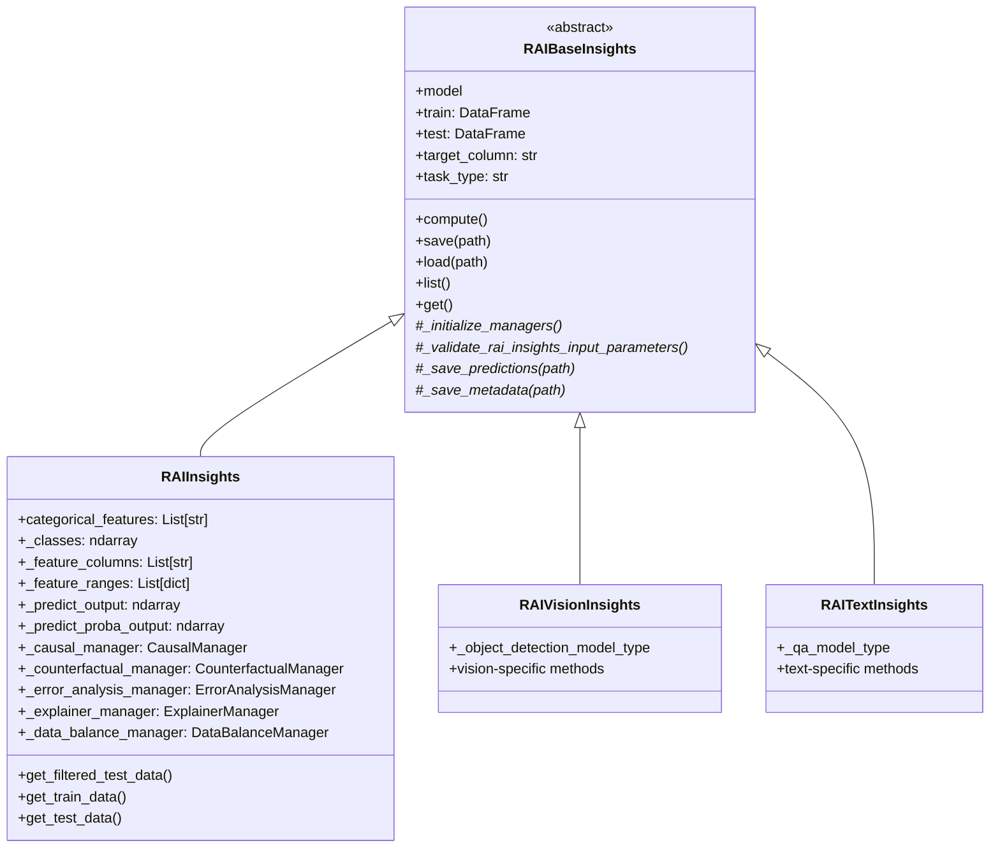
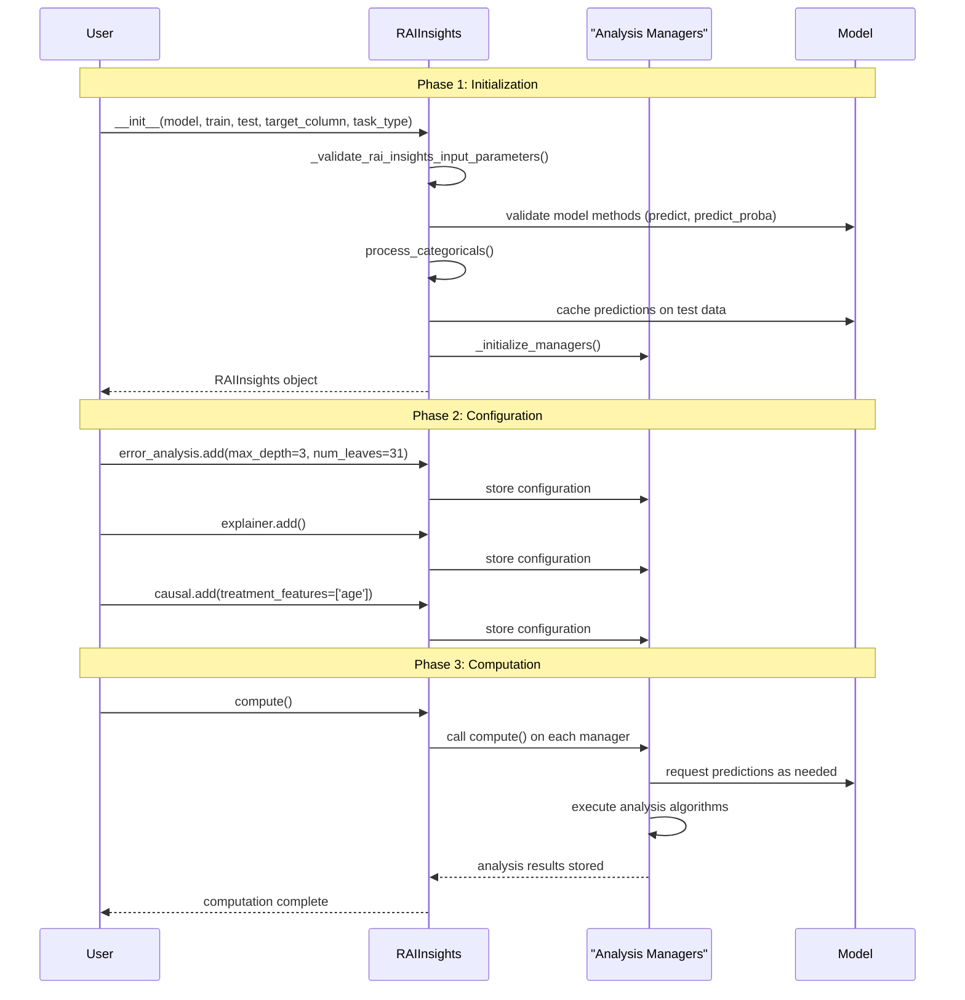
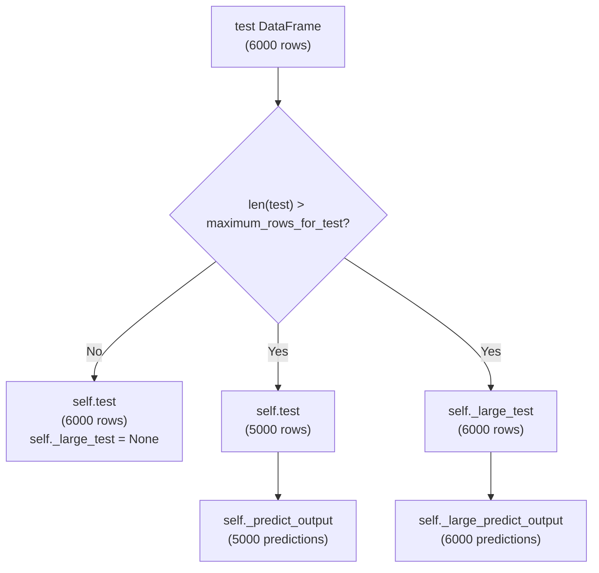
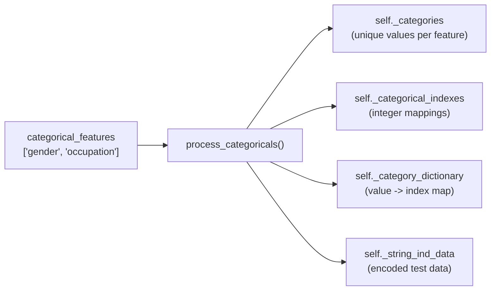
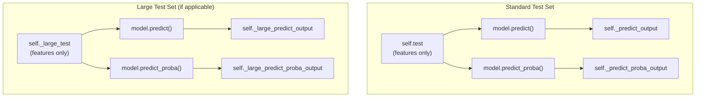
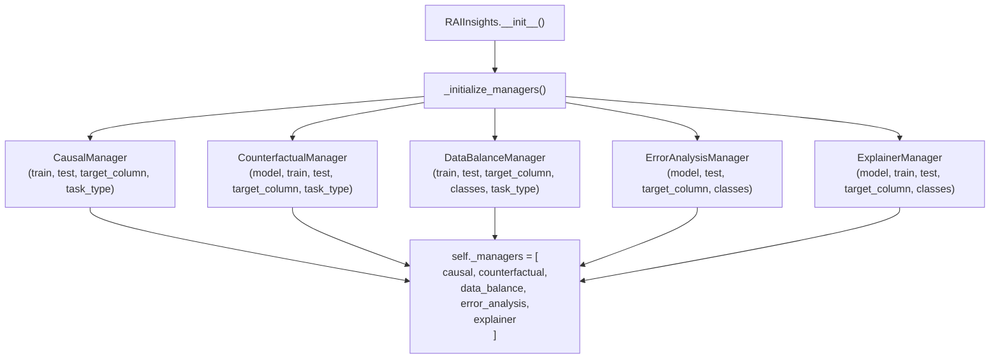
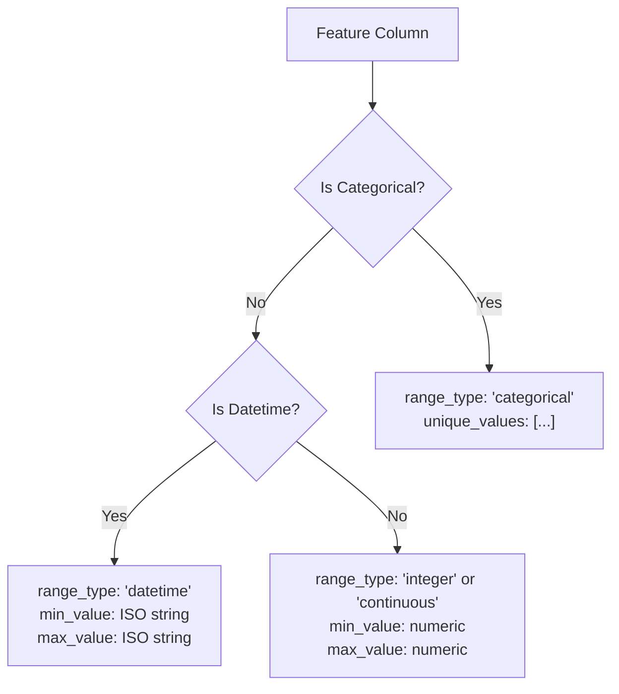

<!-- source: DeepWiki mcp.deepwiki.com · repo microsoft/responsible-ai-toolbox · page 3.2 RAIInsights Core API · fetched 2026-10-26 -->

# RAIInsights Core API

<details>
<summary>Relevant source files</summary>

The following files were used as context for generating this wiki page:

- [responsibleai/responsibleai/_internal/constants.py](responsibleai/responsibleai/_internal/constants.py)
- [responsibleai/responsibleai/rai_insights/rai_base_insights.py](responsibleai/responsibleai/rai_insights/rai_base_insights.py)
- [responsibleai/responsibleai/rai_insights/rai_insights.py](responsibleai/responsibleai/rai_insights/rai_insights.py)
- [responsibleai/tests/common_utils.py](responsibleai/tests/common_utils.py)
- [responsibleai/tests/model_analysis/test_model_analysis.py](responsibleai/tests/model_analysis/test_model_analysis.py)
- [responsibleai/tests/model_analysis/test_model_analysis_validations.py](responsibleai/tests/model_analysis/test_model_analysis_validations.py)
- [responsibleai/tests/rai_insights/test_rai_insights.py](responsibleai/tests/rai_insights/test_rai_insights.py)
- [responsibleai/tests/rai_insights/test_rai_insights_cohort_filter.py](responsibleai/tests/rai_insights/test_rai_insights_cohort_filter.py)
- [responsibleai/tests/rai_insights/test_rai_insights_data_size_scenarios.py](responsibleai/tests/rai_insights/test_rai_insights_data_size_scenarios.py)
- [responsibleai/tests/rai_insights/test_rai_insights_get_feature_ranges.py](responsibleai/tests/rai_insights/test_rai_insights_get_feature_ranges.py)
- [responsibleai/tests/rai_insights/test_rai_insights_save_and_load_scenarios.py](responsibleai/tests/rai_insights/test_rai_insights_save_and_load_scenarios.py)
- [responsibleai/tests/rai_insights/test_rai_insights_validations.py](responsibleai/tests/rai_insights/test_rai_insights_validations.py)
- [responsibleai/tests/test_model_serializer.py](responsibleai/tests/test_model_serializer.py)

</details>


## Purpose and Scope

This document describes the `RAIInsights` class, the primary entry point for performing responsible AI analysis on tabular machine learning models. The `RAIInsights` class orchestrates multiple analysis types (error analysis, explainability, causal inference, counterfactuals, and data balance) through a unified API.

For initialization and validation details, see [Initialization and Validation](#3.2.1). For details on how RAIInsights coordinates the various analysis managers, see [Manager Orchestration](#3.2.2). For persistence mechanisms, see [Persistence and Serialization](#3.2.3). For documentation of individual analysis managers, see [Analysis Managers](#3.3).

For vision-specific extensions, see [RAIVisionInsights API](#5.1.1). For text/NLP-specific extensions, see [RAITextInsights API](#5.2.1).

---

## Class Hierarchy

The `RAIInsights` class extends `RAIBaseInsights`, which provides core functionality shared across different data modalities (tabular, vision, text).



**Sources:** [responsibleai/responsibleai/rai_insights/rai_insights.py:141-146](), [responsibleai/responsibleai/rai_insights/rai_base_insights.py:29-77]()

---

## Core Workflow

The `RAIInsights` API follows a three-phase pattern: initialization, configuration, and computation.



**Sources:** [responsibleai/responsibleai/rai_insights/rai_insights.py:148-263](), [responsibleai/responsibleai/rai_base_insights.py:84-87]()

---

## Constructor Parameters

The `RAIInsights` constructor accepts the following parameters:

| Parameter | Type | Required | Default | Description |
|-----------|------|----------|---------|-------------|
| `model` | object | No* | None | ML model with `predict()` and optionally `predict_proba()` methods |
| `train` | DataFrame | Yes | - | Training dataset including target column |
| `test` | DataFrame | Yes | - | Test dataset including target column |
| `target_column` | str | Yes | - | Name of the label/target column |
| `task_type` | str | Yes | - | Either `'classification'`, `'regression'`, or `'forecasting'`** |
| `categorical_features` | List[str] | No | None | Deprecated; use `feature_metadata` instead |
| `classes` | ndarray | No | None | Class labels (auto-detected if not provided) |
| `serializer` | object | No | None | Custom serializer with `save()` and `load()` methods |
| `maximum_rows_for_test` | int | No | 5000 | Max test rows; excess stored separately for large datasets |
| `feature_metadata` | FeatureMetadata | No | None | Metadata describing feature types |

\* Model is optional but required for most analyses (error analysis, explainability, counterfactuals)  
\*\* Forecasting requires `forecasting_enabled=True` kwarg (experimental)

**Sources:** [responsibleai/responsibleai/rai_insights/rai_insights.py:148-194]()

---

## Key Methods and Properties

### Core Methods

| Method | Description | Returns |
|--------|-------------|---------|
| `compute()` | Executes all configured analyses by calling `compute()` on each manager | None |
| `save(path)` | Persists entire RAIInsights state to directory | None |
| `load(path)` | Static method to restore RAIInsights from saved directory | RAIInsights |
| `list()` | Returns configuration summary for all managers | dict |
| `get()` | Returns complete results from all managers | dict |
| `get_filtered_test_data(filters, composite_filters)` | Applies cohort filters to test data | DataFrame |

### Manager Properties

| Property | Type | Description |
|----------|------|-------------|
| `causal` | CausalManager | Manager for causal inference analysis |
| `counterfactual` | CounterfactualManager | Manager for counterfactual generation |
| `error_analysis` | ErrorAnalysisManager | Manager for error analysis |
| `explainer` | ExplainerManager | Manager for model explainability |
| `data_balance` | DataBalanceManager | Manager for data balance analysis |

### Data Access Methods

| Method | Description | Returns |
|--------|-------------|---------|
| `get_train_data()` | Returns training data with dropped features removed | DataFrame |
| `get_test_data(test_data=None)` | Returns test data with dropped features removed | DataFrame |
| `get_categorical_features_after_drop()` | Returns categorical features excluding dropped ones | List[str] |

**Sources:** [responsibleai/responsibleai/rai_insights/rai_insights.py:810-848](), [responsibleai/responsibleai/rai_base_insights.py:84-108](), [responsibleai/responsibleai/rai_insights/rai_insights.py:265-312]()

---

## Data Management

### Test Data Size Handling

RAIInsights handles large test datasets by splitting them into a standard-size portion (default 5000 rows) and an overflow portion.



When test data exceeds `maximum_rows_for_test`, predictions are cached for both the truncated test set and the full dataset, enabling downstream components to access either version.

**Sources:** [responsibleai/responsibleai/rai_insights/rai_insights.py:198-260]()

### Feature Metadata

The `FeatureMetadata` class describes feature characteristics:

| Metadata Field | Type | Purpose |
|----------------|------|---------|
| `categorical_features` | List[str] | Categorical feature names |
| `dropped_features` | List[str] | Features excluded from analysis (e.g., IDs) |
| `identity_feature_name` | str | Feature representing unique identifiers |
| `datetime_features` | List[str] | Datetime features (forecasting only) |
| `time_series_id_features` | List[str] | Time series ID columns (forecasting only) |

Features marked as `dropped_features` are excluded when passing data to the model, but remain in the original DataFrame.

**Sources:** [responsibleai/responsibleai/rai_insights/rai_insights.py:314-370](), [responsibleai/responsibleai/rai_insights/rai_insights.py:697-728]()

### Categorical Feature Processing

During initialization, categorical features are processed using `process_categoricals()` from the erroranalysis package:



This encoding enables managers to work with both string and numeric representations of categorical data.

**Sources:** [responsibleai/responsibleai/rai_insights/rai_insights.py:245-250]()

---

## Model Handling

### Model Method Validation

RAIInsights validates that the model provides required methods based on task type:

| Task Type | Required Methods | Optional Methods | Purpose |
|-----------|-----------------|------------------|---------|
| Classification | `predict()`, `predict_proba()` | - | `predict_proba()` is required for classification |
| Regression | `predict()` | - | No probability predictions |
| Forecasting | `forecast()` | `forecast_quantiles()` | Forecasting-specific methods |

The validation occurs in `_ensure_model_outputs()`, which tests each method on sample data to ensure they execute without errors and don't modify input data.

**Sources:** [responsibleai/responsibleai/rai_insights/rai_insights.py:100-138](), [responsibleai/responsibleai/rai_insights/rai_insights.py:621-627]()

### Prediction Caching

To avoid redundant computation, RAIInsights caches model predictions during initialization:



Cached predictions are stored as:
- `_predict_output` / `_large_predict_output`: Class labels or regression values
- `_predict_proba_output` / `_large_predict_proba_output`: Class probabilities (classification only)
- `_forecast_output` / `_large_forecast_output`: Forecasts (forecasting only)
- `_forecast_quantiles_output` / `_large_forecast_quantiles_output`: Quantile forecasts (forecasting only)

**Sources:** [responsibleai/responsibleai/rai_insights/rai_insights.py:252-260](), [responsibleai/responsibleai/rai_insights/rai_insights.py:59-79]()

### Model Wrapping

For forecasting tasks, models are wrapped using `_wrap_model()` to provide a consistent interface:

**Sources:** [responsibleai/responsibleai/rai_insights/rai_insights.py:730-740]()

### Custom Serialization

The `serializer` parameter enables custom model serialization for models that aren't pickle-compatible:

```python
class CustomSerializer:
    def save(self, model, parent_directory):
        # Save model to parent_directory
        pass
    
    def load(self, parent_directory):
        # Load and return model from parent_directory
        return model
```

The serializer must be pickle-serializable itself and implement both `save()` and `load()` methods.

**Sources:** [responsibleai/responsibleai/rai_insights/rai_insights.py:503-516](), [responsibleai/tests/test_model_serializer.py:12-22]()

---

## Manager Integration

### Manager Initialization

During `__init__()`, RAIInsights creates five manager instances:



Each manager is initialized with the appropriate subset of data and configuration. Note that forecasting tasks skip manager initialization (no managers are created).

**Sources:** [responsibleai/responsibleai/rai_insights/rai_insights.py:372-414]()

### Manager Access Pattern

Managers are accessed via property methods that return the manager instance:

```python
# Configuration phase - add analyses
rai_insights.error_analysis.add(max_depth=3, num_leaves=31)
rai_insights.explainer.add()
rai_insights.causal.add(treatment_features=['age', 'income'])

# Computation phase - execute all analyses
rai_insights.compute()  # Calls compute() on each manager

# Access results
error_reports = rai_insights.error_analysis.get()
explanations = rai_insights.explainer.get()
```

The `compute()` method iterates through `self._managers` and invokes each manager's `compute()` method.

**Sources:** [responsibleai/responsibleai/rai_insights/rai_insights.py:810-848](), [responsibleai/responsibleai/rai_base_insights.py:84-87]()

---

## Input Validation

RAIInsights performs extensive validation during initialization to catch configuration errors early:

### Data Validation

| Validation | Error Condition | Exception |
|------------|----------------|-----------|
| DataFrame type | Train or test not pandas DataFrame | `UserConfigValidationException` |
| Empty datasets | Zero-length train or test | `UserConfigValidationException` |
| Column mismatch | Train and test have different columns | `UserConfigValidationException` |
| Target presence | Target column missing from data | `UserConfigValidationException` |
| Continuous target (classification) | Float target with non-integer values in classification | `UserConfigValidationException` |
| String features | Non-categorical string features found | `UserConfigValidationException` |

### Model Validation

| Validation | Error Condition | Exception |
|------------|----------------|-----------|
| Model methods | Required methods (predict, predict_proba) missing or failing | `UserConfigValidationException` |
| Task type mismatch | Regression model has `predict_proba()` | `UserConfigValidationException` |
| Input mutation | Model methods modify input DataFrame | `UserConfigValidationException` |
| Serializer interface | Serializer missing `save()` or `load()` | `UserConfigValidationException` |
| Serializer picklability | Serializer not pickle-serializable | `UserConfigValidationException` |

### Class Validation (Classification)

When `classes` parameter is provided, RAIInsights validates consistency:
- Train labels match provided classes
- Test labels match provided classes  
- Train predictions match provided classes
- Test predictions match provided classes

**Sources:** [responsibleai/responsibleai/rai_insights/rai_insights.py:440-639](), [responsibleai/responsibleai/rai_insights/rai_insights.py:653-695]()

---

## Feature Range Computation

RAIInsights computes feature ranges for UI rendering and data validation:



Feature ranges are stored in `self._feature_ranges` as a list of dictionaries with keys:
- `column_name`: Feature name
- `range_type`: One of `'categorical'`, `'integer'`, `'continuous'`, `'datetime'`
- `unique_values`: For categorical features only
- `min_value` / `max_value`: For numeric/datetime features

**Sources:** [responsibleai/responsibleai/rai_insights/rai_insights.py:240-244](), [responsibleai/responsibleai/rai_insights/rai_insights.py:42-47]()

---

## Cohort Filtering

The `get_filtered_test_data()` method applies cohort filters to select data subsets:

**Parameters:**
- `filters`: List of simple filters (e.g., age > 30)
- `composite_filters`: List of composite filters (ANDs/ORs of simple filters)
- `include_original_columns_only`: Whether to drop computed columns (predictions, errors)
- `use_entire_test_data`: Whether to use `_large_test` instead of truncated `test`

Returns a filtered DataFrame matching the cohort criteria.

**Sources:** [responsibleai/responsibleai/rai_insights/rai_insights.py:850-948]()

---

