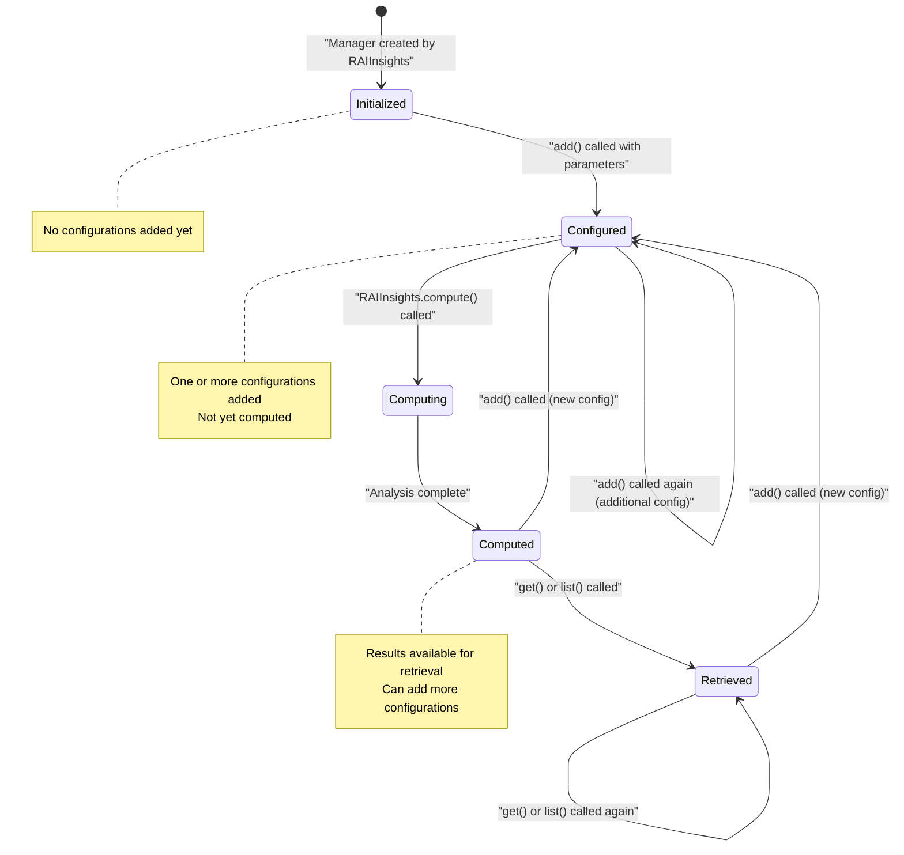
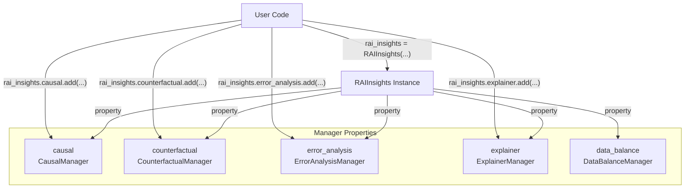
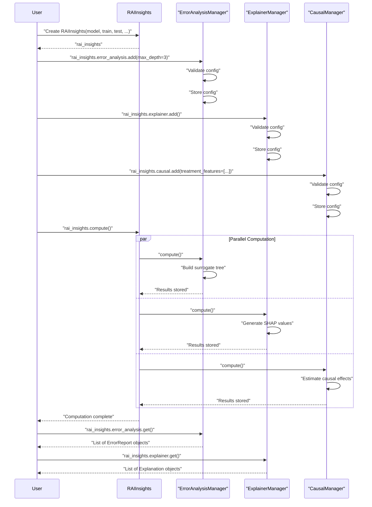
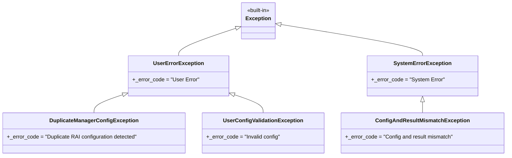
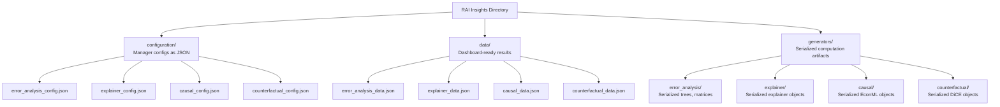
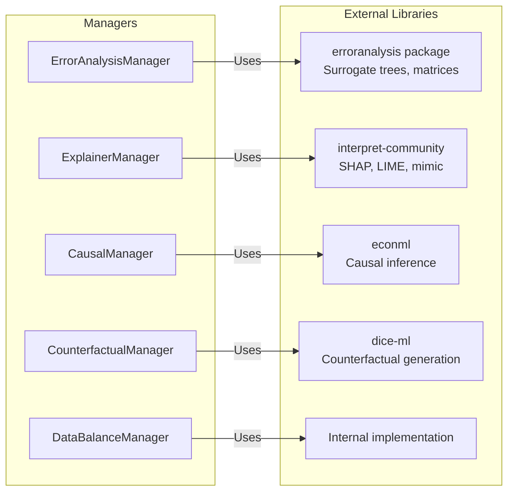

<!-- source: DeepWiki mcp.deepwiki.com · repo microsoft/responsible-ai-toolbox · page 3.3 Analysis Managers · fetched 2026-10-26 -->

# Analysis Managers

<details>
<summary>Relevant source files</summary>

The following files were used as context for generating this wiki page:

- [raiwidgets/raiwidgets/interfaces.py](raiwidgets/raiwidgets/interfaces.py)
- [responsibleai/responsibleai/_tools/shared/state_directory_management.py](responsibleai/responsibleai/_tools/shared/state_directory_management.py)
- [responsibleai/responsibleai/exceptions.py](responsibleai/responsibleai/exceptions.py)
- [responsibleai/responsibleai/modelanalysis/model_analysis.py](responsibleai/responsibleai/modelanalysis/model_analysis.py)
- [responsibleai/tests/causal_manager_validator.py](responsibleai/tests/causal_manager_validator.py)
- [responsibleai/tests/counterfactual_manager_validator.py](responsibleai/tests/counterfactual_manager_validator.py)
- [responsibleai/tests/error_analysis_validator.py](responsibleai/tests/error_analysis_validator.py)
- [responsibleai/tests/explainer_manager_validator.py](responsibleai/tests/explainer_manager_validator.py)
- [responsibleai/tests/test_exceptions.py](responsibleai/tests/test_exceptions.py)

</details>


This document provides an overview of the Manager Pattern used in the Responsible AI Toolbox's Python backend. Managers are the primary mechanism for organizing different types of analysis capabilities (error analysis, explainability, causal inference, counterfactual generation, and data balance analysis). Each manager implements a consistent lifecycle of configuration, computation, and result retrieval.

For detailed information about the RAIInsights class that orchestrates these managers, see [RAIInsights Core API](#3.2). For documentation of individual managers, see their respective pages: [Error Analysis Manager](#3.3.1), [Explainer Manager](#3.3.2), [Causal Manager](#3.3.3), [Counterfactual Manager](#3.3.4), and [Data Balance Manager](#3.3.5).

## Manager Pattern Overview

All analysis managers follow a consistent three-phase pattern that separates configuration from computation:

**Configuration Phase**: Users call the manager's `add()` method one or more times to register analysis configurations. Each configuration specifies parameters for a particular analysis instance.

**Computation Phase**: Users call the `compute()` method on the RAIInsights object (not individual managers), which triggers computation for all configured analyses across all managers in parallel.

**Retrieval Phase**: Users call `get()` to retrieve computed results or `list()` to retrieve metadata about configured analyses.

This pattern provides several advantages:
- Independent evolution of different analysis types
- Parallelizable computation across managers
- Clear separation between configuration validation and execution
- Ability to save/load configurations without recomputing

Sources: [responsibleai/responsibleai/modelanalysis/model_analysis.py:91-140]()

## Manager Lifecycle



Sources: [responsibleai/tests/counterfactual_manager_validator.py:56-95](), [responsibleai/tests/causal_manager_validator.py:52-84]()

## Available Managers

The Responsible AI Toolbox provides five core managers, each responsible for a distinct analysis capability:

| Manager | Class Name | Primary Purpose | Key Dependencies |
|---------|-----------|-----------------|------------------|
| Error Analysis | `ErrorAnalysisManager` | Identify error patterns and cohorts using surrogate trees and heatmaps | `erroranalysis` package, LightGBM |
| Explainer | `ExplainerManager` | Generate model explanations using SHAP, LIME, or mimic models | `interpret-community` package |
| Causal | `CausalManager` | Estimate causal effects and generate treatment policies | `econml` package |
| Counterfactual | `CounterfactualManager` | Generate counterfactual examples using DiCE | `dice-ml` package |
| Data Balance | `DataBalanceManager` | Analyze data distribution and balance metrics | Internal implementation |

Sources: [responsibleai/responsibleai/modelanalysis/model_analysis.py:13-16]()

## Manager Access Through RAIInsights

Managers are exposed as properties of the RAIInsights object. Users do not instantiate managers directly.



Sources: [responsibleai/responsibleai/modelanalysis/model_analysis.py:91-120]()

## Configuration and Computation Flow

The following diagram illustrates the typical flow of adding configurations and computing results across multiple managers:



Sources: [responsibleai/responsibleai/modelanalysis/model_analysis.py:122-124](), [responsibleai/tests/counterfactual_manager_validator.py:56-95]()

## Common Manager Methods

All managers implement a consistent API:

### add() Method

The `add()` method registers a new analysis configuration. Each manager accepts different parameters specific to its analysis type:

- **ErrorAnalysisManager**: `add(max_depth=3, num_leaves=31, min_child_samples=20, filter_features=None)`
- **ExplainerManager**: `add()` (no parameters, uses default SHAP with LightGBM mimic)
- **CausalManager**: `add(treatment_features, nuisance_model='automl', heterogeneity_model=None, ...)`
- **CounterfactualManager**: `add(total_CFs=10, method='random', desired_class=None, desired_range=None, feature_importance=False, ...)`

Calling `add()` multiple times registers multiple configurations. Each configuration is assigned a unique ID.

Sources: [responsibleai/tests/error_analysis_validator.py:20-30](), [responsibleai/tests/explainer_manager_validator.py:13-30](), [responsibleai/tests/causal_manager_validator.py:38-95](), [responsibleai/tests/counterfactual_manager_validator.py:35-85]()

### compute() Method

The `compute()` method is called on the RAIInsights object, not on individual managers. This triggers computation for all pending configurations across all managers:

```python
rai_insights.compute()  # Computes all managers
```

Individual managers do not expose a public `compute()` method. RAIInsights orchestrates computation internally.

Sources: [responsibleai/responsibleai/modelanalysis/model_analysis.py:122-124]()

### get() Method

The `get()` method retrieves computed results for a manager:

```python
error_reports = rai_insights.error_analysis.get()
explanations = rai_insights.explainer.get()
causal_results = rai_insights.causal.get()
counterfactuals = rai_insights.counterfactual.get()
```

Returns a list of result objects, one per configuration. If computation has not been performed, returns `None` or an empty list.

Some managers support optional parameters:
- `CounterfactualManager.get(failed_to_compute=True)`: Returns only failed configurations

Sources: [responsibleai/tests/counterfactual_manager_validator.py:62-92](), [responsibleai/tests/causal_manager_validator.py:59-72]()

### list() Method

The `list()` method retrieves metadata about configured analyses without returning the full results:

```python
metadata = rai_insights.error_analysis.list()
metadata = rai_insights.causal.list()
```

Returns a dictionary with keys including:
- `manager_type`: The type of manager (e.g., `"causal"`, `"error_analysis"`)
- Configuration-specific metadata (e.g., number of reports, treatment features)

Sources: [responsibleai/tests/causal_manager_validator.py:97-111](), [responsibleai/tests/counterfactual_manager_validator.py:22-30]()

## Configuration Validation

Managers validate configurations when `add()` is called. Validation checks include:

### Model Requirements

Some managers require a model to be provided:

```python
# Raises UserConfigValidationException if model is None
rai_insights.error_analysis.add()
rai_insights.explainer.add()
rai_insights.counterfactual.add()
```

Sources: [responsibleai/tests/error_analysis_validator.py:22-25](), [responsibleai/tests/explainer_manager_validator.py:16-19](), [responsibleai/tests/counterfactual_manager_validator.py:43-53]()

### Duplicate Detection

Managers detect duplicate configurations and raise `DuplicateManagerConfigException`:

```python
rai_insights.error_analysis.add(max_depth=3)
rai_insights.error_analysis.add(max_depth=3)  # Raises DuplicateManagerConfigException
```

The exception is defined in [responsibleai/responsibleai/exceptions.py:25-32]().

Sources: [responsibleai/tests/error_analysis_validator.py:28-29](), [responsibleai/tests/counterfactual_manager_validator.py:72-77]()

### Parameter Validation

Invalid parameters raise `UserConfigValidationException`:

```python
# Invalid nuisance_model
rai_insights.causal.add(treatment_features=['feature1'], nuisance_model='fake_model')

# Invalid total_CFs (negative value)
rai_insights.counterfactual.add(total_CFs=-2)
```

Sources: [responsibleai/tests/causal_manager_validator.py:87-94](), [responsibleai/tests/counterfactual_manager_validator.py:113-120]()

### Task Type Restrictions

Some analyses have task type restrictions:

- **CausalManager**: Does not support multiclass classification (only binary classification and regression)

Sources: [responsibleai/tests/causal_manager_validator.py:38-50]()

## Exception Hierarchy



Sources: [responsibleai/responsibleai/exceptions.py:1-62]()

## Manager State Persistence

Managers support serialization through the RAIInsights `save()` and `load()` methods. Each manager persists three types of data:

### Directory Structure



The `DirectoryManager` class manages these three directories:
- **configuration**: Stores manager configurations (parameters passed to `add()`)
- **data**: Stores dashboard-ready results (what `get_data()` returns)
- **generators**: Stores computation artifacts needed to regenerate results

Sources: [responsibleai/responsibleai/_tools/shared/state_directory_management.py:11-132]()

### Serialization Format

Each manager serializes its state into these directories:

**Configuration**: Stored as JSON, includes all parameters passed to `add()` calls
**Data**: Stored as JSON, includes dashboard-ready results with simplified data structures
**Generators**: Stored using manager-specific serialization (pickle, joblib, etc.)

When loading, managers reconstruct their state from these files, allowing users to:
- Load pre-computed analyses without recomputing
- Share analyses with others
- Version control analysis configurations

Sources: [responsibleai/responsibleai/modelanalysis/model_analysis.py:149-175]()

## Manager Integration with External Libraries

Each manager integrates with specialized external libraries for its analysis:



Each manager acts as an adapter, translating between the RAIInsights API and the external library's API. This provides:
- Consistent interface across different analysis types
- Centralized configuration validation
- Unified error handling
- Coordinated computation lifecycle

Sources: [responsibleai/responsibleai/modelanalysis/model_analysis.py:13-16]()

---

