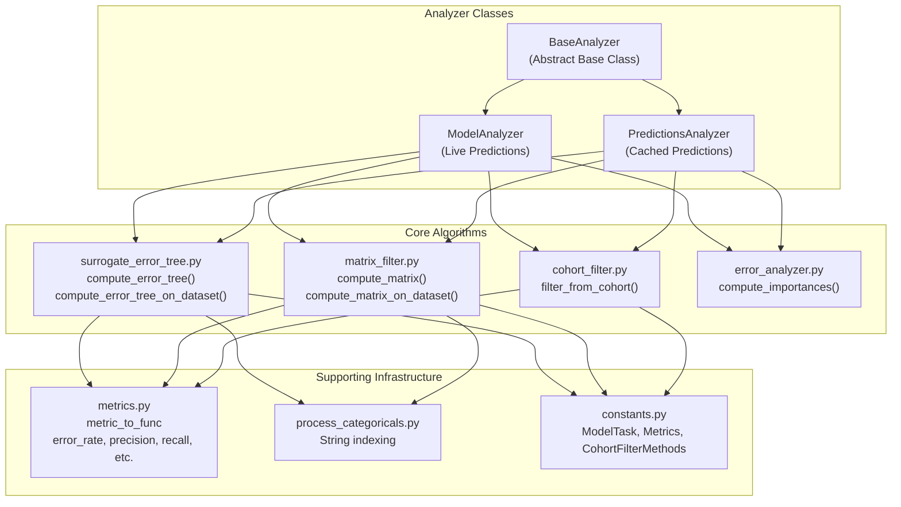
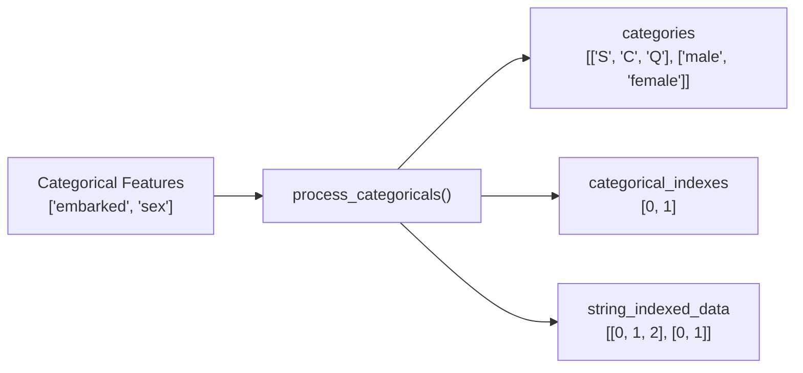
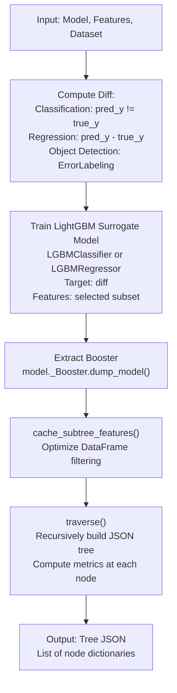
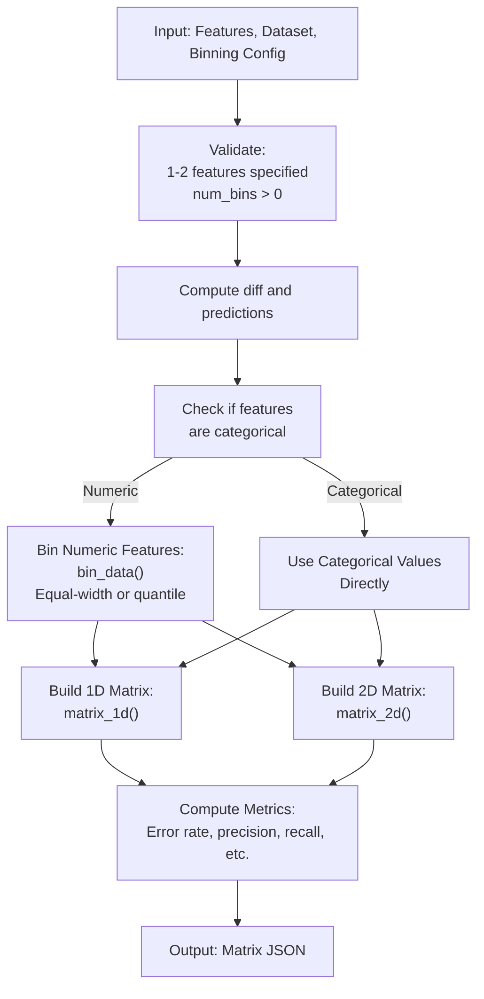
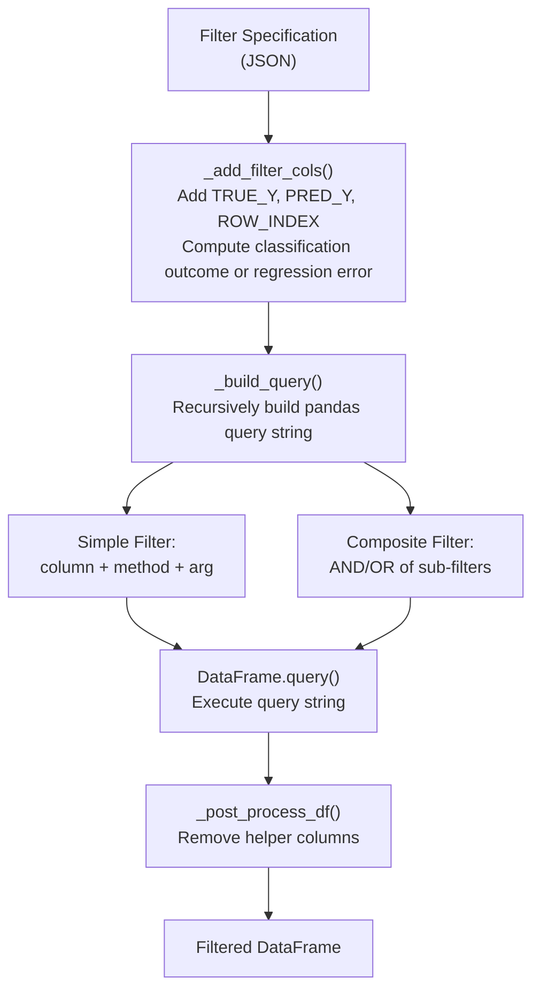
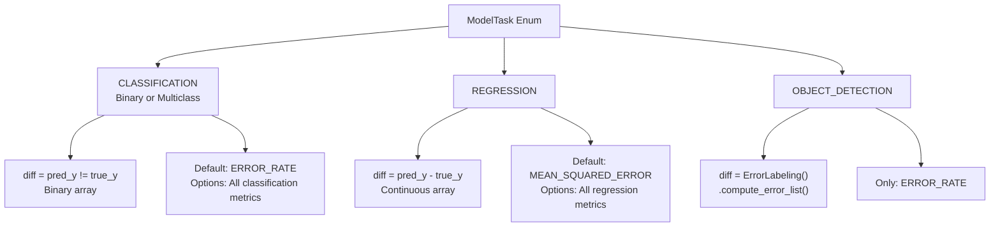

<!-- source: DeepWiki mcp.deepwiki.com · repo microsoft/responsible-ai-toolbox · page 3.4 Error Analysis Engine · fetched 2026-10-26 -->

# Error Analysis Engine

<details>
<summary>Relevant source files</summary>

The following files were used as context for generating this wiki page:

- [erroranalysis/erroranalysis/_internal/cohort_filter.py](erroranalysis/erroranalysis/_internal/cohort_filter.py)
- [erroranalysis/erroranalysis/_internal/constants.py](erroranalysis/erroranalysis/_internal/constants.py)
- [erroranalysis/erroranalysis/_internal/matrix_filter.py](erroranalysis/erroranalysis/_internal/matrix_filter.py)
- [erroranalysis/erroranalysis/_internal/metrics.py](erroranalysis/erroranalysis/_internal/metrics.py)
- [erroranalysis/erroranalysis/_internal/surrogate_error_tree.py](erroranalysis/erroranalysis/_internal/surrogate_error_tree.py)
- [erroranalysis/erroranalysis/analyzer/error_analyzer.py](erroranalysis/erroranalysis/analyzer/error_analyzer.py)
- [erroranalysis/erroranalysis/version.py](erroranalysis/erroranalysis/version.py)
- [erroranalysis/requirements-object-detection.txt](erroranalysis/requirements-object-detection.txt)
- [erroranalysis/tests/common_utils.py](erroranalysis/tests/common_utils.py)
- [erroranalysis/tests/test_cohort_filter.py](erroranalysis/tests/test_cohort_filter.py)
- [erroranalysis/tests/test_error_report.py](erroranalysis/tests/test_error_report.py)
- [erroranalysis/tests/test_importances.py](erroranalysis/tests/test_importances.py)
- [erroranalysis/tests/test_matrix_filter.py](erroranalysis/tests/test_matrix_filter.py)
- [erroranalysis/tests/test_metrics.py](erroranalysis/tests/test_metrics.py)
- [erroranalysis/tests/test_surrogate_error_tree.py](erroranalysis/tests/test_surrogate_error_tree.py)

</details>


## Purpose and Scope

The Error Analysis Engine is the computational core of the `erroranalysis` package that analyzes where and why machine learning models make errors. It provides three primary visualization algorithms: **Surrogate Error Trees** for hierarchical error analysis, **Matrix Filters** (heatmaps) for 2D error distribution, and **Cohort Filtering** for data subsetting. This page documents the internal algorithms and data structures of the engine itself.

For the high-level API used by data scientists, see [Error Analysis Manager](#3.3.1). For the visualization components that render these analyses in the dashboard, see [Error Analysis Dashboard](#4.3).

**Sources:** [erroranalysis/erroranalysis/_internal/surrogate_error_tree.py:1-50](), [erroranalysis/erroranalysis/_internal/matrix_filter.py:1-50](), [erroranalysis/erroranalysis/analyzer/error_analyzer.py:1-50]()

## Architecture Overview

The Error Analysis Engine consists of a family of analyzer classes and three core algorithmic modules that work together to identify error patterns.

### Component Hierarchy



**Sources:** [erroranalysis/erroranalysis/analyzer/error_analyzer.py:53-130](), [erroranalysis/erroranalysis/_internal/surrogate_error_tree.py:76-275](), [erroranalysis/erroranalysis/_internal/matrix_filter.py:58-389]()

## BaseAnalyzer and Analyzer Implementations

The `BaseAnalyzer` class provides the common infrastructure for error analysis, managing the dataset, features, categorical feature encoding, and metrics configuration.

### Class Responsibilities

| Class | Purpose | Prediction Source |
|-------|---------|------------------|
| `BaseAnalyzer` | Abstract base class with shared logic | N/A |
| `ModelAnalyzer` | Computes predictions on-demand from live model | `model.predict(X)` called during analysis |
| `PredictionsAnalyzer` | Uses pre-computed predictions | `pred_y` array provided at initialization |

### Key Properties and State

The `BaseAnalyzer` maintains the following state:

- **`dataset`**: Feature matrix (numpy array or pandas DataFrame)
- **`true_y`**: Ground truth labels
- **`feature_names`**: List of feature names
- **`categorical_features`**: List of categorical feature names
- **`categories`**: Mapping of categorical values for each categorical feature
- **`categorical_indexes`**: Integer indexes of categorical features
- **`string_indexed_data`**: Encoded categorical features as integers
- **`model_task`**: One of `ModelTask.CLASSIFICATION`, `ModelTask.REGRESSION`, `ModelTask.OBJECT_DETECTION`
- **`metric`**: Evaluation metric (e.g., `Metrics.ERROR_RATE`, `Metrics.PRECISION_SCORE`)
- **`classes`**: Ordered list of class labels (for classification)

**Sources:** [erroranalysis/erroranalysis/analyzer/error_analyzer.py:91-130](), [erroranalysis/erroranalysis/analyzer/error_analyzer.py:131-250]()

### Categorical Feature Processing

Categorical features are string-indexed during initialization to enable efficient computation in LightGBM and other algorithms:



**Sources:** [erroranalysis/erroranalysis/analyzer/error_analyzer.py:122-128]()

## Surrogate Error Tree Algorithm

The Surrogate Error Tree algorithm trains a LightGBM decision tree to predict where the primary model makes errors, creating an interpretable hierarchy of error-prone regions in the feature space.

### Algorithm Overview



**Sources:** [erroranalysis/erroranalysis/_internal/surrogate_error_tree.py:195-275](), [erroranalysis/erroranalysis/_internal/surrogate_error_tree.py:277-393]()

### Surrogate Model Creation

The `create_surrogate_model` function trains a single-tree LightGBM model on the error signal:

**For Classification:**
```python
LGBMClassifier(
    n_estimators=1,
    max_depth=max_depth,         # Default: 3
    num_leaves=num_leaves,       # Default: 31
    min_child_samples=min_child_samples,  # Default: 20
    verbosity=-1
)
```

**For Regression:**
```python
LGBMRegressor(
    n_estimators=1,
    max_depth=max_depth,
    num_leaves=num_leaves,
    min_child_samples=min_child_samples,
    verbosity=-1
)
```

The model is trained on the subset of selected features with the difference (error) as the target variable.

**Sources:** [erroranalysis/erroranalysis/_internal/surrogate_error_tree.py:480-543]()

### Tree Traversal and JSON Generation

The `traverse` function recursively walks the LightGBM tree structure and generates a JSON representation with computed metrics at each node:

**Node Structure:**
```python
{
    'id': int,                    # Unique node identifier
    'parentId': int or None,      # Parent node ID
    'nodeName': str or None,      # Feature name for split nodes
    'method': str or None,        # Filter method (e.g., "less and equal")
    'arg': float or list,         # Threshold or category values
    'condition': str or None,     # Human-readable condition
    'size': int,                  # Number of instances
    'error': int,                 # Error count (or metric value)
    'metricName': str,            # Display name of metric
    'metricValue': float          # Computed metric value
}
```

**Sources:** [erroranalysis/erroranalysis/_internal/surrogate_error_tree.py:587-650](), [erroranalysis/erroranalysis/_internal/surrogate_error_tree.py:754-859]()

### Performance Optimization

The tree traversal includes several optimizations for large datasets:

1. **Subtree Feature Caching**: `cache_subtree_features()` pre-computes which features are used in each subtree, enabling efficient DataFrame filtering
2. **Progressive DataFrame Reduction**: At each node, the DataFrame is filtered to only include columns needed by child nodes
3. **Fast Prediction**: For datasets >1M rows, the surrogate tree trains in ~1 second

**Sources:** [erroranalysis/erroranalysis/_internal/surrogate_error_tree.py:668-693](), [erroranalysis/erroranalysis/_internal/surrogate_error_tree.py:653-665](), [erroranalysis/tests/test_surrogate_error_tree.py:181-236]()

### Object Detection Support

For object detection models, the error computation uses the `ErrorLabeling` class from `vision_explanation_methods`:

```python
from vision_explanation_methods.error_labeling.error_labeling import ErrorLabeling

diff = [
    len(
        ErrorLabeling(
            ModelTask.OBJECT_DETECTION,
            pred_y[image_idx],
            true_y[image_idx]
        ).compute_error_list()
    ) > 0
    for image_idx in range(len(true_y))
]
```

**Sources:** [erroranalysis/erroranalysis/_internal/surrogate_error_tree.py:325-340]()

## Matrix Filter (Heatmap) Algorithm

The Matrix Filter algorithm creates 1D or 2D heatmaps showing error rates or other metrics across bins of one or two features.

### Algorithm Flow



**Sources:** [erroranalysis/erroranalysis/_internal/matrix_filter.py:78-319](), [erroranalysis/erroranalysis/_internal/matrix_filter.py:322-388]()

### Binning Strategies

The `bin_data` function supports two binning strategies:

| Strategy | Method | When Used | pandas Function |
|----------|--------|-----------|-----------------|
| **Equal-width** | Divides range into equal intervals | Default | `pd.cut()` |
| **Quantile** | Each bin has ~equal number of points | `quantile_binning=True` | `pd.qcut()` |

**Special Handling:**
- Categorical features bypass binning
- Features with ≤ `num_bins` unique values bypass binning
- Duplicate bin edges are removed with a warning

**Sources:** [erroranalysis/erroranalysis/_internal/matrix_filter.py:417-479]()

### 2D Matrix Construction

For two features, the algorithm creates a 2D crosstab:

```python
# For error rate metric
matrix_total = pd.crosstab(feature1_binned, feature2_binned)
matrix_error = pd.crosstab(feature1_error, feature2_error)

# For other metrics (precision, recall, etc.)
matrix_error = pd.crosstab(
    feature1_binned, 
    feature2_binned,
    values=list(zip(true_y, pred_y)),
    aggfunc=custom_aggregation_function
)
```

**Output Structure:**
```python
{
    'matrix': [
        {
            'category1': 'Interval[0, 5)',
            'category2': 'Interval[10, 20)',
            'count': 100,
            'falseCount': 15,
            'metricValue': 0.15,
            'metricName': 'Error rate'
        },
        # ... more cells
    ]
}
```

**Sources:** [erroranalysis/erroranalysis/_internal/matrix_filter.py:225-257](), [erroranalysis/erroranalysis/_internal/matrix_filter.py:678-820]()

### Multi-Metric Aggregation

The `_MultiMetricAggFunc` class handles precision, recall, F1, and accuracy metrics by computing confusion matrix statistics for each cell:

```python
class _MultiMetricAggFunc:
    def _multi_metric_result(self, true_y, pred_y):
        conf_matrix = multilabel_confusion_matrix(true_y, pred_y, labels=self.labels)
        tp_sum = conf_matrix[:, 1, 1]
        fp_sum = conf_matrix[:, 0, 1]
        fn_sum = conf_matrix[:, 1, 0]
        tn_sum = conf_matrix[:, 0, 0]
        metric_value = self.aggfunc(true_y, pred_y)
        return (metric_value, tp_sum.tolist(), fp_sum.tolist(), 
                fn_sum.tolist(), tn_sum.tolist(), error_count)
```

**Sources:** [erroranalysis/erroranalysis/_internal/matrix_filter.py:588-676]()

## Cohort Filtering

The Cohort Filtering system enables subsetting data based on complex boolean queries, supporting both simple filters and composite filters with AND/OR operations.

### Filter Types and Methods

The `CohortFilterMethods` class defines supported filter operations:

| Method | Description | Example |
|--------|-------------|---------|
| `METHOD_EQUAL` | Exact equality | `age == 25` |
| `METHOD_GREATER` | Greater than | `age > 25` |
| `METHOD_LESS` | Less than | `age < 25` |
| `METHOD_LESS_AND_EQUAL` | Less than or equal | `age <= 25` |
| `METHOD_GREATER_AND_EQUAL` | Greater than or equal | `age >= 25` |
| `METHOD_RANGE` | Within range (inclusive) | `25 <= age <= 65` |
| `METHOD_INCLUDES` | Categorical inclusion | `embarked in ['S', 'C']` |
| `METHOD_EXCLUDES` | Categorical exclusion | `embarked not in ['S', 'C']` |

**Sources:** [erroranalysis/erroranalysis/_internal/constants.py:20-32]()

### Query Building Architecture



**Sources:** [erroranalysis/erroranalysis/_internal/cohort_filter.py:105-134](), [erroranalysis/erroranalysis/_internal/cohort_filter.py:370-439]()

### Special Computed Columns

The filtering system can compute special columns for filtering:

**Classification Outcome (Binary):**
```python
# Values: 0 = TP, 1 = FP, 2 = FN, 3 = TN
if true_y[i] == pred_y[i]:
    classification_outcome = 0 if true_y[i] == classes[0] else 3
else:
    classification_outcome = 2 if true_y[i] == classes[0] else 1
```

**Classification Outcome (Multiclass):**
```python
# Values: 0 = Correct, 1 = Incorrect
classification_outcome = 0 if true_y[i] == pred_y[i] else 1
```

**Regression Error:**
```python
regression_error = abs(true_y[i] - pred_y[i])
```

**Sources:** [erroranalysis/erroranalysis/_internal/cohort_filter.py:179-245](), [erroranalysis/erroranalysis/_internal/cohort_filter.py:246-266]()

### Composite Filter Example

A composite filter with nested AND/OR operations:

```python
{
    'compositeFilters': [
        {
            'compositeFilters': [
                {'arg': [13.45, 22.27], 'column': 'mean radius', 'method': 'in the range of'},
                {'arg': [10.88, 24.46], 'column': 'mean texture', 'method': 'in the range of'}
            ],
            'operation': 'and'
        }
    ],
    'operation': 'or'
}
```

Translates to pandas query:
```python
'(((`mean radius` >= 13.45 & `mean radius` <= 22.27) & (`mean texture` >= 10.88 & `mean texture` <= 24.46)))'
```

**Sources:** [erroranalysis/erroranalysis/_internal/cohort_filter.py:429-438](), [erroranalysis/tests/test_surrogate_error_tree.py:248-261]()

## Supported Metrics

The Error Analysis Engine supports a variety of metrics for evaluating model performance at each tree node or heatmap cell.

### Classification Metrics

| Metric | Constant | Binary | Multiclass | Description |
|--------|----------|--------|-----------|-------------|
| Error Rate | `Metrics.ERROR_RATE` | ✓ | ✓ | Proportion of incorrect predictions |
| Accuracy | `Metrics.ACCURACY_SCORE` | ✓ | ✓ | Proportion of correct predictions |
| Precision | `Metrics.PRECISION_SCORE` | ✓ | - | TP / (TP + FP) |
| Macro Precision | `Metrics.MACRO_PRECISION_SCORE` | - | ✓ | Unweighted mean of per-class precision |
| Micro Precision | `Metrics.MICRO_PRECISION_SCORE` | - | ✓ | Global TP / (TP + FP) |
| Recall | `Metrics.RECALL_SCORE` | ✓ | - | TP / (TP + FN) |
| Macro Recall | `Metrics.MACRO_RECALL_SCORE` | - | ✓ | Unweighted mean of per-class recall |
| Micro Recall | `Metrics.MICRO_RECALL_SCORE` | - | ✓ | Global TP / (TP + FN) |
| F1 Score | `Metrics.F1_SCORE` | ✓ | - | Harmonic mean of precision and recall |
| Macro F1 | `Metrics.MACRO_F1_SCORE` | - | ✓ | Unweighted mean of per-class F1 |
| Micro F1 | `Metrics.MICRO_F1_SCORE` | - | ✓ | Global harmonic mean |

### Regression Metrics

| Metric | Constant | Description |
|--------|----------|-------------|
| Mean Absolute Error | `Metrics.MEAN_ABSOLUTE_ERROR` | Average absolute difference |
| Mean Squared Error | `Metrics.MEAN_SQUARED_ERROR` | Average squared difference |
| Median Absolute Error | `Metrics.MEDIAN_ABSOLUTE_ERROR` | Median absolute difference |
| R² Score | `Metrics.R2_SCORE` | Coefficient of determination |
| Mean Prediction | `Metrics.MEAN_PREDICTION` | Average predicted value |

**Sources:** [erroranalysis/erroranalysis/_internal/constants.py:80-228](), [erroranalysis/erroranalysis/_internal/metrics.py:240-280]()

## Model Task Support

The Error Analysis Engine adapts its algorithms based on the model task type.

### Task-Specific Behavior



**Sources:** [erroranalysis/erroranalysis/_internal/surrogate_error_tree.py:323-344](), [erroranalysis/erroranalysis/analyzer/error_analyzer.py:109-121]()

### Object Detection Handling

Object detection requires special handling because predictions and labels are arrays of bounding boxes:

```python
# Each prediction/label is: [[x, y, width, height, class], ...]
# ErrorLabeling compares predicted and true bounding boxes
from vision_explanation_methods.error_labeling.error_labeling import ErrorLabeling

diff = [
    len(ErrorLabeling(
        ModelTask.OBJECT_DETECTION,
        pred_y[image_idx],
        true_y[image_idx]
    ).compute_error_list()) > 0
    for image_idx in range(len(true_y))
]
```

This converts the complex bounding box comparison into a binary error signal for the surrogate tree.

**Sources:** [erroranalysis/erroranalysis/_internal/surrogate_error_tree.py:325-340](), [erroranalysis/erroranalysis/_internal/matrix_filter.py:129-145]()

## Data Format Requirements

### Input Dataset Format

The Error Analysis Engine accepts data in multiple formats, which are normalized internally:

**Supported Formats:**
- `numpy.ndarray`: Raw numeric arrays
- `pandas.DataFrame`: Preferred for named features and mixed types
- `pyspark.sql.DataFrame`: For distributed computation (limited support)

**Required Columns for Dataset-Based APIs:**

When using `compute_error_tree_on_dataset()` or `compute_matrix_on_dataset()`:

| Column | Type | Description |
|--------|------|-------------|
| `true_y` | Any | Ground truth labels |
| `Index` | int | Row indices (0 to n-1) |
| `pred_y` | Any | Predictions (only for `PredictionsAnalyzer`) |
| Feature columns | Any | All features used for analysis |

**Sources:** [erroranalysis/erroranalysis/_internal/surrogate_error_tree.py:117-149](), [erroranalysis/erroranalysis/_internal/matrix_filter.py:78-104]()

### Categorical Feature Encoding

Categorical features are automatically string-indexed to integer codes for efficient computation:

```python
# Input categorical features
categorical_features = ['embarked', 'sex']
dataset = DataFrame with columns ['embarked', 'sex', 'age', ...]

# After processing
categories = [
    ['S', 'C', 'Q'],        # Values for 'embarked'
    ['male', 'female']      # Values for 'sex'
]
categorical_indexes = [0, 1]
string_indexed_data = array([[0, 1], [2, 0], ...])  # Integer codes
```

**Sources:** [erroranalysis/erroranalysis/_internal/process_categoricals.py:1-100]()

## Configuration Parameters

### Surrogate Tree Parameters

| Parameter | Type | Default | Description |
|-----------|------|---------|-------------|
| `max_depth` | int | 3 | Maximum depth of the surrogate tree |
| `num_leaves` | int | 31 | Maximum number of leaves in the tree |
| `min_child_samples` | int | 20 | Minimum samples required to create a leaf |
| `features` | list[str] | All features | Subset of features to train surrogate on |

**Sources:** [erroranalysis/erroranalysis/_internal/surrogate_error_tree.py:50-54](), [erroranalysis/erroranalysis/_internal/surrogate_error_tree.py:195-222]()

### Matrix Filter Parameters

| Parameter | Type | Default | Description |
|-----------|------|---------|-------------|
| `features` | list[str] | Required | 1 or 2 features for heatmap |
| `num_bins` | int | 8 | Number of bins per numeric feature |
| `quantile_binning` | bool | False | Use quantile binning instead of equal-width |
| `filters` | list[dict] | None | Simple filters to apply before computation |
| `composite_filters` | list[dict] | None | Complex AND/OR filters |

**Sources:** [erroranalysis/erroranalysis/_internal/matrix_filter.py:78-104](), [erroranalysis/erroranalysis/_internal/constants.py:74-77]()

## Performance Characteristics

### Computational Complexity

**Surrogate Tree Training:**
- Time: O(n × m × log(n)) where n = rows, m = selected features
- Space: O(n × m)
- Optimization: For n > 1M rows, trains in ~1 second with LightGBM

**Matrix Filter Computation:**
- Time: O(n) for binning + O(bins²) for 2D crosstab
- Space: O(bins × bins) for 2D matrix
- Optimization: Categorical features bypass binning

**Cohort Filtering:**
- Time: O(n) for pandas query execution
- Space: O(n) for filtered DataFrame

**Sources:** [erroranalysis/tests/test_surrogate_error_tree.py:181-236](), [erroranalysis/tests/test_importances.py:99-123]()

### Scalability Limits

The engine includes automatic downsampling for feature importance computation when datasets exceed 50,000 rows, but tree and matrix computations work on full datasets efficiently.

**Sources:** [erroranalysis/erroranalysis/analyzer/error_analyzer.py:48]()

---

