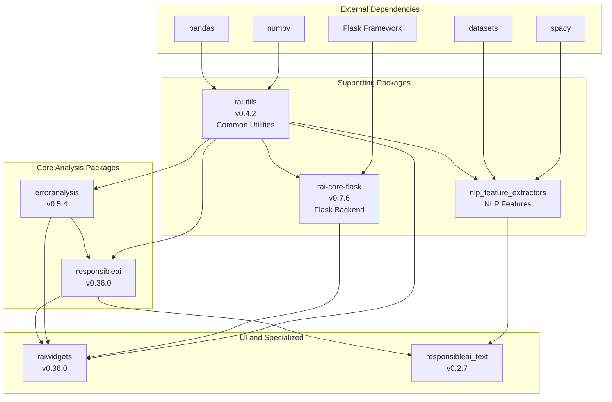
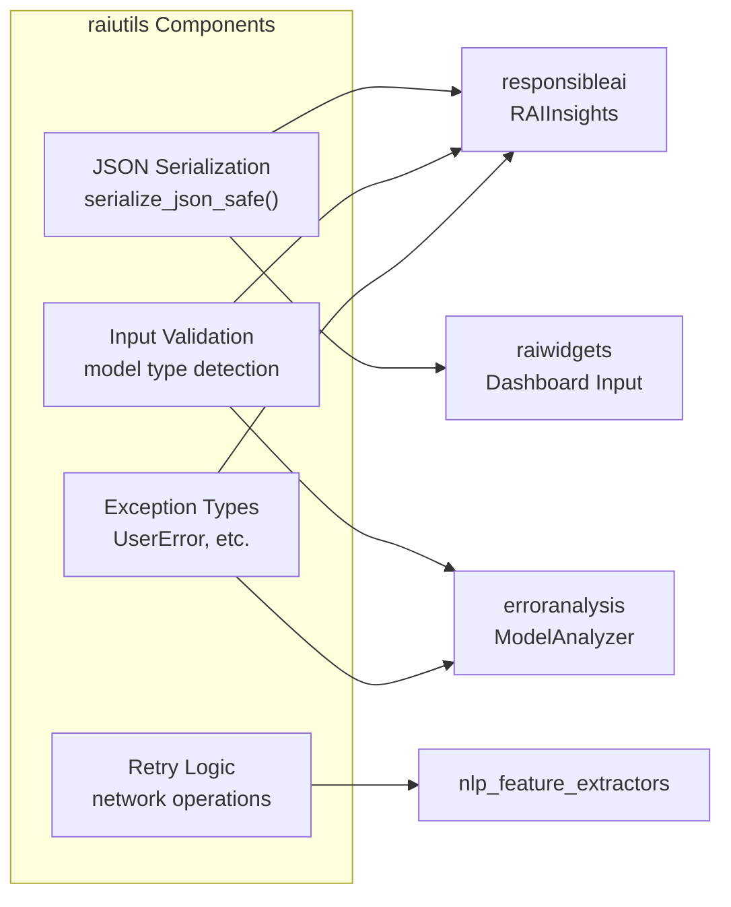
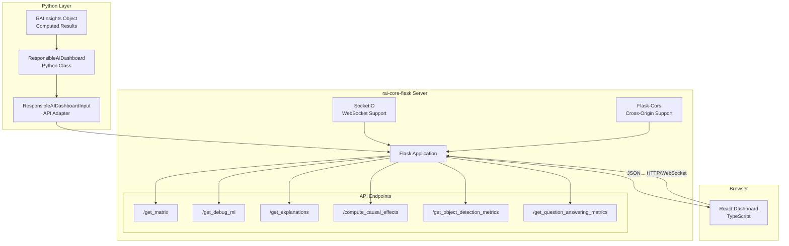
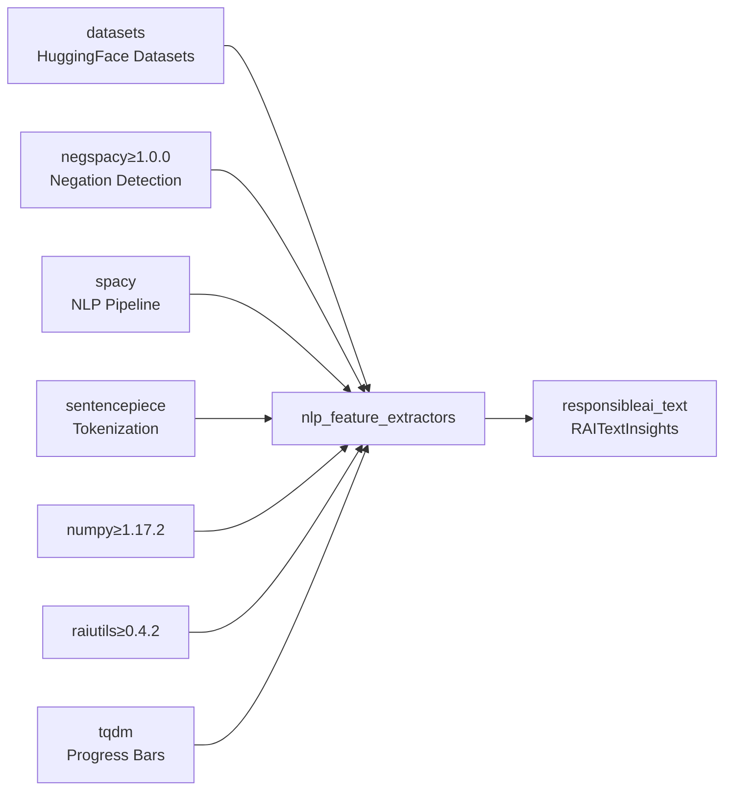
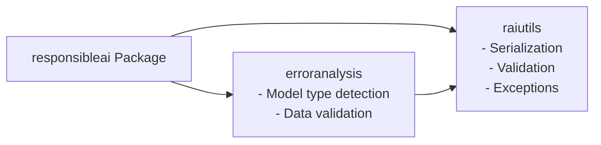
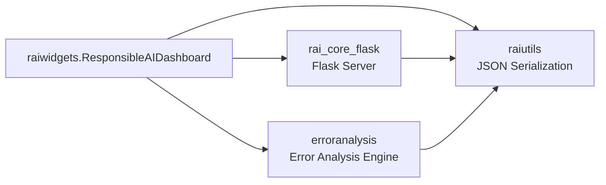
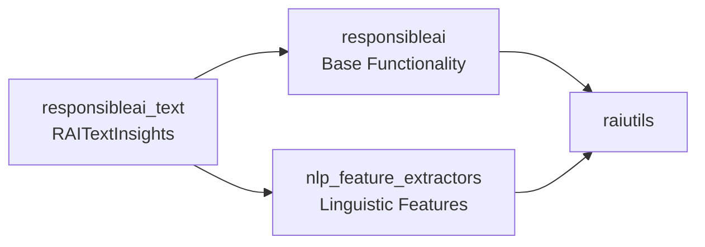

<!-- source: DeepWiki mcp.deepwiki.com · repo microsoft/responsible-ai-toolbox · page 3.5 Supporting Packages · fetched 2026-10-26 -->

# Supporting Packages

<details>
<summary>Relevant source files</summary>

The following files were used as context for generating this wiki page:

- [CHANGES.md](CHANGES.md)
- [erroranalysis/requirements-dev.txt](erroranalysis/requirements-dev.txt)
- [erroranalysis/requirements.txt](erroranalysis/requirements.txt)
- [nlp_feature_extractors/requirements.txt](nlp_feature_extractors/requirements.txt)
- [rai_core_flask/requirements.txt](rai_core_flask/requirements.txt)
- [raiwidgets/requirements.txt](raiwidgets/requirements.txt)
- [responsibleai/requirements-dev.txt](responsibleai/requirements-dev.txt)
- [responsibleai/requirements.txt](responsibleai/requirements.txt)
- [responsibleai_text/responsibleai_text/version.py](responsibleai_text/responsibleai_text/version.py)
- [responsibleai_vision/responsibleai_vision/version.py](responsibleai_vision/responsibleai_vision/version.py)
- [version.cfg](version.cfg)

</details>


## Purpose and Scope

This page documents the supporting Python packages that provide foundational functionality across the Responsible AI Toolbox. These packages handle common utilities, Flask backend services, and NLP feature extraction. For information about the main analysis packages (`responsibleai`, `erroranalysis`), see [RAIInsights Core API](#3.2) and [Error Analysis Engine](#3.4). For domain-specific packages handling vision and text tasks, see [Specialized Packages](#5).

The supporting packages covered in this document are:
- **raiutils**: Common utilities for serialization, data processing, and validation
- **rai-core-flask**: Flask web server for hosting the interactive dashboard
- **nlp_feature_extractors**: NLP-specific feature extraction utilities

These packages are designed to be reusable across multiple components and minimize code duplication.

---

## Package Dependency Structure

The following diagram illustrates how supporting packages fit into the overall dependency hierarchy:



**Sources:** [responsibleai/requirements.txt:1-22](), [raiwidgets/requirements.txt:1-10](), [rai_core_flask/requirements.txt:1-8](), [erroranalysis/requirements.txt:1-6](), [nlp_feature_extractors/requirements.txt:1-7]()

---

## Package Versions and Release Coordination

The supporting packages use semantic versioning and are released independently from the main packages, though they coordinate on breaking changes.

| Package | Current Version | Python Support | Purpose |
|---------|----------------|----------------|---------|
| `raiutils` | 0.4.2 | 3.7+ | Common utilities, serialization, validation |
| `rai-core-flask` | 0.7.6 | 3.7+ | Flask backend server and API endpoints |
| `nlp_feature_extractors` | (no version) | 3.7+ | NLP feature extraction |
| `rai-test-utils` | 0.4.2 | 3.7+ | Testing utilities (dev dependency) |

**Version Constraints:**
- All downstream packages specify minimum versions (e.g., `raiutils>=0.4.2`)
- Breaking changes in supporting packages trigger coordinated updates across dependents
- Version pinning is avoided except where necessary for compatibility

**Sources:** [responsibleai/requirements.txt:21](), [raiwidgets/requirements.txt:4,9](), [CHANGES.md:66-67,82-84]()

---

## raiutils Package

### Purpose and Functionality

The `raiutils` package provides common utilities used across all Responsible AI packages. It handles:
- **JSON serialization** for complex Python objects (NumPy arrays, Pandas DataFrames, timestamps)
- **Data validation** for model inputs and outputs
- **Error handling** with custom exception types
- **Retry logic** for network operations
- **Model type detection** for classification, regression, object detection, and QA tasks

### Key Components



### JSON Serialization Utilities

The package provides safe JSON serialization that handles data types common in ML workflows:

**Supported Types:**
- NumPy arrays (converted to lists)
- Pandas DataFrames and Series
- Timestamps and datetime objects (converted to strings)
- Python native types (int, float, string, list, dict)

This is used throughout the codebase when:
- Saving `RAIInsights` objects to disk
- Sending data from Python backend to TypeScript dashboard
- Caching computation results

**Sources:** [CHANGES.md:252]()

### Model Type Detection

The package includes utilities for detecting model task types:
- **Classification**: binary, multiclass, multilabel
- **Regression**: continuous predictions
- **Object Detection**: bounding box predictions
- **Question Answering**: text span predictions

This detection is used by error analysis and other managers to adapt their algorithms.

**Sources:** [CHANGES.md:337]()

### Retry Logic

Provides retry mechanisms for network operations and I/O that may fail transiently:

**Features:**
- Configurable retry attempts
- Exponential backoff
- Interrupt handling (allows stopping long retry loops)

**Sources:** [CHANGES.md:134]()

### Version History

Recent releases:
- **v0.4.2** (latest): Improved interrupt handling in retry logic, pandas timestamp support
- Earlier versions provided core serialization and validation

**Sources:** [CHANGES.md:82,252](), [responsibleai/requirements.txt:21]()

---

## rai-core-flask Package

### Purpose and Architecture

The `rai-core-flask` package provides the Flask-based web server that powers the interactive dashboard. It bridges the Python backend analysis with the TypeScript/React frontend.



**Sources:** [rai_core_flask/requirements.txt:1-8]()

### Dependencies

The package requires:

| Dependency | Purpose |
|------------|---------|
| `Flask` | Core web framework |
| `Flask-Cors` | Enable cross-origin requests (for development) |
| `flask-socketio` | WebSocket support for long-running operations |
| `ipython` | Interactive Python environment integration |
| `greenlet` | Lightweight concurrent tasks |
| `gevent` | Asynchronous I/O for Flask |

**Python Version Handling:**
- IPython ≤7.16.3 for Python 3.6
- IPython ≥7.31.1 for Python 3.7+

**Sources:** [rai_core_flask/requirements.txt:1-8]()

### SocketIO Integration

Version 0.7.0 introduced SocketIO support for computationally expensive operations:

**Use Cases:**
- **Object Detection Metrics**: Computing mean average precision over large datasets
- **Question Answering Metrics**: F1/EM scores for QA models
- **Real-time Progress Updates**: Stream computation progress to the UI

**Fallback Strategy:**
The implementation includes backward compatibility—if SocketIO connection fails, it falls back to traditional HTTP requests.

**Sources:** [CHANGES.md:208,215,359]()

### Port Configuration

Recent versions (v0.7.1+) added support for configurable dashboard ports:
- Allows running multiple dashboards simultaneously
- Supports private link URLs for Azure compute instances

**Sources:** [CHANGES.md:209,214]()

### Version History

| Version | Changes |
|---------|---------|
| 0.7.6 | Removed pins on werkzeug, itsdangerous, markupsafe |
| 0.7.5 | Updated ipython and werkzeug dependencies |
| 0.7.4 | Fixed whitespace in Azure compute instance base URLs |
| 0.7.3 | Private link URL support |
| 0.7.2 | Interrupt handling improvements |
| 0.7.1 | Port configuration support |
| 0.7.0 | SocketIO integration for long-running operations |

**Sources:** [CHANGES.md:46,66,63,120,160,214,212]()

---

## nlp_feature_extractors Package

### Purpose

The `nlp_feature_extractors` package provides specialized feature extraction utilities for text data, used primarily by the `responsibleai_text` package. It extracts linguistic features that can be used for error analysis and model debugging.

### Dependencies



**Sources:** [nlp_feature_extractors/requirements.txt:1-7]()

### Key Features

**Linguistic Feature Extraction:**
- Part-of-speech tagging
- Named entity recognition
- Negation detection (via `negspacy`)
- Sentence segmentation
- Token-level features

**Integration with spaCy:**
The package leverages spaCy's NLP pipelines for efficient feature extraction at scale.

**Dataset Compatibility:**
Uses HuggingFace `datasets` library for loading and processing standard NLP datasets.

### Usage in Text Analysis

The extracted features are used by `responsibleai_text` for:
- **Error Analysis**: Identifying linguistic patterns correlated with model errors
- **Data Balance**: Analyzing distribution of linguistic features across cohorts
- **Model Debugging**: Understanding which text characteristics cause failures

**Sources:** [nlp_feature_extractors/requirements.txt:1-7]()

---

## Testing Utilities (rai-test-utils)

### Purpose

While primarily a development dependency, `rai-test-utils` provides shared testing utilities across packages:

**Features:**
- Mock models for testing
- Sample datasets (including object detection datasets)
- Test helpers for common assertions
- Fixtures for integration tests

### Object Detection Support

Version 0.4.2 added support for object detection testing:
```
rai-test-utils[object_detection]>=0.4.2
```

This includes:
- Synthetic object detection datasets
- Mock bounding box predictions
- Utilities for testing vision pipelines

**Sources:** [erroranalysis/requirements-dev.txt:6](), [CHANGES.md:84]()

---

## Dependency Management Strategy

### Minimum Version Requirements

Supporting packages use minimum version constraints (`>=`) rather than exact pinning to allow flexibility:

```
raiutils>=0.4.2
rai-core-flask>=0.7.6
erroranalysis>=0.5.4
```

**Rationale:**
- Allows bug fixes in dependencies to propagate automatically
- Reduces dependency conflicts in user environments
- Maintains backward compatibility within major versions

### Coordinated Releases

When a supporting package receives a breaking change:
1. The supporting package is released with a new minor/major version
2. All dependent packages update their minimum version requirements
3. Dependent packages are tested against the new version
4. A coordinated release updates all affected packages

**Example:** When `raiutils` 0.4.2 was released with interrupt handling fixes, all dependent packages updated to require `raiutils>=0.4.2`.

**Sources:** [CHANGES.md:67,82-84,555,558]()

### Version Synchronization

Core packages (`responsibleai`, `raiwidgets`, `responsibleai_vision`, `responsibleai_text`) maintain synchronized versions (e.g., all at 0.36.0), while supporting packages version independently.

**Sources:** [version.cfg:1](), [responsibleai_vision/responsibleai_vision/version.py:5-8](), [responsibleai_text/responsibleai_text/version.py:5-8]()

---

## Integration with Core Packages

### responsibleai Package Integration

The `responsibleai` package depends on all three supporting packages:



**Sources:** [responsibleai/requirements.txt:5,21]()

### raiwidgets Package Integration

The `raiwidgets` package integrates with `rai-core-flask` to serve the dashboard:



**Sources:** [raiwidgets/requirements.txt:4,7,9]()

### responsibleai_text Package Integration

The `responsibleai_text` package uses `nlp_feature_extractors` for text-specific features:



**Sources:** [nlp_feature_extractors/requirements.txt:7]()

---

## Summary

The supporting packages provide essential infrastructure for the Responsible AI Toolbox:

- **raiutils** offers common utilities that prevent code duplication across packages
- **rai-core-flask** bridges Python analysis with interactive TypeScript dashboards
- **nlp_feature_extractors** enables text-specific analysis capabilities

These packages are designed for:
- **Reusability**: Shared across multiple analysis components
- **Maintainability**: Independent versioning allows targeted updates
- **Flexibility**: Minimum version constraints reduce dependency conflicts
- **Performance**: Specialized implementations (SocketIO, retry logic) optimize user experience

For information on how these packages integrate with the main analysis components, see [RAIInsights Core API](#3.2), [Analysis Managers](#3.3), and [Error Analysis Engine](#3.4).

---

